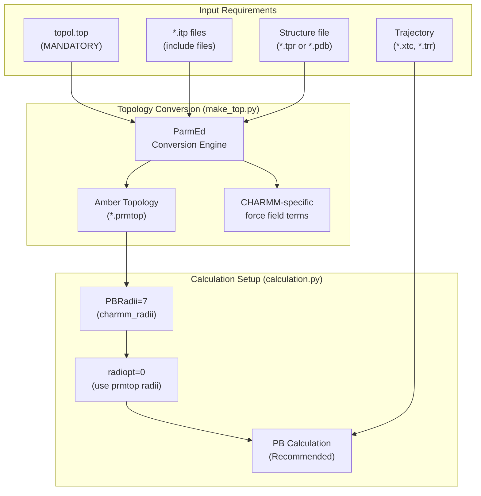
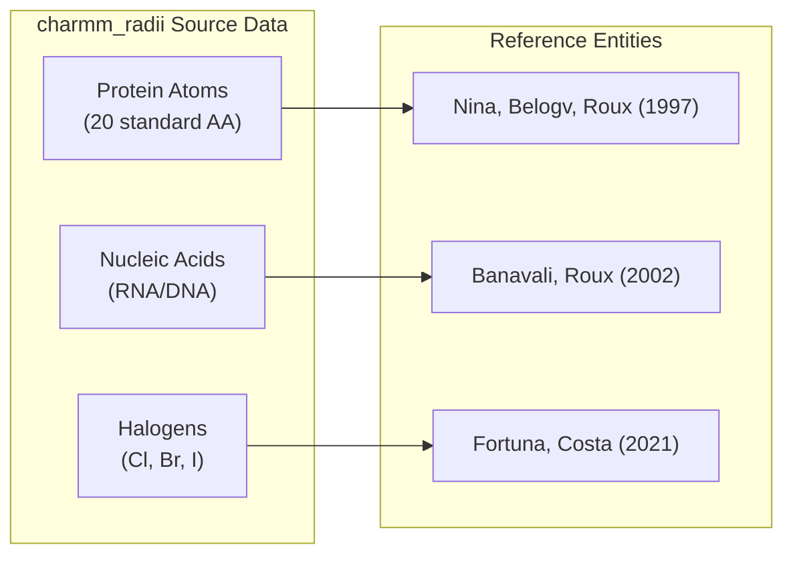
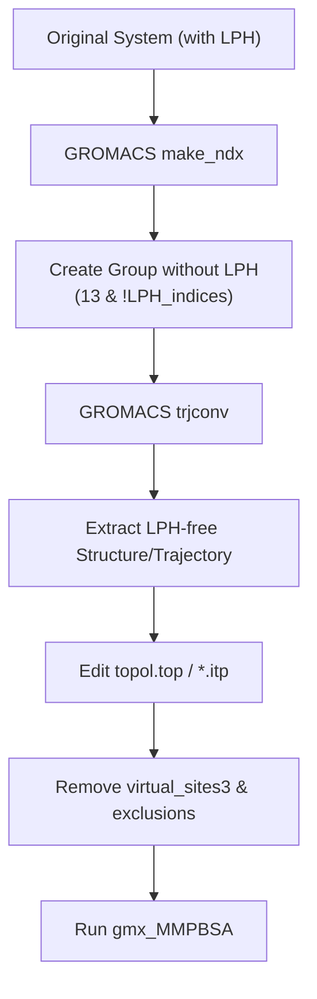

# CHARMM Force Field Systems

<details>
<summary>Relevant source files</summary>

The following files were used as context for generating this wiki page:

- [docs/examples/Comp_receptor/README.md](docs/examples/Comp_receptor/README.md)
- [docs/examples/Protein_ligand_CHARMMff/README.md](docs/examples/Protein_ligand_CHARMMff/README.md)
- [docs/examples/Protein_ligand_LPH_atoms_CHARMMff/README.md](docs/examples/Protein_ligand_LPH_atoms_CHARMMff/README.md)
- [docs/examples/Protein_membrane_CHARMMff/README.md](docs/examples/Protein_membrane_CHARMMff/README.md)
- [examples/Protein_ligand_LPH_atoms_CHARMMff/README.md](examples/Protein_ligand_LPH_atoms_CHARMMff/README.md)

</details>


## Purpose and Scope

This page documents the technical implementation and usage of MM/PB(GB)SA calculations for systems prepared using CHARMM force fields. It details the specialized `charmm_radii` set, the mandatory requirement for topology files, and specific handling procedures for virtual particles like Lone Pairs on Halogens (LPH).

---

## Overview

Support for CHARMM force fields in `gmx_MMPBSA` relies on `ParmEd` for converting GROMACS topologies into Amber-format topologies while preserving CHARMM-specific terms such as CMAP and Urey-Bradley potentials.



**Sources:** [docs/examples/Protein_ligand_CHARMMff/README.md:98-103](), [docs/examples/Protein_membrane_CHARMMff/README.md:102-112]()

---

## Key Differences from Amber Systems

| Aspect | CHARMM Systems | Amber Systems |
|--------|----------------|---------------|
| **Topology File** | Required (`-cp` flag) | Optional |
| **PB Radii Set** | `PBRadii=7` (charmm_radii) | `PBRadii=1-4` (bondi variants) |
| **radiopt** | `radiopt=0` (recommended) | Can use `radiopt=1` |
| **Recommended Model** | PB strongly recommended | GB or PB |
| **LPH Atoms** | Require manual removal | Not applicable |

**Sources:** [docs/examples/Protein_ligand_CHARMMff/README.md:6-9](), [docs/examples/Protein_ligand_CHARMMff/README.md:92-93](), [docs/examples/Protein_membrane_CHARMMff/README.md:13-18]()

---

## CHARMM Radii Set (PBRadii=7)

Introduced in v1.5.0, the `charmm_radii` set is specifically derived for Poisson-Boltzmann calculations using CHARMM force fields. These radii are based on average solvent electrostatic charge distributions with explicit solvent.

### Radii Sources and Code Mapping



### Standard Halogen Radii in charmm_radii

| Element | Radius (Å) |
|---------|-----------|
| Cl | 1.86 |
| Br | 1.98 |
| I | 2.24 |

**Sources:** [docs/examples/Protein_ligand_CHARMMff/README.md:13-25](), [docs/examples/Protein_ligand_LPH_atoms_CHARMMff/README.md:45-51]()

---

## PB Calculation Parameters

Poisson-Boltzmann (PB) is the recommended solvation model for CHARMM systems. The parameter `radiopt=0` is critical as it instructs the solver to use the radii stored within the `prmtop` file generated by the conversion process.

### Recommended PB Input Configuration

```yaml
&general
sys_name="CHARMM_System",
PBRadii=7,              # Use charmm_radii set
/
&pb
radiopt=0,              # Use radii from prmtop (REQUIRED)
istrng=0.15,            # Ionic strength
fillratio=4.0,          # Standard for non-membrane
inp=1,                  # PB solver type
/
```

**Sources:** [docs/examples/Protein_ligand_CHARMMff/README.md:68-90](), [docs/examples/Protein_membrane_CHARMMff/README.md:96-98]()

---

## Membrane Protein Systems with CHARMM

CHARMM is frequently used for membrane systems (e.g., POPC/Cholesterol bilayers). `gmx_MMPBSA` handles these via the `&pb` namelist with `memopt=1`.

### Membrane Implementation Parameters

| Parameter | Value | Description |
|-----------|-------|-------------|
| `memopt` | 1 | Enables implicit membrane slab |
| `emem` | 7.0 | Membrane interior dielectric (must be ≥ `indi`) |
| `mthick` | 40 | Membrane thickness in Å |
| `mctrdz` | 37 | Offset of membrane center from protein center |
| `fillratio`| 1.25 | Reduced ratio often required for periodic boundary conditions (`bcopt=10`) |

**Sources:** [docs/examples/Protein_membrane_CHARMMff/README.md:114-121](), [docs/examples/Protein_membrane_CHARMMff/README.md:85-93]()

---

## Lone Pair on Halogen (LPH) Handling

LPH particles are virtual sites used in CHARMM to model halogen bonds. Because `gmx_MMPBSA` and underlying AmberTools cannot process these virtual particles, they must be removed from the structure, trajectory, and topology before calculation.

### LPH Removal Workflow



### Manual Topology Modification
To prepare a CHARMM topology for `gmx_MMPBSA` after removing LPH atoms from coordinates:
1. Delete LPH atom entries in the `[ atoms ]` section.
2. Delete entries involving LPH in `[ pairs ]`.
3. Remove the entire `[ virtual_sites3 ]` section.
4. Remove the entire `[ exclusions ]` section.

**Sources:** [docs/examples/Protein_ligand_LPH_atoms_CHARMMff/README.md:28-44](), [docs/examples/Protein_ligand_LPH_atoms_CHARMMff/README.md:162-185]()

---

## Example Command-line Execution

For a CHARMM system, the topology file (`-cp`) must be specified:

```bash
gmx_MMPBSA -O -i mmpbsa.in \
  -cs com.tpr \
  -ci index.ndx \
  -cg 1 13 \
  -ct com_traj.xtc \
  -cp topol.top \
  -o FINAL_RESULTS_MMPBSA.dat \
  -eo FINAL_RESULTS_MMPBSA.csv
```

**Sources:** [docs/examples/Protein_ligand_CHARMMff/README.md:54-56](), [docs/examples/Protein_membrane_CHARMMff/README.md:54-56]()

---

## Limitations and Warnings

1. **GB Model Testing:** The combination of GB models with CHARMM force fields has not been extensively tested. PB is the preferred method.
2. **LPH Results:** Since LPH particles are removed, binding energy contributions from halogen bonds may be underestimated.
3. **Topology Files:** All `.itp` files referenced in the main `.top` file must be present in the execution directory.

**Sources:** [docs/examples/Protein_ligand_CHARMMff/README.md:6-9](), [docs/examples/Protein_ligand_LPH_atoms_CHARMMff/README.md:40-44](), [docs/examples/Protein_membrane_CHARMMff/README.md:43]()

---