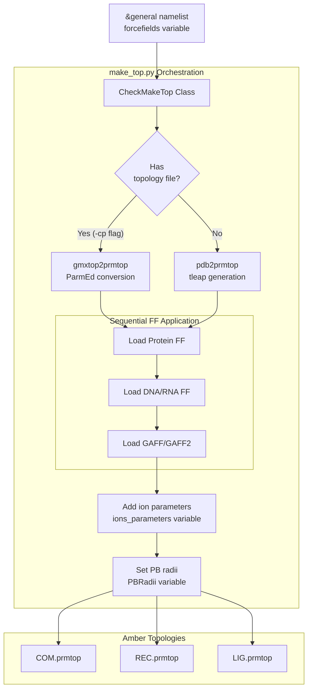
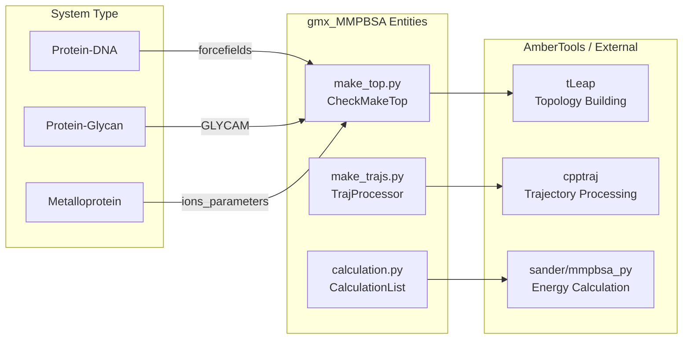

# Multicomponent and Special Systems

<details>
<summary>Relevant source files</summary>

The following files were used as context for generating this wiki page:

- [docs/examples/Protein_DNA/README.md](docs/examples/Protein_DNA/README.md)
- [docs/examples/Protein_DNA_RNA_Ion_ligand/README.md](docs/examples/Protein_DNA_RNA_Ion_ligand/README.md)
- [docs/examples/Protein_ligand/MT/README.md](docs/examples/Protein_ligand/MT/README.md)
- [docs/examples/Protein_protein/README.md](docs/examples/Protein_protein/README.md)
- [docs/examples/psf_dcd/multicomponent_system/README.md](docs/examples/psf_dcd/multicomponent_system/README.md)
- [docs/examples/psf_dcd/protein_ligand/README.md](docs/examples/psf_dcd/protein_ligand/README.md)
- [docs/examples/psf_dcd/protein_protein/README.md](docs/examples/psf_dcd/protein_protein/README.md)
- [examples/Metalloprotein_ligand/index.ndx](examples/Metalloprotein_ligand/index.ndx)
- [examples/Protein_glycan/README.md](examples/Protein_glycan/README.md)

</details>


## Purpose and Scope

This page covers the handling of complex molecular systems containing multiple biomolecular components or requiring specialized treatment in `gmx_MMPBSA`. These include:

- Systems with combinations of proteins, nucleic acids (DNA/RNA), ions, ligands, and glycans.
- Membrane proteins requiring implicit membrane models.
- Metalloproteins with metal cofactors.
- Systems with halogenated compounds or modified residues.
- CHARMM force field systems with special requirements.

For basic protein-ligand systems, see [Protein-Ligand Systems](#6.1). For standard force field support, see [Force Field Support](#3.8).

---

## The `forcefields` Variable

The `forcefields` variable in the `&general` namelist is the primary mechanism for handling multicomponent systems. It accepts a comma-separated list of force field files, enabling `gmx_MMPBSA` to properly parametrize systems containing diverse molecular types [docs/examples/Protein_DNA_RNA_Ion_ligand/README.md:69-69]().

### Syntax and Force Field Selection

```yaml
&general
forcefields="force_field_1,force_field_2,force_field_3"
/
```

### Available Force Field Categories

| Category | Force Field | Description | Compatibility Notes |
|----------|-------------|-------------|---------------------|
| **Protein/Nucleic Acids** | `oldff/leaprc.ff99SB` | ff99SB for proteins and nucleic acids | Compatible with all |
| | `oldff/leaprc.ff99SBildn` | ff99SB with ILDN modifications | [docs/examples/Protein_DNA_RNA_Ion_ligand/README.md:69-69]() |
| **Proteins Only** | `leaprc.protein.ff14SB` | ff14SB proteins | [docs/examples/Protein_protein/README.md:61-61]() |
| **Organic Molecules** | `leaprc.gaff` | General Amber Force Field | [docs/examples/Protein_DNA_RNA_Ion_ligand/README.md:69-69]() |
| **Glycans** | `leaprc.GLYCAM_06j-1` | GLYCAM carbohydrate ff | [examples/Protein_glycan/README.md:83-83]() |
| | `leaprc.GLYCAM_06EPb` | GLYCAM-06EPb | [examples/Protein_glycan/README.md:84-84]() |
| | `leaprc.GLYCAM_06h-1` | GLYCAM-06h-1 | [examples/Protein_glycan/README.md:84-85]() |

### Force Field Combination Workflow

The `forcefields` variable informs the topology generation process within `make_top.py`.


**Sources:** [docs/examples/Protein_DNA_RNA_Ion_ligand/README.md:65-71](), [docs/examples/Protein_protein/README.md:57-62]()

---

## Protein-DNA-RNA-Ion-Ligand Complexes

Complex multicomponent systems require coordinated force field selection and parameter adjustment to account for electrostatic complexity.

### Input File Configuration

```yaml
&general
sys_name="Prot-DNA-RNA-ION-Lig",
startframe=1
endframe=10
forcefields="oldff/leaprc.ff99SBildn,leaprc.gaff"
PBRadii=4, ions_parameters=1
/
&gb
igb=8, saltcon=0.150, intdiel=10
/
```
**Sources:** [docs/examples/Protein_DNA_RNA_Ion_ligand/README.md:65-75]()

### Critical Parameters

**`PBRadii=4`**: Sets `mbondi3` radii, which is the recommended set for the GB-Neck2 (`igb=8`) solvation model [docs/examples/Protein_DNA_RNA_Ion_ligand/README.md:92-93]().

**`ions_parameters=1`**: Uses Li/Merz ion parameters (12-6 normal usage set) for ions such as Mg²⁺ [docs/examples/Protein_DNA_RNA_Ion_ligand/README.md:96-97]().

**`intdiel=10`**: A high internal dielectric constant is recommended for systems with a high number of charged residues at the interface, such as DNA/RNA complexes [docs/examples/Protein_DNA_RNA_Ion_ligand/README.md:93-94]().

---

## Glycan-Containing Systems

Systems with carbohydrate components (glycoproteins) require the GLYCAM force field.

### GLYCAM Force Field Selection

`gmx_MMPBSA` supports several GLYCAM versions depending on the base protein force field:
- `leaprc.GLYCAM_06j-1` and `leaprc.GLYCAM_06EPb`: Compatible with `amber12SB` and later [examples/Protein_glycan/README.md:83-84]().
- `leaprc.GLYCAM_06h-1`: Compatible with `amber99SB` and earlier [examples/Protein_glycan/README.md:84-85]().

### Example Configuration

```yaml
&general
sys_name="Protein-glycan",
startframe=1,
endframe=10,
/
&gb
igb=5, saltcon=0.150,
/
```
**Sources:** [examples/Protein_glycan/README.md:57-65]()

---

## Metalloprotein Systems

Metalloproteins are handled by including the metal ions in the receptor or complex groups and selecting appropriate ion parameters.

### Example Setup
For a metalloprotein-ligand complex, the index file defines the solute atoms including the metal center [examples/Metalloprotein_ligand/index.ndx:1-101](). The `ions_parameters` variable in the `&general` namelist ensures the metal is correctly parametrized during topology conversion.

---

## Multiple Trajectory (MT) Method

For systems where the bound and unbound states differ significantly in conformation, the Multiple Trajectory method is used. This requires separate trajectories for the complex, receptor, and ligand.

### MT Command-line Example

```bash
mpirun -np 2 gmx_MMPBSA -O -i mmpbsa.in \
  -cs com.tpr -ci index.ndx -cg 1 13 -ct com_traj.xtc \
  -rs rec.pdb -ri rec_index.ndx -rg 1 -rt rec_traj.pdb \
  -lm ligand.mol2 -ls lig.pdb -li lig_index.ndx -lg 2 -lt lig_traj.pdb \
  -o FINAL_RESULTS_MMPBSA.dat -eo FINAL_RESULTS_MMPBSA.csv
```
**Sources:** [docs/examples/Protein_ligand/MT/README.md:49-51]()

---

## System Mapping to Code Entities

The following diagram maps common multicomponent system configurations to the internal `gmx_MMPBSA` logic and AmberTools components.


**Sources:** [docs/examples/Protein_DNA/README.md:56-65](), [examples/Protein_glycan/README.md:83-86](), [docs/examples/Protein_DNA_RNA_Ion_ligand/README.md:96-98]()

---

## Summary of Special System Requirements

| System Type | Required Input Flags | Key Namelist Variables |
| :--- | :--- | :--- |
| **Protein-DNA** | `-cs`, `-ci`, `-cg`, `-ct`, `-cp` | `PBRadii=4`, `intdiel=10` |
| **Protein-Glycan** | `-cs`, `-ci`, `-cg`, `-ct`, `-cp` | `forcefields` (GLYCAM) |
| **MT Protocol** | `-cs`, `-rs`, `-ls`, `-ct`, `-rt`, `-lt` | `startframe`, `endframe` |
| **Multicomponent** | `-cs`, `-ci`, `-cg`, `-ct`, `-lm` | `ions_parameters`, `forcefields` |

**Sources:** [docs/examples/Protein_DNA/README.md:36-40](), [docs/examples/Protein_ligand/MT/README.md:45-45](), [docs/examples/Protein_DNA_RNA_Ion_ligand/README.md:44-44]()

---