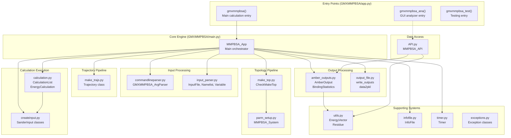
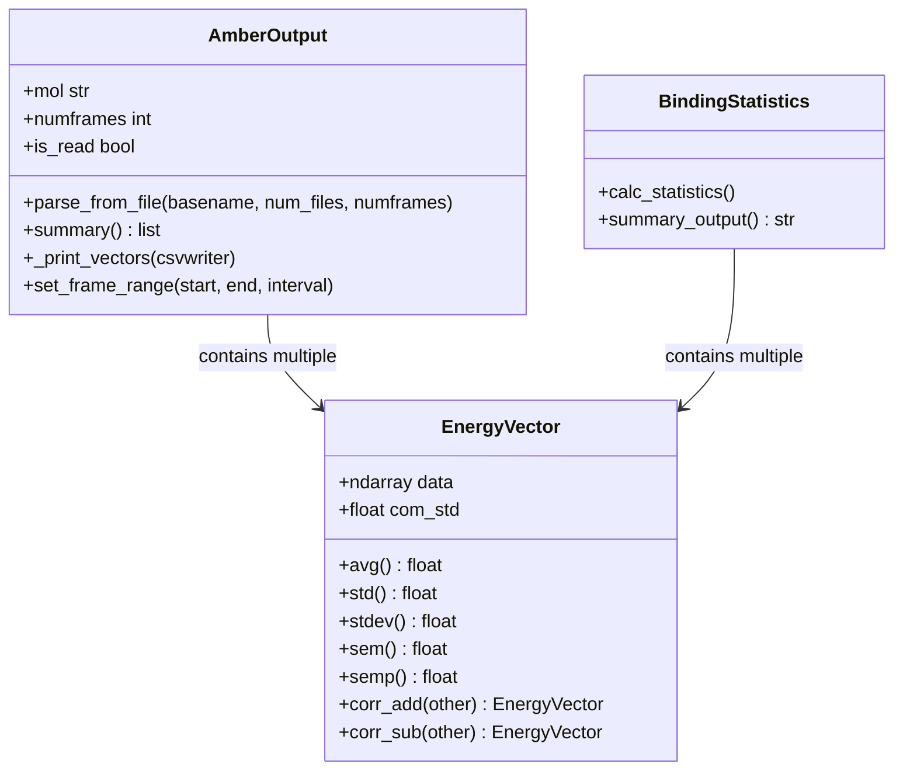
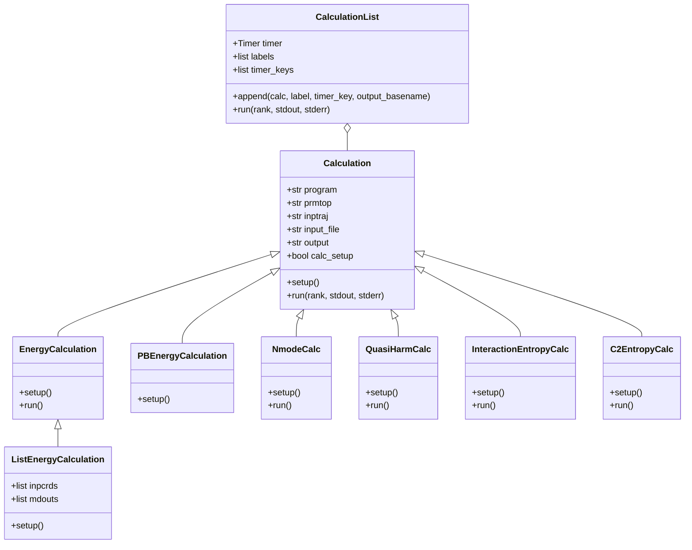
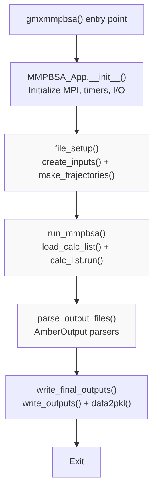
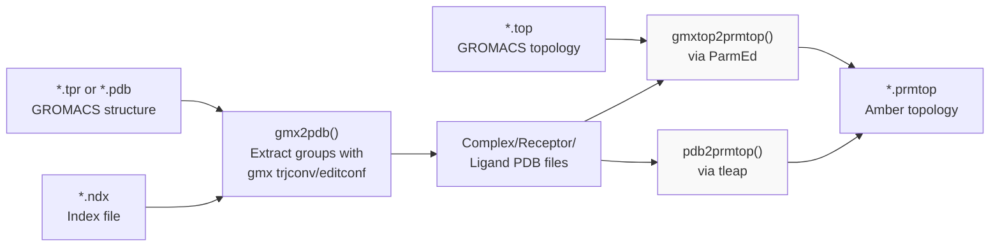
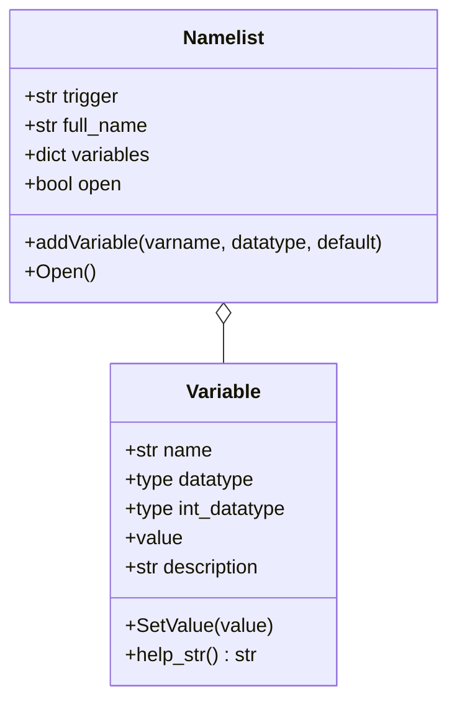
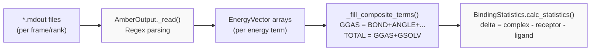
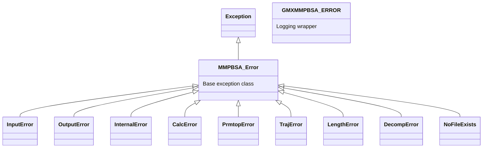

# Technical Reference

Relevant source files

The following files were used as context for generating this wiki page:

- [GMXMMPBSA/API.py](GMXMMPBSA/API.py)
- [GMXMMPBSA/amber_outputs.py](GMXMMPBSA/amber_outputs.py)
- [GMXMMPBSA/calculation.py](GMXMMPBSA/calculation.py)
- [GMXMMPBSA/createinput.py](GMXMMPBSA/createinput.py)
- [GMXMMPBSA/exceptions.py](GMXMMPBSA/exceptions.py)
- [GMXMMPBSA/input_parser.py](GMXMMPBSA/input_parser.py)
- [GMXMMPBSA/main.py](GMXMMPBSA/main.py)
- [GMXMMPBSA/make_top.py](GMXMMPBSA/make_top.py)
- [GMXMMPBSA/output_file.py](GMXMMPBSA/output_file.py)
- [GMXMMPBSA/utils.py](GMXMMPBSA/utils.py)

## Purpose and Scope

This section provides detailed technical information about gmx_MMPBSA's internal implementation, architecture, and core systems. It is intended for developers who want to understand how gmx_MMPBSA works internally, contribute to the codebase, or build custom extensions.

For information about using the API to analyze results, see [API Reference (MMPBSA_API)](#7.5). For practical usage examples, see [Example Use Cases](#6). For installation procedures, see [Installation and Setup](#2).

## Module Organization and Package Structure

The gmx_MMPBSA package is organized into distinct functional modules, each responsible for a specific aspect of the calculation pipeline. The primary modules are located in the `GMXMMPBSA/` directory.

### Package Structure Diagram

**Sources:** [GMXMMPBSA/main.py:65-110](), [GMXMMPBSA/main.py:111-210](), [GMXMMPBSA/calculation.py:88-150]()

### Module Responsibilities

| Module | Primary Classes | Responsibility |
|--------|----------------|----------------|
| `main.py` | `MMPBSA_App` | Main application orchestrator; coordinates all subsystems [GMXMMPBSA/main.py:65-66]() |
| `commandlineparser.py` | `parser` | Parse command-line arguments and validate file inputs [GMXMMPBSA/main.py:39-39]() |
| `input_parser.py` | `Variable`, `Namelist` | Parse mmpbsa.in configuration files using Fortran-style namelists [GMXMMPBSA/input_parser.py:30-164]() |
| `make_top.py` | `CheckMakeTop` | Convert GROMACS topologies to Amber format via ParmEd [GMXMMPBSA/make_top.py:76-113]() |
| `parm_setup.py` | `MMPBSA_System` | Map complex/receptor/ligand topology relationships [GMXMMPBSA/main.py:48-48]() |
| `make_trajs.py` | `make_trajectories` | Process trajectories with cpptraj; strip solvent, RMS fit, distribute frames [GMXMMPBSA/main.py:46-46]() |
| `createinput.py` | `SanderInput`, `SanderGBInput`, `SanderPBSAInput` | Generate .mdin input files for sander calculations [GMXMMPBSA/createinput.py:10-18]() |
| `calculation.py` | `CalculationList`, `EnergyCalculation`, `NmodeCalc` | Execute external programs (sander, cpptraj, gbnsr6) [GMXMMPBSA/calculation.py:88-150]() |
| `amber_outputs.py` | `AmberOutput`, `GBout`, `PBout`, `BindingStatistics` | Parse calculation output files and compute statistics [GMXMMPBSA/amber_outputs.py:65-1703]() |
| `output_file.py` | `write_outputs`, `data2pkl` | Generate final result files and serialize data [GMXMMPBSA/output_file.py:31-53]() |
| `utils.py` | `EnergyVector` | Core data structures and helper functions [GMXMMPBSA/utils.py:52-63]() |
| `API.py` | `_setup_data` | Programmatic interface for loading and analyzing results [GMXMMPBSA/API.py:130-171]() |
| `infofile.py` | `InfoFile` | Serialize/deserialize calculation state for rewriting output [GMXMMPBSA/main.py:42-42]() |
| `exceptions.py` | `MMPBSA_Error`, `GMXMMPBSA_ERROR` | Hierarchical exception system [GMXMMPBSA/exceptions.py:25-173]() |
| `timer.py` | `Timer` | Profiling and performance timing [GMXMMPBSA/main.py:50-50]() |

**Sources:** [GMXMMPBSA/main.py:26-50](), [GMXMMPBSA/calculation.py:88-150](), [GMXMMPBSA/amber_outputs.py:65-74]()

## Core Data Structures

### EnergyVector Class

The `EnergyVector` class is the fundamental data structure for storing per-frame energy values. It is a numpy ndarray subclass with additional statistical methods.

**Key Features:**
- **Propagation of Uncertainty**: The `com_std` attribute stores the standard deviation computed using propagation of uncertainty formulas when combining vectors [GMXMMPBSA/utils.py:62-69]().
- **Statistical Methods**: Built-in `avg()`, `std()`, `sem()` (standard error of mean), `semp()` (SEM with propagation) [GMXMMPBSA/utils.py:86-100]().
- **Arithmetic Operations**: Overloaded `__add__` and `__sub__` operators automatically compute propagated standard deviations using `get_std` [GMXMMPBSA/utils.py:117-132]().
- **Correlation Support**: `corr_add()` and `corr_sub()` methods compute correlated standard deviations using `get_corrstd` [GMXMMPBSA/utils.py:101-116]().

**Sources:** [GMXMMPBSA/utils.py:52-159](), [GMXMMPBSA/amber_outputs.py:65-134]()

### Calculation Classes Hierarchy

**Design Pattern:** The Calculation classes follow the **Template Method** pattern. The base `Calculation` class (implied by hierarchy) defines the `run()` skeleton, while subclasses implement calculation-specific `setup()` methods. Each calculation type encapsulates the command-line arguments needed to invoke external programs like sander, cpptraj, or gbnsr6.

**Sources:** [GMXMMPBSA/calculation.py:88-150](), [GMXMMPBSA/main.py:36-38]()

## Execution Flow Architecture

### Main Application Flow

The `MMPBSA_App` class in `main.py` orchestrates the entire calculation through a well-defined sequence of operations:

**Critical Operations:**

1. **file_setup()** [GMXMMPBSA/main.py:111-150]()
   - Generates .mdin input files via `create_inputs()` [GMXMMPBSA/main.py:129-129]()
   - Processes trajectories via `make_trajectories()` [GMXMMPBSA/main.py:139-142]()
   - Distributes frames across MPI ranks [GMXMMPBSA/main.py:140-140]()

2. **run_mmpbsa()** [GMXMMPBSA/main.py:184-210]()
   - Orchestrates the execution of the calculation list.

**Sources:** [GMXMMPBSA/main.py:65-210](), [GMXMMPBSA/createinput.py:49-61]()

### Topology Generation Pipeline

**Key Implementation Details:**
- **PBRadii sets**: Support for multiple radii sets (bondi, mbondi, mbondi2, etc.) including `charmm_radii` [GMXMMPBSA/make_top.py:55-55]().
- **Ion parameters**: Automated selection of `frcmod` files for different water models [GMXMMPBSA/make_top.py:63-68]().

**Sources:** [GMXMMPBSA/make_top.py:119-261](), [GMXMMPBSA/make_top.py:55-74]()

## Data Flow and Transformations

### Input File Parsing Architecture

The input file parser implements a Fortran-style namelist system with strong type checking:

**Parsing Process:**
- **Variable**: Handles base types (int, str, float, list, tuple) and performs conversion in `SetValue` [GMXMMPBSA/input_parser.py:30-104]().
- **Namelist**: Mimics Fortran behavior, grouping variables that are only recognized when the namelist is active [GMXMMPBSA/input_parser.py:106-158]().

**Sources:** [GMXMMPBSA/input_parser.py:30-158]()

### Output Parsing and Statistics

The output parsing system converts raw calculation output files into structured data with statistics:

**Key Classes and Methods:**
- **AmberOutput**: Base class for parsing thread-specific output files [GMXMMPBSA/amber_outputs.py:65-108]().
- **_fill_composite_terms()**: Aggregates individual terms into `GGAS`, `GSOLV`, and `TOTAL` [GMXMMPBSA/amber_outputs.py:109-109]().
- **BindingStatistics**: Calculates Δ binding free energy using propagation of uncertainty [GMXMMPBSA/amber_outputs.py:1350-1350]().

**Sources:** [GMXMMPBSA/amber_outputs.py:65-1350](), [GMXMMPBSA/utils.py:153-185]()

## Internal Systems

### Exception Hierarchy

gmx_MMPBSA implements a comprehensive exception hierarchy for precise error handling:

**Sources:** [GMXMMPBSA/exceptions.py:25-173]()

### State Persistence

The system uses pickling to serialize the `MMPBSA_App` state into a compact format for the analyzer and API:

- **data2pkl**: Serializes `INPUT`, `FILES`, and results into `COMPACT_MMXSA_RESULTS.mmxsa` [GMXMMPBSA/output_file.py:31-51]().
- **EnergyVector pickling**: Custom `__reduce__` and `__setstate__` methods ensure custom attributes like `com_std` are preserved during serialization [GMXMMPBSA/utils.py:71-84]().

**Sources:** [GMXMMPBSA/output_file.py:31-51](), [GMXMMPBSA/utils.py:71-84]()

### Detailed Information

For more specific details on the following topics, please refer to the child pages:
- For a deep dive into module responsibilities and data flow, see [Internal Architecture](#7.1).
- For details on the exception hierarchy and logging, see [Error Handling and Exceptions](#7.2).
- For MPI strategies and performance optimization, see [Parallel Processing and Performance](#7.3).
- For temporary file management and cleanup, see [File Management and Temporary Files](#7.4).
- For programmatic access to results, see [API Reference (MMPBSA_API)](#7.5).

---