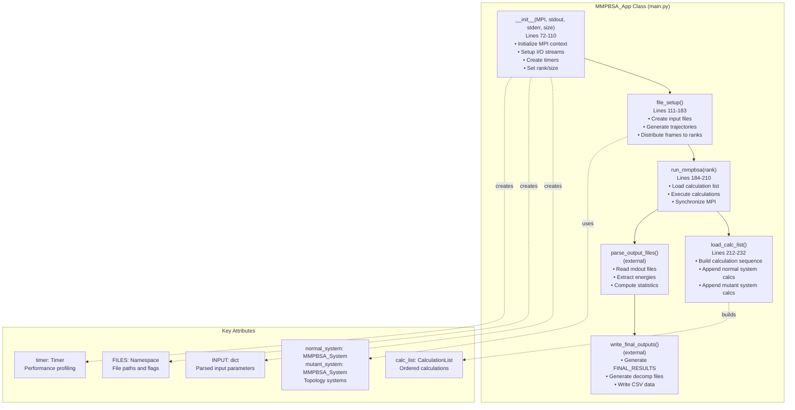
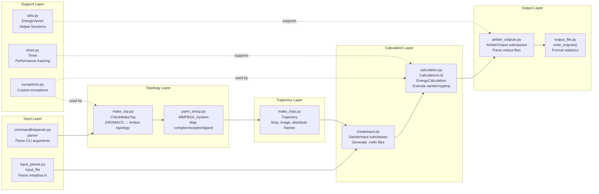
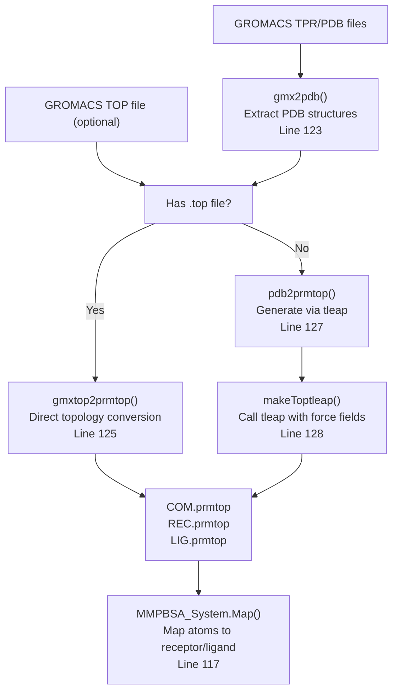
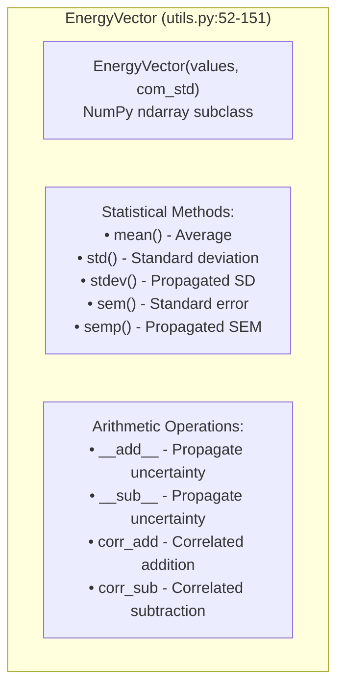
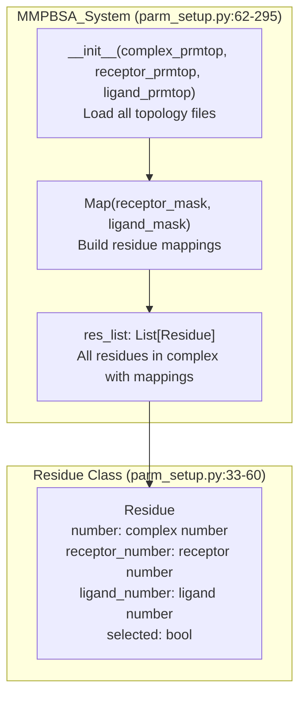

# Internal Architecture

Relevant source files

The following files were used as context for generating this wiki page:

- [GMXMMPBSA/__init__.py](GMXMMPBSA/__init__.py)
- [GMXMMPBSA/app.py](GMXMMPBSA/app.py)
- [GMXMMPBSA/main.py](GMXMMPBSA/main.py)
- [GMXMMPBSA/make_top.py](GMXMMPBSA/make_top.py)
- [GMXMMPBSA/make_trajs.py](GMXMMPBSA/make_trajs.py)
- [GMXMMPBSA/parm_setup.py](GMXMMPBSA/parm_setup.py)
- [GMXMMPBSA/timer.py](GMXMMPBSA/timer.py)
- [GMXMMPBSA/utils.py](GMXMMPBSA/utils.py)
- [setup.py](setup.py)

This page provides a detailed technical reference of gmx_MMPBSA's internal architecture, covering the core application class, module organization, execution pipeline, and key data structures. This documentation is intended for developers who want to understand the codebase structure or contribute to the project.

**Scope**: This page focuses on the architectural design, class hierarchy, and module responsibilities. For specialized topics, see: [Error Handling and Exceptions](#7.2), [Parallel Processing and Performance](#7.3), [File Management and Temporary Files](#7.4), and [API Reference (MMPBSA_API)](#7.5).

---

## Main Application Class

The entire application is orchestrated by the `MMPBSA_App` class, which serves as the central coordinator for all calculation phases. This class manages state, coordinates subsystems, and enforces the execution pipeline.

### MMPBSA_App Structure

**Sources**: [GMXMMPBSA/main.py:65-210](), [GMXMMPBSA/app.py:40-113]()

### Execution Entry Points

The application provides three entry points defined in `app.py`, each registered as console scripts in `setup.py`:

| Entry Point | Function | Purpose | Key Steps |
|------------|----------|---------|-----------|
| `gmx_MMPBSA` | `gmxmmpbsa()` | Main calculation engine | Setup → Parse args → Process → Calculate → Output |
| `gmx_MMPBSA_ana` | `gmxmmpbsa_ana()` | GUI analyzer | Initialize Qt → Load files → Display interface |
| `gmx_MMPBSA_test` | `gmxmmpbsa_test()` | Installation validation | Clone examples → Run tests → Report results |

**Sources**: [GMXMMPBSA/app.py:116-169](), [setup.py:56-61]()

---

## Module Organization

The codebase is organized into functional modules, each responsible for a specific phase of the calculation pipeline. This separation of concerns enables maintainability and parallel development.

### Core Module Responsibilities

**Sources**: [GMXMMPBSA/main.py:31-50](), [GMXMMPBSA/make_top.py:76-128](), [GMXMMPBSA/parm_setup.py:62-113](), [GMXMMPBSA/make_trajs.py:43-108](), [GMXMMPBSA/utils.py:52-63]()

### Module-to-Phase Mapping

| Phase | Primary Module | Key Classes/Functions | Purpose |
|-------|---------------|----------------------|---------|
| **Configuration** | `commandlineparser.py` | `parser` | Parse command-line arguments |
| | `input_parser.py` | `input_file` | Parse input file namelists |
| **Topology Generation** | `make_top.py` | `CheckMakeTop` | Convert GROMACS files to Amber format |
| | `parm_setup.py` | `MMPBSA_System`, `Residue` | Map complex to receptor/ligand |
| **Trajectory Preparation** | `make_trajs.py` | `Trajectory`, `make_trajectories()` | Strip solvent, distribute frames |
| **Input Generation** | `createinput.py` | `create_inputs()` | Generate calculation-specific `.mdin` files |
| **Calculation Execution** | `calculation.py` | `CalculationList`, `EnergyCalculation`, `NmodeCalc` | Run external programs, manage parallel execution |
| **Output Processing** | `amber_outputs.py` | `GBout`, `PBout`, `NMODEout`, `BindingStatistics` | Parse output files, compute statistics |
| | `output_file.py` | `write_outputs()`, `data2pkl()` | Format final results, serialize data |
| **Utilities** | `utils.py` | `EnergyVector`, helper functions | Data structures, common operations |

**Sources**: [GMXMMPBSA/main.py:1-50](), [GMXMMPBSA/app.py:40-112]()

---

## Pipeline Architecture

gmx_MMPBSA follows a strict sequential pipeline where each phase must complete before the next begins. The `MMPBSA_App` class enforces this ordering and manages state transitions.

### Complete Execution Pipeline

```mermaid
graph TB
    START["Application Start<br/>gmxmmpbsa()"]
    
    subgraph "Phase 1: Initialization"
        P1A["setup_run()<br/>Signal handlers"]
        P1B["MMPBSA_App.__init__()<br/>MPI, I/O, timers"]
        P1C["get_cl_args()<br/>commandlineparser.py"]
    end
    
    subgraph "Phase 2: Input Processing"
        P2A["read_input_file()<br/>input_parser.py"]
        P2B["process_input()<br/>Validate parameters"]
        P2C["check_for_bad_input()<br/>Sanity checks"]
    end
    
    subgraph "Phase 3: Topology Generation"
        P3A["make_prmtops()<br/>CheckMakeTop.buildTopology()"]
        P3B["gmx2pdb()<br/>Extract PDB from TPR/trajs"]
        P3C["gmxtop2prmtop() or pdb2prmtop()<br/>Convert to Amber format"]
        P3D["loadcheck_prmtops()<br/>MMPBSA_System.Map()"]
    end
    
    subgraph "Phase 4: File Setup"
        P4A["file_setup()<br/>create_inputs()"]
        P4B["make_trajectories()<br/>Trajectory.Setup()"]
        P4C["cpptraj execution<br/>Strip, image, split frames"]
        P4D["make_mutant_trajectories()<br/>Alanine scanning"]
    end
    
    subgraph "Phase 5: Calculation"
        P5A["run_mmpbsa()<br/>load_calc_list()"]
        P5B["CalculationList.append()<br/>Build calculation sequence"]
        P5C["CalculationList.run()<br/>Execute all calculations"]
        P5D["Calculation.run()<br/>sander/cpptraj subprocess"]
    end
    
    subgraph "Phase 6: Output Processing"
        P6A["parse_output_files()<br/>AmberOutput classes"]
        P6B["Read mdout files<br/>Extract energies per frame"]
        P6C["Compute statistics<br/>Mean, SD, SEM"]
        P6D["write_final_outputs()<br/>FINAL_RESULTS_MMPBSA.dat"]
    end
    
    subgraph "Phase 7: Finalization"
        P7A["data2pkl()<br/>Serialize to .mmxsa"]
        P7B["finalize()<br/>Cleanup, timing report"]
    end
    
    START --> P1A
    P1A --> P1B
    P1B --> P1C
    P1C --> P2A
    P2A --> P2B
    P2B --> P2C
    P2C --> P3A
    P3A --> P3B
    P3B --> P3C
    P3C --> P3D
    P3D --> P4A
    P4A --> P4B
    P4B --> P4C
    P4C --> P4D
    P4D --> P5A
    P5A --> P5B
    P5B --> P5C
    P5C --> P5D
    P5D --> P6A
    P6A --> P6B
    P6B --> P6C
    P6C --> P6D
    P6D --> P7A
    P7A --> P7B
```

**Sources**: [GMXMMPBSA/app.py:40-112](), [GMXMMPBSA/main.py:65-210]()

### Phase-Specific Details

#### Phase 3: Topology Generation

This critical phase converts GROMACS topology files to Amber format:

**Critical Classes**:
- `CheckMakeTop`: Main topology generation orchestrator [GMXMMPBSA/make_top.py:76-144]()
- `MMPBSA_System`: Maps complex topology to receptor/ligand subsystems [GMXMMPBSA/parm_setup.py:62-113]()

**Sources**: [GMXMMPBSA/make_top.py:76-144](), [GMXMMPBSA/parm_setup.py:62-113]()

#### Phase 4: Trajectory Preparation

The `Trajectory` class uses cpptraj to prepare trajectory files:

**Key Functions**:
- `make_trajectories()`: Main trajectory preparation [GMXMMPBSA/make_trajs.py:43-110]()
- `Trajectory.Setup()`: Configure frame selection [GMXMMPBSA/make_trajs.py:69]()

**Sources**: [GMXMMPBSA/make_trajs.py:43-110]()

---

## Key Data Structures

### EnergyVector Class

The `EnergyVector` is a NumPy array subclass that stores per-frame energies and provides automatic statistical methods:

**Sources**: [GMXMMPBSA/utils.py:52-151]()

### MMPBSA_System Class

The `MMPBSA_System` class maintains the mapping between complex, receptor, and ligand topologies:

**Sources**: [GMXMMPBSA/parm_setup.py:33-113]()

---

## Summary

The gmx_MMPBSA internal architecture follows a strict pipeline design:

1. **MMPBSA_App** orchestrates the workflow [GMXMMPBSA/main.py:65]().
2. **CheckMakeTop** handles topology conversion [GMXMMPBSA/make_top.py:76]().
3. **Trajectory** class prepares frames via cpptraj [GMXMMPBSA/make_trajs.py:68]().
4. **EnergyVector** manages data and statistical propagation [GMXMMPBSA/utils.py:52]().

**Sources**: [GMXMMPBSA/main.py:65](), [GMXMMPBSA/make_top.py:76](), [GMXMMPBSA/make_trajs.py:43](), [GMXMMPBSA/utils.py:52]()

---