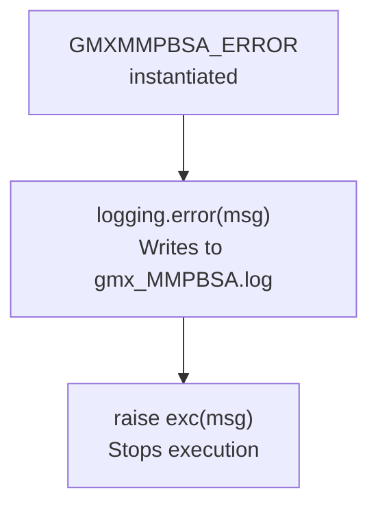
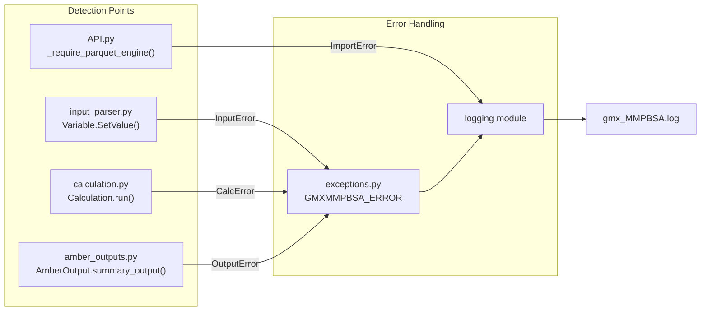

# Error Handling and Exceptions

Relevant source files

The following files were used as context for generating this wiki page:

- [GMXMMPBSA/API.py](GMXMMPBSA/API.py)
- [GMXMMPBSA/amber_outputs.py](GMXMMPBSA/amber_outputs.py)
- [GMXMMPBSA/calculation.py](GMXMMPBSA/calculation.py)
- [GMXMMPBSA/createinput.py](GMXMMPBSA/createinput.py)
- [GMXMMPBSA/exceptions.py](GMXMMPBSA/exceptions.py)
- [GMXMMPBSA/input_parser.py](GMXMMPBSA/input_parser.py)
- [GMXMMPBSA/output_file.py](GMXMMPBSA/output_file.py)

This page documents the exception hierarchy, error handling patterns, and logging mechanisms used throughout gmx_MMPBSA. It explains how the system manages failures across serial and parallel execution modes, ensuring that errors are reported clearly and resources are cleaned up properly.

## Purpose and Scope

gmx_MMPBSA implements a comprehensive exception system for detecting and reporting errors during topology generation, trajectory processing, calculations, and output parsing. The system provides:

- A hierarchical exception structure with specialized error types [GMXMMPBSA/exceptions.py:25-153]().
- MPI-aware error handling that coordinates across parallel processes [GMXMMPBSA/exceptions.py:168-171]().
- Integration with the logging system for error tracking [GMXMMPBSA/exceptions.py:170-170]().
- Graceful degradation and technical error reporting via the `GMXMMPBSA_ERROR` interface [GMXMMPBSA/exceptions.py:168-172]().

---

## Exception Hierarchy

The following diagram shows the complete exception class hierarchy in gmx_MMPBSA:

**Exception Class Architecture**

```mermaid
graph TB
    Exception["Exception<br/>(Python built-in)"]
    Warning["Warning<br/>(Python built-in)"]
    
    MMPBSA_Error["MMPBSA_Error<br/>Base exception class"]
    MMPBSA_Warning["MMPBSA_Warning<br/>Base warning class"]
    
    TimerException["TimerException<br/>Timer errors"]
    CommandlineError["CommandlineError<br/>CLI parsing errors"]
    CalcError["CalcError<br/>Calculation failures"]
    SetupError["SetupError<br/>Environment setup errors"]
    PrmtopError["PrmtopError<br/>Topology file errors"]
    SelectionError["SelectionError<br/>Residue selection errors"]
    TrajError["TrajError<br/>Trajectory processing errors"]
    InputError["InputError<br/>Input file parsing errors"]
    IllegalOption["IllegalOption<br/>Incompatible options"]
    InterruptError["InterruptError<br/>Process interruption"]
    OutputError["OutputError<br/>Output parsing errors"]
    InconsistentError1["InconsistentError1<br/>Data inconsistency"]
    InconsistentError2["InconsistentError2<br/>Additional inconsistency"]
    LengthError["LengthError<br/>Array length mismatch"]
    DecompError["DecompError<br/>Decomposition errors"]
    MutantResError["MutantResError<br/>Mutation errors"]
    InternalError["InternalError<br/>Internal logic errors"]
    NoFileExists["NoFileExists<br/>File not found"]
    
    Exception --> MMPBSA_Error
    Warning --> MMPBSA_Warning
    
    MMPBSA_Error --> TimerException
    MMPBSA_Error --> CommandlineError
    MMPBSA_Error --> CalcError
    MMPBSA_Error --> SetupError
    MMPBSA_Error --> PrmtopError
    MMPBSA_Error --> SelectionError
    MMPBSA_Error --> TrajError
    MMPBSA_Error --> InputError
    MMPBSA_Error --> IllegalOption
    MMPBSA_Error --> InterruptError
    MMPBSA_Error --> OutputError
    MMPBSA_Error --> InconsistentError1
    MMPBSA_Error --> InconsistentError2
    MMPBSA_Error --> LengthError
    MMPBSA_Error --> DecompError
    MMPBSA_Error --> MutantResError
    MMPBSA_Error --> InternalError
    MMPBSA_Error --> NoFileExists
```

Sources: [GMXMMPBSA/exceptions.py:25-153]()

---

## Exception Classes Reference

The following table summarizes all exception classes and their purposes:

| Exception Class | Purpose | Typical Use Cases |
|----------------|---------|-------------------|
| `MMPBSA_Error` | Base exception for all gmx_MMPBSA errors | Parent for all other exceptions [GMXMMPBSA/exceptions.py:25-32]() |
| `MMPBSA_Warning` | Base warning class | Parent for non-fatal warnings [GMXMMPBSA/exceptions.py:35-42]() |
| `TimerException` | Timer module errors | Failures in performance profiling [GMXMMPBSA/exceptions.py:45-47]() |
| `CommandlineError` | Command-line parsing errors | Invalid flags or missing arguments [GMXMMPBSA/exceptions.py:50-52]() |
| `CalcError` | Calculation execution failures | Sander/GBNSR6/cpptraj execution errors [GMXMMPBSA/exceptions.py:55-57]() |
| `SetupError` | Environment setup issues | Missing external programs or invalid paths [GMXMMPBSA/exceptions.py:60-62]() |
| `PrmtopError` | Topology file problems | Incompatible prmtop files [GMXMMPBSA/exceptions.py:65-67]() |
| `SelectionError` | Invalid residue selections | Malformed masks [GMXMMPBSA/exceptions.py:70-72]() |
| `TrajError` | Trajectory processing failures | Frame extraction errors [GMXMMPBSA/exceptions.py:75-77]() |
| `InputError` | Input file parsing errors | Unrecognized namelists or invalid variables [GMXMMPBSA/exceptions.py:80-82]() |
| `IllegalOption` | Incompatible option combinations | Conflicting calculation types [GMXMMPBSA/exceptions.py:85-87]() |
| `InterruptError` | Process interruption | User cancellation (Ctrl+C) [GMXMMPBSA/exceptions.py:90-92]() |
| `OutputError` | Output parsing failures | Malformed output files [GMXMMPBSA/exceptions.py:95-97]() |
| `InconsistentError1` | Primary data inconsistency | Mismatched BOND, ANGLE, DIHED terms [GMXMMPBSA/exceptions.py:100-104]() |
| `InconsistentError2` | Secondary inconsistency | Mismatched 1-4 VDW and 1-4 EEL terms [GMXMMPBSA/exceptions.py:107-111]() |
| `LengthError` | Array length mismatches | Frame count inconsistencies in `EnergyVector` [GMXMMPBSA/exceptions.py:134-138]() |
| `DecompError` | Decomposition analysis errors | Invalid decomposition results [GMXMMPBSA/exceptions.py:141-143]() |
| `MutantResError` | Alanine scanning errors | Invalid mutation specifications [GMXMMPBSA/exceptions.py:124-126]() |
| `InternalError` | Internal logic errors | Buggy coding or duplicate variables [GMXMMPBSA/exceptions.py:146-148]() |
| `NoFileExists` | File not found | Missing required input/output files [GMXMMPBSA/exceptions.py:151-153]() |

Sources: [GMXMMPBSA/exceptions.py:25-153]()

---

## Error Handling Pattern: GMXMMPBSA_ERROR

The primary error handling mechanism is the `GMXMMPBSA_ERROR` class, which serves as a functional wrapper to provide centralized error logging and exception raising.

**Logic Flow of GMXMMPBSA_ERROR**

Sources: [GMXMMPBSA/exceptions.py:168-172]()

**Implementation Details:**
- **Centralized Logging**: The constructor immediately calls `logging.error()`, ensuring the error is recorded even if the exception is caught elsewhere [GMXMMPBSA/exceptions.py:170]().
- **Traceability**: It prompts the user to check the `gmx_MMPBSA.log` file to report the problem [GMXMMPBSA/exceptions.py:171]().
- **Type Flexibility**: It allows specifying the exception type (defaulting to `MMPBSA_Error`) [GMXMMPBSA/exceptions.py:168]().

---

## Error Handling Workflow

The following diagram bridges the high-level system components with the specific code entities responsible for error management.

**Code Entity Error Flow**

Sources: [GMXMMPBSA/exceptions.py:168-172](), [GMXMMPBSA/calculation.py:163-164](), [GMXMMPBSA/amber_outputs.py:136-137](), [GMXMMPBSA/API.py:72-76]()

---

## Module-Specific Error Handling

### Input Parsing (input_parser.py)
The `Variable` and `Namelist` classes validate data types and structures during the initialization of the calculation parameters.

- **Variable Type Mismatch**: The `Variable` class checks if the provided `dat_type` is supported (int, str, float, list, tuple) [GMXMMPBSA/input_parser.py:41-44]().
- **Duplicate Variables**: The `Namelist.addVariable` method raises an `InternalError` if a variable is defined twice in the same namelist [GMXMMPBSA/input_parser.py:147-148]().
- **Namelist Integrity**: `Namelist.Open` prevents opening a namelist that is already open [GMXMMPBSA/input_parser.py:153-154]().

### Calculation Execution (calculation.py)
The calculation module ensures that the environment and external tools are ready before execution.

- **Setup Validation**: `MultiCalculation.run` checks the `calc_setup` flag. If `setup()` was not called, it raises a `CalcError` [GMXMMPBSA/calculation.py:163-164]().
- **Calculation List Integrity**: `CalculationList.append` ensures only `Calculation` or `MultiCalculation` instances are added, raising a `TypeError` otherwise [GMXMMPBSA/calculation.py:101-102]().

### Output Processing (amber_outputs.py)
The output system validates the state of data before generating reports.

- **Read State Check**: `AmberOutput.summary_output` and `AmberOutput.summary` verify that the output files have been successfully read (`is_read` flag) before attempting to format a summary [GMXMMPBSA/amber_outputs.py:136-137](), [GMXMMPBSA/amber_outputs.py:159-160]().

### API and Data Management (API.py)
The API module handles dependency and file system errors during post-processing.

- **Dependency Checks**: `_require_parquet_engine` raises an `ImportError` if neither `pyarrow` nor `fastparquet` is installed when disk-backed data is required [GMXMMPBSA/API.py:65-76]().
- **File Existence**: Functions using the API check for file presence, raising `NoFileExists` when expected results are missing [GMXMMPBSA/API.py:38]().

Sources: [GMXMMPBSA/input_parser.py:41-154](), [GMXMMPBSA/calculation.py:101-164](), [GMXMMPBSA/amber_outputs.py:136-160](), [GMXMMPBSA/API.py:65-76]()

---

## Logging System

gmx_MMPBSA uses the standard Python `logging` module to provide a consistent audit trail.

**Logging Components**
| Entity | Role | Code Reference |
|--------|------|----------------|
| `logging.error` | Records critical failures | [GMXMMPBSA/exceptions.py:170]() |
| `GMXMMPBSA_INFO` | Handles standard information logging | [GMXMMPBSA/exceptions.py:174-181]() |
| `logging.warning` | Reports non-fatal issues (e.g., setting `arad`) | [GMXMMPBSA/createinput.py:102]() |

**Data Flow in GMXMMPBSA_INFO:**
The `GMXMMPBSA_INFO` class takes a message and, via its `write` method, prints it to the console and writes it to the log file with an "INFO" prefix [GMXMMPBSA/exceptions.py:178-180]().

Sources: [GMXMMPBSA/exceptions.py:168-181](), [GMXMMPBSA/createinput.py:102-126]()

---