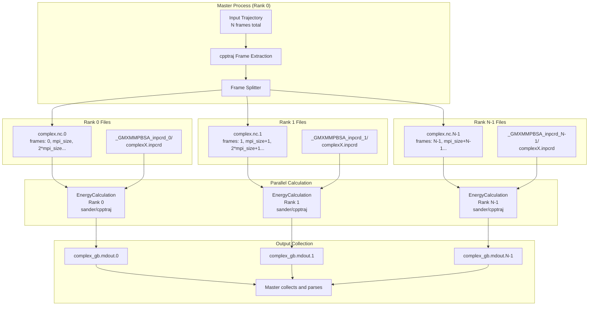
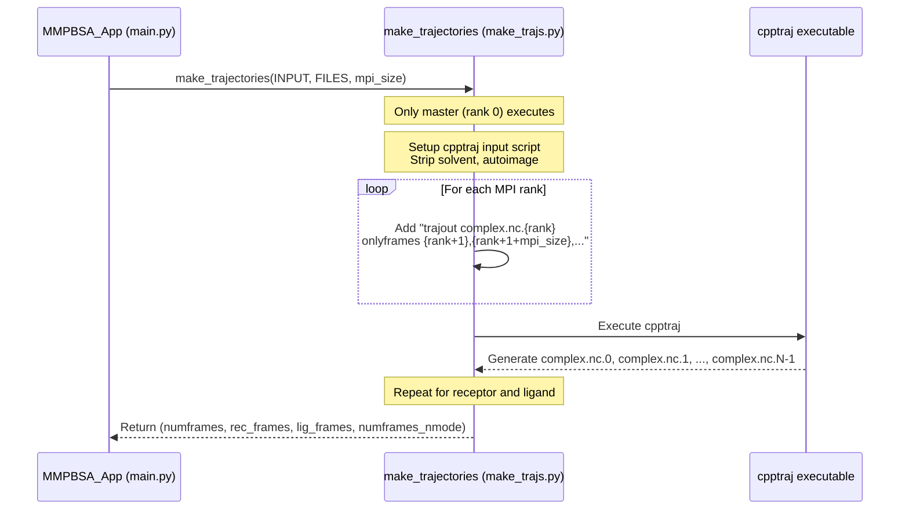
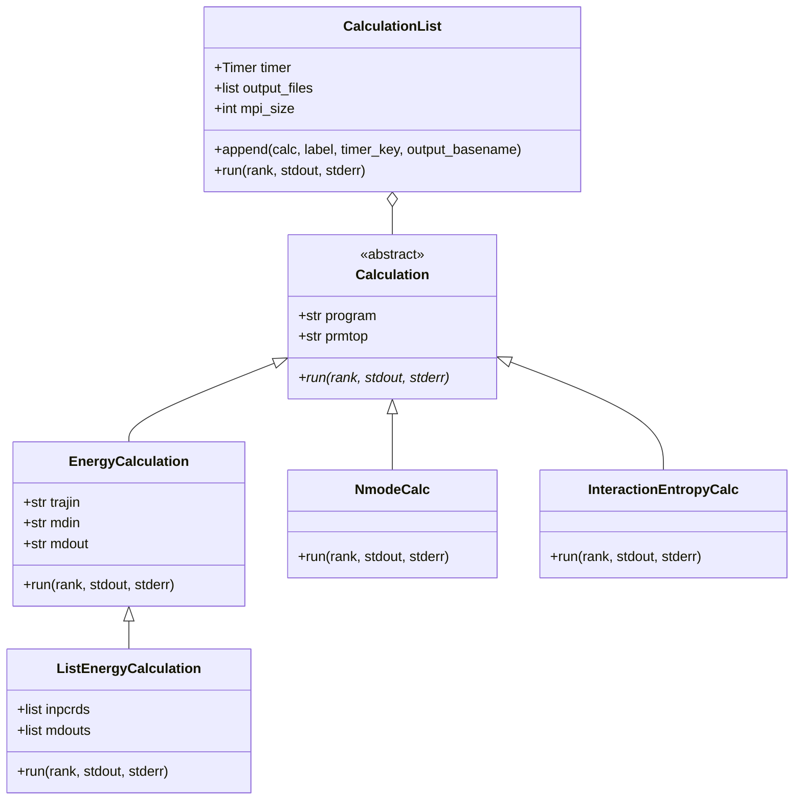
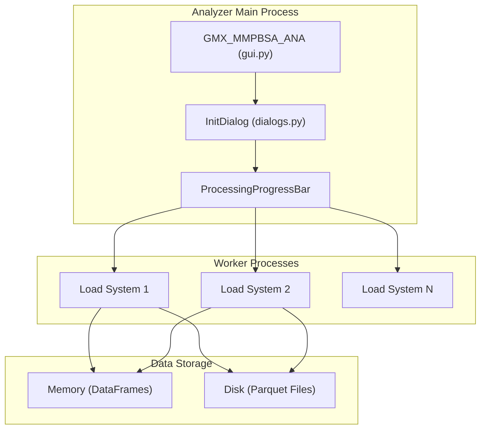

# Parallel Processing and Performance

Relevant source files

The following files were used as context for generating this wiki page:

- [GMXMMPBSA/analyzer/chartsettings.py](GMXMMPBSA/analyzer/chartsettings.py)
- [GMXMMPBSA/analyzer/customitem.py](GMXMMPBSA/analyzer/customitem.py)
- [GMXMMPBSA/analyzer/dialogs.py](GMXMMPBSA/analyzer/dialogs.py)
- [GMXMMPBSA/analyzer/gui.py](GMXMMPBSA/analyzer/gui.py)
- [GMXMMPBSA/analyzer/plots.py](GMXMMPBSA/analyzer/plots.py)
- [GMXMMPBSA/analyzer/utils.py](GMXMMPBSA/analyzer/utils.py)
- [GMXMMPBSA/fake_mpi.py](GMXMMPBSA/fake_mpi.py)
- [GMXMMPBSA/main.py](GMXMMPBSA/main.py)
- [GMXMMPBSA/make_top.py](GMXMMPBSA/make_top.py)
- [GMXMMPBSA/utils.py](GMXMMPBSA/utils.py)

This document describes the parallel processing architecture and performance optimization strategies in gmx_MMPBSA. It covers MPI-based frame parallelism in the calculation engine, multiprocessing in the analyzer application, and key performance considerations.

For information about the overall calculation workflow, see [Calculation Execution (3.3.3)](). For details about the analyzer application architecture, see [GUI Architecture and Components (4.1)]().

---

## Overview of Parallelization Strategy

gmx_MMPBSA employs two distinct parallelization approaches depending on the application:

1.  **MPI-based frame parallelism** in the core calculation engine (`gmx_MMPBSA`).
2.  **Multiprocessing/threading** in the analyzer GUI (`gmx_MMPBSA_ana`).

The fundamental design principle is **embarrassingly parallel frame processing**: each trajectory frame can be analyzed independently, enabling efficient distribution across compute resources without inter-process communication during calculation.

Sources: [GMXMMPBSA/main.py:72-110](), [GMXMMPBSA/fake_mpi.py:28-68]()

---

## MPI Frame Distribution Architecture

### Frame Distribution Strategy

The frame distribution follows a **round-robin pattern**: if `mpi_size = 4` and there are 100 frames, then:
*   Rank 0 processes frames: 0, 4, 8, 12, ..., 96
*   Rank 1 processes frames: 1, 5, 9, 13, ..., 97
*   Rank 2 processes frames: 2, 6, 10, 14, ..., 98
*   Rank 3 processes frames: 3, 7, 11, 15, ..., 99

This ensures balanced load distribution even if the total frame count is not evenly divisible by the number of ranks.

Sources: [GMXMMPBSA/make_trajs.py:52-181](), [GMXMMPBSA/main.py:133-151]()

### Trajectory Preparation and Frame Splitting

The `make_trajectories` function coordinates frame distribution. The `Trajectory` class (internal to `make_trajs.py`) constructs a `cpptraj` input script that outputs multiple trajectory files simultaneously using the `trajout` command combined with rank-specific frame selection.

Sources: [GMXMMPBSA/make_trajs.py:52-181](), [GMXMMPBSA/main.py:133-151]()

### MPI Synchronization Points

Key synchronization points ensure data integrity across the parallel workflow:
1.  **After trajectory preparation**: Ensures all ranks have access to split trajectory files before starting calculations [GMXMMPBSA/main.py:148]().
2.  **After mutation trajectories**: Synchronizes after mutant trajectory generation [GMXMMPBSA/main.py:161]().
3.  **Before output processing**: Ensures all calculations complete before the master aggregates results [GMXMMPBSA/main.py:209]().

Non-master ranks have their `stdout` redirected to `os.devnull` to prevent output clutter [GMXMMPBSA/main.py:96-97]().

Sources: [GMXMMPBSA/main.py:92-98](), [GMXMMPBSA/main.py:148](), [GMXMMPBSA/main.py:209]()

---

## Calculation Execution Model

### CalculationList Architecture

The `CalculationList` class in `GMXMMPBSA/calculation.py` orchestrates the parallel execution of various energy and entropy terms.

Sources: [GMXMMPBSA/calculation.py:88-115](), [GMXMMPBSA/calculation.py:148-204]()

### Per-Frame vs Batch Calculation Patterns

*   **Standard Energy (GB/PB)**: Frames are processed sequentially within each rank using `sander` [GMXMMPBSA/calculation.py:148-204]().
*   **GBNSR6**: Uses `ListEnergyCalculation` to process a list of coordinate files (inpcrd) in batch [GMXMMPBSA/calculation.py:240-274]().
*   **Entropy (NMODE/QH)**: Each rank processes its assigned subset of frames in a single execution of the external program [GMXMMPBSA/calculation.py:365-430]().

### Progress Tracking

Progress is monitored via the `pb` function [GMXMMPBSA/calculation.py:53-86](), which runs in a separate thread. It scans output files (like `.mdout`) for completion markers (e.g., "FINAL RESULTS") to update a `tqdm` progress bar across all ranks.

Sources: [GMXMMPBSA/calculation.py:53-86](), [GMXMMPBSA/calculation.py:123-145]()

---

## Multiprocessing in the Analyzer

### Data Loading Parallelization

The analyzer GUI (`gmx_MMPBSA_ana`) uses a `multiprocessing.Pool` (or `ThreadPool`) during initialization to load multiple `.mmxsa` or info files concurrently.

Sources: [GMXMMPBSA/analyzer/dialogs.py:234-347](), [GMXMMPBSA/analyzer/gui.py:44-193]()

### Memory vs Disk Trade-off

Users can configure the analyzer to prioritize RAM or Disk space:
*   **In-Memory**: All data loaded into Pandas DataFrames. Faster chart rendering but high RAM usage [GMXMMPBSA/analyzer/dialogs.py:58-66]().
*   **On-Disk**: Data stored as temporary Parquet files. Slower due to I/O but handles massive datasets [GMXMMPBSA/analyzer/dialogs.py:68-84]().

---

## Performance Considerations

### Memory Management

*   **Calculation Engine**: Each rank only loads its frame subset. `EnergyVector` (a `numpy.ndarray` subclass) is used for efficient numerical storage and statistical operations [GMXMMPBSA/utils.py:52-151]().
*   **Analyzer**: Employs term thresholds to discard negligible energy contributions (default 0.01 kcal/mol) and non-contributing residues (default 0.5 kcal/mol) during loading to save memory [GMXMMPBSA/analyzer/dialogs.py:74-113]().

### Disk I/O Optimization

The system prefers NetCDF trajectories for faster I/O [GMXMMPBSA/main.py:251](). During MPI execution, each rank writes to its own set of output files (e.g., `_GMXMMPBSA_complex_gb.mdout.0`), avoiding file contention.

### Scaling Characteristics

*   **Optimal MPI Size**: Each rank should ideally process at least 5-10 frames. Using more ranks than frames results in idle resources.
*   **Setup Overhead**: Topology generation (`make_top.py`) and trajectory splitting (`make_trajs.py`) are performed by the master rank and do not scale with MPI size.

Sources: [GMXMMPBSA/main.py:133-151](), [GMXMMPBSA/timer.py:1-135]()

---

## Performance Monitoring

The `Timer` class tracks execution time for major phases: setup, cpptraj, and specific calculation types [GMXMMPBSA/timer.py:1-135](). These timings are reported in the final output and can be used to identify bottlenecks.

Sources: [GMXMMPBSA/timer.py:1-135](), [GMXMMPBSA/main.py:103-104]()

---