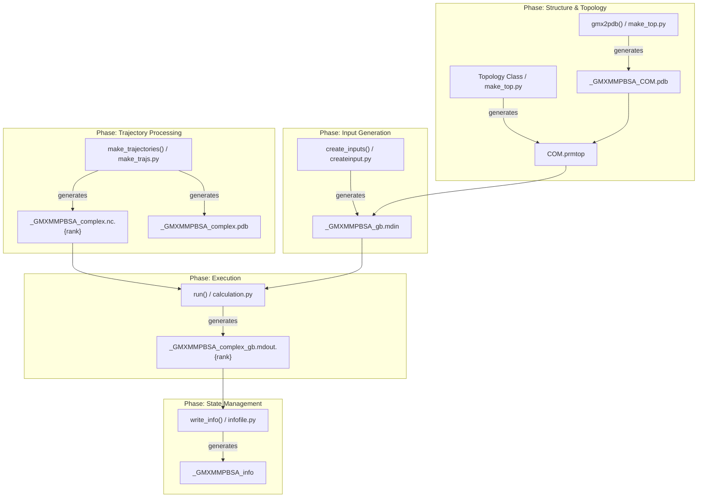
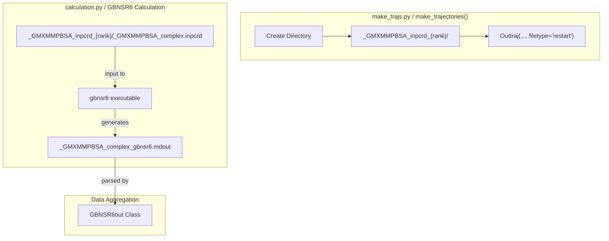

# File Management and Temporary Files

<details>
<summary>Relevant source files</summary>

The following files were used as context for generating this wiki page:

- [GMXMMPBSA/infofile.py](GMXMMPBSA/infofile.py)
- [GMXMMPBSA/make_trajs.py](GMXMMPBSA/make_trajs.py)
- [GMXMMPBSA/parm_setup.py](GMXMMPBSA/parm_setup.py)
- [GMXMMPBSA/timer.py](GMXMMPBSA/timer.py)

</details>


## Purpose and Scope

This page documents gmx_MMPBSA's temporary file management system, including naming conventions, file categories, cleanup behavior, and storage strategies. Understanding this system is essential for debugging calculations, managing disk space, and recovering from interrupted runs.

For information about persistent output files (FINAL_RESULTS_*.dat, *.csv, etc.), see [Output Files and Data Formats](). For the state management system that enables checkpoint/resume, see [InfoFile]().

---

## Temporary File Prefix

All temporary files created by gmx_MMPBSA use a consistent prefix defined in the application:

```
_GMXMMPBSA_
```

This prefix serves multiple purposes:
- **Easy identification**: All intermediate files are immediately recognizable.
- **Cleanup safety**: Enables selective removal without affecting user files.
- **Namespace separation**: Prevents conflicts with user-provided files.

The prefix is set in `GMXMMPBSA/main.py` as `self.pre = '_GMXMMPBSA_'` and propagated throughout the application components.

**Sources**: [GMXMMPBSA/main.py:78-78](), [GMXMMPBSA/make_top.py:81-81]()

---

## File Categories and Lifecycle

### Overview of File Types

The following diagram maps the logical preparation phases to the specific code entities and file patterns generated during execution.

**Preparation to Code Entity Mapping**

**Sources**: [GMXMMPBSA/main.py:233-625](), [GMXMMPBSA/make_top.py:108-110](), [GMXMMPBSA/make_trajs.py:92-107](), [GMXMMPBSA/infofile.py:86-90]()

---

## Detailed File Categories

### 1. Structure Files
These PDB files contain extracted structures from GROMACS files, converted for Amber topology generation.

| File Pattern | Purpose | Created By | Cleanup |
|-------------|---------|------------|---------|
| `_GMXMMPBSA_COM.pdb` | Complex structure | `make_top.py:gmx2pdb()` | Optional |
| `_GMXMMPBSA_REC.pdb` | Receptor structure | `make_top.py:gmx2pdb()` | Optional |
| `_GMXMMPBSA_LIG.pdb` | Ligand structure | `make_top.py:gmx2pdb()` | Optional |

**Sources**: [GMXMMPBSA/make_top.py:263-526]()

### 2. Topology Files
Amber-format topology and coordinate files generated from GROMACS files.

| File Pattern | Purpose | Format | Cleanup |
|-------------|---------|--------|---------|
| `COM.prmtop` | Complex topology | Amber prmtop | Keep |
| `REC.prmtop` | Receptor topology | Amber prmtop | Keep |
| `LIG.prmtop` | Ligand topology | Amber prmtop | Keep |
| `MUT_*.prmtop` | Mutant topologies | Amber prmtop | Keep |

**Sources**: [GMXMMPBSA/make_top.py:562-608](), [GMXMMPBSA/make_top.py:575-591]()

### 3. Trajectory Files
Thread-specific trajectory files for parallel processing. The distribution is handled by the `Trajectory` class in `make_trajs.py`.

| File Pattern | Purpose | Format |
|-------------|---------|--------|
| `_GMXMMPBSA_complex.{fmt}.{rank}` | Per-thread complex frames | NetCDF (`nc`) or ASCII (`mdcrd`) |
| `_GMXMMPBSA_receptor.{fmt}.{rank}` | Per-thread receptor frames | NetCDF or ASCII |
| `_GMXMMPBSA_ligand.{fmt}.{rank}` | Per-thread ligand frames | NetCDF or ASCII |
| `_GMXMMPBSA_complex.pdb` | Reference structure (frame 1) | PDB |

**Sources**: [GMXMMPBSA/make_trajs.py:43-149](), [GMXMMPBSA/make_trajs.py:91-108]()

---

## Special: GBNSR6 Directories and GBNSR6 Calculation

GBNSR6 calculations require special file organization. Unlike standard GB/PB, GBNSR6 often involves individual frame processing in separate directories to manage `inpcrd` files for the numerical solver.

**GBNSR6 File Organization and Processing**


In `make_trajs.py`, if `gbnsr6run` is active, a temporary directory is created for each rank to hold individual coordinate files:
- `_GMXMMPBSA_inpcrd_{rank}/` [GMXMMPBSA/make_trajs.py:104-105]()
- `_GMXMMPBSA_inpcrd_{rank}/{pre}complex.inpcrd` [GMXMMPBSA/make_trajs.py:106-107]()

**Sources**: [GMXMMPBSA/make_trajs.py:103-107](), [GMXMMPBSA/calculation.py:202-202]()

---

## Cleanup Options and Behavior

### The `keep_files` Parameter
The `keep_files` input parameter controls temporary file retention. It is parsed from the `&general` namelist.

| Value | Behavior | Use Case |
|-------|----------|----------|
| `0` | Remove temporary files after completion | Production runs (default) |
| `1` | Keep temporary files in working directory | Debugging, inspection |
| `2` | Keep files in `_GMXMMPBSA_{sys_name}/` subdirectory | Organized archiving |

### Files Always Retained
Regardless of the `keep_files` setting, these files are essential for post-processing and state recovery:
- `_GMXMMPBSA_info`: Written by `InfoFile.write_info()`. Contains the serialized state of `INPUT` and `FILES`. [GMXMMPBSA/infofile.py:86-113]()
- `FINAL_RESULTS_MMPBSA.dat`: The primary statistics output.
- `*.prmtop`: Amber topologies generated during setup.

**Sources**: [GMXMMPBSA/infofile.py:86-113](), [GMXMMPBSA/main.py:78-78]()

---

## MPI-Specific File Handling

### Rank-Based File Distribution
In MPI mode, the `make_trajectories` function calculates the frames assigned to each rank to ensure balanced workloads.

```python
# Frame distribution logic in make_trajs.py
frames_per_rank = traj.processed_frames // size
extras = traj.processed_frames - frames_per_rank * size
frame_count = [frames_per_rank for i in range(size)]
for i in range(size):
    if i < extras: frame_count[i] += 1
```
[GMXMMPBSA/make_trajs.py:84-88]()

Each rank `i` then generates its own trajectory segment named `_GMXMMPBSA_complex.nc.i`. [GMXMMPBSA/make_trajs.py:100-101]()

**Sources**: [GMXMMPBSA/make_trajs.py:84-108]()

---

## Performance Profiling: Timer
The `Timer` class in `timer.py` tracks the duration of various phases. While not a "file" in the traditional sense, it outputs timing data to the log file.

- **Global Timer**: Tracks total execution time. [GMXMMPBSA/timer.py:35-35]()
- **Units**: Automatically scales from seconds to minutes, hours, or days based on duration. [GMXMMPBSA/timer.py:106-114]()

**Sources**: [GMXMMPBSA/timer.py:27-128]()

---

## Summary of File Naming Patterns

| Component | Pattern | Variable Reference |
|-----------|---------|--------------------|
| **Prefix** | `_GMXMMPBSA_` | `self.pre` in `main.py` |
| **Trajectory** | `{pre}complex.{ext}.{rank}` | `trj_suffix` in `make_trajs.py` |
| **Info File** | `{pre}info` | `name` in `infofile.py` |
| **GBNSR6 Dir** | `{pre}inpcrd_{rank}` | `temp_dir` in `make_trajs.py` |

**Sources**: [GMXMMPBSA/main.py:78-78](), [GMXMMPBSA/make_trajs.py:52-104](), [GMXMMPBSA/infofile.py:89-89]()

---