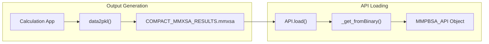
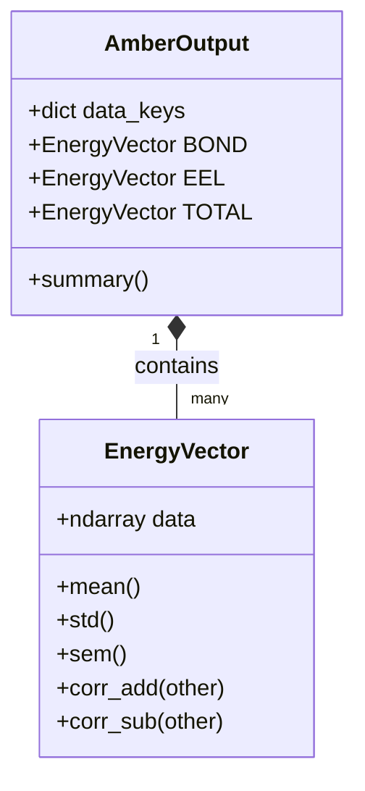
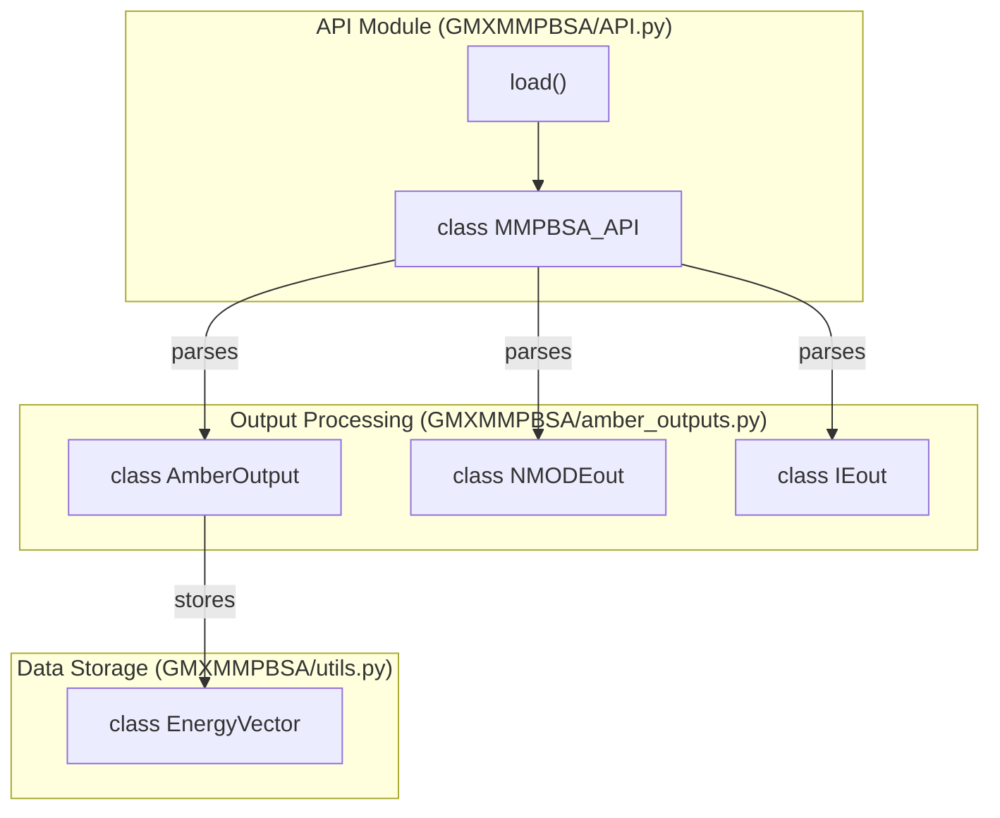

# API Reference (MMPBSA_API)

<details>
<summary>Relevant source files</summary>

The following files were used as context for generating this wiki page:

- [GMXMMPBSA/API.py](GMXMMPBSA/API.py)
- [GMXMMPBSA/amber_outputs.py](GMXMMPBSA/amber_outputs.py)
- [GMXMMPBSA/exceptions.py](GMXMMPBSA/exceptions.py)
- [GMXMMPBSA/output_file.py](GMXMMPBSA/output_file.py)
- [docs/analyzer.md](docs/analyzer.md)
- [docs/api.md](docs/api.md)
- [docs/examples/API/README.md](docs/examples/API/README.md)
- [docs/howworks.md](docs/howworks.md)
- [examples/API/COMPACT_MMXSA_RESULTS.mmxsa](examples/API/COMPACT_MMXSA_RESULTS.mmxsa)
- [examples/API/README.md](examples/API/README.md)
- [examples/API/extract_api_data.py](examples/API/extract_api_data.py)
- [examples/API/gb_delta_total.csv](examples/API/gb_delta_total.csv)

</details>


## Purpose and Scope

This document provides technical reference for the `MMPBSA_API` class and the high-level `API` module, which enable programmatic access to `gmx_MMPBSA` calculation results. The API allows custom Python scripts to load, filter, and analyze energy data, entropy calculations, and decomposition results without rerunning calculations. It exposes the free energy data (optionally to numpy arrays) so that users can leverage the full power of Python's scientific extensions (e.g., `numpy`, `scipy`, `pandas`) [GMXMMPBSA/API.py:1-6]().

**Related Documentation:**
- For command-line result analysis, see [Analyzer Application (gmx_MMPBSA_ana)](#4)
- For output file formats, see [Output Files and Data Formats](#5)
- For calculation setup, see [Core Application (gmx_MMPBSA)](#3)

Sources: [GMXMMPBSA/API.py:1-6]().

---

## Overview

The `MMPBSA_API` class provides a high-level interface for loading `gmx_MMPBSA` results from either binary `.mmxsa` files or calculation directories. It exposes energy data as pandas DataFrames, enabling custom statistical analysis, visualization, and data manipulation.

**Key Capabilities:**
- Load results from completed calculations via `load()` or `MMPBSA_API.load_file()` [GMXMMPBSA/API.py:230-252]().
- Filter data by calculation type, energy model, molecule, and energy term [GMXMMPBSA/API.py:294-315]().
- Access raw per-frame energies or statistical summaries [GMXMMPBSA/API.py:87-108]().
- Retrieve entropy calculations (NMODE, QH, IE, C2) [GMXMMPBSA/API.py:411-440]().
- Process decomposition analysis data [GMXMMPBSA/API.py:1050-1070]().
- Handle both normal and mutant calculations [GMXMMPBSA/API.py:1354-1370]().

Sources: [GMXMMPBSA/API.py:230-1370]().

---

## Basic Usage Workflow

### Natural Language to Code Entity Mapping: Initialization and Loading

| System Name | Code Entity | File Reference |
| :--- | :--- | :--- |
| High-level Loader | `GMXMMPBSA.API.load` | [GMXMMPBSA/API.py:1444-1454]() |
| Core API Class | `GMXMMPBSA.API.MMPBSA_API` | [GMXMMPBSA/API.py:195-200]() |
| Result Metadata | `get_info()` | [GMXMMPBSA/API.py:253-259]() |
| Input Parameters | `get_input()` | [GMXMMPBSA/API.py:261-268]() |
| Energy Data | `get_energy()` | [GMXMMPBSA/API.py:294-315]() |

Sources: [GMXMMPBSA/API.py:195-1454]().

### API Usage Pattern

The recommended way to load data in modern versions of `gmx_MMPBSA` is using the `load()` function in the `API` module.

```python
from GMXMMPBSA import API

# Load from a compact binary file
api = API.load("COMPACT_MMXSA_RESULTS.mmxsa")

# Get metadata
input_settings = api.get_input()
calculation_info = api.get_info()

# Retrieve energy data (e.g. GB binding energy)
# Returns (map, data, summary, component_summary)
_, energy_data, summary, _ = api.get_energy(model='gb', mol='delta')

# Access delta energy DataFrame
gb_delta_df = energy_data['normal']['gb']
print(summary['normal']['gb'])
```

Sources: [GMXMMPBSA/API.py:1444-1454](), [GMXMMPBSA/API.py:253-315]().

---

## Data Loading and Serialization

### File Format Support

The API supports two primary input formats:
1. **Info Files (`_GMXMMPBSA_info`)**: A text-based metadata file that points to external calculation outputs [GMXMMPBSA/API.py:230-252]().
2. **Compact Binary (`.mmxsa`)**: A serialized pickle file containing the entire result payload [GMXMMPBSA/API.py:1031-1048]().

### Compact Result Generation
The compact `.mmxsa` file is generated at the end of a calculation by the `data2pkl` function. It stores the `INPUT` namelists, `FILES` namespace, frame counts, and calculation types [GMXMMPBSA/output_file.py:31-51]().


Sources: [GMXMMPBSA/output_file.py:31-51](), [GMXMMPBSA/API.py:1031-1048]().

---

## Energy and Entropy Data Structures

### Result Types and Components

The API organizes data into hierarchical keys based on the calculation context.

| Category | Keys | Description |
| :--- | :--- | :--- |
| **Result Type** | `normal`, `mutant`, `mutant-normal` | Original, mutated (alanine scan), or difference [GMXMMPBSA/API.py:322-328]() |
| **Molecule** | `complex`, `receptor`, `ligand`, `delta` | Component or binding difference [GMXMMPBSA/API.py:334-338]() |
| **Energy Terms** | `BOND`, `VDWAALS`, `EEL`, `EGB`, `EPB`, etc. | Individual physical components [GMXMMPBSA/amber_outputs.py:44-62]() |

Sources: [GMXMMPBSA/API.py:322-338](), [GMXMMPBSA/amber_outputs.py:44-62]().

### The EnergyVector System
All per-frame energy data is stored in `EnergyVector` objects, which are specialized list derivatives designed for statistical operations on molecular dynamics frames [GMXMMPBSA/amber_outputs.py:105-107]().


Sources: [GMXMMPBSA/amber_outputs.py:105-107](), [GMXMMPBSA/utils.py:52-151]().

---

## Technical Reference: Methods

### get_energy()
Retrieves energy calculations with extensive filtering and frame range selection [GMXMMPBSA/API.py:294-315]().

**Signature:**
```python
def get_energy(etype=None, model=None, mol=None, term=None, 
               remove_empty_terms=True, threshold=0.01, 
               startframe=None, endframe=None, interval=1)
```

**Return Structure:**
- `map`: Dictionary of available keys [GMXMMPBSA/API.py:397]()
- `data`: Nested dictionary of pandas DataFrames (per-frame values) [GMXMMPBSA/API.py:399]()
- `summary`: Statistical summaries (Average, SD, SEM) [GMXMMPBSA/API.py:401]()

Sources: [GMXMMPBSA/API.py:294-409]().

### get_entropy()
Retrieves entropy results for `nmode`, `qh`, `ie` (Interaction Entropy), or `c2` [GMXMMPBSA/API.py:411-440]().

**Method Keys:**
- `nmode`: Normal Mode Analysis [GMXMMPBSA/API.py:454]()
- `qh`: Quasi-Harmonic [GMXMMPBSA/API.py:454]()
- `ie`: Interaction Entropy [GMXMMPBSA/API.py:458]()
- `c2`: C2 Entropy [GMXMMPBSA/API.py:465]()

Sources: [GMXMMPBSA/API.py:411-476]().

### get_decomp_energy()
Accesses decomposition data. This method handles the complex multi-indexing required for per-residue and pairwise analysis [GMXMMPBSA/API.py:1050-1070]().

**Residue Naming:**
Residues are identified using the format `MOL:CHAIN:RESNAME:RESNUM` (e.g., `R:A:ARG:10`) [GMXMMPBSA/API.py:1145-1150]().

Sources: [GMXMMPBSA/API.py:1050-1150]().

---

## Data Management and Performance

The API provides options to handle large datasets (e.g., 200,000+ frames) by offloading data to disk [GMXMMPBSA/API.py:135-158]().

| Setting | Default | Description |
| :--- | :--- | :--- |
| `inmemory` | `False` | If True, stores DataFrames in RAM. If False, uses Parquet files [GMXMMPBSA/API.py:135-140]() |
| `temp_path` | `Path` | Location for temporary Parquet files [GMXMMPBSA/API.py:136]() |

### Performance Optimization
`gmx_MMPBSA_ana` and the API were optimized in version 1.5.5 to improve data processing speeds significantly (up to 265x for large energy datasets) by:
- Implementing multithreading for data processing [GMXMMPBSA/API.py:31]()
- Optimizing access to subsets in pandas DataFrames [GMXMMPBSA/API.py:173-175]()
- Using disk-backed storage via Parquet engines (`pyarrow` or `fastparquet`) [GMXMMPBSA/API.py:65-76]()

Sources: [GMXMMPBSA/API.py:31-158](), [docs/analyzer.md:21-45]().

---

## Summary of Code Entities



Sources: [GMXMMPBSA/API.py:1-1454](), [GMXMMPBSA/amber_outputs.py:65-108](), [GMXMMPBSA/utils.py:52-60]().

---