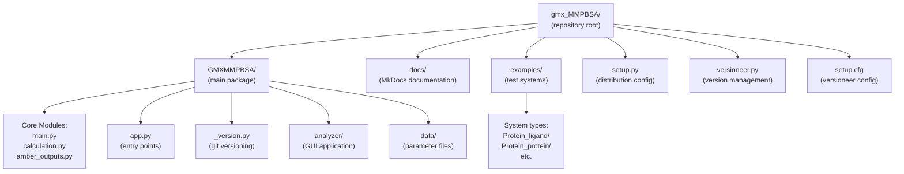
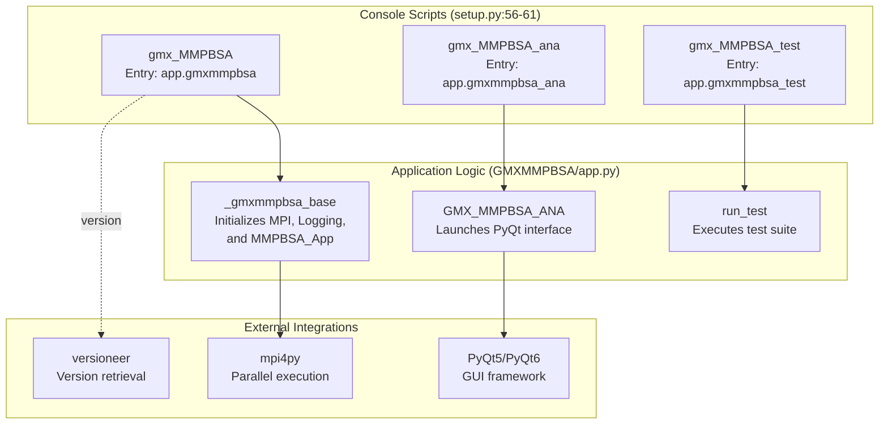
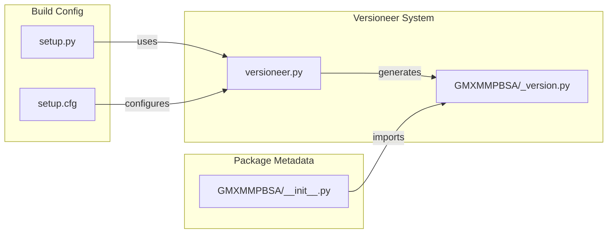

# Developer Guide

Relevant source files

The following files were used as context for generating this wiki page:

- [CONTRIBUTING.md](CONTRIBUTING.md)
- [GMXMMPBSA/__init__.py](GMXMMPBSA/__init__.py)
- [GMXMMPBSA/_version.py](GMXMMPBSA/_version.py)
- [GMXMMPBSA/app.py](GMXMMPBSA/app.py)
- [MANIFEST.in](MANIFEST.in)
- [setup.cfg](setup.cfg)
- [setup.py](setup.py)
- [versioneer.py](versioneer.py)

This guide provides technical documentation for developers who want to contribute to, extend, or deeply understand the gmx_MMPBSA codebase. It covers the internal architecture, development workflows, and implementation details necessary for working with the source code.

For end-user documentation on running gmx_MMPBSA, see [Core Application (gmx_MMPBSA)](#3). For information on using the API to access calculation results programmatically, see [API Reference (MMPBSA_API)](#7.5). For testing your installation, see [Validation with gmx_MMPBSA_test](#2.2).

---

## Repository Organization

The gmx_MMPBSA repository follows a standard Python package structure with distinct directories for source code, documentation, tests, and examples. The project requires Python 3.11 as specified in the build configuration [setup.py:26-27]().

**Directory Structure**

**Key Files and Their Roles**

| File | Purpose |
|------|---------|
| `GMXMMPBSA/app.py` | Console script entry points: `gmxmmpbsa()`, `gmxmmpbsa_ana()`, `gmxmmpbsa_test()` [GMXMMPBSA/app.py:116-168]() |
| `setup.py` | Package metadata, dependencies (numpy, pandas, etc.), and console script registration [setup.py:29-62]() |
| `versioneer.py` | Tool for managing recorded version numbers in setuptools-based projects [versioneer.py:17-21]() |
| `GMXMMPBSA/_version.py` | Git implementation for computing version numbers from source trees [GMXMMPBSA/_version.py:12-13]() |
| `GMXMMPBSA/data/` | Force field parameter files, xvv files for RISM, and GUI styles [setup.py:34]() |

Sources: [setup.py:26-62](), [GMXMMPBSA/app.py:116-168](), [versioneer.py:1-21](), [GMXMMPBSA/_version.py:1-60]()

---

## Application Architecture

gmx_MMPBSA consists of three independent console applications that share common library code but serve distinct purposes. These are registered as entry points in the package configuration [setup.py:56-61]().

**Three-Application System**

**Execution Entry Points**

The primary entry points are defined in `GMXMMPBSA/app.py`:
- `gmxmmpbsa()`: The main calculation engine [GMXMMPBSA/app.py:116-118]().
- `gmxmmpbsa_ana()`: The GUI analyzer, requiring PyQt5 or PyQt6 [GMXMMPBSA/app.py:123-151]().
- `gmxmmpbsa_test()`: The testing utility [GMXMMPBSA/app.py:154-168]().

Sources: [setup.py:56-61](), [GMXMMPBSA/app.py:40-168](), [GMXMMPBSA/__init__.py:24-35]()

---

## Build and Distribution System

The project uses `versioneer` to handle versioning automatically based on Git tags. This ensures that the version string in `GMXMMPBSA.__version__` is always synchronized with the repository state [GMXMMPBSA/__init__.py:34-35]().

**Versioning and Setup Configuration**

**Key Distribution Components**
- **Dependency Management**: Dependencies like `numpy==1.26.4`, `pandas==1.5.3`, and `mpi4py==4.0.1` are strictly pinned or ranged in `setup.py` [setup.py:50-55]().
- **Versioneer Config**: `setup.cfg` defines the version file source and tag prefix [setup.cfg:1-7]().
- **Manifest**: `MANIFEST.in` ensures `versioneer.py` and `_version.py` are included in source distributions [MANIFEST.in:1-3]().

Sources: [setup.py:29-62](), [setup.cfg:1-7](), [versioneer.py:98-113](), [GMXMMPBSA/_version.py:47-59]()

---

## Detailed Developer Topics

For more specific information on different aspects of development, please refer to the following child pages:

### [Project Structure](#8.1)
Detailed overview of the repository organization, package structure, and key modules. Explains the role of each directory and the relationship between core calculation modules and the analyzer.

### [Building and Distribution](#8.2)
Deep dive into the `setup.py` configuration, `versioneer` integration for automatic versioning, and the process for creating and distributing packages.

### [Documentation System](#8.3)
Information on the MkDocs setup, theme customization, and how to contribute to the documentation. Covers the use of the Material theme and version management for the docs site.

### [Testing Infrastructure](#8.4)
Explains the `gmx_MMPBSA_test` system, how examples are organized, and the process for adding new tests to ensure code stability.

---

## Contributing

Developers wishing to contribute should refer to `CONTRIBUTING.md`. The project welcomes:
- Bug reports and feature requests via GitHub Issues [CONTRIBUTING.md:6-7]().
- Improvements to the code or documentation via Pull Requests [CONTRIBUTING.md:9-10]().
- New binding free energy (BFE) methods [CONTRIBUTING.md:11]().

Before submitting a Pull Request, please ensure you have read the documentation and existing discussions [CONTRIBUTING.md:19-24]().

Sources: [CONTRIBUTING.md:1-39]()

---