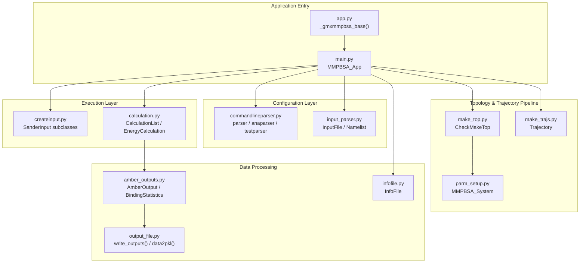
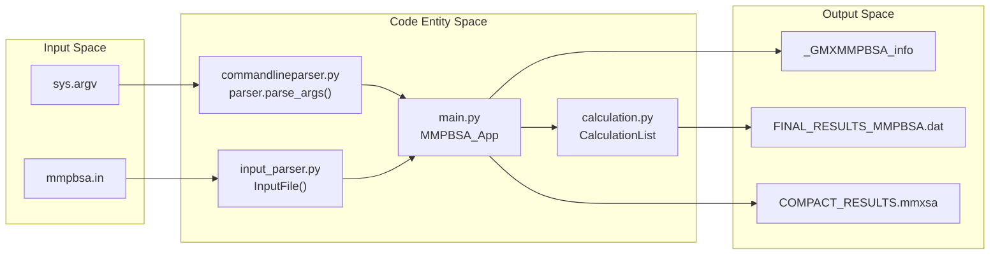

# Project Structure

<details>
<summary>Relevant source files</summary>

The following files were used as context for generating this wiki page:

- [GMXMMPBSA/__init__.py](GMXMMPBSA/__init__.py)
- [GMXMMPBSA/_version.py](GMXMMPBSA/_version.py)
- [GMXMMPBSA/app.py](GMXMMPBSA/app.py)
- [MANIFEST.in](MANIFEST.in)
- [setup.cfg](setup.cfg)
- [setup.py](setup.py)
- [versioneer.py](versioneer.py)

</details>


This page provides an overview of the gmx_MMPBSA repository organization, package structure, and key modules. It serves as a map for developers who want to understand how the codebase is organized and where to find specific functionality.

For information about building and distributing the package, see [8.2 Building and Distribution](). For details about the documentation system, see [8.3 Documentation System]().

## Repository Layout

The gmx_MMPBSA repository follows a standard Python package structure with setuptools-based installation. It requires Python 3.11 [setup.py:26-27]().

```
gmx_MMPBSA/
├── GMXMMPBSA/              # Main package directory
│   ├── __init__.py         # Package metadata and exports
│   ├── app.py              # Application entry points and CLI logic
│   ├── main.py             # Core application orchestration (MMPBSA_App)
│   ├── commandlineparser.py# Argument parsing for all apps
│   ├── input_parser.py     # mmpbsa.in parsing and validation
│   ├── make_top.py         # GROMACS to AMBER topology conversion
│   ├── make_trajs.py       # Trajectory processing and MPI distribution
│   ├── calculation.py      # Execution of sander/cpptraj/nmode
│   ├── createinput.py      # Generation of .mdin and .in files
│   ├── amber_outputs.py    # Parsers for AMBER output files
│   ├── output_file.py      # Result writing (DAT, CSV, MMXSA)
│   ├── parm_setup.py       # Topology manipulation and masking
│   ├── utils.py            # EnergyVector and common utilities
│   ├── API.py              # Programmatic API (MMPBSA_API)
│   ├── timer.py            # Performance profiling
│   ├── infofile.py         # State management and checkpoints
│   ├── exceptions.py       # Custom exception hierarchy
│   ├── tester.py           # Logic for gmx_MMPBSA_test
│   ├── analyzer/           # GUI analyzer source code
│   │   ├── gui.py          # Main PyQt window
│   │   ├── utils.py        # GUI data loading
│   │   └── style/          # CSS stylesheets
│   └── data/               # XVV files and template data
├── setup.py                # Installation and dependency config
├── setup.cfg               # Versioneer configuration
├── versioneer.py           # Git-based versioning script
└── MANIFEST.in             # Package distribution manifest
```

**Sources:** [setup.py:29-62](), [GMXMMPBSA/__init__.py:24-35](), [MANIFEST.in:1-3](), [setup.cfg:1-7]()

## Console Script Entry Points

The package registers four console scripts that become available system-wide after installation via the `entry_points` configuration in `setup.py` [setup.py:56-61]().

| Script Name | Entry Point Function | Module | Purpose |
|------------|-------------------|---------------|---------|
| `gmx_MMPBSA` | `gmxmmpbsa` | `GMXMMPBSA.app` | Main calculation driver for GROMACS files |
| `amber_MMPBSA` | `gmxmmpbsa_amber` | `GMXMMPBSA.app` | Calculation driver for AMBER files |
| `gmx_MMPBSA_ana` | `gmxmmpbsa_ana` | `GMXMMPBSA.app` | GUI analyzer for result visualization |
| `gmx_MMPBSA_test` | `gmxmmpbsa_test` | `GMXMMPBSA.app` | Installation validation utility |

**Sources:** [setup.py:56-61](), [GMXMMPBSA/app.py:116-168]()

## Core Application Module Hierarchy

The following diagram illustrates the relationship between the main entry point and the functional modules during a calculation run.



**Sources:** [GMXMMPBSA/app.py:40-113](), [GMXMMPBSA/__init__.py:24-26]()

## Module-by-Module Breakdown

### Entry Point and Orchestration

#### `app.py` - CLI Wrapper
This module handles the initial logging setup, MPI initialization (using `mpi4py` or a `fake_mpi` fallback for serial runs), and directs execution to the appropriate sub-application [GMXMMPBSA/app.py:40-55]().

**Key Functions:**
- `_gmxmmpbsa_base(parser, engine)`: The core logic shared by `gmx_MMPBSA` and `amber_MMPBSA`. It instantiates `MMPBSA_App` and calls the high-level workflow methods [GMXMMPBSA/app.py:40-113]().
- `gmxmmpbsa_ana()`: Initializes the `QApplication` and launches the GUI analyzer [GMXMMPBSA/app.py:123-151]().
- `gmxmmpbsa_test()`: Launches the automated testing suite [GMXMMPBSA/app.py:154-168]().

#### `main.py` - Core Logic Orchestrator
**Primary Class:** `MMPBSA_App`
The `MMPBSA_App` class coordinates the sequential steps of the calculation. It is responsible for calling `make_prmtops()`, `file_setup()`, and `run_mmpbsa()` in the correct order [GMXMMPBSA/app.py:90-103]().

**Sources:** [GMXMMPBSA/app.py:40-168]()

### Calculation Subsystems

#### `calculation.py` - Execution Engine
This module contains the `CalculationList` class, which manages a collection of `Calculation` objects (e.g., `EnergyCalculation`, `NmodeCalc`). It handles the execution of external tools like `sander`, `cpptraj`, and `mmpbsa_py_energy` [GMXMMPBSA/__init__.py:24-26]().

#### `amber_outputs.py` - Result Parsing
Contains classes designed to parse the text-based output files from AMBER.
- `AmberOutput`: Base class for all parsers.
- `BindingStatistics`: Aggregates parsed data to calculate final binding free energies and statistical uncertainties [GMXMMPBSA/__init__.py:24-26]().

**Sources:** [GMXMMPBSA/__init__.py:24-26](), [GMXMMPBSA/app.py:111-112]()

### GUI Analyzer

#### `analyzer/gui.py`
The entry point for the visual analysis tool. It uses `PyQt6` (or `PyQt5` as fallback) to provide a multi-document interface (MDI) for exploring energy components, residue decomposition, and correlations [GMXMMPBSA/app.py:125-149]().

**Sources:** [GMXMMPBSA/app.py:123-151]()

## Data Flow: From CLI to Results

The following diagram maps the internal data flow from the command line interface through the internal data structures to the final output files.



**Sources:** [GMXMMPBSA/app.py:65-113](), [GMXMMPBSA/infofile.py:26](), [GMXMMPBSA/output_file.py:31-52]()

## Versioning System

The project uses `versioneer` to manage version strings dynamically based on Git tags. This ensures that the version reported by the tool always matches the repository state [setup.py:20-32]().

- **Configuration**: Defined in `setup.cfg` under the `[versioneer]` section [setup.cfg:1-7]().
- **Source**: `GMXMMPBSA/_version.py` is the generated file containing the version metadata [GMXMMPBSA/_version.py:1-60]().
- **Integration**: `setup.py` calls `versioneer.get_version()` to set the package version during build/install [setup.py:31]().

**Sources:** [setup.py:20-32](), [setup.cfg:1-7](), [GMXMMPBSA/_version.py:1-60](), [versioneer.py:1-125]()

---