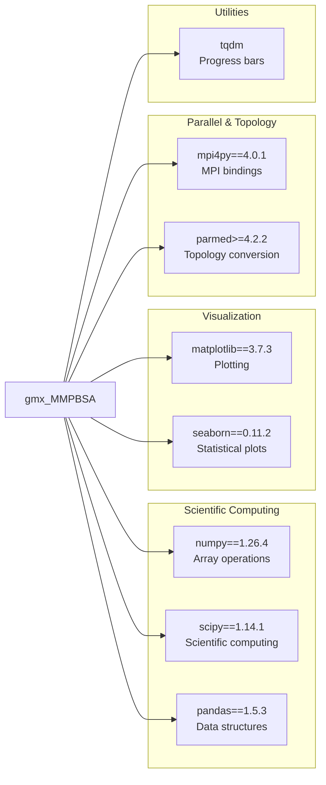
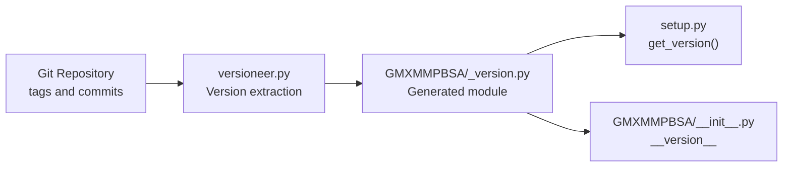

# Building and Distribution

<details>
<summary>Relevant source files</summary>

The following files were used as context for generating this wiki page:

- [.github/workflows/gh-pages.yml](.github/workflows/gh-pages.yml)
- [.github/workflows/gh-pages_tags.yml](.github/workflows/gh-pages_tags.yml)
- [.github/workflows/python-publish.yml](.github/workflows/python-publish.yml)
- [GMXMMPBSA/__init__.py](GMXMMPBSA/__init__.py)
- [GMXMMPBSA/_version.py](GMXMMPBSA/_version.py)
- [GMXMMPBSA/app.py](GMXMMPBSA/app.py)
- [MANIFEST.in](MANIFEST.in)
- [docs/requirements.txt](docs/requirements.txt)
- [scripts/conda_pip_install.sh](scripts/conda_pip_install.sh)
- [setup.cfg](setup.cfg)
- [setup.py](setup.py)
- [versioneer.py](versioneer.py)

</details>


This page documents the build configuration, version management, and distribution mechanisms for gmx_MMPBSA. It covers how the package is configured for installation, how versions are managed, and the various channels through which users can obtain the software. For information about the project's file organization, see [Project Structure](#8.1). For details on the documentation build system, see [Documentation System](#8.3).

## Package Configuration Overview

The gmx_MMPBSA package is built using Python's standard `setuptools` infrastructure, with enhanced version management provided by `versioneer`. The build configuration enforces strict dependency requirements to ensure compatibility across the AmberTools and GROMACS ecosystems.

### setup.py Structure

```mermaid
graph TB
    SETUP["setup.py<br/>Main configuration"]
    VERSION["versioneer<br/>Git-based versioning"]
    METADATA["Package Metadata<br/>name, author, license"]
    DEPS["install_requires<br/>Pinned dependencies"]
    PKGS["find_packages()<br/>Auto-discovery"]
    DATA["package_data<br/>Non-Python resources"]
    ENTRY["entry_points<br/>Console scripts"]
    
    SETUP --> VERSION
    SETUP --> METADATA
    SETUP --> DEPS
    SETUP --> PKGS
    SETUP --> DATA
    SETUP --> ENTRY
    
    VERSION --> VERSION_STR["version string<br/>from git tags"]
    VERSION --> CMDCLASS["cmdclass<br/>build commands"]
    
    DEPS --> NUMPY["numpy==1.26.4"]
    DEPS --> PANDAS["pandas==1.5.3"]
    DEPS --> MPT["matplotlib==3.7.3"]
    DEPS --> MPI["mpi4py==4.0.1"]
    DEPS --> PARMED["parmed>=4.2.2"]
    DEPS --> OTHERS["scipy, seaborn, tqdm"]
    
    DATA --> DATAFILES["data/*"]
    DATA --> STYLES["analyzer/style/*"]
    DATA --> BASH["GMXMMPBSA.sh"]
    
    ENTRY --> MAIN["gmx_MMPBSA"]
    ENTRY --> AMBER["amber_MMPBSA"]
    ENTRY --> ANA["gmx_MMPBSA_ana"]
    ENTRY --> TEST["gmx_MMPBSA_test"]
```



Sources: [setup.py:19-62]()

The [setup.py:29-62]() file contains the complete package configuration. Key components include:

| Configuration Element | Purpose | Location |
|----------------------|---------|----------|
| Package discovery | Automatic discovery of Python packages | [setup.py:33]() |
| Version management | Git-based versioning via versioneer | [setup.py:31-32]() |
| Dependencies | Pinned scientific stack versions | [setup.py:50-55]() |
| Console scripts | Four command-line entry points | [setup.py:56-61]() |
| Package data | Non-Python resources (data files, styles) | [setup.py:34]() |

## Python Version Enforcement

gmx_MMPBSA strictly requires Python 3.11. This requirement is enforced at installation time:

```python
# From setup.py
if sys.version_info[:2] != (3, 11):
    raise RuntimeError("gmx_MMPBSA requires python == 3.11")
```

Sources: [setup.py:26-27]()

This strict enforcement prevents installation with incompatible Python versions, ensuring consistent behavior across all deployments. The requirement is specified as an exact match for the minor version (3.11) due to compatibility constraints with the scientific stack and AmberTools integration.

## Dependency Management

### Core Dependencies

The package declares core dependencies with specific version pins to maintain stability:



Sources: [setup.py:50-55]()

**Version Pinning Strategy:**

- **Exact pins** (`==`): Used for `numpy`, `pandas`, `matplotlib`, `scipy`, `seaborn`, and `mpi4py` to ensure consistent numerical results and avoid API breakage.
- **Minimum version** (`>=`): Used for `parmed` to allow bug fixes while maintaining compatibility with topology conversion logic.
- **No pin**: Used for `tqdm` which has a stable API.

The [setup.py:50-55]() `install_requires` list specifies these dependencies.

### Optional Dependencies

PyQt (PyQt5 or PyQt6) is an optional dependency required only for the analyzer GUI (`gmx_MMPBSA_ana`). The application logic in `app.py` dynamically checks for these modules:

```python
# From GMXMMPBSA/app.py
try:
    from PyQt6.QtWidgets import QApplication
    pyqt = True
except:
    try:
        from PyQt5.QtWidgets import QApplication
        pyqt = True
    except:
        pyqt = False
```

Sources: [GMXMMPBSA/app.py:124-132]()

If neither is found, the analyzer is disabled with a `GMXMMPBSA_ERROR` [GMXMMPBSA/app.py:134-136](). This separation allows headless installations on compute nodes.

## Version Management with Versioneer

gmx_MMPBSA uses [versioneer](https://github.com/python-versioneer/python-versioneer) for automatic version string generation from Git repository state.



Sources: [setup.py:20](), [setup.py:31-32](), [GMXMMPBSA/__init__.py:34-35]()

**Versioneer Integration:**

1. [setup.py:20]() imports `versioneer`.
2. [setup.py:31]() retrieves the version: `version=versioneer.get_version()`.
3. [GMXMMPBSA/__init__.py:34-35]() imports the generated version: `from . import _version; __version__ = _version.get_versions()['version']`.
4. [setup.cfg:1-7]() provides the configuration for `versioneer`, specifying the VCS as `git` and the style as `pep440`.

## Console Scripts Registration

The package registers four command-line applications as console scripts entry points in [setup.py:56-61]():

| Command | Module Path | Purpose |
|---------|-------------|---------|
| `gmx_MMPBSA` | `GMXMMPBSA.app:gmxmmpbsa` | Core calculation application (GROMACS engine) |
| `amber_MMPBSA` | `GMXMMPBSA.app:gmxmmpbsa_amber` | Core calculation application (AMBER engine) |
| `gmx_MMPBSA_ana` | `GMXMMPBSA.app:gmxmmpbsa_ana` | Graphical analyzer |
| `gmx_MMPBSA_test` | `GMXMMPBSA.app:gmxmmpbsa_test` | Installation validator |

The `app.py` module acts as the router for these commands. For example, `gmxmmpbsa()` and `gmxmmpbsa_amber()` both call the internal `_gmxmmpbsa_base` function with different engine parameters [GMXMMPBSA/app.py:116-121]().

## Package Data Inclusion

Non-Python resources are included in the distribution through the `package_data` directive in [setup.py:34]():

- **`data/*`**: General data files.
- **`data/gmxMMPBSA/*`**: MMPBSA-specific configuration and reference files.
- **`data/xvv_files/*`**: 3D-RISM susceptibility files.
- **`analyzer/style/*`**: Qt stylesheet files for GUI theming.
- **`GMXMMPBSA.sh`**: Bash completion script.

The inclusion of these files is also supported by [MANIFEST.in:1-3](), which ensures `versioneer.py` and `_version.py` are included in source distributions.

## Distribution and CI/CD

The repository utilizes GitHub Actions for automated documentation deployment and package publishing.

### Documentation Deployment
The workflow defined in [.github/workflows/gh-pages.yml:1-36]() automates documentation updates. It:
1. Installs documentation dependencies from [docs/requirements.txt:1-6]().
2. Uses `mike` to deploy documentation versions [ .github/workflows/gh-pages.yml:34-35]().
3. Supports version-specific documentation through release tags [.github/workflows/gh-pages_tags.yml:1-38]().

### Package Publishing
The workflow in [.github/workflows/python-publish.yml:1-50]() handles PyPI distribution when a release is created:
1. Checks out the release tag [.github/workflows/python-publish.yml:15-20]().
2. Builds the package using the `build` module [.github/workflows/python-publish.yml:42]().
3. Publishes the resulting `dist/*` files to PyPI using `twine` [.github/workflows/python-publish.yml:50]().

### Conda and Pip Installation
For reproducible setups, the project provides a shell script [scripts/conda_pip_install.sh:1-32]() that demonstrates the recommended installation flow:
1. Create a Conda environment with Python 3.11 [scripts/conda_pip_install.sh:9]().
2. Install non-pip packages (`ambertools`, `gromacs`) via Conda [scripts/conda_pip_install.sh:17-18]().
3. Install scientific dependencies and `gmx_MMPBSA` via Pip [scripts/conda_pip_install.sh:21-28]().
4. Validate the installation using `gmx_MMPBSA_test` [scripts/conda_pip_install.sh:31]().

Sources: [setup.py:19-62](), [GMXMMPBSA/app.py:1-169](), [.github/workflows/python-publish.yml:1-50](), [scripts/conda_pip_install.sh:1-32]()

---