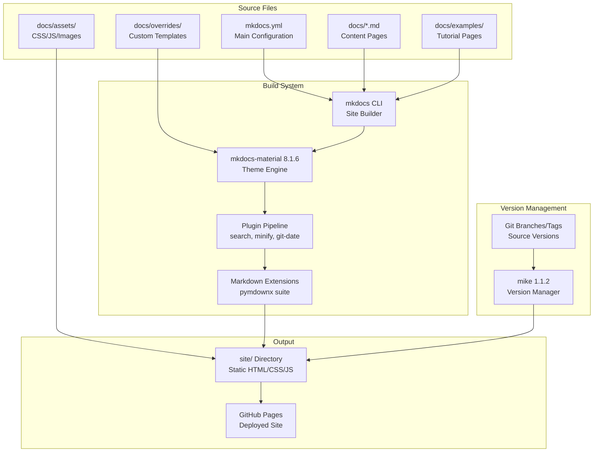
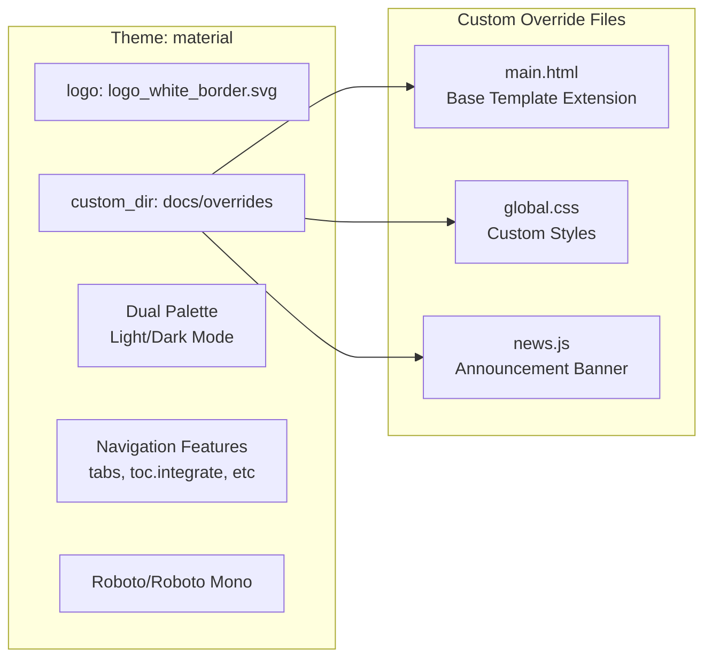
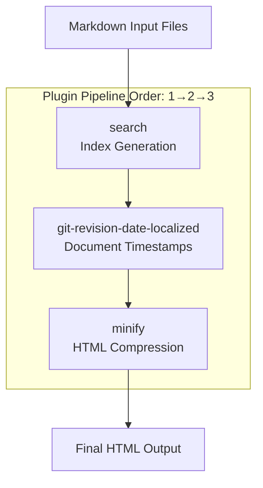

# Documentation System

<details>
<summary>Relevant source files</summary>

The following files were used as context for generating this wiki page:

- [.github/workflows/gh-pages.yml](.github/workflows/gh-pages.yml)
- [.github/workflows/gh-pages_tags.yml](.github/workflows/gh-pages_tags.yml)
- [.github/workflows/python-publish.yml](.github/workflows/python-publish.yml)
- [docs/assets/js/news.js](docs/assets/js/news.js)
- [docs/examples/README.md](docs/examples/README.md)
- [docs/overrides/main.html](docs/overrides/main.html)
- [docs/overrides/stylesheets/global.css](docs/overrides/stylesheets/global.css)
- [docs/requirements.txt](docs/requirements.txt)
- [mkdocs.yml](mkdocs.yml)
- [notebooks/gmx_MMPBSA_Colab.ipynb](notebooks/gmx_MMPBSA_Colab.ipynb)

</details>


This page documents the static documentation system used to generate the gmx_MMPBSA documentation website. The system is built on MkDocs Material with multi-version support via Mike and automated deployment through GitHub Actions.

## System Overview

The gmx_MMPBSA documentation uses a static site generation approach based on **MkDocs Material 8.1.6**, providing a searchable, versioned documentation website. The system transforms Markdown files in the `docs/` directory into a deployable HTML site with navigation, search, syntax highlighting, and custom styling.



**Sources:** [mkdocs.yml:1-231](), [docs/requirements.txt:1-7]()

## Core Configuration

The documentation system is configured through `mkdocs.yml`, which defines site metadata, theme settings, navigation structure, and plugin behavior.

### Site Metadata and Repository

```yaml
site_name: gmx_MMPBSA Documentation
site_url: https://valdes-tresanco-ms.github.io/gmx_MMPBSA/dev/
repo_name: gmx_MMPBSA
repo_url: https://github.com/Valdes-Tresanco-MS/gmx_MMPBSA
```

The `site_url` includes `/dev/` as the base path, indicating that Mike manages multiple versions at different URL paths [mkdocs.yml:4-4](). The `edit_uri` is set to an empty string to disable the "Edit on GitHub" links [mkdocs.yml:13-13]().

**Sources:** [mkdocs.yml:3-13]()

### Theme Configuration

The Material theme is customized with specific features and styling:



Key theme features enabled in [mkdocs.yml:35-52]():

| Feature | Purpose |
|---------|---------|
| `content.code.annotate` | Inline code annotations |
| `content.tabs.link` | Synchronized content tabs |
| `navigation.expand` | Expanded sidebar by default |
| `navigation.sections` | Section grouping in sidebar |
| `navigation.tabs` | Top-level navigation tabs |
| `navigation.top` | Back-to-top button |
| `search.highlight` | Highlight search terms in results |
| `search.suggest` | Search suggestions |
| `toc.integrate` | Integrate TOC into sidebar |

The dual palette configuration allows users to toggle between light and dark modes, with color schemes defined as `primary: black` and `accent: black` for both modes [mkdocs.yml:53-78]().

**Sources:** [mkdocs.yml:19-85](), [docs/overrides/main.html:1-29]()

## Plugin System

The documentation uses three core plugins that extend MkDocs functionality:



### Plugin Details

1. **search** - Default MkDocs search plugin that creates a search index from all documentation pages [mkdocs.yml:88-88](). Configured with `search_index_only: true` to prevent separate search page generation [mkdocs.yml:31-31]().

2. **git-revision-date-localized** - Adds creation and modification timestamps to each page footer based on git history [mkdocs.yml:89-91]():
   ```yaml
   - git-revision-date-localized:
       type: datetime
       enable_creation_date: true
   ```

3. **minify** - Compresses HTML output to reduce file sizes [mkdocs.yml:92-94]():
   ```yaml
   - minify:
       minify_html: true
   ```

**Sources:** [mkdocs.yml:87-94](), [docs/requirements.txt:1-5]()

## Markdown Extensions

The documentation system uses multiple markdown extensions, enabling advanced formatting capabilities:

### Code and Syntax Extensions

| Extension | Capability |
|-----------|-----------|
| `pymdownx.highlight` | Syntax highlighting with `anchor_linenums: true` [mkdocs.yml:127-128]() |
| `pymdownx.inlinehilite` | Inline code highlighting [mkdocs.yml:129-129]() |
| `pymdownx.superfences` | Code blocks with custom fences (including mermaid) [mkdocs.yml:137-141]() |

### Content Formatting Extensions

| Extension | Capability |
|-----------|-----------|
| `admonition` | Callout boxes (!!! syntax) [mkdocs.yml:108-108]() |
| `pymdownx.details` | Collapsible details blocks [mkdocs.yml:123-123]() |
| `pymdownx.tabbed` | Tabbed content blocks [mkdocs.yml:142-143]() |
| `pymdownx.arithmatex` | LaTeX math rendering [mkdocs.yml:117-118]() |
| `pymdownx.emoji` | Twemoji and SVG emoji support [mkdocs.yml:124-126]() |

### Special Features

The `pymdownx.superfences` extension includes custom fence configuration for mermaid diagrams [mkdocs.yml:138-141]():

```yaml
custom_fences:
  - name: mermaid
    class: mermaid
    format: !!python/name:pymdownx.superfences.fence_code_format
```

**Sources:** [mkdocs.yml:107-147]()

## Version Management with Mike

Mike provides multi-version documentation deployment, allowing users to browse documentation for different releases.

### Deployment Automation

The system uses GitHub Actions to automate documentation deployment. There are two primary workflows:

1. **Master Branch Workflow (`gh-pages.yml`)**: Triggered on pushes to the master branch. It deploys to the `dev` version and sets it as default [ .github/workflows/gh-pages.yml:1-36]().
2. **Release Workflow (`gh-pages_tags.yml`)**: Triggered when a new release is published. It extracts the tag name and deploys it as a new version using Mike [ .github/workflows/gh-pages_tags.yml:1-38]().

### Workflow Implementation

The `updatedoc` job in the master workflow performs the following steps:
- Checks out the repository with `fetch-depth: 0` (required for `git-revision-date-localized`) [ .github/workflows/gh-pages.yml:13-18]().
- Installs dependencies from `docs/requirements.txt` [ .github/workflows/gh-pages.yml:23-25]().
- Executes `mike deploy --push --rebase --update-aliases dev latest` [ .github/workflows/gh-pages.yml:34-34]().

**Sources:** [mkdocs.yml:103-104](), [docs/requirements.txt:5](), [ .github/workflows/gh-pages.yml:1-36](), [ .github/workflows/gh-pages_tags.yml:1-38]()

## Custom Assets and Styling

The documentation includes custom CSS, JavaScript, and images to enhance the default Material theme.

### Override System

The `docs/overrides/main.html` extends the base Material template to add custom blocks:

1. **Outdated version warning** - Displays a banner when viewing a non-latest version [docs/overrides/main.html:6-11]().
2. **News announcement banner** - Marquee-style news ticker loaded from `news.json` via `loadNews` function [docs/overrides/main.html:18-28]().

### Custom CSS Features

The `global.css` file provides specialized styling for parameter requirements [docs/overrides/stylesheets/global.css:35-45]():

| CSS Class | Purpose |
|-----------|---------|
| `.req` | Red styling for required parameters |
| `.req_optrec` | Teal styling for recommended parameters |
| `.req_opt` | Blue styling for optional parameters |

The `news.js` script dynamically calculates the marquee translation and animation duration based on content width [docs/assets/js/news.js:23-37]().

**Sources:** [docs/overrides/main.html:1-29](), [docs/overrides/stylesheets/global.css:1-145](), [docs/assets/js/news.js:1-40]()

## Contributing to Docs

Documentation is written in Markdown and stored in the `docs/` folder.

### Adding Examples

Examples are categorized by system type, analysis type, and force field support in `mkdocs.yml` [mkdocs.yml:171-224](). When adding a new example:
1. Create the appropriate directory in `docs/examples/`.
2. Add a `README.md` file.
3. Update the `nav` section in `mkdocs.yml`.

### Interactive Documentation

The documentation links to Jupyter notebooks for interactive learning:
- **Google Colab notebook**: Installs a conda environment and runs bundled examples [docs/examples/README.md:16-18]().
- **Local notebook**: For extracting data with the Python API and plotting [docs/examples/README.md:19-21]().

**Sources:** [mkdocs.yml:149-224](), [docs/examples/README.md:1-100](), [notebooks/gmx_MMPBSA_Colab.ipynb:11-26]()

---