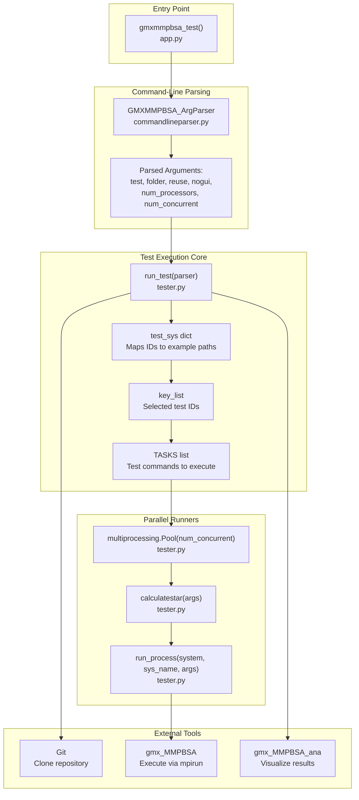
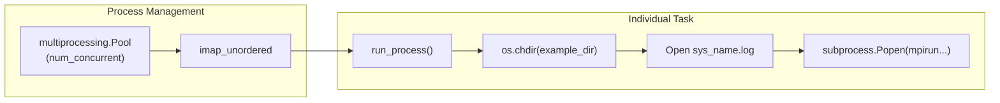

# Testing Infrastructure

Relevant source files

The following files were used as context for generating this wiki page:

- [.github/ISSUE_TEMPLATE/documentation.yml](.github/ISSUE_TEMPLATE/documentation.yml)
- [.github/ISSUE_TEMPLATE/feature_request.yml](.github/ISSUE_TEMPLATE/feature_request.yml)
- [.github/ISSUE_TEMPLATE/gmx_mmpbsa_ana_bug_report.yml](.github/ISSUE_TEMPLATE/gmx_mmpbsa_ana_bug_report.yml)
- [.github/ISSUE_TEMPLATE/gmx_mmpbsa_bug_report.yml](.github/ISSUE_TEMPLATE/gmx_mmpbsa_bug_report.yml)
- [.github/ISSUE_TEMPLATE/gmx_mmpbsa_test_bug_report.yml](.github/ISSUE_TEMPLATE/gmx_mmpbsa_test_bug_report.yml)
- [.github/ISSUE_TEMPLATE/question.yml](.github/ISSUE_TEMPLATE/question.yml)
- [GMXMMPBSA/commandlineparser.py](GMXMMPBSA/commandlineparser.py)
- [GMXMMPBSA/tester.py](GMXMMPBSA/tester.py)
- [docs/examples/README.md](docs/examples/README.md)
- [docs/examples/gmx_MMPBSA_test.md](docs/examples/gmx_MMPBSA_test.md)
- [mkdocs.yml](mkdocs.yml)
- [notebooks/gmx_MMPBSA_Colab.ipynb](notebooks/gmx_MMPBSA_Colab.ipynb)

## Purpose and Scope

This document describes the testing infrastructure for gmx_MMPBSA, specifically the `gmx_MMPBSA_test` utility that validates installation and functionality. This testing system allows users to run predefined examples covering various molecular systems and analysis methods. For information about using the test utility as an end user, see [Validation with gmx_MMPBSA_test](#2.2). For information about the example files themselves, see [Example Use Cases](#6).

The testing infrastructure serves two primary purposes:
1. **Installation validation**: Verify that gmx_MMPBSA and its dependencies are correctly installed.
2. **Example demonstration**: Provide working examples of different calculation types that users can reference.

## Architecture Overview

The testing system is built around the `run_test` function, which manages the lifecycle of a test run: from cloning the necessary data to executing the calculations and launching the analyzer.

### Test Infrastructure Data Flow

**Sources**: [GMXMMPBSA/tester.py:80-183](), [GMXMMPBSA/commandlineparser.py:189-204]()

## Command-Line Interface

The `gmx_MMPBSA_test` CLI is defined via a custom `ArgumentParser` that handles test selection, folder management, and parallel execution parameters.

| Argument | Type | Default | Description |
|----------|------|---------|-------------|
| `-t`, `--test` | `int` list | `[2]` | Test IDs to run. Supports predefined sets (0, 1, 2). |
| `-f`, `--folder` | `Path` | `.` | Directory to store cloned repository and test data. |
| `-r`, `--reuse` | flag | `False` | Reuse existing test folder instead of cloning fresh. |
| `-ng`, `--nogui` | flag | `False` | Skip opening `gmx_MMPBSA_ana` after tests complete. |
| `-n`, `--num_processors` | `int` | `1` | Number of MPI processors per calculation. |
| `-j`, `--num_concurrent` | `int` | `1` | Number of examples to run concurrently. |

**Sources**: [GMXMMPBSA/commandlineparser.py:259-313](), [GMXMMPBSA/tester.py:136-155]()

## Test Categories and Organization

The testing system organizes tests into tiers and individual test cases mapping to the `examples/` directory of the repository.

### Test Tiers

The system defines three logical sets for convenience:
* **0 (All)**: Runs all 23+ examples. [GMXMMPBSA/tester.py:136-137]()
* **1 (Minimal)**: 12 systems. Excludes slow/redundant tests like 3D-RISM or NMODE. [GMXMMPBSA/tester.py:138-140]()
* **2 (Fast)**: 9 systems. Only the shortest calculations for quick verification. [GMXMMPBSA/tester.py:141-142]()

### Individual Test Systems

The `test_sys` dictionary maps test IDs to their corresponding example paths and descriptions:

| ID | System / Method | Path |
|----|-----------------|------|
| 3 | Protein-Ligand (ST) | `Protein_ligand/ST` |
| 4 | Protein-Protein | `Protein_protein` |
| 6 | Protein-Membrane | `Protein_membrane` |
| 12| Alanine Scanning | `Alanine_scanning` |
| 14| Decomposition | `Decomposition_analysis` |
| 17| Normal Mode (NMODE) | `Entropy_calculations/nmode` |
| 18| 3D-RISM | `3D-RISM` |
| 23| QM/MMGBSA | `QM_MMGBSA` |
| 24| GBNSR6 | `GBNSR6` |

**Sources**: [GMXMMPBSA/tester.py:109-134]()

## Test Execution Workflow

### 1. Environment Preparation
The system first verifies that `git` is available. It then checks if the destination folder exists and either clones the `gmx_MMPBSA` repository (using `--depth 1` for speed) or reuses an existing one if the `-r` flag is provided. [GMXMMPBSA/tester.py:81-106]()

### 2. Task Construction
For each selected test, the system:
1. Determines the number of frames in the input file using `_get_frames`. [GMXMMPBSA/tester.py:58-71]()
2. Parses the `README.md` file in the example folder to extract the specific `gmx_MMPBSA` command. [GMXMMPBSA/tester.py:157-164]()
3. Prepends `mpirun` with the appropriate number of processors. [GMXMMPBSA/tester.py:165-171]()

### 3. Parallel Execution
The system uses `multiprocessing.Pool` to manage concurrent test execution. The `-j` flag controls how many examples run at once, while each example uses `-n` MPI ranks. [GMXMMPBSA/tester.py:175-188]()

**Sources**: [GMXMMPBSA/tester.py:36-44](), [GMXMMPBSA/tester.py:175-180]()

## Implementation Details

### Frame Counting and CPU Allocation
The function `_get_frames` parses the `mmpbsa.in` file to calculate the number of snapshots. This is used to ensure the number of MPI processors does not exceed the number of frames, which would be inefficient. [GMXMMPBSA/tester.py:58-71]()

### Error Detection
The system includes specialized error detection, such as `_has_known_rism_fortran_runtime_error`, which scans log files for specific Fortran runtime issues common in RISM calculations. [GMXMMPBSA/tester.py:47-55]()

### Result Accumulation
Successful tests are added to a `result_list`. If the `-ng` (no GUI) flag is not set, the system launches `gmx_MMPBSA_ana` with all successful result folders loaded simultaneously for comparison. [GMXMMPBSA/tester.py:192-202]()

## Adding New Tests

To add a new test case to the infrastructure:

1. **Add Example**: Place the example files in the `examples/` directory of the repository.
2. **Define Test ID**: Add a new entry to the `test_sys` dictionary in `tester.py` mapping a new ID to the directory path and a description. [GMXMMPBSA/tester.py:109-134]()
3. **Update Parser**: Update the `choices` and `help` text for the `-t` argument in `commandlineparser.py` to include the new ID. [GMXMMPBSA/commandlineparser.py:269-304]()
4. **Update Tiers**: If applicable, add the ID to the `key_list` for predefined sets (0, 1, or 2). [GMXMMPBSA/tester.py:136-143]()

**Sources**: [GMXMMPBSA/tester.py:109-143](), [GMXMMPBSA/commandlineparser.py:269-304]()

---