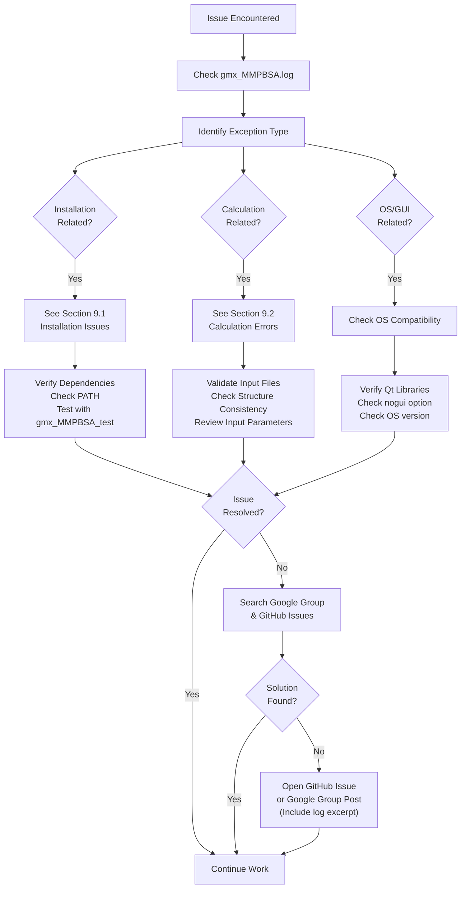

# Troubleshooting and FAQ

Relevant source files

The following files were used as context for generating this wiki page:

- [docs/Q&A/OS_issues.md](docs/Q&A/OS_issues.md)
- [docs/Q&A/README.md](docs/Q&A/README.md)
- [docs/Q&A/calculations.md](docs/Q&A/calculations.md)
- [docs/Q&A/installation.md](docs/Q&A/installation.md)
- [docs/assets/images/q_a/inconsistent_str.png](docs/assets/images/q_a/inconsistent_str.png)
- [docs/assets/images/q_a/traj_comp.gif](docs/assets/images/q_a/traj_comp.gif)
- [docs/overrides/home.html](docs/overrides/home.html)

This page provides guidance on diagnosing and resolving common issues encountered when using gmx_MMPBSA. It covers general troubleshooting strategies, the error handling system, and frequently asked questions. For category-specific issues, see the subsections: [Installation Issues](#9.1), [Calculation Errors](#9.2), and [Performance and Resource Issues](#9.3).

## Purpose and Scope

This section serves as the central resource for resolving problems with gmx_MMPBSA. It documents:

- The error handling architecture and exception hierarchy.
- Common diagnostic workflows and commands.
- Where to find help beyond this documentation.
- General troubleshooting strategies applicable across all issue types.

For detailed solutions to specific problem categories, refer to the subsections. For examples of correct usage, see [Example Use Cases](#6).

## Help Resources

gmx_MMPBSA provides multiple channels for troubleshooting assistance:

| Resource | Purpose | Location |
|----------|---------|----------|
| **Documentation** | Comprehensive guides and examples | [Online Docs](https://valdes-tresanco-ms.github.io/gmx_MMPBSA/dev/getting-started/) |
| **Google Group** | Community discussion forum | [gmx_mmpbsa group](https://groups.google.com/g/gmx_mmpbsa) |
| **Issue Tracker** | Bug reports and feature requests | [GitHub Issues](https://github.com/Valdes-Tresanco-MS/gmx_MMPBSA/issues) |
| **Q&A Section** | Frequently asked questions | [docs/Q&A/README.md:1-19]() |

Before opening a new issue, search existing issues and Google Group posts for similar problems. The log file `gmx_MMPBSA.log` is essential for diagnosis—always include relevant excerpts when seeking help.

**Sources:** [docs/Q&A/README.md:1-19]()

## Exception Hierarchy and Error System

gmx_MMPBSA implements a hierarchical exception system for structured error handling. All exceptions inherit from the `MMPBSA_Error` base class.

### Exception Class Hierarchy

```mermaid
graph TB
    BASE["MMPBSA_Error<br/>(Base Exception)"]
    WRAPPER["GMXMMPBSA_ERROR<br/>(Logging Wrapper)"]
    
    BASE --> TimerException["TimerException<br/>Timer module errors"]
    BASE --> CommandlineError["CommandlineError<br/>CLI parsing errors"]
    BASE --> CalcError["CalcError<br/>Calculation failures"]
    BASE --> SetupError["SetupError<br/>Environment setup"]
    BASE --> PrmtopError["PrmtopError<br/>Topology file errors"]
    BASE --> SelectionError["SelectionError<br/>Invalid residue selection"]
    BASE --> TrajError["TrajError<br/>Trajectory processing"]
    BASE --> InputError["InputError<br/>Input file errors"]
    BASE --> IllegalOption["IllegalOption<br/>Incompatible options"]
    BASE --> InterruptError["InterruptError<br/>Process interruption"]
    BASE --> OutputError["OutputError<br/>Output parsing errors"]
    
    BASE --> InconsistentError1["InconsistentError1<br/>BOND/ANGLE/DIHED<br/>inconsistency"]
    BASE --> InconsistentError2["InconsistentError2<br/>1-4 VDW/EEL<br/>inconsistency"]
    BASE --> ConvergenceError["ConvergenceError<br/>NMODE minimization"]
    
    BASE --> MutateError["MutateError<br/>Alanine scanning"]
    MutateError --> MutantResError["MutantResError<br/>Invalid mutation target"]
    
    BASE --> CreateInputError["CreateInputError<br/>MDIN file generation"]
    BASE --> LengthError["LengthError<br/>EnergyVector mismatch"]
    BASE --> DecompError["DecompError<br/>Decomposition parsing"]
    BASE --> InternalError["InternalError<br/>Programming errors"]
    BASE --> NoFileExists["NoFileExists<br/>Missing required files"]
    
    WRAPPER -.wraps.-> BASE
    
    WARN["MMPBSA_Warning<br/>(Base Warning)"]
    WARN --> InputWarning["InputWarning<br/>Non-fatal warnings"]
    WARN --> StabilityWarning["StabilityWarning<br/>Stability calc warnings"]
```

The error system is designed to provide specific feedback for different failure modes, such as `CalcError` for calculation failures and `TrajError` for trajectory processing issues.

**Sources:** [docs/Q&A/calculations.md:15-16](), [docs/Q&A/installation.md:40]()

## Diagnostic Workflow

When encountering issues, follow this systematic troubleshooting approach:

**Sources:** [docs/Q&A/README.md:15-17](), [docs/Q&A/OS_issues.md:1-33]()

## Pre-Execution Validation

Before running `gmx_MMPBSA`, validate input files to prevent common errors.

### Structure and Trajectory Consistency

Input structures must be centered and properly wrapped. Broken structures cause inconsistent results and "could not convert string to float" errors in `sander`.

| Issue | Solution | Command Example |
|-------|----------|-----------------|
| **Broken Structure** | Generate from TPR | `gmx editconf -f md.tpr -o md.pdb` |
| **PBC in Trajectory** | Remove PBC | `gmx trjconv -s md.tpr -f md.xtc -o md_noPBC.xtc -pbc mol -center` |
| **Fitted Trajectory** | Remove rotation | `gmx trjconv -s md.tpr -f md_noPBC.xtc -o md_fit.xtc -fit rot+trans` |

**Sources:** [docs/Q&A/calculations.md:15-71]()

### OS and Environment Compatibility

- **macOS:** Versions lower than BigSur are generally not supported [docs/Q&A/OS_issues.md:10-14]().
- **WSL/HPC:** The analyzer (`gmx_MMPBSA_ana`) requires graphics drivers. Use the `-nogui` option on HPC systems to avoid crashes [docs/Q&A/OS_issues.md:19-33]().
- **Qt Plugins:** Errors related to `xcb` can often be fixed by reinstalling `libxcb-xinerama0` [docs/Q&A/OS_issues.md:35-45]().

## Common Diagnostic Commands

These commands help diagnose different aspects of functionality:

| Category | Command | Purpose |
|----------|---------|---------|
| **Setup** | `source amber.sh` | Ensure AmberTools environment is loaded [docs/Q&A/installation.md:14]() |
| **Setup** | `conda list gmx-mmpbsa` | Verify installation in current conda environment |
| **Calculation** | `gmx_MMPBSA --rewrite-output` | Update output files after modifying `_GMXMMPBSA_info` [docs/Q&A/calculations.md:131]() |
| **Validation** | `gmx_MMPBSA_test -t 2` | Run predefined test examples |

## Frequently Asked Questions

### Installation

**Q: I can't find the `amber.python` executable.**  
A: Ensure `AmberTools` is installed and the `amber.sh` (or `amber.csh`) file has been sourced. If using conda, the python in the conda environment should be used [docs/Q&A/installation.md:10-16]().

**Q: I get a `ModuleNotFoundError: No module named 'parmed'`.**  
A: This usually indicates a broken installation or an environment mismatch. Refer to GitHub issue #2 for resolution [docs/Q&A/installation.md:40-44]().

### Calculations

**Q: Why do I get very high solvation energy values with the PB model?**  
A: By default, `inp=2` includes a dispersion term that can sometimes produce unrealistic values due to error cancellation imbalances. Try setting `inp=1` in the `&pb` namelist to use a single term SASA-based model [docs/Q&A/calculations.md:103-125]().

**Q: What does `ValueError: could not convert string to float: '*************'` mean?**  
A: This usually occurs when energy values exceed 7 digits, often due to inconsistent input structures (PBC issues) or trying to calculate a group that is too large for `sander`'s output format [docs/Q&A/calculations.md:15-93]().

### Performance and Resources

For detailed information on handling memory issues, MPI configuration, and optimizing large calculations, see [Performance and Resource Issues](#9.3).

**Sources:** [docs/Q&A/calculations.md:1-148](), [docs/Q&A/installation.md:1-53](), [docs/Q&A/OS_issues.md:1-48]()

---