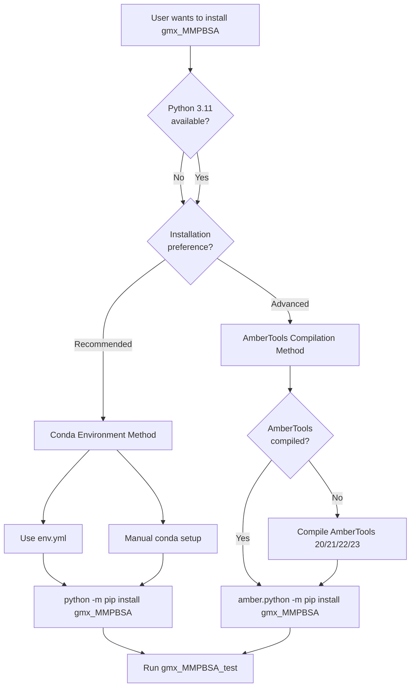
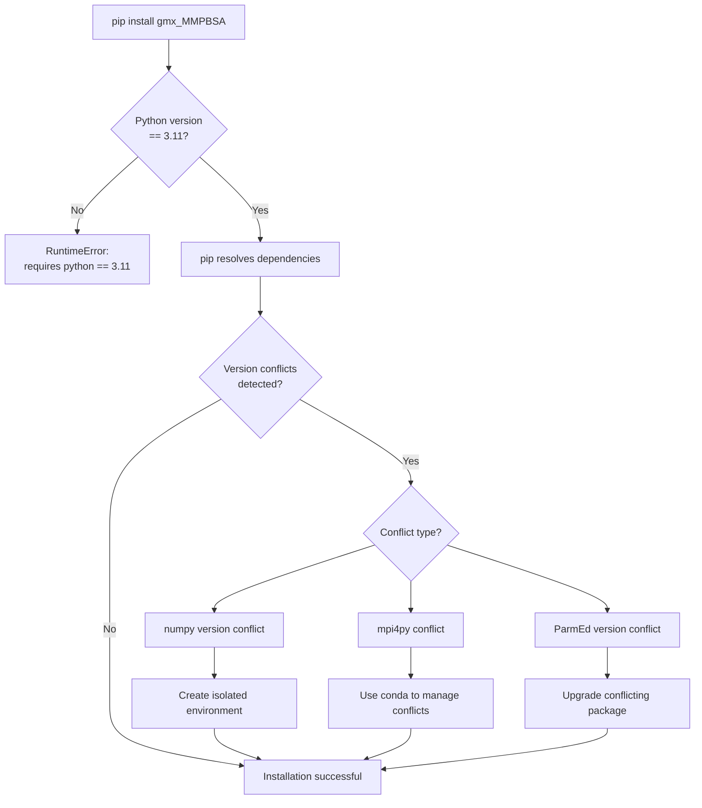
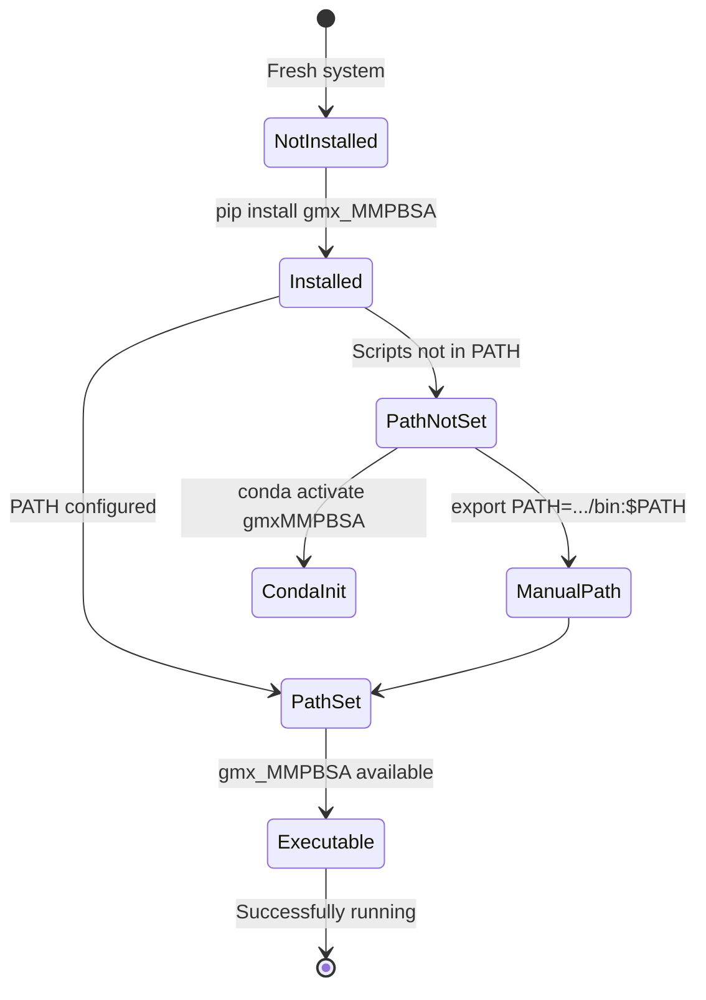
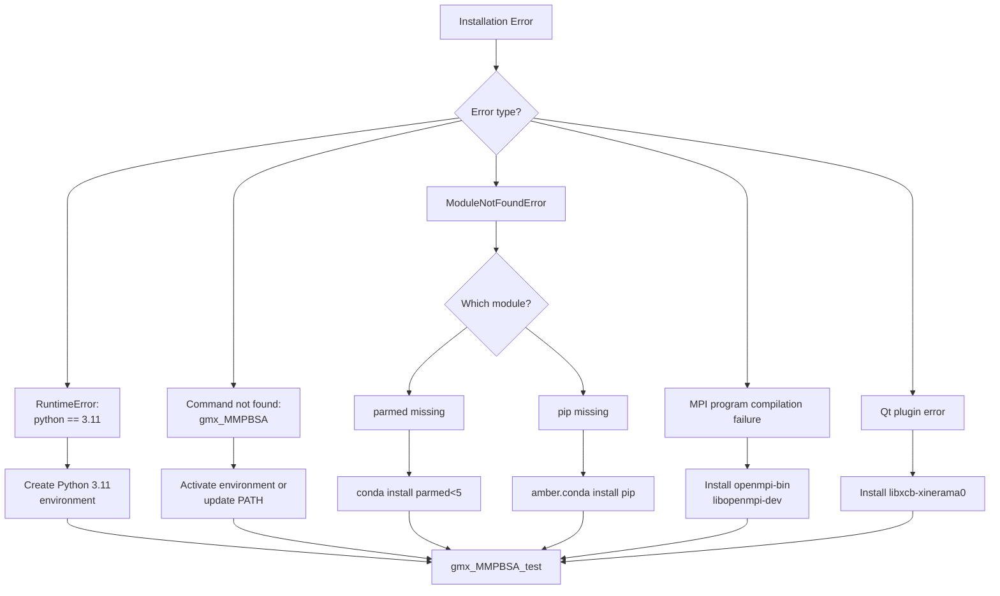

# Installation Issues

<details>
<summary>Relevant source files</summary>

The following files were used as context for generating this wiki page:

- [GMXMMPBSA/GMXMMPBSA.sh](GMXMMPBSA/GMXMMPBSA.sh)
- [docs/Q&A/OS_issues.md](docs/Q&A/OS_issues.md)
- [docs/Q&A/calculations.md](docs/Q&A/calculations.md)
- [docs/Q&A/installation.md](docs/Q&A/installation.md)
- [docs/assets/images/q_a/inconsistent_str.png](docs/assets/images/q_a/inconsistent_str.png)
- [docs/assets/images/q_a/traj_comp.gif](docs/assets/images/q_a/traj_comp.gif)
- [docs/env.yml](docs/env.yml)
- [docs/gmx_MMPBSA_ana_command-line.md](docs/gmx_MMPBSA_ana_command-line.md)
- [docs/gmx_MMPBSA_command-line.md](docs/gmx_MMPBSA_command-line.md)
- [docs/installation.md](docs/installation.md)
- [docs/summary.md](docs/summary.md)
- [docs/versus.md](docs/versus.md)

</details>


This page documents common installation problems encountered when setting up `gmx_MMPBSA` and their resolutions. It covers dependency conflicts, environment configuration issues, and platform-specific problems.

For general installation instructions, see [Installation and Setup](#2). For validation procedures after installation, see [Validation with gmx_MMPBSA_test](#2.2). For runtime calculation errors, see [Calculation Errors](#9.2).

## Python Version Enforcement

`gmx_MMPBSA` enforces a strict Python version requirement that is a common source of installation failures.

### The Python 3.11 Requirement

The `setup.py` file contains a hard version check that prevents installation with any Python version other than 3.11:

```python
if sys.version_info[:2] != (3, 11):
    raise RuntimeError("gmx_MMPBSA requires python == 3.11")
```

**Sources:** [setup.py:26-27]()

This check executes immediately when `pip install` attempts to install the package, causing the installation to abort with:

```
RuntimeError: gmx_MMPBSA requires python == 3.11
```

### Resolution Strategy

| Installation Method | Solution |
|-------------------|----------|
| Conda environment | Use `python=3.11` in environment creation: `conda create -n gmxMMPBSA python=3.11` |
| AmberTools compilation | Ensure AmberTools' bundled Python is version 3.11 before installation |
| Existing environment | Create a new Python 3.11 environment; in-place upgrades/downgrades are not supported |

**Sources:** [setup.py:26-27](), [docs/installation.md:79-80](), [docs/env.yml:6]()

### Installation Method Decision Tree



**Sources:** [docs/installation.md:19-32](), [setup.py:26-27]()

## Dependency Conflict Patterns

### Core Scientific Stack Version Requirements

The `setup.py` and `env.yml` files specify exact versions for the scientific computing stack to ensure compatibility:

| Package | Required Version | Common Conflict Source |
|---------|-----------------|----------------------|
| `numpy` | `1.26.4` | Machine learning frameworks (TensorFlow, PyTorch) |
| `pandas` | `1.5.3` | General data analysis environments |
| `matplotlib` | `3.7.3` | System-wide visualization tools |
| `scipy` | `1.14.1` | Scientific computing packages |
| `mpi4py` | `4.0.1` | HPC system-wide installations |
| `parmed` | `<5` (typically `4.2.2`) | Topology handling tools |
| `seaborn` | `0.11.2` | Plotting libraries |

**Sources:** [setup.py:46-51](), [docs/env.yml:20-29](), [docs/installation.md:83-86]()

### Dependency Resolution Flow



**Sources:** [setup.py:46-51](), [docs/installation.md:34-117]()

## PATH and Environment Configuration Issues

### Console Script Registration Problem

After installation, users may find that `gmx_MMPBSA` is not recognized as a command. This occurs because `setup.py` registers three console scripts that pip installs to the Python environment's `bin/` directory:

```python
entry_points={
    "console_scripts": [
        "gmx_MMPBSA=GMXMMPBSA.app:gmxmmpbsa",
        "gmx_MMPBSA_ana=GMXMMPBSA.app:gmxmmpbsa_ana",
        "gmx_MMPBSA_test=GMXMMPBSA.app:gmxmmpbsa_test"]}
```

**Sources:** [setup.py:52-56](), [docs/Q&A/installation.md:32-39]()

### Resolution Options

**1. Check PATH:** Ensure the bin folder of your conda environment is in the `PATH`.
**2. Activation:** Always activate the environment before use: `conda activate gmxMMPBSA`.
**3. Permissions:** Check if the application has execution permissions.

**Sources:** [docs/Q&A/installation.md:32-39](), [GMXMMPBSA/GMXMMPBSA.sh:23-39]()

### Environment Activation State Machine



**Sources:** [docs/installation.md:51-53](), [docs/Q&A/installation.md:32-39]()

## AmberTools-Related Issues

### Missing AmberTools Installation

`gmx_MMPBSA` requires **AmberTools20 or 21** (and has been tested with newer versions up to 24 in some contexts) to be installed. It depends on several executables:

- `sander` - GB/PB energy calculations.
- `rism3d.snglpnt` - 3D-RISM calculations.
- `mmpbsa_py_nabnmode` - Normal mode entropy calculations.
- `cpptraj` - Trajectory processing.

**Sources:** [docs/installation.md:8-9](), [docs/env.yml:9-21](), [docs/summary.md:18-29]()

### AmberTools Detection Issues

**Problem:** `amber.python` executable not found.
**Solution:** Ensure `AmberTools` is installed and the `amber.sh` (or `amber.csh`) file is sourced. If installed via conda, use the python executable from that environment.

**Sources:** [docs/Q&A/installation.md:10-16]()

## MPI and Parallelism Issues

### mpi4py Installation Failures

**Problem:** Error: "Cannot compile MPI programs. Check your configuration!!!"
**Solution:** Install or reinstall the OpenMPI library:
```bash
sudo apt install openmpi-bin libopenmpi-dev openssh-client
```
**Sources:** [docs/Q&A/installation.md:17-31]()

### MPI Version Requirements
The project specifies `mpi4py=4.0.1`. In HPC environments, this must be compatible with the system's MPI implementation.

**Sources:** [docs/env.yml:22](), [docs/installation.md:83]()

## OS and GUI Specific Issues

### WSL and Remote GUI
**Problem:** `gmx_MMPBSA_ana` fails in Windows Subsystem for Linux (WSL).
**Cause:** WSL lacks native graphics drivers for Linux GUI applications.
**HPC Usage:** Use the `-nogui` flag to prevent the analyzer from launching automatically after calculations.

**Sources:** [docs/Q&A/OS_issues.md:16-34](), [docs/gmx_MMPBSA_command-line.md:60-61]()

### Qt Plugin Errors
**Problem:** `qt.qpa.plugin: Could not load the Qt platform plugin "xcb"`.
**Solution:** Reinstall the `libxcb-xinerama0` library:
```bash
sudo apt install --reinstall libxcb-xinerama0
```
**Sources:** [docs/Q&A/OS_issues.md:35-47]()

### macOS Compatibility
`gmx_MMPBSA` has been tested on macOS BigSur. Versions lower than BigSur are assumed to be incompatible.

**Sources:** [docs/Q&A/OS_issues.md:10-15]()

## Validation After Installation

After resolving installation issues, validate the setup using `gmx_MMPBSA_test`:

```bash
# Activate environment
conda activate gmxMMPBSA

# Run a specific test example (e.g., test 1)
gmx_MMPBSA_test -t 1
```

**Sources:** [docs/installation.md:52-53](), [GMXMMPBSA/GMXMMPBSA.sh:109](), [docs/summary.md:46-47]()

## Common Error Pattern Reference



**Sources:** [docs/Q&A/installation.md:1-53](), [docs/Q&A/OS_issues.md:1-47](), [setup.py:26-51]()

---