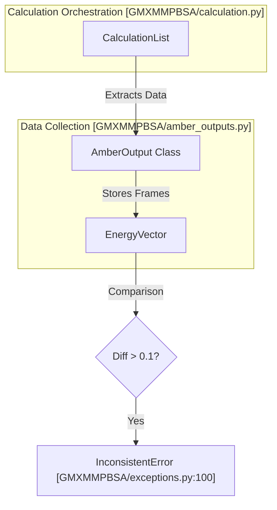

# Calculation Errors

Relevant source files

The following files were used as context for generating this wiki page:

- [GMXMMPBSA/API.py](GMXMMPBSA/API.py)
- [GMXMMPBSA/amber_outputs.py](GMXMMPBSA/amber_outputs.py)
- [GMXMMPBSA/exceptions.py](GMXMMPBSA/exceptions.py)
- [GMXMMPBSA/output_file.py](GMXMMPBSA/output_file.py)
- [docs/Q&A/OS_issues.md](docs/Q&A/OS_issues.md)
- [docs/Q&A/calculations.md](docs/Q&A/calculations.md)
- [docs/Q&A/installation.md](docs/Q&A/installation.md)
- [docs/assets/images/q_a/inconsistent_str.png](docs/assets/images/q_a/inconsistent_str.png)
- [docs/assets/images/q_a/traj_comp.gif](docs/assets/images/q_a/traj_comp.gif)

This page documents common calculation failures, input file errors, and debugging strategies for gmx_MMPBSA.

## Overview

Calculation errors in gmx_MMPBSA can occur at multiple stages of the pipeline: during input validation, topology generation, trajectory processing, energy calculations, or output processing. The application utilizes a robust exception system and detailed logging to help users identify the root cause of failures.

## Error Classification

gmx_MMPBSA uses a hierarchical exception system defined in `GMXMMPBSA/exceptions.py`. All calculation-related errors inherit from the base `MMPBSA_Error` class.

### Exception Hierarchy

```mermaid
graph TB
    BASE["MMPBSA_Error [GMXMMPBSA/exceptions.py:25]"]
    
    INPUT["InputError [GMXMMPBSA/exceptions.py:80]"]
    CALC["CalcError [GMXMMPBSA/exceptions.py:55]"]
    TRAJ["TrajError [GMXMMPBSA/exceptions.py:75]"]
    PRMTOP["PrmtopError [GMXMMPBSA/exceptions.py:65]"]
    SELECT["SelectionError [GMXMMPBSA/exceptions.py:70]"]
    ILLEGAL["IllegalOption [GMXMMPBSA/exceptions.py:85]"]
    OUTPUT["OutputError [GMXMMPBSA/exceptions.py:95]"]
    CONSIST1["InconsistentError1 [GMXMMPBSA/exceptions.py:100]"]
    CONSIST2["InconsistentError2 [GMXMMPBSA/exceptions.py:107]"]
    CONVERG["ConvergenceError [GMXMMPBSA/exceptions.py:114]"]
    MUTATE["MutateError [GMXMMPBSA/exceptions.py:119]"]
    CREATEIN["CreateInputError [GMXMMPBSA/exceptions.py:129]"]
    DECOMP["DecompError [GMXMMPBSA/exceptions.py:141]"]
    NOFILE["NoFileExists [GMXMMPBSA/exceptions.py:151]"]
    
    BASE --> INPUT
    BASE --> CALC
    BASE --> TRAJ
    BASE --> PRMTOP
    BASE --> SELECT
    BASE --> ILLEGAL
    BASE --> OUTPUT
    BASE --> CONSIST1
    BASE --> CONSIST2
    BASE --> CONVERG
    BASE --> MUTATE
    BASE --> CREATEIN
    BASE --> DECOMP
    BASE --> NOFILE
    
    MUTATE --> MUTANTRES["MutantResError [GMXMMPBSA/exceptions.py:124]"]
```

**Sources:** [GMXMMPBSA/exceptions.py:25-153]()

## Numerical and Format Errors

### ValueError: could not convert string to float: '*************'

This is one of the most frequent errors reported. It occurs when `sander` (the underlying calculation engine from AmberTools) produces output values that exceed the allocated field width in its text-based output files.

| Cause | Code Entity Impacted | Solution |
|-------|----------------------|----------|
| **Broken Structure/PBC** | `make_trajs.py` | Ensure PBC is removed and molecules are centered using `gmx trjconv`. |
| **System Too Large** | `sander` (external) | Modify calculation parameters (e.g., `intdiel`) or use a sub-system. |
| **High Solvation Energy** | `&pb` namelist | Switch `inp=2` (default) to `inp=1` to avoid the `EDISPER` term. |

**Sources:** [docs/Q&A/calculations.md:15-101]()

### PB Solvation Energy Imbalances

When using the Poisson-Boltzmann (PB) model, unrealistic values can arise from the `EDISPER` (dispersion) contribution.

- **Symptom:** Unusually high non-polar solvation energy.
- **Mechanism:** `inp=2` models non-polar energy as cavity + dispersion. `inp=1` models it as a single term proportional to SASA.
- **Fix:** Set `inp=1` in the `&pb` namelist of `mmpbsa.in`.

**Sources:** [docs/Q&A/calculations.md:103-148]()

## Trajectory and Topology Consistency

### Inconsistent Potential Terms

The classes `InconsistentError1` and `InconsistentError2` are raised when internal potential terms (BOND, ANGLE, DIHEDRAL, 1-4 VDW, 1-4 EEL) do not match between the complex and the sum of its components (receptor + ligand).

**Sources:** [GMXMMPBSA/exceptions.py:100-111](), [GMXMMPBSA/amber_outputs.py:104-107]()

### Trajectory Preparation Checklist

To avoid `TrajError` or inconsistent energies, follow this `gmx trjconv` protocol:
1. **Center:** Use a group containing both receptor and ligand.
2. **PBC Removal:** Use `-pbc mol -ur compact`.
3. **Fitting:** Use `-fit rot+trans` (optional but recommended for NMODE).

**Sources:** [docs/Q&A/calculations.md:43-85]()

## Specific Calculation Failures

### NMODE Convergence Issues

`ConvergenceError` occurs when a frame fails to minimize within the specified `maxcyc` or `drms` tolerance.

- **Indicator:** `self.no_nmode_convergence` is set to `True` in `AmberOutput`.
- **Debugging:** Check `gmx_MMPBSA.log` to see which frames failed. If many frames fail, consider increasing `maxcyc` or relaxing `drms`.

**Sources:** [GMXMMPBSA/amber_outputs.py:87-87](), [GMXMMPBSA/exceptions.py:114-116]()

### Interaction Entropy (IE) Unreliability

The Interaction Entropy method requires the standard deviation of the interaction energy ($\sigma_{IE}$) to be small.

- **Threshold:** If $\sigma_{IE} > 3.6$ kcal/mol, the results are considered unreliable.
- **Code implementation:** The `IEout` class in `amber_outputs.py` handles the parsing and statistics for these calculations.

**Sources:** [GMXMMPBSA/amber_outputs.py:40-40](), [docs/Q&A/calculations.md:149-160]()

## Output and Parsing Errors

### Output Parsing Logic

The `AmberOutput` class and its derivatives (like `IEout`, `C2out`, `NMODEout`) are responsible for reading `sander` output files.

**Sources:** [GMXMMPBSA/amber_outputs.py:65-110](), [GMXMMPBSA/output_file.py:64-67]()

### Data Keys and Components

Errors in parsing often stem from unexpected components in the output. The `data_key_owner` dictionary maps energy terms to their categories (`GGAS`, `GSOLV`, `TOTAL`).

| Term | Category | Source |
|------|----------|--------|
| BOND, ANGLE, DIHED | GGAS | Gas Phase |
| EPB, ENPOLAR | GSOLV | PB Solvation |
| EGB, ESURF | GSOLV | GB Solvation |
| ESCF | GGAS | QM/GB |

**Sources:** [GMXMMPBSA/amber_outputs.py:44-62]()

## Debugging Strategies

1. **Check the Log:** `gmx_MMPBSA.log` is the primary source for identifying which specific command (e.g., `sander`, `cpptraj`, `tleap`) failed.
2. **Rewrite Output:** Use `gmx_MMPBSA --rewrite-output` to regenerate the summary file without re-running expensive calculations if you only need to change metadata or filtering.
3. **API Access:** For custom debugging, use the `MMPBSA_API` to load results into a Python environment and inspect the `EnergyVector` objects directly.

**Sources:** [GMXMMPBSA/exceptions.py:170-171](), [GMXMMPBSA/API.py:2-6](), [docs/Q&A/calculations.md:131-131]()

---