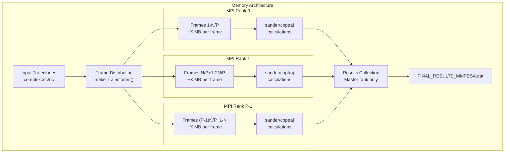
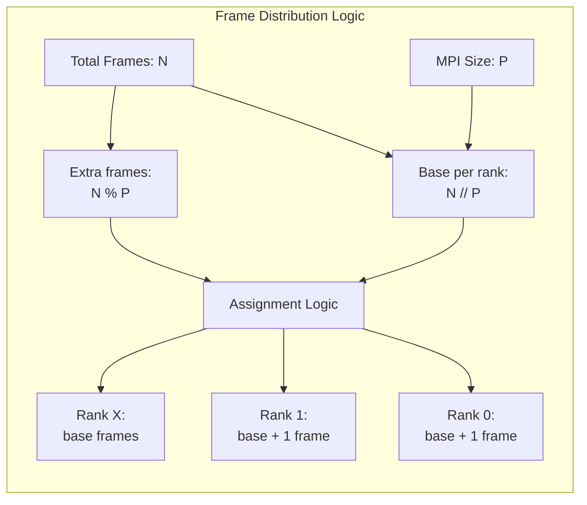
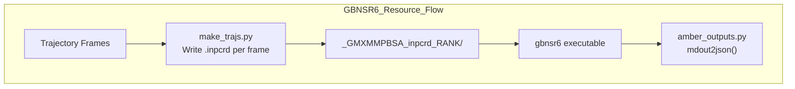

# Performance and Resource Issues

<details>
<summary>Relevant source files</summary>

The following files were used as context for generating this wiki page:

- [GMXMMPBSA/fake_mpi.py](GMXMMPBSA/fake_mpi.py)
- [docs/Q&A/OS_issues.md](docs/Q&A/OS_issues.md)
- [docs/Q&A/calculations.md](docs/Q&A/calculations.md)
- [docs/Q&A/installation.md](docs/Q&A/installation.md)
- [docs/assets/images/q_a/inconsistent_str.png](docs/assets/images/q_a/inconsistent_str.png)
- [docs/assets/images/q_a/traj_comp.gif](docs/assets/images/q_a/traj_comp.gif)

</details>


This page addresses common performance bottlenecks and resource management issues in gmx_MMPBSA calculations. For installation-related problems, see [Installation Issues](#9.1). For errors during calculations, see [Calculation Errors](#9.2).

## Overview

gmx_MMPBSA calculations can be computationally demanding, involving:

- Large trajectory processing requiring significant memory
- Parallel calculations using MPI for frame distribution
- Multiple external program calls (sander, cpptraj, gbnsr6, etc.)
- Generation of temporary files and intermediate data
- Per-residue decomposition analysis generating extensive output

Performance issues typically manifest as excessive memory consumption, slow calculation times, MPI failures, or disk space exhaustion.

---

## Memory Usage Patterns

### Frame Distribution and Memory Requirements

The primary memory consumer in gmx_MMPBSA is the trajectory processing and energy calculation phase. The system distributes frames across MPI ranks to enable parallel processing.



**Memory Scaling Per Rank**:
- Base trajectory data: ~5-10 MB per frame (depends on system size)
- Working memory for sander: ~100-500 MB per process
- PB calculations: 2-10× more memory than GB
- NMODE calculations: Additional ~200-800 MB depending on system size

Sources: [GMXMMPBSA/make_trajs.py:84-108](), [GMXMMPBSA/main.py:218-225]()

### Memory Warnings

gmx_MMPBSA issues memory warnings for specific calculation types:

```python
# From main.py
if (self.INPUT['pb']['pbrun'] or self.INPUT['rism']['rismrun'] or
    self.INPUT['nmode']['nmoderun']) and self.mpi_size > 1:
    logging.warning('PB/RISM/NMODE will be calculated with multiple threads, make sure you have enough RAM.')
```

This warning appears because:
- **PB calculations** solve the Poisson-Boltzmann equation on a grid, requiring substantial memory.
- **RISM calculations** involve 3D grids for solvent distribution.
- **NMODE calculations** compute Hessian matrices for entropy estimation.

Sources: [GMXMMPBSA/main.py:223-225]()

### Decomposition Analysis Memory Impact

Per-residue and pairwise decomposition analysis can generate massive amounts of data:

| Decomposition Mode | Energy Terms | Molecules | Residues | Total Items | Memory Impact |
|:-------------------|:-------------|:----------|:---------|:------------|:--------------|
| `idecomp=1` | 6 | 3 | N | 18N | Moderate |
| `idecomp=2` | 6 | 3 | N | 18N | Moderate |
| `idecomp=3` | 6 | 3 | N² | 18N² | **High** |
| `idecomp=4` | 6 | 3 | N² | 18N² | **High** |

With `dec_verbose` levels (0-3), the multiplier increases from 1× to 12×. gmx_MMPBSA warns about large decomposition selections when `total_items > 250` [GMXMMPBSA/make_top.py:164-180]().

Sources: [GMXMMPBSA/make_top.py:164-180]()

---

## MPI Configuration and Parallelization

### Frame Distribution Strategy

gmx_MMPBSA uses MPI to distribute frames across processors. The distribution algorithm ensures balanced workload:



**Distribution Code**:
```python
# From make_trajs.py
frames_per_rank = traj.processed_frames // size
extras = traj.processed_frames - frames_per_rank * size
frame_count = [frames_per_rank for i in range(size)]
for i in range(size):
    if i < extras: frame_count[i] += 1
```

If the number of frames is less than the MPI size, the application will terminate with an error [GMXMMPBSA/make_trajs.py:79-88](). For serial execution where MPI is not installed, `fake_mpi.py` provides a fallback `Communicator` class that returns a rank of 0 and size of 1 [GMXMMPBSA/fake_mpi.py:28-69]().

Sources: [GMXMMPBSA/make_trajs.py:79-88](), [GMXMMPBSA/fake_mpi.py:28-69]()

### MPI-Specific Issues

**1. Thread Safety and Environment**

Each MPI rank calls external programs independently. In HPC environments, the GUI must be disabled using the `-nogui` flag to avoid errors related to graphics libraries [docs/Q&A/OS_issues.md:29-33]().

**2. File System Contention**

Multiple MPI ranks writing temporary files simultaneously can cause I/O bottlenecks. Output files are typically suffixed with the rank index (e.g., `.0`, `.1`) to prevent collisions [GMXMMPBSA/calculation.py:295-299]().

**3. Non-Uniform Calculation Times**

Some frames may take longer to calculate, particularly NMODE where convergence might fail. If convergence is not reached, terms are set to `NaN` [GMXMMPBSA/amber_outputs.py:561-566]().

Sources: [docs/Q&A/OS_issues.md:29-33](), [GMXMMPBSA/calculation.py:295-299](), [GMXMMPBSA/amber_outputs.py:561-566]()

---

## Disk Space and I/O Management

### Temporary File Generation

gmx_MMPBSA generates extensive temporary files. The `keep_files` parameter in `&general` namelist controls temporary file retention:

| Value | Behavior | Use Case |
|:------|:---------|:---------|
| `0` | Delete all temporary files | Production runs, disk space limited |
| `1` | Keep input files (`.mdin`, topology) | Debugging input generation |
| `2` | Keep all files | Full debugging, method development |

Sources: [GMXMMPBSA/main.py:398-407](), [docs/Q&A/calculations.md:127-132]()

### NetCDF vs ASCII Trajectories

The `netcdf` flag affects both performance and disk usage. NetCDF (`.nc`) is a binary format that is generally faster and more compact than ASCII (`.mdcrd`) [GMXMMPBSA/make_trajs.py:52-55]().

---

## Calculation-Specific Performance

### GBNSR6 Memory and I/O

GBNSR6 calculations are particularly resource-intensive because they require generating individual `inpcrd` files for every frame [GMXMMPBSA/main.py:398-407]().



Sources: [GMXMMPBSA/main.py:365-412](), [GMXMMPBSA/calculation.py:404-411]()

### NMODE Convergence and Performance

NMODE calculations can be slow and may fail to converge. If the gradient in the minimization step is too high, `sander` may fail to produce valid entropy values, leading to `ValueError: could not convert string to float: '*************'` in the output parser [docs/Q&A/calculations.md:15-93]().

**Recommendations**:
- Ensure the trajectory is properly fitted and PBC is removed [docs/Q&A/calculations.md:43-88]().
- Check for "broken" structures in the input files [docs/Q&A/calculations.md:24-41]().
- Consider interaction entropy as a faster alternative [docs/Q&A/calculations.md:148-150]().

Sources: [docs/Q&A/calculations.md:15-150](), [GMXMMPBSA/amber_outputs.py:578-584]()

---

## Common Resource Issues and Solutions

### Large System Limitations
When calculating energy for very large groups, the energy value might exceed the 7-digit limit allowed by the `sander` output format, causing a `ValueError` [docs/Q&A/calculations.md:90-93]().

**Solutions**:
- Recompile `sander` with modified output formats (not recommended).
- Modify calculation parameters (solvent model, dielectric).
- Perform calculations on a sub-system [docs/Q&A/calculations.md:97-100]().

### PB Model Performance
High non-polar solvation energy values in PB models can occur due to the `EDISPER` term (`inp=2`). Using `inp=1` models non-polar solvation as a single term proportional to SASA, which is often faster and avoids imbalances between cavity and dispersion terms [docs/Q&A/calculations.md:103-146]().

### OS and GUI Issues
- **WSL**: No graphics drivers, so `gmx_MMPBSA_ana` cannot run [docs/Q&A/OS_issues.md:19-21]().
- **HPC**: GUI is disabled; use `-nogui` [docs/Q&A/OS_issues.md:29-33]().
- **Qt Plugins**: Reinstalling `libxcb-xinerama0` can fix plugin loading errors [docs/Q&A/OS_issues.md:35-46]().

Sources: [docs/Q&A/calculations.md:90-146](), [docs/Q&A/OS_issues.md:16-46]()

---