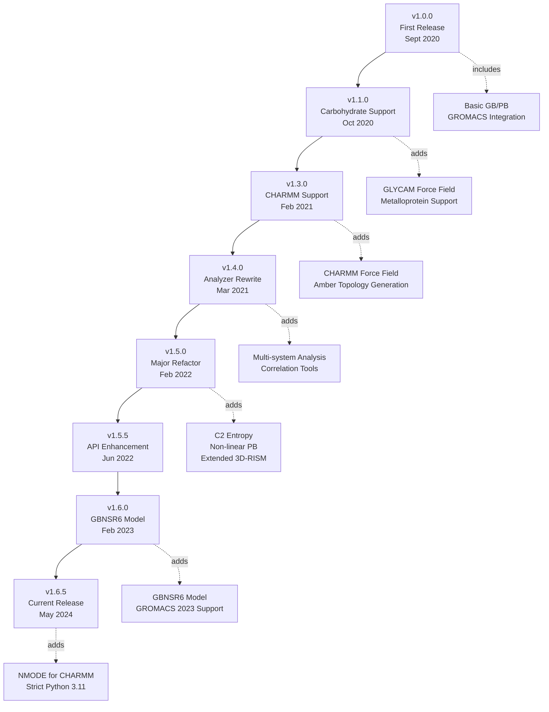
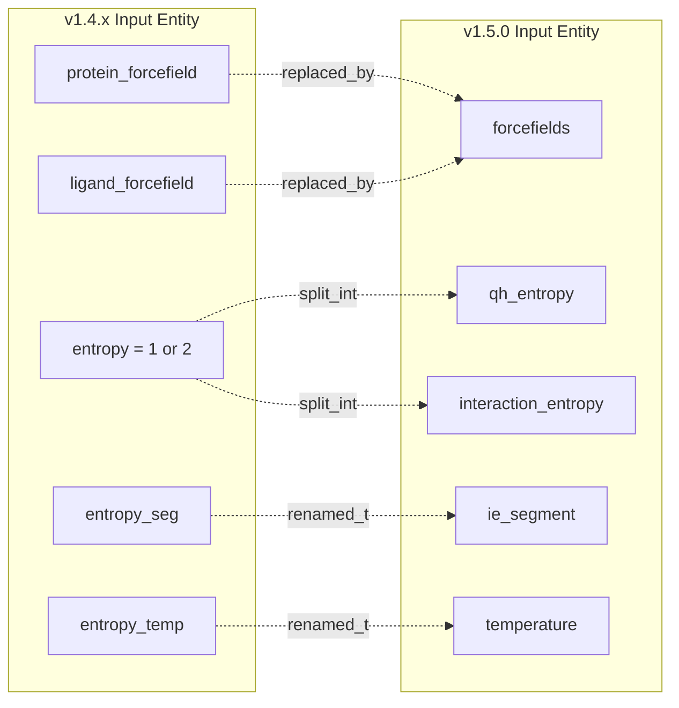

# Version History and Compatibility

<details>
<summary>Relevant source files</summary>

The following files were used as context for generating this wiki page:

- [GMXMMPBSA/infofile.py](GMXMMPBSA/infofile.py)
- [docs/changelog.md](docs/changelog.md)
- [docs/cite_us.md](docs/cite_us.md)
- [docs/compatibility.md](docs/compatibility.md)
- [docs/gmx_MMPBSA_citation.bib](docs/gmx_MMPBSA_citation.bib)
- [docs/gmx_MMPBSA_citation.ris](docs/gmx_MMPBSA_citation.ris)
- [docs/gmx_MMPBSA_running.md](docs/gmx_MMPBSA_running.md)
- [docs/input_file.md](docs/input_file.md)
- [docs/news.json](docs/news.json)

</details>


This page documents the version history of gmx_MMPBSA, tracking major releases, breaking changes, deprecated features, and compatibility requirements. It provides migration guides for upgrading between major versions and details changes in input file format, API, and file structures.

For information about installing gmx_MMPBSA, see [Installation and Setup](#2). For details on current input file parameters, see [Input File Configuration](#3.2).

---

## Version Timeline and Major Releases

gmx_MMPBSA follows semantic versioning with major releases introducing breaking changes, minor releases adding features, and patch releases fixing bugs. The project has evolved through several significant milestones since its initial release.

### Release History Diagram



**Sources:** [docs/changelog.md:7-664](), [docs/news.json:3-5]()

---

## Current Version Requirements

The latest version (v1.6.5) enforces specific dependency versions for stability and compatibility. Notably, Python 3.11 is now a strict requirement.

| Dependency | Version Requirement | Notes |
|------------|-------------------|-------|
| Python | 3.11 (strict) | Enforced in setup.py [docs/changelog.md:43-43]() |
| AmberTools | 20, 21, 22, or 23 | Provides calculation engines |
| GROMACS | All versions supported | Up to GROMACS 2023 [docs/changelog.md:84-84]() |
| mpi4py | Required for MPI | Used when `mpi_size > 1` [docs/changelog.md:116-116]() |
| ParmEd | Latest compatible | Topology conversion |

**Sources:** [docs/changelog.md:38-44](), [docs/changelog.md:84-84](), [docs/changelog.md:116-116]()

---

## Breaking Changes by Version

### Version 1.6.5 → Dependency Tightening (May 2024)
- **Python 3.11 Constraint**: The package now strictly requires Python 3.11 [docs/changelog.md:43-43]().
- **Installation**: A new installation script `scripts/conda_pip_install.sh` was introduced to manage environment complexities [docs/changelog.md:28-28]().

### Version 1.5.0 → Major Refactor (February 2022)
Version 1.5.0 introduced the most significant breaking changes, fundamentally reworking calculation and processing modules.



#### Removed Variables
- `protein_forcefield` and `ligand_forcefield` → Replaced by a single `forcefields` variable [docs/compatibility.md:81-83]().
- `use_sander` → Removed; sander is the default engine [docs/compatibility.md:49-49]().

#### New Capabilities in v1.5.0
- **&general**: `c2_entropy` [docs/compatibility.md:26-26]().
- **&pb**: Extensive control with 18+ new variables like `smoothopt`, `iprob`, and `npbopt` for non-linear PB solvers [docs/compatibility.md:30-32]().
- **&rism**: Advanced 3D-RISM parameters including `mdiis_del` and `entropicDecomp` [docs/compatibility.md:34-37]().

**Sources:** [docs/compatibility.md:15-55](), [GMXMMPBSA/infofile.py:29-61]()

---

## Deprecated Features Tracking

The codebase maintains a mapping of old variables to new namelists for backward compatibility, though many were formally removed in v1.5.0.

| Variable | Deprecated In | Removed In | Replacement | Namelist |
|----------|--------------|------------|-------------|-------|
| `protein_forcefield` | v1.4.1 | v1.5.0 | `forcefields` | `&general` |
| `ligand_forcefield` | v1.4.1 | v1.5.0 | `forcefields` | `&general` |
| `entropy` | v1.4.2 | v1.5.0 | `qh_entropy` / `interaction_entropy` | `&general` |
| `entropy_seg` | v1.4.2 | v1.5.0 | `ie_segment` | `&general` |
| `entropy_temp` | v1.4.1 | v1.5.0 | `temperature` | `&general` |

**Internal Handling:**
The `InfoFile` class in `GMXMMPBSA/infofile.py` manages these transitions. It defines `nl_variables` to map old names to their respective namelists [GMXMMPBSA/infofile.py:29-61]() and tracks editable variables like `exp_ki` and `sys_name` [GMXMMPBSA/infofile.py:73-75]().

**Sources:** [docs/compatibility.md:101-121](), [GMXMMPBSA/infofile.py:29-80]()

---

## Migration Guide: 1.4.3 → 1.5.0

### Option 1: Update the Input File
The most robust method is to regenerate or update your `.in` file using the new syntax. v1.5.0 introduced a GROMACS-like format [docs/input_file.md:10-12]().

```bash
# Generate a template for the new format
gmx_MMPBSA --create_input all
```

### Option 2: Modify the Info File
For existing results, you can edit the `_GMXMMPBSA_info` file to make them compatible with `gmx_MMPBSA_ana` v1.5.0+.

```python
# Manually add missing metadata to _GMXMMPBSA_info
INPUT['general']['temperature'] = 298.15
INPUT['general']['sys_name'] = 'My_Complex'
INPUT['general']['exp_ki'] = 1.5
```

**Sources:** [docs/compatibility.md:140-162](), [GMXMMPBSA/infofile.py:97-101]()

---

## File Format Compatibility

### Binary Output (.mmxsa)
The binary format used for the analyzer was completely reworked in v1.5.0 and v1.5.6 [docs/changelog.md:140-140]().
- **v1.5.6**: Re-implementation of compact binary output file [docs/changelog.md:140-140]().
- **v1.6.0**: A copy of the old info file is created when rewriting output to preserve backward compatibility [docs/changelog.md:90-90]().

### Info File Evolution
The `InfoFile` class handles writing metadata so that post-processing can occur without re-supplying all command-line arguments [GMXMMPBSA/infofile.py:1-5]().
- **Editable Variables**: Users can alter `exp_ki`, `sys_name`, and `ie_segment` within the info file [GMXMMPBSA/infofile.py:73-75]().
- **Careful Variables**: `inp` (PB solver) is marked as "edit with care" [GMXMMPBSA/infofile.py:77-77]().

**Sources:** [GMXMMPBSA/infofile.py:63-113](), [docs/changelog.md:89-91]()

---

## Summary of Major Milestones

| Version | Date | Key Change |
|---------|------|------------|
| v1.6.5 | 05/2024 | Experimental NMODE for CHARMM; Python 3.11 strict [docs/changelog.md:7-43]() |
| v1.6.0 | 02/2023 | GBNSR6 model implementation; GROMACS 2023 support [docs/changelog.md:66-84]() |
| v1.5.5 | 06/2022 | Multiprocessing in Analyzer; Correlation analysis [docs/changelog.md:144-163]() |
| v1.5.0 | 02/2022 | Major Refactor; Non-linear PB; C2 Entropy [docs/compatibility.md:16-55]() |
| v1.4.0 | 03/2021 | Analyzer rewrite; `sys_name` and `exp_ki` added [docs/compatibility.md:89-95]() |

**Sources:** [docs/changelog.md:1-664](), [docs/compatibility.md:1-130]()

---