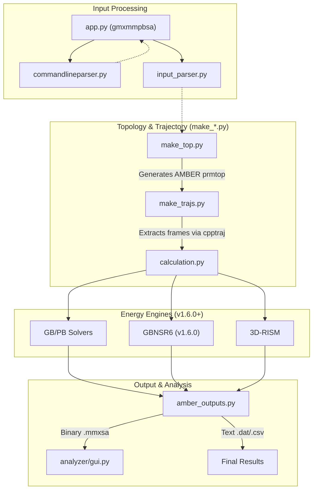
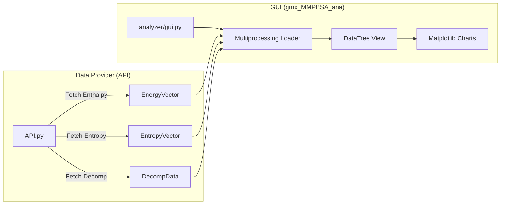

# Changelog and Release Notes

Relevant source files

The following files were used as context for generating this wiki page:

- [GMXMMPBSA/__init__.py](GMXMMPBSA/__init__.py)
- [GMXMMPBSA/app.py](GMXMMPBSA/app.py)
- [docs/changelog.md](docs/changelog.md)
- [docs/compatibility.md](docs/compatibility.md)
- [docs/gmx_MMPBSA_running.md](docs/gmx_MMPBSA_running.md)
- [docs/input_file.md](docs/input_file.md)
- [docs/news.json](docs/news.json)
- [setup.py](setup.py)

This page provides a comprehensive technical history of `gmx_MMPBSA` development. It details the evolution of the codebase from its initial release through version 1.6.5, highlighting major architectural shifts, API changes, and the integration of advanced solvation models and entropy methods.

## Overview of Development History

The development of `gmx_MMPBSA` has focused on bridging the gap between GROMACS trajectories and AMBER-based energy engines. Key milestones include the transition to a modular API in v1.5.x and the implementation of advanced numerical models like GBNSR6 in v1.6.x.

### Codebase Evolution Diagram
The following diagram illustrates the relationship between the core application modules and how they have evolved through various versions to handle data flow from GROMACS to final analysis.

**Title: gmx_MMPBSA Core Logic Flow and Module Evolution**

Sources: [GMXMMPBSA/app.py:40-113](), [GMXMMPBSA/__init__.py:24-26](), [docs/changelog.md:68-72]()

---

## v1.6.x Series: Advanced Models and Stability

The 1.6.x series introduced significant scientific capabilities, most notably the GBNSR6 model, and improved compatibility with modern GROMACS versions.

### v1.6.5 (Current Stable)
*   **CHARMM NMODE Support:** Experimental implementation of Normal Mode Analysis for systems using CHARMM topologies [docs/changelog.md:12-12]().
*   **Residue Selection:** Expanded support for histidine variants in residue selection logic [docs/changelog.md:13-13]().
*   **Bug Fixes:** 
    *   Stricter rules for detecting Lone Pair (LP) atoms to avoid energy inconsistencies [docs/changelog.md:16-16]().
    *   Fixed duplication in Interaction Entropy (IE) and C2 calculations [docs/changelog.md:19-19]().
    *   Resolved an issue where `ie_segment` updates in `gmx_MMPBSA_ana` were not correctly applied if the original input differed [docs/changelog.md:20-21]().

### v1.6.0
*   **GBNSR6 Model:** Full implementation of the GBNSR6 model, including Enthalpy and per-residue/pairwise decomposition [docs/changelog.md:69-72]().
*   **GROMACS 2023 Compatibility:** Updated internal calls to handle changes in GROMACS 2023 [docs/changelog.md:84-84]().
*   **Index File Logic:** Groups can now be defined by either number or name, with improved error tracking for missing groups [docs/changelog.md:74-75]().

Sources: [docs/changelog.md:7-46](), [docs/changelog.md:66-92]()

---

## v1.5.x Series: The API and Analyzer Revolution

Version 1.5.0 marked a breaking change from the 1.4.x series, introducing a completely reworked Analyzer (`gmx_MMPBSA_ana`) and a robust API for programmatic access.

### Architectural Changes in v1.5.0
The application was restructured to separate data processing from visualization. The introduction of the `.mmxsa` binary format allowed for faster data loading in the GUI [docs/changelog.md:140-140]().

**Title: Analyzer Data Flow and API Integration**

Sources: [docs/changelog.md:150-155](), [docs/changelog.md:188-196](), [GMXMMPBSA/app.py:123-151]()

### Key Additions in 1.5.x
*   **Multiprocessing:** Added to `gmx_MMPBSA_ana` to prevent GUI freezing during large dataset loads [docs/changelog.md:158-159]().
*   **Correlation Analysis:** New module for comparing predicted $\Delta G$ with experimental $K_i$ values, including regression plots [docs/changelog.md:163-174]().
*   **C2 Entropy:** Introduced as a new entropy approximation method [docs/compatibility.md:52-55]().
*   **Input Creation:** Added the `--create_input` flag to generate template input files [docs/input_file.md:30-36]().

Sources: [docs/changelog.md:144-204](), [docs/input_file.md:62-62]()

---

## v1.4.x Series: Refinement and MPI Stability

The 1.4.x series focused on stabilizing parallel execution and refining the input file format.

### Significant Changes
*   **MPI Integration:** Fixed inconsistencies when running with `mpirun`. The application now uses `mpi4py` when `mpi_size > 1`, otherwise falling back to a `fake_MPI` implementation for serial runs [docs/changelog.md:116-117](), [GMXMMPBSA/app.py:53-55]().
*   **Variable Renaming:** Standardized many input variables (e.g., `entropy = 1` became `qh_entropy`, `protein_forcefield` and `ligand_forcefield` were merged into `forcefields`) [docs/compatibility.md:68-88]().
*   **System Naming:** Introduced `sys_name` in the `&general` namelist to allow better organization of multi-system projects [docs/input_file.md:120-129]().

Sources: [docs/compatibility.md:65-121](), [GMXMMPBSA/app.py:40-57](), [docs/gmx_MMPBSA_running.md:79-81]()

---

## Summary of Breaking Changes and Migrations

| Version | Change Type | Description |
| :--- | :--- | :--- |
| **1.5.0** | **Breaking** | Completely reworked `gmx_MMPBSA_ana`; incompatible with old `.info` files [docs/compatibility.md:16-17](). |
| **1.5.0** | **Removed** | `protein_forcefield`, `ligand_forcefield`, and `use_sander` variables removed [docs/compatibility.md:47-49](). |
| **1.4.2** | **Deprecated** | `entropy` variable deprecated in favor of `qh_entropy` or `interaction_entropy` [docs/compatibility.md:102-104](). |
| **1.4.0** | **CLI Change** | `gmx_MMPBSA_ana` changed `-p` option to `-f` [docs/compatibility.md:126-127](). |

### Variable Mapping for Migration
Users migrating from older versions should update their `mmpbsa.in` files as follows:
*   `entropy = 1` $\rightarrow$ `qh_entropy = 1` [docs/compatibility.md:69-70]()
*   `entropy = 2` $\rightarrow$ `interaction_entropy = 1` [docs/compatibility.md:73-74]()
*   `entropy_temp` $\rightarrow$ `temperature` [docs/compatibility.md:85-86]()
*   `entropy_seg` $\rightarrow$ `ie_segment` [docs/compatibility.md:77-78]()

Sources: [docs/compatibility.md:65-121](), [docs/input_file.md:145-149]()

---

## Technical Environment Requirements

As of v1.6.5, the software has strict dependency requirements to ensure stability with AmberTools and GROMACS.

*   **Python:** Exactly 3.11 [setup.py:26-27]().
*   **Core Libraries:** 
    *   `numpy==1.26.4` [setup.py:50-50]()
    *   `pandas==1.5.3` [setup.py:50-50]()
    *   `parmed>=4.2.2` [setup.py:54-54]()
    *   `mpi4py==4.0.1` [setup.py:53-53]()

Sources: [setup.py:26-61](), [docs/changelog.md:38-43]()

---