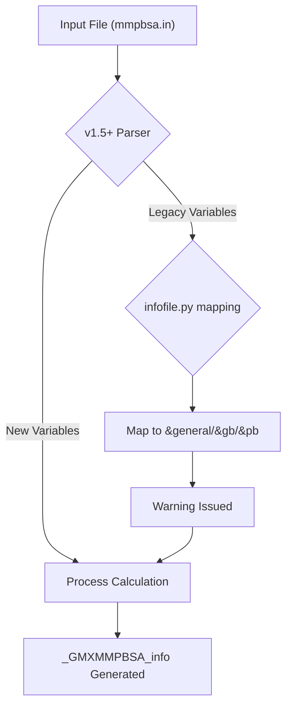
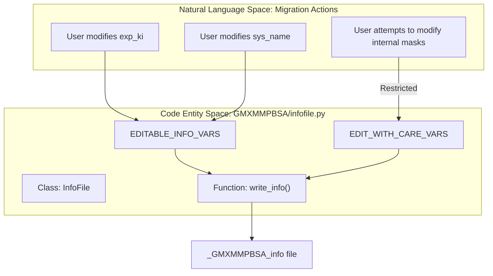

# Migration Guides

Relevant source files

The following files were used as context for generating this wiki page:

- [GMXMMPBSA/infofile.py](GMXMMPBSA/infofile.py)
- [docs/changelog.md](docs/changelog.md)
- [docs/compatibility.md](docs/compatibility.md)
- [docs/gmx_MMPBSA_running.md](docs/gmx_MMPBSA_running.md)
- [docs/input_file.md](docs/input_file.md)
- [docs/news.json](docs/news.json)

This page provides technical documentation for migrating between major versions of `gmx_MMPBSA`. It covers breaking changes in input variables, architectural shifts, and data format updates.

## Purpose and Scope

As `gmx_MMPBSA` has evolved from its initial release, several major versions (1.4.x, 1.5.x, 1.6.x) have introduced architectural changes to improve performance, accuracy, and feature sets. This guide assists users and developers in updating their workflows and input files to maintain compatibility with the latest stable releases.

## 1. Migration from 1.5.x to 1.6.x

The transition to version 1.6.x focuses on expanding solvation models (GBNSR6) and refining existing entropy and topology handling.

### Key Changes
*   **GBNSR6 Support:** Introduction of the `&gbnsr6` namelist for advanced Generalized Born calculations [docs/input_file.md:18-18]().
*   **GROMACS 2023 Compatibility:** Updates to handle changes in GROMACS trajectory and topology formats [docs/changelog.md:84-84]().
*   **Stricter Atom Detection:** Enhanced rules for detecting Lone Pair (LP) atoms in CHARMM force fields [docs/changelog.md:16-16]().
*   **Python Requirement:** Version 1.6.5 restricts the Python environment to 3.11 for stability [docs/changelog.md:43-43]().

### Variable Mapping (1.5.x to 1.6.x)
| Old Variable (1.5.x) | New Variable (1.6.x) | Context |
| :--- | :--- | :--- |
| N/A | `&gbnsr6` namelist | New solvation model [docs/input_file.md:18-18]() |
| `saopt` | *Removed* | Removed from PB/LPH documentation [docs/changelog.md:31-31]() |
| `inp` | `inp = 1` (Default) | Now defaults to 1 for PB calculations [docs/changelog.md:91-91]() |

Sources: [docs/input_file.md:18-18](), [docs/changelog.md:16-91]()

---

## 2. Migration from 1.4.x to 1.5.x

Version 1.5.0 represented a major overhaul of the codebase, introducing significant breaking changes in both the core application and the analyzer.

### Architectural Shift: Parallelism and API
In version 1.5.0, the `gmx_MMPBSA_ana` tool was completely reworked to include multiprocessing and multithreading [docs/changelog.md:158-158](). A new programmatic API was introduced to allow data access via `MMPBSA_API` [docs/changelog.md:150-156]().

### Variable Rework and Deprecations
Many variables in the `&general` namelist were renamed to be more descriptive or to consolidate functionality.

| 1.4.x Variable | 1.5.x Variable | Namelist |
| :--- | :--- | :--- |
| `entropy = 1` | `qh_entropy` | `&general` |
| `entropy = 2` | `interaction_entropy` | `&general` |
| `entropy_seg` | `ie_segment` | `&general` |
| `entropy_temp` | `temperature` | `&general` |
| `protein_forcefield` | `forcefields` | `&general` |
| `ligand_forcefield` | `forcefields` | `&general` |
| `use_sander` | *Removed* | N/A |

Sources: [docs/compatibility.md:15-121](), [GMXMMPBSA/infofile.py:29-61]()

### Logic Flow for Legacy Variable Support
The `InfoFile` class in `GMXMMPBSA/infofile.py` maintains a mapping of variables to their respective namelists to provide backward compatibility where possible, though direct use of old variables in `mmpbsa.in` is discouraged.

**Variable to Namelist Mapping Logic**
`nl_variables` dictionary in `infofile.py` maps legacy and current keys to their parent namelists [GMXMMPBSA/infofile.py:29-61]().

**Data Flow: Legacy Variable Resolution**

Sources: [GMXMMPBSA/infofile.py:29-61](), [docs/compatibility.md:140-162]()

---

## 3. Data Format Changes

### Info File Migration
The `_GMXMMPBSA_info` file (managed by `InfoFile` class) changed its internal structure. In version 1.6.0, a copy of the old info file is created when rewriting output to prevent data loss [docs/changelog.md:89-90]().

### Compact Binary Format
Version 1.5.6 introduced a re-implementation of the compact binary output file (`.mmxsa`) to optimize storage for large trajectories [docs/changelog.md:140-140](). Version 1.5.0+ of `gmx_MMPBSA_ana` is incompatible with binary files generated by versions `< 1.5.2` [docs/changelog.md:186-186]().

### Logic: Info File Variable Writing
The `InfoFile.write_info` method distinguishes between editable and non-editable variables to prevent users from corrupting the state of a calculation during post-processing.

Sources: [GMXMMPBSA/infofile.py:72-117](), [docs/compatibility.md:140-162]()

---

## 4. Summary of Major Calculation Changes

| Feature | 1.4.x | 1.5.x | 1.6.x |
| :--- | :--- | :--- | :--- |
| **Solvation** | GB/PB/RISM | + Non-linear PB | + GBNSR6 |
| **Entropy** | QH/IE | + C2 Entropy | + CHARMM NMODE |
| **Parallelism** | MPI (Experimental) | MPI (Stable/Default) | MPI + Optimized API |
| **Force Fields** | AMBER | + CHARMM/OPLS | + Enhanced LPH support |

### Implementation Note on MPI
Since version 1.5.7, the application automatically uses `mpi4py` if `mpi_size > 1`, otherwise falling back to `fake_MPI`. The explicit "MPI" flag used in older versions is no longer required [docs/changelog.md:116-117]().

Sources: [docs/changelog.md:7-117](), [docs/compatibility.md:52-59](), [docs/gmx_MMPBSA_running.md:79-81]()

---