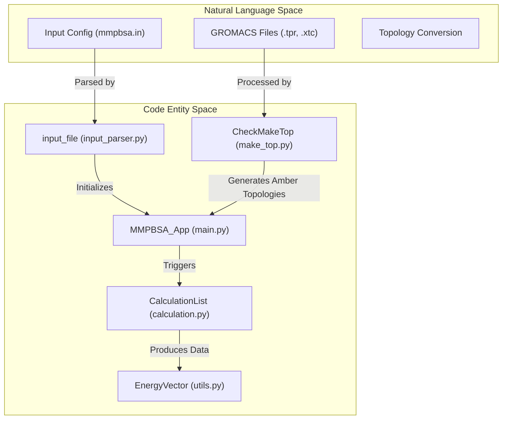
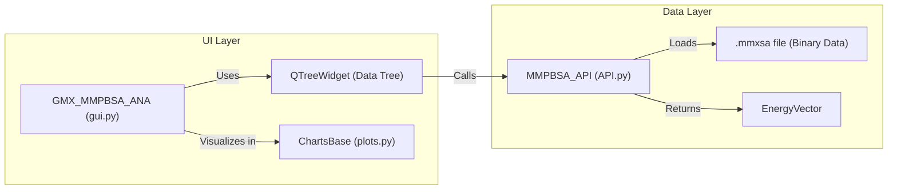

# Glossary

Relevant source files

The following files were used as context for generating this wiki page:

- [GMXMMPBSA/API.py](GMXMMPBSA/API.py)
- [GMXMMPBSA/amber_outputs.py](GMXMMPBSA/amber_outputs.py)
- [GMXMMPBSA/analyzer/chartsettings.py](GMXMMPBSA/analyzer/chartsettings.py)
- [GMXMMPBSA/analyzer/customitem.py](GMXMMPBSA/analyzer/customitem.py)
- [GMXMMPBSA/analyzer/dialogs.py](GMXMMPBSA/analyzer/dialogs.py)
- [GMXMMPBSA/analyzer/gui.py](GMXMMPBSA/analyzer/gui.py)
- [GMXMMPBSA/analyzer/plots.py](GMXMMPBSA/analyzer/plots.py)
- [GMXMMPBSA/analyzer/utils.py](GMXMMPBSA/analyzer/utils.py)
- [GMXMMPBSA/calculation.py](GMXMMPBSA/calculation.py)
- [GMXMMPBSA/createinput.py](GMXMMPBSA/createinput.py)
- [GMXMMPBSA/exceptions.py](GMXMMPBSA/exceptions.py)
- [GMXMMPBSA/input_parser.py](GMXMMPBSA/input_parser.py)
- [GMXMMPBSA/main.py](GMXMMPBSA/main.py)
- [GMXMMPBSA/make_top.py](GMXMMPBSA/make_top.py)
- [GMXMMPBSA/output_file.py](GMXMMPBSA/output_file.py)
- [GMXMMPBSA/utils.py](GMXMMPBSA/utils.py)
- [README.md](README.md)
- [docs/getting-started.md](docs/getting-started.md)

This glossary defines technical terms, abbreviations, and domain-specific concepts used within the `gmx_MMPBSA` codebase.

## Core Concepts and Abbreviations

### MM/PBSA (Molecular Mechanics / Poisson-Boltzmann Surface Area)
A method used to estimate the binding free energy of small molecules to biological macromolecules. It combines molecular mechanics energies with continuum solvation models.
*   **Implementation:** Orchestrated by the `MMPBSA_App` class which manages the data flow from GROMACS files to energy calculations [GMXMMPBSA/main.py:65-110]().

### GB (Generalized Born)
A computationally efficient model used to estimate the electrostatic contribution to solvation free energy.
*   **Code Reference:** Handled by `GBout` for output parsing [GMXMMPBSA/amber_outputs.py:32-35]() and `EnergyCalculation` for execution [GMXMMPBSA/calculation.py:36-38]().

### PB (Poisson-Boltzmann)
A more rigorous (and computationally expensive) method for calculating electrostatic solvation energy by solving the Poisson-Boltzmann equation.
*   **Code Reference:** Handled by `PBout` [GMXMMPBSA/amber_outputs.py:32-35]() and `PBEnergyCalculation` [GMXMMPBSA/calculation.py:36-38]().

### Decomposition Analysis
A method to break down the total binding free energy into contributions from individual residues (per-residue) or pairs of residues (pairwise).
*   **Implementation:** Controlled by the `idecomp` parameter. Modes 1-4 define different levels of interaction inclusion (e.g., 1-4 interactions) [GMXMMPBSA/amber_outputs.py:37-41]().

## Code-Specific Terminology

### EnergyVector
A specialized subclass of `numpy.ndarray` used throughout the codebase to store and manipulate per-frame energy data. It includes built-in methods for statistical analysis (SD, SEM) and uncertainty propagation.
*   **Definition:** `class EnergyVector(np.ndarray)` [GMXMMPBSA/utils.py:52-151]().
*   **Key Methods:** `stdev()`, `sem()`, `corr_add()` (for correlated uncertainty), and `avg()` [GMXMMPBSA/utils.py:86-107]().

### Namelist
A structure mimicking Fortran namelists used in AMBER. It groups variables (like `&general`, `&gb`, `&pb`) for organized input file parsing.
*   **Definition:** `class Namelist(object)` [GMXMMPBSA/input_parser.py:106-121]().
*   **Usage:** Variables are added via `addVariable` [GMXMMPBSA/input_parser.py:143-149]().

### ST vs MT (Single-Trajectory vs Multi-Trajectory)
*   **ST (Single-Trajectory):** Binding energy is calculated using a single trajectory of the complex. Receptor and Ligand coordinates are extracted from this trajectory.
*   **MT (Multi-Trajectory):** Uses three separate trajectories (Complex, Receptor, Ligand). This is more rigorous but requires significantly more simulation time.
*   **Validation:** The `MMPBSA_App` checks if trajectory lengths match for MT protocols [GMXMMPBSA/main.py:143-146]().

## Data Flow and Entities

The following diagram illustrates the relationship between GROMACS input entities and the internal code classes that process them.

### Diagram: Input to Code Entity Mapping

**Sources:** [GMXMMPBSA/main.py:65-110](), [GMXMMPBSA/make_top.py:76-112](), [GMXMMPBSA/input_parser.py:106-121](), [GMXMMPBSA/utils.py:52-63]().

## Solvation Models and Entropy Terms

| Term | Description | Code Entity |
| :--- | :--- | :--- |
| **GGB** | Gas-phase energy (Bond, Angle, Dihedral, VDW, EEL) | `AmberOutput['GGAS']` [GMXMMPBSA/amber_outputs.py:89-91]() |
| **GSOLV** | Solvation free energy (Polar + Non-polar) | `AmberOutput['GSOLV']` [GMXMMPBSA/amber_outputs.py:91]() |
| **IE** | Interaction Entropy (efficient entropy approximation) | `IEout` [GMXMMPBSA/amber_outputs.py:32-35]() |
| **NMODE** | Normal Mode Analysis (rigorous vibrational entropy) | `NmodeCalc` [GMXMMPBSA/calculation.py:36-38]() |
| **QH** | Quasi-Harmonic Entropy | `QuasiHarmCalc` [GMXMMPBSA/calculation.py:36-38]() |

## Analyzer (GUI) Components

The `gmx_MMPBSA_ana` application uses a Model-View-Controller style architecture.

### Diagram: GUI Architecture

**Sources:** [GMXMMPBSA/analyzer/gui.py:44-71](), [GMXMMPBSA/API.py:33-46](), [GMXMMPBSA/analyzer/plots.py:122-135](), [GMXMMPBSA/analyzer/customitem.py:104-140]().

### Key GUI Terms
*   **mmxsa:** A binary file format (pickled Python object) containing all results and metadata required for visualization [GMXMMPBSA/output_file.py:48-51]().
*   **CustomItem:** A specialized `QTreeWidgetItem` that represents a specific calculation result (e.g., GB or PB) and holds references to its plot windows [GMXMMPBSA/analyzer/customitem.py:104-132]().
*   **ParameterTree:** A GUI component for adjusting chart settings like colors, themes, and font sizes [GMXMMPBSA/analyzer/gui.py:137-140]().