**gmx_MMPBSA** is an open-source computational chemistry tool that bridges two of the most widely used molecular dynamics ecosystems — **GROMACS** and **AMBER** — to perform end-state free energy calculations. Built as a faithful adaptation of AMBER's `MMPBSA.py`, it allows researchers who simulate their biomolecular systems with GROMACS to leverage the mature implicit solvent models (Generalized Born, Poisson–Boltzmann, 3D-RISM, and others) from AmberTools for binding free energy estimation, decomposition analysis, alanine scanning, and entropy calculations. The project is licensed under GPLv3 and requires Python 3.11 alongside AmberTools ≥ 20.

Sources: [README.md](README.md#L1-L15), [setup.py](setup.py#L27-L48), [GMXMMPBSA/__init__.py](GMXMMPBSA/__init__.py#L30-L36)


## The Big Picture: How gmx_MMPBSA Works

At its core, gmx_MMPBSA follows a **pipeline architecture** that converts GROMACS-native simulation outputs into AMBER-compatible formats, runs implicit solvent energy calculations on each snapshot, and then aggregates the results into statistical summaries. The entire workflow is orchestrated by the `MMPBSA_App` class in [`main.py`](GMXMMPBSA/main.py), which serves as the central driver for every calculation session.


The pipeline begins with **topology conversion**, where the `CheckMakeTop` class reads GROMACS `.tpr` and `.top` files, generates PDB coordinates, and uses ParmEd alongside `tleap` to produce AMBER `.prmtop` (topology) and `.inpcrd` (coordinate) files. Next, **trajectory processing** via `make_trajectories` and `cpptraj` strips solvents, applies image centering, and splits the trajectory into per-MPI-rank chunks. The **energy calculation engine** then dispatches snapshots to external programs (sander, mmpbsa_py_energy, gbnsr6) for implicit solvent evaluation. Finally, results are parsed, statistics are computed, and output files are written — with an optional launch of the interactive GUI analyzer.

Sources: [GMXMMPBSA/main.py](GMXMMPBSA/main.py#L109-L180), [GMXMMPBSA/make_top.py](GMXMMPBSA/make_top.py#L76-L123), [GMXMMPBSA/make_trajs.py](GMXMMPBSA/make_trajs.py#L43-L48)

## Project Structure

The codebase is organized into a clear module hierarchy under the `GMXMMPBSA/` package. Each module encapsulates a single responsibility within the calculation pipeline, making the system modular and extensible.

```
gmx_MMPBSA/
├── GMXMMPBSA/                    # Core package
│   ├── main.py                   # MMPBSA_App — central orchestrator (1526 lines)
│   ├── calculation.py            # Calculation class hierarchy (1226 lines)
│   ├── make_top.py               # GROMACS → AMBER topology conversion (1758 lines)
│   ├── make_trajs.py             # Trajectory processing via cpptraj (747 lines)
│   ├── input_parser.py           # Input file definition & parser (664 lines)
│   ├── commandlineparser.py      # CLI argument parsing (313 lines)
│   ├── parm_setup.py             # AMBER topology validation & masking (878 lines)
│   ├── API.py                    # Python API for post-hoc analysis (1051 lines)
│   ├── output_file.py            # Final output generation (631 lines)
│   ├── amber_outputs.py          # AMBER output file parsers
│   ├── createinput.py            # sander/rism input file generation
│   ├── infofile.py               # Calculation metadata persistence
│   ├── app.py                    # CLI entry points
│   ├── fake_mpi.py               # MPI stub for single-process mode
│   ├── exceptions.py             # Custom exception hierarchy
│   ├── utils.py                  # Shared utility functions
│   ├── timer.py                  # Performance timing
│   ├── tester.py                 # Built-in example test runner
│   └── analyzer/                 # Interactive GUI analyzer
│       ├── gui.py                # Main window (PyQt5/PyQt6)
│       ├── plots.py              # Chart & table rendering
│       ├── dialogs.py            # Configuration dialogs
│       ├── parametertree/        # Parameter tree widgets
│       └── style/                # Themes & assets
├── GMXMMPBSA.sh                  # Shell wrapper script
├── setup.py                      # Package installation
├── examples/                     # 20+ worked examples
└── docs/                         # Documentation source (MkDocs)
```

Sources: [GMXMMPBSA/app.py](GMXMMPBSA/app.py#L40-L166), [setup.py](setup.py#L30-L58)

## Key Capabilities

gmx_MMPBSA provides a comprehensive suite of molecular mechanics methods for binding free energy estimation. The following table summarizes the core capabilities and the calculation modules that implement them.

| Capability | Description | Key Module |
|---|---|---|
| **GB Calculations** | Generalized Born implicit solvent models (igb 1–8, ALPB) | [`calculation.py`](GMXMMPBSA/calculation.py#L300-L332) |
| **PB Calculations** | Poisson–Boltzmann solvers (linear/nonlinear, membrane support) | [`calculation.py`](GMXMMPBSA/calculation.py#L572-L584) |
| **GBNSR6** | Surface-area generalized Born with optimized radii | [`calculation.py`](GMXMMPBSA/calculation.py#L873-L929) |
| **3D-RISM** | 3D Reference Interaction Site Model solvation | [`calculation.py`](GMXMMPBSA/calculation.py#L367-L478) |
| **Normal Mode Entropy** | Quasi-harmonic vibrational entropy via nmode | [`calculation.py`](GMXMMPBSA/calculation.py#L482-L518) |
| **Quasi-Harmonic Entropy** | Entropy from covariance matrix diagonalization | [`calculation.py`](GMXMMPBSA/calculation.py#L519-L568) |
| **Interaction Entropy** | Entropy from gas-phase energy fluctuations | [`calculation.py`](GMXMMPBSA/calculation.py#L761-L831) |
| **C² Entropy** | Compact entropy estimator from interaction energies | [`calculation.py`](GMXMMPBSA/calculation.py#L833-L871) |
| **Decomposition** | Per-residue energy decomposition (idecomp 1–3) | [`calculation.py`](GMXMMPBSA/calculation.py#L902-L928) |
| **Alanine Scanning** | In-silico mutagenesis to alanine/glycine | [`make_top.py`](GMXMMPBSA/make_top.py#L1017-L1080) |
| **QM/MMGBSA** | Quantum mechanics region in GB calculations | [`input_parser.py`](GMXMMPBSA/input_parser.py#L448-L466) |
| **Stability Analysis** | Fold stability without receptor/ligand separation | [`input_parser.py`](GMXMMPBSA/input_parser.py#L402-L433) |

Sources: [GMXMMPBSA/input_parser.py](GMXMMPBSA/input_parser.py#L395-L664), [GMXMMPBSA/calculation.py](GMXMMPBSA/calculation.py#L1-L50)

## Three Ways to Use gmx_MMPBSA

The project exposes three distinct entry points, each registered as a console script in [`setup.py`](setup.py#L53-L56). These cover the full spectrum from one-shot command-line calculations to programmatic integration and interactive visual analysis.

```mermaid
flowchart TB
    subgraph Entry["Entry Points"]
        CLI["gmx_MMPBSA<br/>Command-line calculator"]
        ANA["gmx_MMPBSA_ana<br/>Interactive GUI analyzer"]
        TEST["gmx_MMPBSA_test<br/>Built-in example runner"]
        API2["Python API<br/>MMPBSA_API class"]
    end
    
    subgraph CLI_Flow["CLI Flow"]
        C1["Parse arguments"] --> C2["Build topologies"] --> C3["Process trajectories"]
        C3 --> C4["Run energy calculations"] --> C5["Write output files"]
    end
    
    subgraph ANA_Flow["Analyzer Flow"]
        A1["Load .info files"] --> A2["Select energy/entropy data"] --> A3["Interactive charts & tables"]
    end
    
    subgraph API_Flow["API Flow"]
        P1["Load results"] --> P2["Filter/query data"] --> P3["Custom Python analysis"]
    end
    
    CLI --> CLI_Flow
    ANA --> ANA_Flow
    API2 --> API_Flow
    TEST --> CLI_Flow
    
    style Entry fill:#E8F5E9
    style CLI fill:#4CAF50,color:#fff
    style ANA fill:#FF9800,color:#fff
    style API2 fill:#2196F3,color:#fff
```



**Command-line interface** (`gmx_MMPBSA`) is the primary workflow. Users specify a GROMACS structure file (`.tpr`), trajectory files (`.xtc`/`.trr`), an index file (`.ndx`), and an input configuration file. The `MMPBSA_App` class orchestrates the entire pipeline from topology conversion through final output generation. MPI parallelism is supported natively — the same command works on a laptop or an HPC cluster.

**GUI analyzer** (`gmx_MMPBSA_ana`) is a PyQt5/PyQt6 desktop application that reads the `.info` metadata files produced by calculations. It provides interactive energy bar charts, per-frame line plots, heatmaps, decomposition tables, and multi-system correlation analysis — all without re-running any calculations.

**Python API** (`MMPBSA_API`) enables programmatic access to all calculated energies, entropies, and decomposition data as pandas DataFrames. This is ideal for researchers who want to integrate gmx_MMPBSA results into custom analysis pipelines using numpy, scipy, or machine learning libraries.

Sources: [GMXMMPBSA/app.py](GMXMMPBSA/app.py#L40-L145), [GMXMMPBSA/API.py](GMXMMPBSA/API.py#L195-L198), [GMXMMPBSA/analyzer/gui.py](GMXMMPBSA/analyzer/gui.py#L35-L60)

## Supported System Types

One of gmx_MMPBSA's distinguishing strengths is its broad support for different biomolecular system types. The `examples/` directory contains over 20 complete, runnable examples that demonstrate these capabilities. Each example includes input files, reference structures, and ready-to-run configurations.

| System Type | Example Directory | Key Considerations |
|---|---|---|
| Protein–Ligand | `Protein_ligand/` | Single and multiple trajectory protocols |
| Protein–Protein | `Protein_protein/` | Standard MM/PBSA workflow |
| Protein–DNA | `Protein_DNA/` | Nucleic acid parameterization |
| Protein–DNA–RNA–Ion–Ligand | `Protein_DNA_RNA_Ion_ligand/` | Multi-component systems |
| Protein–Glycan | `Protein_glycan/` | GLYCAM force field support |
| Protein–Membrane | `Protein_membrane/` | Implicit membrane PB model |
| Metalloprotein–Ligand | `Metalloprotein_ligand/` | Metal ion parameterization |
| CHARMM Force Field | `Protein_ligand_CHARMMff/` | CHARMM-to-AMBER conversion |
| OPLS Force Field | `OPLS/` | OPLS parameter handling |
| PSF/DCD (NAMD) | `psf_dcd/` | Cross-tool compatibility |
| Alanine Scanning | `Alanine_scanning/` | In-silico mutagenesis |
| Decomposition Analysis | `Decomposition_analysis/` | Per-residue energy breakdown |
| Entropy Calculations | `Entropy_calculations/` | nmode, IE, C², quasi-harmonic |
| COVID-19 Proteins | `COVID-19_related_proteins/` | Real-world application |
| Correlation Studies | `Correlation/` | Multi-system comparison |
| QM/MMGBSA | `QM_MMGBSA/` | Semi-empirical QM region |
| GBNSR6 | `GBNSR6/` | Optimized GB surface model |

Sources: [examples/README.md](examples/README.md), [GMXMMPBSA/data/gmxMMPBSA/](GMXMMPBSA/data/gmxMMPBSA/), [GMXMMPBSA/input_parser.py](GMXMMPBSA/input_parser.py#L402-L466)

## Dependencies and Requirements

gmx_MMPBSA requires a specific, well-defined software stack. The dependency chain is managed through both `pip` packages and external system-level tools.

| Requirement | Version | Purpose |
|---|---|---|
| Python | 3.11 | Runtime environment (strict pin) |
| AmberTools | ≥ 20 | sander, mmpbsa_py_energy, cpptraj, tleap |
| GROMACS | Any | Simulation engine (provides input files) |
| ParmEd | ≥ 4.2.2 | Topology format conversion |
| mpi4py | 4.0.1 | MPI parallelism support |
| numpy | 1.26.4 | Numerical computation |
| pandas | 1.5.3 | Data handling (API & output) |
| matplotlib | 3.7.3 | Plotting (GUI analyzer) |
| PyQt5/PyQt6 | — | GUI analyzer (optional) |
| tqdm | — | Progress bars |

Sources: [setup.py](setup.py#L41-L48), [GMXMMPBSA/__init__.py](GMXMMPBSA/__init__.py#L33-L34), [GMXMMPBSA/main.py](GMXMMPBSA/main.py#L36-L47)

## Where to Go Next

This Overview covers the "what" and "why" of gmx_MMPBSA at a high level. To start using it, proceed through the following learning path:

1. **[Quick Start](2-quick-start)** — Install gmx_MMPBSA and run your first binding free energy calculation in minutes.
2. **[Input File Reference](3-input-file-reference)** — Master the input file namelists (`general`, `gb`, `pb`, `nmode`, `decomp`, `ala`, etc.) that control every aspect of the calculation.
3. **[Output Files Guide](4-output-files-guide)** — Understand the structure and meaning of all output files, including `FINAL_RESULTS_MMPBSA.dat` and decomposition outputs.

For a deeper understanding of the internals, explore the Architecture section starting with **[Architecture Overview](5-architecture-overview)**.