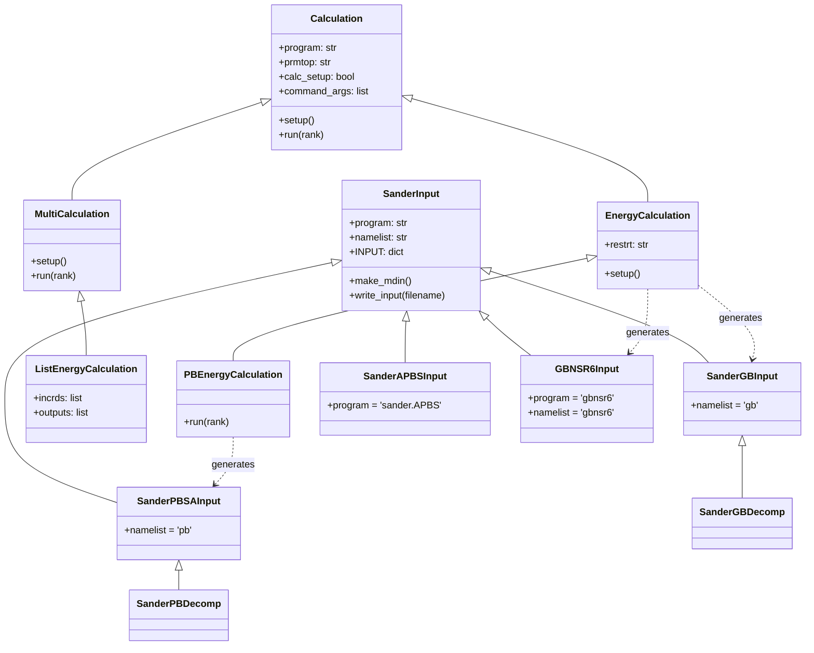
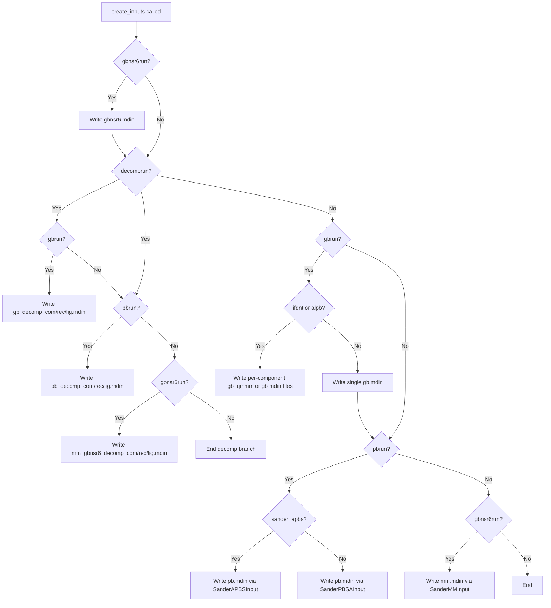

Implicit solvation is the computational engine at the heart of gmx_MMPBSA's free energy estimation. This page dissects the three solver families—Generalized Born (GB), Poisson-Boltzmann (PB), and the specialized GBNSR6—by tracing their paths from input parameterization through external solver invocation to output recovery. Understanding this machinery is essential for anyone tuning solver parameters, debugging convergence failures, or extending the framework with custom solvation models.

## Solver Architecture Overview

gmx_MMPBSA does not implement GB or PB solvers natively. Instead, it orchestrates external executables—primarily AMBER's `sander`, the standalone `gbnsr6` binary, and optionally `sander.APBS`—by generating solver-specific input files, constructing command-line invocations, and monitoring subprocess lifecycle. The entire pipeline is split across two modules: [`createinput.py`](GMXMMPBSA/createinput.py) handles input file generation, while [`calculation.py`](GMXMMPBSA/calculation.py) manages execution and progress tracking.



The class hierarchy is deliberately flat: every solver variant inherits from a single `Calculation` base class, with `EnergyCalculation` adding sander-specific argument handling (restart files, XVV files for GB) and `PBEnergyCalculation` overriding `run()` to intercept and parse PB-specific error output. This design means that all solvers share the same execution infrastructure but can inject solver-specific behavior at precisely two points—input generation and stdout processing.

Sources: [calculation.py](GMXMMPBSA/calculation.py#L218-L335), [calculation.py](GMXMMPBSA/calculation.py#L572-L635), [createinput.py](GMXMMPBSA/createinput.py#L312-L420)

## Input File Generation Pipeline

The `create_inputs()` function in [`createinput.py`](GMXMMPBSA/createinput.py#L49) is the central dispatcher. It receives the parsed `INPUT` dictionary and a `prmtop_system` object, then determines which `.mdin` files need to be written based on the trigger flags (`gbrun`, `pbrun`, `gbnsr6run`) and optional decomposition/decomposition mode flags (`decomprun`). Critically, the function branches on whether decomposition is active because GB decomposition requires per-component input files (COM, REC, LIG), while non-decomposition mode can share a single input file across all components.



Each input class follows a three-phase construction. First, the constructor defines `input_items` (a dictionary mapping sander/mdin variable names to default values), `parent_namelist` (mapping each variable to the mdin section it belongs to, such as `cntrl`, `pb`, or `qmmm`), and `name_map` (translating gmx_MMPBSA's user-facing parameter names to their mdin equivalents). Then, `make_mdin()` iterates over `input_items`, looking up each key in the user's `INPUT` dictionary via `name_map`, falling back to the default if no override exists. Finally, `write_input()` serializes the resulting `Mdin` object to disk.

Sources: [createinput.py](GMXMMPBSA/createinput.py#L49-L310), [createinput.py](GMXMMPBSA/createinput.py#L323-L348)

## Unit Conversion and Parameter Mapping

A subtle but critical detail lives in the base `SanderInput.make_mdin()` method: for both PB and GBNSR6 solvers, the ionic strength (`istrng`) undergoes a **unit conversion from molarity (M) to millimolarity (mM)**, multiplied by 1000 before being written to the mdin file. This conversion is necessary because the external PB and GBNSR6 solvers expect mM, while gmx_MMPBSA's user-facing input format uses M. The GB solver path does not perform this conversion because sander's GB implementation accepts `saltcon` directly in M.

Another key mapping asymmetry involves PB's `dprob` parameter: users specify it as `prbrad` in the input file, which maps to `dprob` in the mdin's `&pb` namelist. Similarly, `indi`/`exdi` in the user input map to `epsin`/`epsout` in the mdin. These translations are all encoded in the `name_map` dictionaries within each input class.

> [!TIP]
> The `istrng` × 1000 conversion is applied only for `pb` and `gbnsr6` namelists (verified by the `self.namelist in ['pb', 'gbnsr6']` conditional). If you add a new solver that also requires mM, you must include its namelist in that set. Source: [createinput.py](GMXMMPBSA/createinput.py#L339-L342)

Sources: [createinput.py](GMXMMPBSA/createinput.py#L323-L348), [input_parser.py](GMXMMPBSA/input_parser.py#L435-L570)

## Generalized Born Solver (GB)

### Solver Execution Path

GB calculations are dispatched through `EnergyCalculation`, which constructs the standard sander command-line arguments: `-O -i <input> -p <prmtop> -c <incrd> -o <output> -y <traj> -r <restrt>`. The GB model is selected via the `igb` parameter in the `&cntrl` namelist of the generated mdin file. gmx_MMPBSA supports all sander-compatible GB models, with the default being `igb=5` (GB-OBC2).

### GB Model Parameters

| Parameter | mdin Section | Default | Description |
|-----------|-------------|---------|-------------|
| `igb` | cntrl | 5 | GB model selector (1=GB1, 2=GB2, 5=OBC2, 7=OBC1, 8=GB-neck2) |
| `intdiel` | cntrl | 1.0 | Internal (solute) dielectric constant |
| `extdiel` | cntrl | 78.5 | External (solvent) dielectric constant |
| `saltcon` | cntrl | 0.0 | Salt concentration in M (no unit conversion) |
| `surften` | cntrl | 0.0072 | Surface tension coefficient (kcal/mol/Ų) |
| `surfoff` | cntrl | 0.0 | Surface tension offset (kcal/mol) |
| `molsurf` | — | 0 | Use Connelly molecular surface (via `cpptraj`) |
| `alpb` | cntrl | 0 | Enable Analytical Linearized PB correction |

### ALPB Mode: External Radius Estimation

When `alpb=1`, gmx_MMPBSA enters a special path that requires the external `elsize` utility. Before writing the GB mdin, the framework uses ParmEd to convert each `.prmtop` + `.inpcrd` pair into a `.pqr` file, then invokes `elsize COM.pqr -hea` via subprocess to estimate the effective electrostatic radius. The `arad_method` parameter (default 1) selects which radius estimator from `elsize`'s output is used. This value is injected into the mdin as `arad`, overriding the default of 15 Å. The process runs independently for COM, REC, and LIG, producing potentially different `arad` values per component.

Sources: [createinput.py](GMXMMPBSA/createinput.py#L100-L115), [createinput.py](GMXMMPBSA/createinput.py#L168-L175), [input_parser.py](GMXMMPBSA/input_parser.py#L435-L470)

## GBNSR6 Solver

GBNSR6 is a standalone implicit solvation program distinct from sander. Its integration into gmx_MMPBSA follows a **two-file execution pattern**: one mdin for GBNSR6 itself (generated by `GBNSR6Input`, which targets the `gbnsr6` executable), and a separate mdin for sander's MM energy terms (generated by `SanderMMInput`, which uses `igb=5` as a no-solvation placeholder).

### GBNSR6 Parameters

| Parameter | mdin Section | Default | Description |
|-----------|-------------|---------|-------------|
| `b` | gb | 0.028 | Uniform offset to inverse effective radii |
| `alpb` | gb | 1 | Enable ALPB correction |
| `epsin` | gb | 1.0 | Solute dielectric constant |
| `epsout` | gb | 78.5 | Solvent dielectric constant |
| `istrng` | gb | 0.0 | Ionic strength in M (converted to mM internally) |
| `dprob` | gb | 1.4 | Solvent probe radius (Å) |
| `space` | gb | 0.5 | Grid spacing for molecular surface (Å) |
| `arcres` | gb | 0.2 | Arc resolution for numerical surface integration |
| `chagb` | gb | 0 | Enable CHAGB model |
| `roh` | gb | 1 | RzOH selection for CHA GB model (1–4 maps to 0.586–0.183) |
| `tau` | gb | 1.47 | τ parameter for CHAGB model |
| `cavity_surften` | gb | 0.005 | Nonpolar surface tension (kcal/mol/Ų) |
| `dgij` | gb | 0 | Enable pairwise decomposition output |

The `roh` parameter uses an integer selector (1–4) that maps to predefined float values via the `ROH` dictionary: `{1: 0.586, 2: 0.699, 3: 0.734, 4: 0.183}`. This mapping is applied in `create_inputs()` before passing to the `GBNSR6Input` constructor. When decomposition is active, `dgij` is automatically set to 1 to request pairwise decomposition data, which is later consumed by the `MergeGBNSR6Output` class.

Sources: [createinput.py](GMXMMPBSA/createinput.py#L46-L50), [createinput.py](GMXMMPBSA/createinput.py#L388-L410), [input_parser.py](GMXMMPBSA/input_parser.py#L473-L496)

## Poisson-Boltzmann Solver (PB)

PB calculations represent the most parameter-rich solver path. gmx_MMPBSA supports three PB variants: the default internal PBSA solver (via `sander` with `ipb=2`), the nonlinear PB option (`npbopt=1`), and the external APBS solver (`sander.APBS` with `igb=6`).

### PB Solver Selection

| Variant | Trigger | Executable | Key Differentiator |
|---------|---------|------------|--------------------|
| Linear PBSA | `pbrun=1` | `sander` | Default; uses `ipb=2`, `inp=2` (SESA NP) |
| Nonlinear PBSA | `pbrun=1, npbopt=1` | `sander` | Nonlinear PB equation (`npbopt` changes solver) |
| APBS | `pbrun=1, sander_apbs=1` | `sander.APBS` | External APBS library; `igb=6` |

### PBSA Parameters

| Category | Parameter | mdin Section | Default | Description |
|----------|-----------|-------------|---------|-------------|
| **Dielectric** | `ipb` | cntrl | 2 | PB solver version (1=old, 2=new) |
| | `indi` | pb | 1.0 | Internal dielectric (mapped to `epsin`) |
| | `exdi` | pb | 80.0 | External dielectric (mapped to `epsout`) |
| | `emem` | pb | 4.0 | Membrane dielectric |
| **Ionic** | `istrng` | pb | 0.0 | Ionic strength M (→ mM in mdin) |
| | `iprob` | pb | 2.0 | Mobile ion probe radius (Å) |
| **Grid** | `fillratio` | pb | 4.0 | Grid-to-solute dimension ratio |
| | `scale` | pb | 2.0 | 1/scale = grid spacing (Å) |
| | `nbuffer` | pb | 0 | Buffer distance (grid units) |
| | `nfocus` | pb | 2 | Electrostatic focusing levels |
| | `fscale` | pb | 8 | Coarse-to-fine grid ratio |
| **Solver** | `npbopt` | pb | 0 | Nonlinear PB (0=linear, 1=nonlinear) |
| | `solvopt` | pb | 1 | Iterative solver method |
| | `accept` | pb | 0.001 | Convergence criterion |
| | `linit` | pb | 1000 | Max SCF iterations |
| **Nonpolar** | `inp` | cntrl | 2 | NP method (1=LCPO, 2=SESA) |
| | `cavity_surften` | pb | 0.0378 | Surface tension |
| | `cavity_offset` | pb | -0.5692 | Nonpolar offset |
| **Boundary** | `bcopt` | pb | 5 | Boundary condition option |
| | `eneopt` | pb | 2 | Energy/force computation |
| **Membrane** | `memopt` | pb | 0 | Enable membrane PB |
| | `mthick` | pb | 40.0 | Membrane thickness (Å) |
| | `mctrdz` | pb | 0.0 | Z-offset for membrane |

### APBS-Specific Parameters

The `SanderAPBSInput` class uses a completely different parameter set because it delegates to APBS's own input format. Key parameters include `bcfl` (boundary condition: 2=MDH), `srfm` (surface: 2=Spline SM), `chgm` (charge mapping: 1=spline), and `cmeth` (calculation method: 1=multipole). The APBS path sets `igb=6` in the sander `&cntrl` namelist as the trigger for the APBS bridge. Unlike PBSA, APBS uses a simpler nonpolar model with a single `gamma` surface tension parameter (default 0.00542).

Sources: [createinput.py](GMXMMPBSA/createinput.py#L626-L714), [createinput.py](GMXMMPBSA/createinput.py#L714-L756), [input_parser.py](GMXMMPBSA/input_parser.py#L498-L570)

## PB Error Interception: PBEnergyCalculation

The `PBEnergyCalculation` class overrides the standard `EnergyCalculation.run()` method to address a fundamental difference between GB and PB solver behavior: **PBSA prints diagnostic warnings and errors to stdout**, not just stderr. In the standard `Calculation.run()`, stdout is redirected to a file and never inspected. `PBEnergyCalculation` instead captures stdout via `subprocess.PIPE`, decodes it, and applies a regex pattern `(pb (?:bomb)|(?:warning))` to extract any PB-specific diagnostic messages. If the subprocess returns a non-zero exit code, these messages are surfaced to the user with a suggestion to inspect the `*.mdout` files.

```python
# The error regex pattern in PBEnergyCalculation
errorre = re.compile('(pb (?:bomb)|(?:warning))', re.I)
```

This interception is critical because PB convergence failures are the most common source of calculation errors in MMPBSA workflows, and without stdout capture, the diagnostic information would be silently discarded into output files the user may not think to check.

> [!TIP]
> If you encounter PB calculation failures, `PBEnergyCalculation` will surface matched `pb bomb` or `pb warning` lines from the solver's stdout. For deeper diagnostics, always inspect the `*.mdout` files directly—the APBS variant in particular writes detailed convergence logs that are not captured by the regex. Source: [calculation.py](GMXMMPBSA/calculation.py#L572-L632)

Sources: [calculation.py](GMXMMPBSA/calculation.py#L572-L632)

## Progress Monitoring

The `pb()` function in [`calculation.py`](GMXMMPBSA/calculation.py#L53) provides a unified progress bar for all solver types by polling output files. It distinguishes between GB/PB (which emit `FINAL RESULTS` markers) and nmode calculations (which emit `Total:` markers). For GBNSR6, progress is tracked by counting output files matching the expected basename pattern via `pathlib.glob`, since GBNSR6 writes one file per frame rather than appending to a single stream. The polling loop uses exponential backoff on the sleep interval (`ctime += 1`) when no new frames are detected, preventing busy-waiting without a fixed polling frequency.

Sources: [calculation.py](GMXMMPBSA/calculation.py#L53-L87)

## Decomposition Integration

Both GB and PB solvers support per-residue energy decomposition, implemented through derived input classes: `SanderGBDecomp` and `SanderPBDecomp`. These classes accept additional GROUP card arguments that define which residues belong to the receptor and ligand, plus optional print-range masks. The decomposition flag `idecomp` and verbosity flag `dec_verbose` are pulled from the `&cntrl` namelist regardless of the solver type, providing a unified decomposition interface across all implicit solvent models.

For GBNSR6 decomposition, the architecture diverges: the MM (electrostatic + vdW) component is computed by sander via `SanderMMDecomp`, while the solvation component is computed by gbnsr6 with `dgij=1`. The two outputs are reconciled by the `MergeGBNSR6Output` class, which reads both the sander MM output and the gbnsr6 pairwise output, then combines them into a unified decomposition table. This two-stage merge is necessary because gbnsr6 cannot compute MM energies—it only provides GB polar solvation terms.

Sources: [createinput.py](GMXMMPBSA/createinput.py#L132-L160), [createinput.py](GMXMMPBSA/createinput.py#L757-L778), [calculation.py](GMXMMPBSA/calculation.py#L929-L1156)

## Continue Reading

- **[Calculation Class Hierarchy](9-calculation-class-hierarchy)** — The parent page covering all calculation types; provides context for how GB/PB fit into the broader execution framework.
- **[Decomposition Analysis](13-decomposition-analysis)** — Deep dive into per-residue decomposition, including how GB/PB decomposition outputs are parsed and merged.
- **[QM/MMGBSA Integration](12-qm-mmgbsa-integration)** — Details on the QM/MM coupling within GB calculations, including the `ifqnt` flag and QM mask propagation.