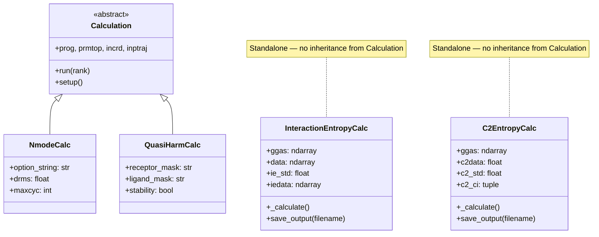
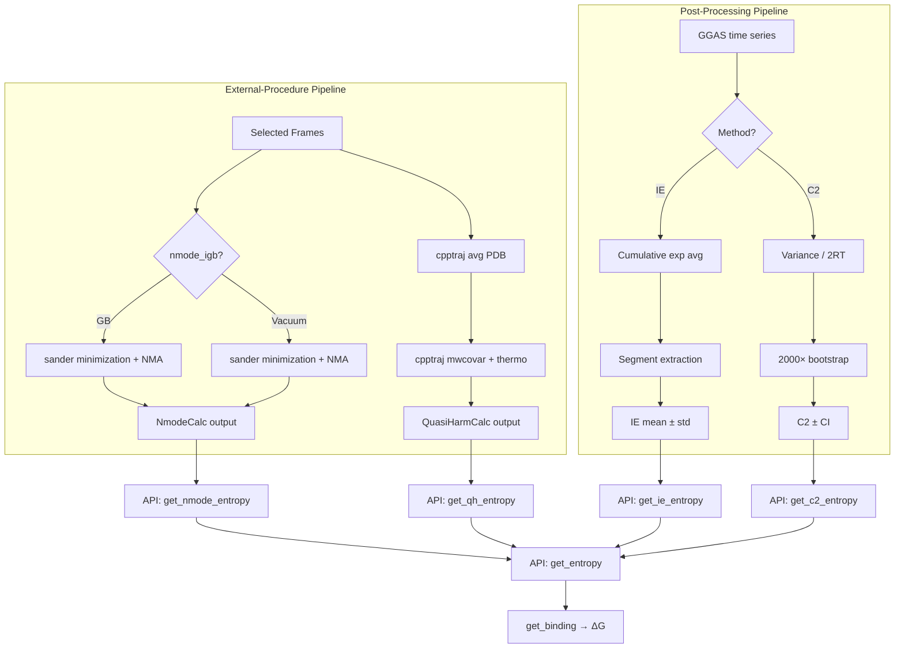

Entropy corrections transform the enthalpic MM/PBSA estimate into a more complete binding free energy. gmx_MMPBSA exposes four distinct entropy approximations—each occupying a different position on the accuracy-versus-computational-cost spectrum—unified under a single `&general` entry point and a polymorphic class hierarchy in [calculation.py](GMXMMPBSA/calculation.py).

## Architectural Overview

The entropy subsystem is split into two architectural families. **External-procedure methods** (Normal Mode and Quasi-Harmonic) delegate to Amber tools (sander, cpptraj) and inherit from the `Calculation` base class, integrating directly into the MPI-aware `CalculationList` pipeline. **Post-processing methods** (Interaction Entropy and C² Entropy) operate purely in Python/NumPy space, consuming the gas-phase energy (GGAS) time series after the fact. This split is the single most important structural distinction for developers extending the entropy subsystem.



The orchestration layer in [MMPBSA_App.get_iec2entropy()](GMXMMPBSA/main.py#L1277-L1342) iterates over all completed energy methods (`gb`, `pb`, `rism std`, `rism gf`, `rism pcplus`, `gbnsr6`) and constructs entropy objects when the corresponding flags are set. External-procedure methods are instead enqueued during [load_calc_list()](GMXMMPBSA/main.py#L212-L238) and execute before output parsing.

## Normal Mode Analysis

Normal mode analysis (NMA) computes entropy by diagonalizing the mass-weighted Hessian after energy minimization. It is the most physically rigorous but also the most expensive option, scaling poorly with system size. In gmx_MMPBSA it is encapsulated by the `NmodeCalc` class ([calculation.py#L482-L518](GMXMMPBSA/calculation.py#L482-L518)), which inherits from `Calculation` and delegates to sander.

### Configuration

All NMA parameters live in the dedicated `&nmode` namelist ([input_parser.py#L650-L663](GMXMMPBSA/input_parser.py#L650-L663)):

| Parameter | Type | Default | Description |
|---|---|---|---|
| `nmstartframe` | `int` | `1` | First frame from the selected trajectory range to feed into NMA |
| `nmendframe` | `int` | `1000000` | Last frame for NMA (capped by `&general` `endframe`) |
| `nminterval` | `int` | `1` | Stride between consecutive NMA snapshots |
| `nmode_igb` | `int` | `1` | GB model flag for the minimization stage (`1` = GB, `0` = vacuum) |
| `nmode_istrng` | `float` | `0` | Ionic strength (M) for the GB dielectric in minimization |
| `dielc` | `float` | `1` | Dielectric constant |
| `drms` | `float` | `0.001` | RMS gradient convergence criterion for minimization |
| `maxcyc` | `int` | `10000` | Maximum minimization cycles per snapshot |

### Execution Path

During `__init__`, `NmodeCalc` computes the Debye-Hückel screening parameter κ as `√(0.10806 × nmode_istrng)` and assembles a sander option string that differs based on `nmode_igb` ([calculation.py#L487-L502](GMXMMPBSA/calculation.py#L487-L502)):

- **GB mode** (`nmode_igb=1`): `diel=C, kappa=…, gb=1` — uses a constant dielectric with GB electrostatics during minimization.
- **Vacuum mode** (`nmode_igb=0`): `diel=R, kappa=…, gb=0` — uses a distance-dependent dielectric.

The `setup()` method appends `(incrd, prmtop, maxcyc, drms, option_string, inptraj)` to the command arguments, which are then executed by the base `Calculation.run()` via subprocess. Because `NmodeCalc` inherits the full `Calculation` lifecycle, it participates naturally in the MPI `CalculationList`.

> [!TIP]
> NMA frame selection is **independent** of the `&general` frame range. The `nmstartframe`/`nmendframe` values index into the already-filtered trajectory, so setting `endframe=10` and `nmstartframe=3` means NMA processes frames 3–10 of the 10-frame window — not frames 3–10 of the full MD trajectory. The example input file at [examples/Entropy_calculations/nmode/mmpbsa.in](examples/Entropy_calculations/nmode/mmpbsa.in) demonstrates this explicitly.

## Quasi-Harmonic Entropy

Quasi-harmonic (QH) analysis estimates configurational entropy from the covariance of atomic positional fluctuations across a trajectory ensemble. Unlike NMA, it requires no minimization or Hessian diagonalization—only a sufficiently long, equilibrated trajectory. gmx_MMPBSA delegates the entire computation to cpptraj via the `QuasiHarmCalc` class ([calculation.py#L519-L569](GMXMMPBSA/calculation.py#L519-L569)).

### Input Generation

The `QuasiHarmonicInput` class ([createinput.py#L779-L804](GMXMMPBSA/createinput.py#L779-L804)) writes a cpptraj control file that performs the following sequence for each molecular partition (complex, receptor, ligand):

1. **Trajectory read** — loads the mass-weighted trajectory.
2. **Reference alignment** — RMS-fits to the pre-computed average PDB.
3. **Mass-weighted covariance** — builds a covariance matrix via `matrix mwcovar`.
4. **Thermodynamic analysis** — `analyze matrix … thermo reduce` computes entropy contributions at the specified temperature.

For binding calculations (not stability mode), three separate matrices are computed and written to `complex_entropy.out`, `receptor_entropy.out`, and `ligand_entropy.out`.

### Pre-processing Step

Before the main cpptraj entropy calculation, `QuasiHarmCalc.setup()` invokes cpptraj to generate the average structure ([calculation.py#L543-L561](GMXMMPBSA/calculation.py#L543-L561)):

```
trajin _GMXMMPBSA_complex.mdcrd
average _GMXMMPBSA_avgcomplex.pdb pdb chainid " "
```

This average PDB serves as the RMS reference for all subsequent covariance analysis. If this pre-processing step fails (non-zero return code), a `CalcError` is raised.

### Activation

QH is enabled by setting `qh_entropy=1` in the `&general` namelist ([input_parser.py#L418](GMXMMPBSA/input_parser.py#L418)). No additional namelist is required—temperature is drawn from `&general temperature` (default 298.15 K).

## Interaction Entropy

Interaction Entropy (IE) is a computationally inexpensive, trajectory-based method that estimates the entropic contribution to binding from fluctuations in the gas-phase interaction energy (ΔE_gas). The implementation lives in `InteractionEntropyCalc` ([calculation.py#L761-L831](GMXMMPBSA/calculation.py#L761-L831))—a standalone class that operates entirely in NumPy.

### Mathematical Formulation

Given a time series of gas-phase interaction energies {ΔE_i}, IE computes:

$$-T\Delta S_{IE} = k_B T \ln \left\langle e^{-(\Delta E_i - \langle \Delta E \rangle) / k_B T} \right\rangle$$

where the average is cumulative: at frame *i*, the exponential average is taken over all frames 0 through *i*. The Boltzmann constant is hardcoded as `k = 0.001985875 kcal/(mol·K)` ([calculation.py#L785](GMXMMPBSA/calculation.py#L785)).

### Segmented Averaging

The cumulative IE time series converges only after sufficient sampling. To avoid early-frame noise, the final result is taken from the **last N% of frames**, controlled by `ie_segment` (default 25, meaning the final quarter of frames) ([input_parser.py#L420](GMXMMPBSA/input_parser.py#L420)):

```python
ieframes = math.ceil(numframes * (self.isegment / 100))
iedata = self.data[-self.ieframes:]
```

The method reports the mean and standard deviation across these converged frames.

### Error Handling

When an energy fluctuation is so large that `exp(ΔE / kT)` overflows, the method logs a warning, disables IE for the current run (`interaction_entropy = 0`), and gracefully continues ([calculation.py#L795-L800](GMXMMPBSA/calculation.py#L795-L800)).

> [!TIP]
> IE requires only the GGAS component from any completed energy method. It does not invoke any external program, making it safe to run on minimal hardware. However, its accuracy is contingent on adequate sampling of the interaction energy distribution—very short trajectories (fewer than ~100 frames) will produce unreliable IE estimates regardless of the `ie_segment` setting.

## C² Entropy

The C² entropy method provides a variance-based entropy estimate derived from the same gas-phase energy fluctuations as IE, but using a fundamentally different statistical approach. The implementation is in `C2EntropyCalc` ([calculation.py#L833-L871](GMXMMPBSA/calculation.py#L833-L871)).

### Core Calculation

The C² estimate is computed directly from the standard deviation of the gas-phase interaction energy:

$$-T\Delta S_{C^2} = \frac{\sigma^2_{\Delta E}}{2RT}$$

where σ is the sample standard deviation of GGAS and R = 0.001987 kcal/(mol·K) ([calculation.py#L848](GMXMMPBSA/calculation.py#L848)).

### Bootstrap Confidence Intervals

Unlike IE, which produces a per-frame time series, C² yields a single scalar. To estimate uncertainty, the implementation performs **2000 bootstrap resampling** iterations ([calculation.py#L853-L858](GMXMMPBSA/calculation.py#L853-L858)):

```python
array_of_c2 = np.zeros(2000)
for i in range(2000):
    idxs = np.random.randint(0, size, size)
    ie_std = self.ggas[idxs].std()
    c2data = (ie_std ** 2) / (2 * temperature * R)
    array_of_c2[i] = c2data
```

The central 95% of the sorted bootstrap distribution (excluding the extreme 100 samples on each side) yields the confidence interval, and the standard deviation of this trimmed set is reported as `c2_std`.

### Output Format

The C² output file contains:

| Field | Description |
|---|---|
| `C2 Entropy (-TΔS)` | Point estimate of the entropic contribution |
| `C2 Entropy SD` | Bootstrap standard deviation (trimmed) |
| `Internal Energy SD (sigma)` | Standard deviation of the input GGAS series |
| `C2 Entropy CI` | 2.5th and 97.5th percentile bootstrap bounds |

## Method Comparison

| Feature | Normal Mode | Quasi-Harmonic | Interaction Entropy | C² Entropy |
|---|---|---|---|---|
| **External program** | sander | cpptraj | None (NumPy) | None (NumPy) |
| **Class** | `NmodeCalc` | `QuasiHarmCalc` | `InteractionEntropyCalc` | `C2EntropyCalc` |
| **Inherits `Calculation`** | Yes | Yes | No | No |
| **Input energy source** | Structure coordinates | Trajectory covariance | GGAS time series | GGAS time series |
| **Minimization required** | Yes (per frame) | No | No | No |
| **Computational cost** | Very high | Moderate | Negligible | Negligible |
| **Input namelist** | `&nmode` | `&general` | `&general` | `&general` |
| **Activation flag** | (implicit via `&nmode`) | `qh_entropy=1` | `interaction_entropy=1` | `c2_entropy=1` |
| **Per-frame output** | Yes | Yes (partitioned) | Yes | No (scalar) |
| **Uncertainty estimation** | Frame-to-frame std | cpptraj thermo | Segment std | Bootstrap CI |
| **MPI parallelizable** | Yes (frame-level) | No (single cpptraj call) | N/A | N/A |



## Orchestration in MMPBSA_App

The `MMPBSA_App` class coordinates entropy calculations at two distinct lifecycle stages, reflecting the architectural split between external-procedure and post-processing methods.

**Stage 1 — Calculation list building** ([main.py#L212-L238](GMXMMPBSA/main.py#L212-L238)). During `load_calc_list()`, the app constructs a `CalculationList` that includes `NmodeCalc` and `QuasiHarmCalc` instances when their respective flags are set. These execute as part of the standard MPI-aware calculation pipeline, alongside energy calculations.

**Stage 2 — Post-calculation entropy** ([main.py#L1277-L1342](GMXMMPBSA/main.py#L1277-L1342)). After all energy outputs have been parsed, `get_iec2entropy()` checks `interaction_entropy` and `c2_entropy` flags, iterates over the set of completed energy methods, extracts the `delta['GGAS']` array, and constructs `InteractionEntropyCalc` or `C2EntropyCalc` instances. Results are written to disk (e.g., `_GMXMMPBSA_normal_gb_IE.dat`) and then parsed back into the `calc_types` data structure for downstream reporting.

Both stages correctly handle alanine scanning scenarios: when `alarun` is active, entropy is computed for both normal and mutant systems, and a `DeltaIEC2Statistic` object is created for the mutant-minus-normal difference.

## API Access Patterns

The `MMPBSA_API` class provides granular access to each entropy method through dedicated accessors, as well as a unified `get_entropy()` entry point ([API.py#L524-L554](GMXMMPBSA/API.py#L524-L554)).

| Method | Returns | Key Parameters |
|---|---|---|
| `get_nmode_entropy()` | Per-frame NMA entropy DataFrames | `nmtype`, `mol`, `term`, frame range |
| `get_qh_entropy()` | Partitioned QH entropy DataFrame | `qhtype`, `mol`, `term` |
| `get_ie_entropy()` | Cumulative IE + segment statistics | `ietype`, frame range, `ie_segment` |
| `get_c2_entropy()` | Scalar C² with bootstrap stats | `c2type`, frame range |
| `get_entropy()` | Union of all enabled methods | All of the above, auto-dispatched by key |

A critical feature of the IE and C² accessors is **lazy recalculation**: if the caller requests a frame range or `ie_segment` different from the original calculation, the API transparently reconstructs the `InteractionEntropyCalc` or `C2EntropyCalc` object from the stored GGAS data ([API.py#L555-L580](GMXMMPBSA/API.py#L555-L580)):

```python
recalc = bool((startframe and startframe != self.app_namespace.INPUT['general']['startframe'] or
               endframe and endframe != self.app_namespace.INPUT['general']['endframe'] or ...))
```

The final binding free energy is assembled by `get_binding()` ([API.py#L581-L620](GMXMMPBSA/API.py#L581-L620)), which combines the enthalpy (ΔH) from energy summaries with the entropy term (-TΔS) and propagates uncertainties via quadrature.

## Configuration Quick Reference

| Namelist | Variable | Default | Activates |
|---|---|---|---|
| `&general` | `qh_entropy` | `0` | Quasi-Harmonic |
| `&general` | `interaction_entropy` | `0` | Interaction Entropy |
| `&general` | `ie_segment` | `25` | IE convergence window (%) |
| `&general` | `c2_entropy` | `0` | C² Entropy |
| `&general` | `temperature` | `298.15` | All methods |
| `&nmode` | `nmstartframe` | `1` | NMA frame range |
| `&nmode` | `nmendframe` | `1000000` | NMA frame range |
| `&nmode` | `nminterval` | `1` | NMA stride |
| `&nmode` | `nmode_igb` | `1` | NMA dielectric model |
| `&nmode` | `nmode_istrng` | `0` | NMA ionic strength |
| `&nmode` | `dielc` | `1` | NMA dielectric constant |
| `&nmode` | `drms` | `0.001` | Minimization convergence |
| `&nmode` | `maxcyc` | `10000` | Minimization cycles |

Multiple entropy methods can be enabled simultaneously—IE and C² are mutually compatible and draw from the same GGAS data, while NMA and QH operate on structural coordinates and can be combined with the post-processing methods.

---

**Next steps**: For the broader context of how entropy fits into the complete energy pipeline, see [Calculation Class Hierarchy](9-calculation-class-hierarchy). To understand how entropy results are combined with solvation energies in the final output, see [Output Files Guide](4-output-files-guide). For programmatic entropy analysis beyond the CLI, proceed to the [Python API](15-python-api) reference.