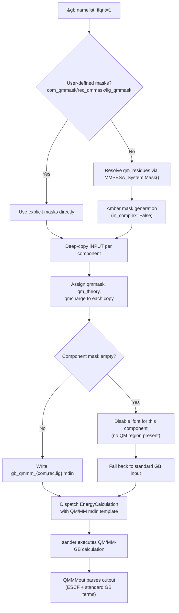
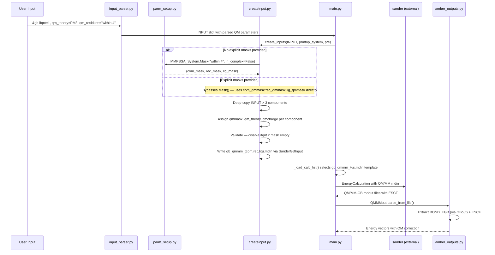

QM/MMGBSA (Quantum Mechanics / Molecular Mechanics Generalized Born Surface Area) integration in gmx_MMPBSA enables hybrid quantum-classical treatment of binding free energy calculations, where a selected region of the system is treated with semi-empirical QM methods while the remainder is handled with classical MM force fields. This approach captures electronic polarization and charge transfer effects at the binding interface — phenomena that purely classical MM/GBSA cannot represent — at the cost of significantly increased computational expense. This page details the internal architecture by which gmx_MMPBSA orchestrates QM/MM input generation, mask resolution, sander dispatch, and output parsing for QM/MMGBSA workflows.

Sources: [createinput.py](GMXMMPBSA/createinput.py#L1-L18), [input_parser.py](GMXMMPBSA/input_parser.py#L448-L466), [amber_outputs.py](GMXMMPBSA/amber_outputs.py#L907-L954)

## Architectural Overview

QM/MMGBSA in gmx_MMPBSA is not a separate calculation engine; it is a **specialized configuration path** within the existing GB calculation pipeline. The trigger is the `ifqnt` flag in the `&gb` namelist. When activated, the framework diverges from the standard single-mdin-per-calculation pattern and instead generates **per-component QM/MM input files** with distinct QM masks for complex, receptor, and ligand systems. This architectural choice reflects a fundamental constraint of Amber's sander: each sander invocation requires its own `&qmmm` namelist block, meaning the complex, receptor, and ligand each need separate mdin files with their own QM region definitions.



Sources: [createinput.py](GMXMMPBSA/createinput.py#L196-L249), [main.py](GMXMMPBSA/main.py#L280-L281)

## Input Parameter Specification

All QM/MM parameters reside within the `&gb` namelist of the gmx_MMPBSA input file. They are defined in the `input_file` specification with the `gbrun` trigger, meaning they are only evaluated when a GB calculation is requested.

### Core QM Activation Parameters

| Parameter | Type | Default | Sander Namelist | Description |
|:----------|:-----|:--------|:----------------|:------------|
| `ifqnt` | `int` | `0` | `&cntrl` | Master switch: `1` activates QM/MM |
| `qm_theory` | `str` | `''` | `&qmmm` | Semi-empirical method (e.g., `PM3`, `AM1`, `PM6`, `DFTB`) |
| `qm_residues` | `str` | `''` | — | Residue selection string for automatic mask generation |
| `qmcut` | `float` | `9999` | `&qmmm` | Non-bonded cutoff within the QM region (Å) |
| `scfconv` | `float` | `1.0e-8` | `&qmmm` | SCF convergence criterion (kcal/mol) |

### Mask Specification Parameters

| Parameter | Type | Default | Description |
|:----------|:-----|:--------|:------------|
| `com_qmmask` | `str` | `''` | Explicit Amber mask for QM atoms in the complex |
| `rec_qmmask` | `str` | `''` | Explicit Amber mask for QM atoms in the receptor |
| `lig_qmmask` | `str` | `''` | Explicit Amber mask for QM atoms in the ligand |
| `qm_residues` | `str` | `''` | Automatic residue selection (overridden by explicit masks) |

### Charge and Correction Parameters

| Parameter | Type | Default | Description |
|:----------|:-----|:--------|:------------|
| `qmcharge_com` | `int` | `0` | QM region charge for complex (deprecated since v1.5.0 for auto-assignment) |
| `qmcharge_lig` | `int` | `0` | QM region charge for ligand (deprecated since v1.5.0 for auto-assignment) |
| `qmcharge_rec` | `int` | `0` | QM region charge for receptor (deprecated since v1.5.0 for auto-assignment) |
| `peptide_corr` | `int` | `0` | Apply MM correction to peptide linkages at QM/MM boundary |
| `writepdb` | `int` | `1` | Write PDB file of the selected QM region |
| `verbosity` | `int` | `0` | Controls verbosity of QM/MM output |

Sources: [input_parser.py](GMXMMPBSA/input_parser.py#L448-L466), [createinput.py](GMXMMPBSA/createinput.py#L356-L387)

## QM Mask Resolution Pipeline

The most architecturally significant aspect of QM/MMGBSA is the **mask resolution strategy** — how the user's residue selection is translated into component-specific Amber atom masks that sander can consume. The framework supports two mutually exclusive paths.

### Path 1: Automatic Residue Selection via `qm_residues`

When explicit masks (`com_qmmask`, `rec_qmmask`, `lig_qmmask`) are **not** provided, the framework delegates mask generation to `MMPBSA_System.Mask()` with `in_complex=False` [createinput.py](GMXMMPBSA/createinput.py#L207-L208). This method invokes `_binding_mask()`, which internally calls `_select_residues()` to parse the selection string and iterate through the system's residue list, building Amber mask strings for complex, receptor, and ligand independently [parm_setup.py](GMXMMPBSA/parm_setup.py#L251-L252).

The `qm_residues` string supports three selection modes demonstrated in the shipped example:

| Selection Mode | Syntax | Example |
|:---------------|:-------|:--------|
| Distance-based (recommended) | `"within <N>"` | `"within 4"` — all residues within 4 Å of ligand |
| Explicit residue list | `"A/res B/res"` | `"A/40-41,44,47,78 B/241"` |
| Amber mask expression | Full Amber syntax | `"(:44,47,85&!@N,H,CA,HA,C,O) \| :241"` |

The distance-based `within` selection (available since v1.5.0) is the recommended approach because it automatically includes residues from both the receptor and ligand within the specified cutoff, ensuring the QM region spans the binding interface — a requirement for meaningful QM/MM binding energy decomposition.

### Path 2: Explicit User-Defined Masks

When any of `com_qmmask`, `rec_qmmask`, or `lig_qmmask` is non-empty, the framework **bypasses** `qm_residues` parsing entirely and uses the user-provided masks directly [createinput.py](GMXMMPBSA/createinput.py#L201-L205). This triggers a logging warning: *"Ignoring residues from qm_residues variable. Using user defined masks instead..."*. This path is necessary when fine-grained control over which atoms enter the QM region is required, such as excluding backbone atoms with `&!@N,H,CA,HA,C,O`.

> [!TIP]
> The explicit mask path disables automatic charge assignment. When using `com_qmmask`/`rec_qmmask`/`lig_qmmask`, you must manually set `qmcharge_com`, `qmcharge_lig`, and `qmcharge_rec` to the correct formal charges of the QM region in each component, since the framework cannot infer charges from arbitrary mask expressions.

### Per-Component Mask Assignment and Validation

After mask resolution, the framework creates three deep-copied INPUT dictionaries (one per component) and assigns the resolved masks [createinput.py](GMXMMPBSA/createinput.py#L197-L209). A critical validation step follows: if any component's QM mask resolves to empty (meaning no QM residues exist in that component), `ifqnt` is set to `0` for that component, effectively downgrading it to a pure MM/GB calculation [createinput.py](GMXMMPBSA/createinput.py#L224-L238). This is physically correct — if the ligand alone is being evaluated and contains no QM residues (because all QM atoms belong to the receptor), the ligand calculation reverts to pure MM.

Sources: [createinput.py](GMXMMPBSA/createinput.py#L196-L249), [parm_setup.py](GMXMMPBSA/parm_setup.py#L185-L252), [examples/QM_MMGBSA/mmpbsa.in](examples/QM_MMGBSA/mmpbsa.in)

## Sander Input File Generation

The `SanderGBInput` class bridges gmx_MMPBSA's parameter dictionary to sander's mdin format. Its constructor establishes a three-layer mapping system that routes each parameter to the correct sander namelist section [createinput.py](GMXMMPBSA/createinput.py#L356-L387):

- **`input_items`**: Default values for every sander parameter, including QM defaults (`ifqnt=0`, `qmmask=''`, `qm_theory=''`, `qmcharge=0`, `qmgb=2`, `qmcut=999.0`)
- **`parent_namelist`**: Maps each parameter key to its sander namelist (`cntrl` for `ifqnt`; `qmmm` for `qmmask`, `qm_theory`, `qmcharge`, `qmgb`, `qmcut`, `scfconv`, `peptide_corr`, `writepdb`, `verbosity`)
- **`name_map`**: Maps internal parameter names to their gmx_MMPBSA input file names

The `make_mdin()` method in the parent `SanderInput` class iterates through `input_items`, replacing defaults with user-specified values from `INPUT['gb']` via the `name_map` lookup, and writes them to the appropriate namelist section via `parent_namelist` [createinput.py](GMXMMPBSA/createinput.py#L323-L337). For QM parameters, string values for `qm_theory` and `qmmask` are wrapped in single quotes during assignment [createinput.py](GMXMMPBSA/createinput.py#L212-L213).

### Generated File Naming Convention

When QM/MM is active, the mdin files follow a distinct naming pattern that diverges from the standard GB path:

| Component | Standard GB | QM/MM GB |
|:----------|:------------|:---------|
| Complex | `_GMXMMPBSA_gb.mdin` | `_GMXMMPBSA_gb_qmmm_com.mdin` |
| Receptor | (shared with complex) | `_GMXMMPBSA_gb_qmmm_rec.mdin` |
| Ligand | (shared with complex) | `_GMXMMPBSA_gb_qmmm_lig.mdin` |

This naming is critical because the calculation dispatcher in `_load_calc_list()` uses the template `self.pre + 'gb_qmmm_%s.mdin'` when `ifqnt` is detected [main.py](GMXMMPBSA/main.py#L280-L281).

Sources: [createinput.py](GMXMMPBSA/createinput.py#L312-L387), [main.py](GMXMMPBSA/main.py#L278-L285)

## Calculation Dispatch and Execution

The calculation dispatch for QM/MMGBSA follows the same `EnergyCalculation` class path as standard GB calculations — there is no separate `QM/MMCalculation` class. The divergence occurs purely at the **mdin template selection** level within `_load_calc_list()` [main.py](GMXMMPBSA/main.py#L278-L285):

```python
if self.INPUT['decomp']['decomprun']:
    mdin_template = self.pre + 'gb_decomp_%s.mdin'
elif self.INPUT['gb']['ifqnt']:
    mdin_template = self.pre + 'gb_qmmm_%s.mdin'
elif self.INPUT['gb']['alpb']:
    mdin_template = self.pre + 'gb_%s.mdin'
else:
    mdin_template = self.pre + 'gb.mdin'
```

The template is then formatted with component names (`com`, `rec`, `lig`) to locate the correct QM/MM-specific mdin file. Each `EnergyCalculation` instance receives the appropriate prmtop, trajectory, and mdin for its component, and sander executes the QM/MM-GB energy evaluation as a standard external process. MPI parallelism distributes frames across ranks identically to non-QM calculations.

> [!TIP]
> QM/MMGBSA is incompatible with decomposition analysis (`idecomp > 0`). The dispatch logic checks `decomprun` before `ifqnt`, meaning if both are enabled, the decomposition mdin template takes precedence and QM/MM parameters are silently ignored. Ensure `&decomp` is absent or `decomprun=0` when performing QM/MMGBSA.

Sources: [main.py](GMXMMPBSA/main.py#L278-L301), [calculation.py](GMXMMPBSA/calculation.py#L300-L314)

## Output Parsing: The QMMMout Class

The `QMMMout` class extends `GBout` to handle the additional energy term produced by QM/MM calculations [amber_outputs.py](GMXMMPBSA/amber_outputs.py#L907-L954). The class hierarchy — `QMMMout → GBout → AmberOutput` — means QM/MM output files are parsed with the full GB energy extraction logic, plus one critical addition.

### The ESCF Energy Term

The QM self-consistent field energy (`ESCF`) replaces the classical electrostatic energy (`EEL`) for atom pairs within the QM region. In the `data_key_owner` dictionary, `ESCF` is registered under both `GGAS` and `TOTAL` composite terms [amber_outputs.py](GMXMMPBSA/amber_outputs.py#L56), meaning it contributes to the gas-phase and total free energy sums.

The `QMMMout._get_energies()` parser reads sander's output line-by-line, extracting the standard `BOND`, `ANGLE`, `DIHED`, `VDWAALS`, `EEL`, `EGB`, `1-4 VDW`, and `1-4 EEL` terms using the same logic as `GBout`, then handles the ESCF line with special formatting logic [amber_outputs.py](GMXMMPBSA/amber_outputs.py#L945-L952):

- If the line starts with `minimization`, it skips (minimization output artifact)
- If the token ends with `=` (format varies by QM theory), it splits on `=` to extract the value
- Otherwise, it uses standard whitespace splitting

This flexible parsing accommodates the different output formats produced by various semi-empirical methods (PM3, PM6, AM1, DFTB, etc.), each of which formats the ESCF line differently in sander's output.

### Graceful Degradation for Empty QM Regions

A design note in the `QMMMout` docstring clarifies an important behavior: a `QMMMout` instance **can** represent a pure MM calculation with `ESCF=0` if the QM region lies entirely outside the system being evaluated (e.g., the ligand when all QM atoms are in the receptor) [amber_outputs.py](GMXMMPBSA/amber_outputs.py#L918-L921). In this case, the `ESCF` array is populated with zeros, and the result is numerically equivalent to a standard `GBout`.

Sources: [amber_outputs.py](GMXMMPBSA/amber_outputs.py#L56), [amber_outputs.py](GMXMMPBSA/amber_outputs.py#L907-L954)

## Practical Configuration

The following example demonstrates the complete input file structure for a QM/MMGBSA calculation using the PM3 semi-empirical method with automatic distance-based residue selection, as shipped in the repository's example suite [examples/QM_MMGBSA/mmpbsa.in](examples/QM_MMGBSA/mmpbsa.in):

```
&general
sys_name="QM/MMGBSA",
startframe=5,
endframe=14,
PBRadii=2,
forcefields="oldff/leaprc.ff99SB,leaprc.gaff"
/
&gb
igb=1, saltcon=0.150,
ifqnt=1, qm_theory=PM3,
qm_residues="within 4"
/
```

The `PBRadii=2` setting corresponds to the `mbondi` radii set, which is commonly used with the GB-HCT model (`igb=1`). The ligand `.mol2` file must be the Antechamber output to ensure correct topology generation from GROMACS structures.

### Key Constraints and Recommendations

| Aspect | Constraint | Rationale |
|:-------|:-----------|:----------|
| GB model compatibility | `igb=1` (GB-HCT) recommended | Most tested with QM/MM; `igb=5` (OBC) also supported |
| Decomposition | **Incompatible** | `decomprun` takes precedence over `ifqnt` in dispatch |
| GBNSR6 | **Incompatible** | GBNSR6 uses its own solver, not sander's QM/MM path |
| PB solvers | **Incompatible** | QM parameters exist only in `&gb` namelist, not `&pb` |
| Frame count | Keep minimal for testing | QM/GB per-frame cost is 10–100× higher than MM/GB |
| Charge assignment | Automatic since v1.5.0 | Manual `qmcharge_*` only needed with explicit masks |

Sources: [examples/QM_MMGBSA/mmpbsa.in](examples/QM_MMGBSA/mmpbsa.in), [examples/QM_MMGBSA/README.md](examples/QM_MMGBSA/README.md)

## Data Flow Summary

The end-to-end QM/MMGBSA data flow within gmx_MMPBSA traverses four modules in a strictly sequential pipeline, with the QM-specific logic concentrated in `createinput.py` and `amber_outputs.py`:



Sources: [input_parser.py](GMXMMPBSA/input_parser.py#L448-L466), [createinput.py](GMXMMPBSA/createinput.py#L196-L249), [main.py](GMXMMPBSA/main.py#L278-L301), [amber_outputs.py](GMXMMPBSA/amber_outputs.py#L907-L954)

## Navigation

This page has covered the QM/MMGBSA-specific integration layer within gmx_MMPBSA. For related topics in the calculation engine:

- **[GB and PB Solvers](10-gb-and-pb-solvers)** — The standard GB calculation path that QM/MM extends
- **[Calculation Class Hierarchy](9-calculation-class-hierarchy)** — The `EnergyCalculation` base class used for QM/MM dispatch
- **[Topology Conversion Pipeline](6-topology-conversion-pipeline)** — How GROMACS topologies become Amber prmtops (required before QM/MM input generation)
- **[Python API](15-python-api)** — Programmatic access to QM/MMGBSA workflows
- **[MPI Parallelism](18-mpi-parallelism)** — Frame-level parallelization across QM/MM calculations