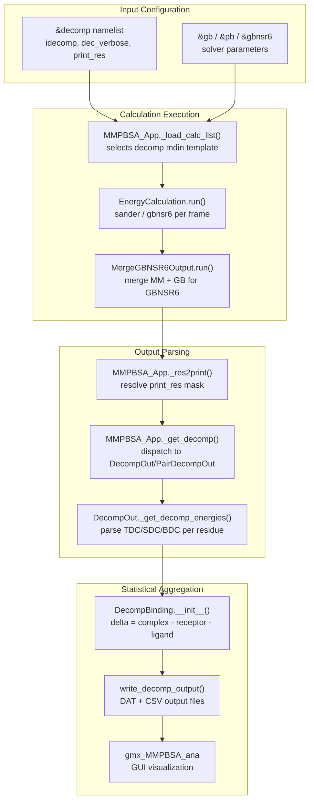
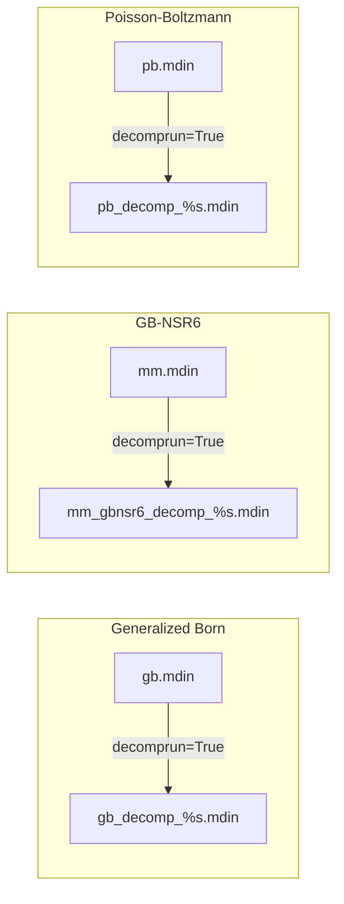
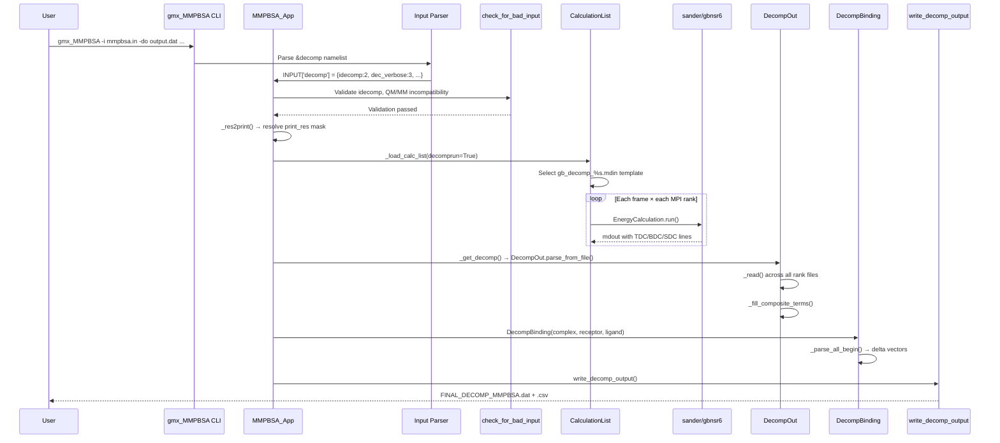

Decomposition analysis dissects the total binding free energy into per-residue (or per-residue-pair) contributions, revealing which amino acids at the binding interface drive complex formation. This page maps the complete decomposition pipeline in gmx_MMPBSA—from input configuration through sander invocation, output parsing, and statistical aggregation—and provides the practical knowledge needed to configure and interpret these calculations correctly.

## Conceptual Foundation

In a standard MM/PB(GB)SA calculation, gmx_MMPBSA reports a single ΔG value for the entire receptor–ligand system. Decomposition analysis refines this by partitioning each energy term (electrostatic, van der Waals, polar solvation, non-polar solvation, and internal) across individual residues. The result is a residue-level energy profile that directly identifies "hot spots" at the binding interface.

The mathematical premise is straightforward: for each frame, sander evaluates pairwise interaction energies between every atom pair. Decomposition re-groups these atomic contributions by parent residue, then subtracts receptor and ligand self-energies to isolate the *interaction* contribution of each residue to binding. The aggregation is performed by the `DecompBinding` class, which subtracts receptor and ligand decomposition vectors from the complex vectors on a per-frame basis before computing statistics [DecompBinding class](GMXMMPBSA/amber_outputs.py#L1657-L1782).



## The &decomp Namelist

All decomposition configuration lives in the `&decomp` namelist, defined in the input parser as four variables with the trigger `decomprun` [input_parser.py](GMXMMPBSA/input_parser.py#L642-L648). The presence of any non-zero `idecomp` value automatically activates `decomprun` within the application.

| Variable | Type | Default | Description |
|:---------|:-----|:--------|:------------|
| `idecomp` | `int` | `0` | Decomposition mode: `1`–`2` for per-residue, `3`–`4` for pairwise residue–residue |
| `dec_verbose` | `int` | `0` | Controls verbosity of energy terms printed: `1` or `3` adds backbone (BDC) and sidechain (SDC) decomposition |
| `print_res` | `str` | `"within 6"` | Mask defining which residues appear in output; supports ranges (`1-50`) and `within N` syntax |
| `csv_format` | `int` | `1` | Write decomposition output in CSV format (`1`) or fixed-width ASCII (`0`) |

### Decomposition Modes (idecomp)

The `idecomp` parameter fundamentally determines how energy contributions are partitioned and which output classes are instantiated. When `MMPBSA_App._get_decomp()` dispatches, it checks this value to select either `DecompBinding`/`DecompOut` or `PairDecompBinding`/`PairDecompOut` [main.py](GMXMMPBSA/main.py#L1388-L1410).

| idecomp | Scope | Meaning | 1-4 EEL | 1-4 VDW | Output Class |
|:--------|:------|:--------|:---------|:---------|:-------------|
| 1 | Per-residue | Pairwise energy terms only (no 1-4) | Excluded | Excluded | `DecompOut` |
| 2 | Per-residue | Pairwise + 1-4 EEL/VDW added | Included | Included | `DecompOut` |
| 3 | Pairwise | Residue–residue pairs, no 1-4 | Excluded | Excluded | `PairDecompOut` |
| 4 | Pairwise | Residue–residue pairs with 1-4 | Included | Included | `PairDecompOut` |

> [!TIP]
> **idecomp=2 is the most common choice.** It includes 1-4 electrostatic and van der Waals interactions in the decomposition, which provides a more complete picture of sidechain energetics. Values of 1 and 3 exclude these terms, which can be useful for isolating non-bonded inter-residue contributions but may undercount interaction energies.

### Verbosity and Backbone/Sidechain Split

Setting `dec_verbose` to `1` or `3` activates a secondary decomposition layer. Within `_get_decomp` in [calculation.py](GMXMMPBSA/calculation.py#L902-L928), the algorithm classifies each atom as backbone or sidechain based on the name list `['CA', 'C', 'O', 'N', 'H', 'OXT', 'H1', 'H2', 'H3']`. For each residue, this produces three energy vectors: **TDC** (total), **BDC** (backbone), and **SDC** (sidechain), where `SDC = TDC − BDC`. The `DecompOut` class mirrors this in its `allowed_tokens` logic: when verbose is 1 or 3, it extends parsing from `('TDC',)` to `('TDC', 'SDC', 'BDC')` [amber_outputs.py](GMXMMPBSA/amber_outputs.py#L1372-L1374).

### The print_res Mask

The `print_res` variable controls which residues appear in the output file. It supports two syntax forms, resolved by the `_res2print()` method [main.py](GMXMMPBSA/main.py#L1375-L1385):

- **Range syntax**: Comma-separated ranges like `"1-50,60-80,100"` → each range expanded to individual integers
- **Within syntax**: `"within N"` → resolved by sander internally during the energy calculation to select all residues with any atom within N Å of any atom in the complementary molecule

> [!TIP]
> **The `within` keyword requires at least one residue from both receptor and ligand** in the print mask. This is automatically satisfied when using the `within` syntax. If you use manual residue ranges, ensure both sides of the interface are represented.

## Calculation Pipeline Integration

Decomposition is not a separate calculation type—it modifies the energy calculation pipeline by swapping the sander input template. When `decomprun` is active, the `_load_calc_list` method selects decomposition-specific mdin files instead of standard ones [main.py](GMXMMPBSA/main.py#L274-L278):

```
gb_decomp_com.mdin  (instead of gb.mdin or gb_com.mdin)
gb_decomp_rec.mdin
gb_decomp_lig.mdin
```

This pattern applies identically across all three solvers:



### GB and PB Decomposition

For standard GB and PB solvers, decomposition is handled entirely by sander. The `EnergyCalculation` class invokes sander with the decomp mdin template, which instructs sander to write per-residue energy breakdowns into the mdout file. Each MPI rank produces its own output file (suffixed `.%d`), and the `DecompOut` parser aggregates them by iterating over all rank files [amber_outputs.py](GMXMMPBSA/amber_outputs.py#L1399-L1407).

### GB-NSR6 Decomposition

GB-NSR6 follows a more complex path because it splits the calculation between sander (for MM terms) and the external `gbnsr6` program (for GB solvation). The `MergeGBNSR6Output` class reconciles these two outputs [calculation.py](GMXMMPBSA/main.py#L929-L1156):

1. sander produces MM energy output files (`complex_mm.mdout.%d`)
2. `gbnsr6` produces GB energy files (`complex_gbnsr6.mdout.%d`) containing pairwise `DGij` atom–atom energies
3. `MergeGBNSR6Output.run()` invokes `get_gbnsr6_out()`, which uses ParmEd to map atoms to residues, then accumulates `DGij` values into per-residue or per-pair dictionaries depending on `idecomp` [calculation.py](GMXMMPBSA/calculation.py#L873-L900)
4. The `_get_decomp()` helper splits contributions into backbone vs. sidechain when `dec_verbose` demands it [calculation.py](GMXMMPBSA/calculation.py#L902-L928)

### Incompatibilities

The input validation in `check_for_bad_input` enforces several constraints [main.py](GMXMMPBSA/main.py#L1087-L1102):

- **QM/MM and decomposition are mutually exclusive** — a hard error is raised if both `ifqnt=1` and `decomprun=True`
- **sander.APBS cannot perform decomposition** — `idecomp` must be 0 if `sander_apbs=1`
- **idecomp cannot be 0 when decomposition is requested** — the explicit check ensures `decomprun=True` always has a valid decomposition mode

## Output Parsing Architecture

### Per-Residue Parsing (DecompOut)

The `DecompOut` class reads sander's decomposition output files, which contain lines prefixed with `TDC`, `SDC`, or `BDC` followed by residue number and five energy columns [amber_outputs.py](GMXMMPBSA/amber_outputs.py#L1408-L1436):

```
TDC   45   -1.234   -0.567    2.891   -1.456    0.234
```

Each line encodes: internal energy, van der Waals, electrostatic, polar solvation, and non-polar solvation (the latter multiplied by `surften` during parsing). The class stores these as `EnergyVector` instances—one per energy term per residue—enabling frame-by-frame statistical analysis. After reading, `_fill_composite_terms()` computes the total energy vector for each residue by summing all component vectors [amber_outputs.py](GMXMMPBSA/amber_outputs.py#L1451-L1467).

### Pairwise Parsing (PairDecompOut)

`PairDecompOut` extends `DecompOut` for residue–residue pair decomposition (idecomp 3–4). It uses the indicator string `"PRINT PAIR DECOMP - TOTAL ENERGIES"` and stores data in a nested dictionary structure `term[residue1][residue2][energy_component]`. The composite total is computed per-pair in `_fill_composite_terms()` [amber_outputs.py](GMXMMPBSA/amber_outputs.py#L1451-L1467).

### Binding Decomposition (DecompBinding)

The `DecompBinding` class computes the binding decomposition by subtracting receptor and ligand decomposition vectors from complex vectors [amber_outputs.py](GMXMMPBSA/amber_outputs.py#L1657-L1782). Its `_parse_all_begin()` method iterates through all frames for complex, receptor, and ligand to establish consistent frame ranges, then computes delta energy vectors. The `PairDecompBinding` variant handles the pairwise case analogously [amber_outputs.py](GMXMMPBSA/amber_outputs.py#L1783-L1903).

## Output Files

### File Generation

The `write_decomp_output()` function produces the final decomposition output files [output_file.py](GMXMMPBSA/output_file.py#L395-L493). It handles both normal and mutant systems (when alanine scanning is combined with decomposition), writing separate sections for each. The function supports two output formats controlled by `csv_format`:

- **ASCII format** (default when `csv_format=0`): Fixed-width tables with mean ± std deviation for each energy term per residue
- **CSV format** (default `csv_format=1`): Comma-separated values for spreadsheet import

### Output File Summary

| Flag | File | Content |
|:-----|:-----|:--------|
| `-do` | `FINAL_DECOMP_MMPBSA.dat` | Statistical summary (mean, std, std error) for each residue's energy decomposition |
| `-deo` | `FINAL_DECOMP_MMPBSA.csv` | Per-frame energy values for every residue across all frames |
| `-o` | `FINAL_RESULTS_MMPBSA.dat` | Overall binding free energy statistics (always produced) |
| `-eo` | `FINAL_RESULTS_MMPBSA.csv` | Per-frame overall energy values (always produced) |

The decomposition output contains energy columns: **Internal**, **van der Waals**, **Electrostatic**, **Polar Solvation**, **Non-Polar Solvation**, and **TOTAL**. When `dec_verbose` is 1 or 3, this structure is repeated for TDC, BDC, and SDC sections.

### PDB Output for Visualization

Beyond the tabular output, gmx_MMPBSA generates a modified PDB file where the B-factor column is replaced with per-residue decomposition energies. This file can be loaded directly into molecular visualization tools:

- **VMD**: Color by B-factor to map energy contributions onto the structure
- **UCSF Chimera**: Use the "Render by B-factor" tool with the same PDB file

## Practical Walkthrough

### Configuration Example

The following input file, from the repository's `examples/Decomposition_analysis/` directory, demonstrates a typical per-residue decomposition with GB-OBC2 [examples/Decomposition_analysis/mmpbsa.in](examples/Decomposition_analysis/mmpbsa.in):

```
&general
sys_name="Decomposition",
startframe=1,
endframe=10,
forcefields="leaprc.protein.ff14SB"
/
&gb
igb=5, saltcon=0.150,
/
&decomp
idecomp=2, dec_verbose=3,
print_res="within 4"
/
```

This configuration requests: per-residue decomposition with 1-4 terms included, backbone/sidechain split enabled, and only residues within 4 Å of the binding partner printed.

### Command-Line Execution

```bash
gmx_MMPBSA -O -i mmpbsa.in -cs com.tpr -ct com_traj.xtc \
  -ci index.ndx -cg 3 4 -cp topol.top \
  -o FINAL_RESULTS_MMPBSA.dat -eo FINAL_RESULTS_MMPBSA.csv \
  -do FINAL_DECOMP_MMPBSA.dat -deo FINAL_DECOMP_MMPBSA.csv
```

The `-do` and `-deo` flags are what activate decomposition output file generation. Without them, the decomp calculation runs but results are only available through the API or GUI analyzer.

### Interpreting Results

In the output, each residue shows five component energies plus a total. Key interpretation guidelines:

- **Electrostatic (EEL)**: Positive values indicate unfavorable electrostatic contribution; negative values indicate favorable charge–charge or dipole interactions
- **van der Waals (VDW)**: Typically favorable (negative) for well-packed interfaces
- **Polar Solvation (POL)**: Desolvation penalty; moving a charged/polar residue from water to the interface costs energy
- **Non-Polar Solvation (SAS)**: Hydrophobic effect contribution; negative values indicate burial of hydrophobic surface area is favorable
- **TOTAL**: The sum of all components; residues with large negative totals are binding hot spots

When `dec_verbose=3`, comparing BDC and SDC reveals whether backbone conformation or sidechain interactions dominate a given residue's contribution.

## Complete Execution Sequence



## Compatibility with Other Features

Decomposition can be combined with several other gmx_MMPBSA features, but not all:

| Feature | Compatible | Notes |
|:--------|:----------|:------|
| Alanine Scanning | ✅ | `DecompBinding` handles mutant systems; separate decomp output sections for mutant |
| QM/MMGBSA | ❌ | Hard incompatibility enforced in input validation |
| sander.APBS | ❌ | APBS does not support decomposition |
| Entropy (nmode, quasi-harmonic) | ⚠️ | Entropy calculated separately; not decomposed per-residue |
| Interaction Entropy / C2 | ⚠️ | Calculated at system level, not per-residue |
| GB-NSR6 | ✅ | Special merge pipeline via `MergeGBNSR6Output` |
| Stability mode | ✅ | Outputs complex-only decomposition (no receptor/ligand delta) |
| MPI parallelism | ✅ | Each rank writes separate decomp files, aggregated by parser |

## Next Steps

- **[Alanine Scanning](14-alanine-scanning)**: Learn how to combine decomposition with systematic mutation to quantify the energetic importance of individual residues
- **[Python API](15-python-api)**: Programmatic access to decomposition data for custom analysis workflows
- **[Interactive Visualization](16-interactive-visualization)**: Using `gmx_MMPBSA_ana` to generate bar charts and heat maps from decomposition results
- **[GB and PB Solvers](10-gb-and-pb-solvers)**: Understanding the solvation models whose energies are decomposed here