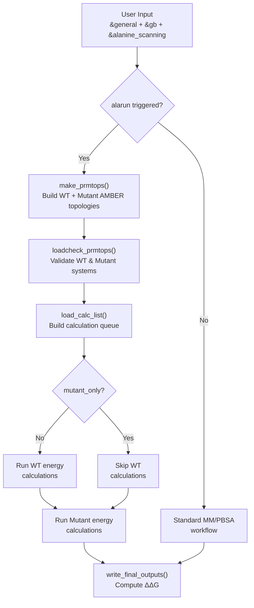
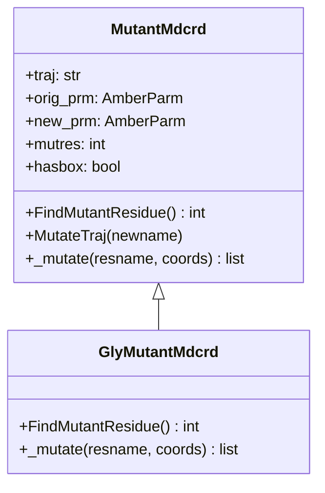
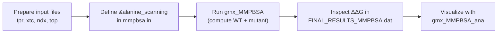

Alanine scanning is a computational mutagenesis technique that systematically evaluates the energetic contribution of individual residues to binding affinity. In gmx_MMPBSA, this feature mutates a specified residue to alanine (or glycine) *in silico* and computes the difference in binding free energy between the wild-type and mutant systems — revealing which residues are "hot spots" at the interaction interface. This page provides an intermediate-level architectural walkthrough of how gmx_MMPBSA implements alanine scanning, from input specification through trajectory mutation to energy comparison.

Sources: [alamdcrd.py](GMXMMPBSA/alamdcrd.py#L1-L6), [input_parser.py](GMXMMPBSA/input_parser.py#L630-L640)

## Conceptual Overview

The fundamental principle behind computational alanine scanning is straightforward: by replacing a side chain with a methyl group (alanine), the energetic contribution of that side chain to the binding free energy is removed. The difference between the wild-type (WT) and mutant binding free energies — denoted ΔΔG — quantifies how critical that residue is for the molecular interaction. A large positive ΔΔG indicates the residue contributes favorably to binding, while a value near zero suggests it is peripheral.

gmx_MMPBSA performs this as a post-processing analysis on existing MD trajectories, meaning no additional MD simulations are required. Instead, it applies a coordinate-space mutation to the already-generated AMBER-format trajectory files and recomputes energies with the mutated topology. This approach is fast but carries an inherent approximation: the surrounding environment does not relax after mutation, which is an acceptable trade-off for screening purposes.



The workflow executes in a dual-track pattern: if `mutant_only` is disabled (the default), both wild-type and mutant calculations run sequentially; otherwise only the mutant energies are computed. The results are combined in the final output to present ΔΔG values alongside the individual energy components.

Sources: [main.py](GMXMMPBSA/main.py#L226-L231), [main.py](GMXMMPBSA/main.py#L664-L690)

## The `&alanine_scanning` Namelist

Alanine scanning is activated by including the `&alanine_scanning` namelist in the input file. This namelist is registered in the input parser with the `alarun` trigger variable — when any value within this namelist is set, the trigger fires and the scanning pipeline is engaged. The full set of configurable parameters is defined in the input file specification.

| Variable | Type | Default | Description |
|:---------|:----:|:-------:|:------------|
| `mutant_res` | `str` | `''` | Residue to mutate, in `CHAIN:NUMBER` format (e.g., `R:23`) |
| `mutant` | `str` | `'ALA'` | Target mutation type: `'ALA'` for alanine, `'GLY'` for glycine |
| `mutant_only` | `int` | `0` | Set to `1` to skip wild-type calculations and only compute mutant energies |
| `cas_intdiel` | `int` | `0` | Enable charge-aware internal dielectric adjustment (see below) |
| `intdiel_nonpolar` | `int` | `1` | Internal dielectric for nonpolar residues when `cas_intdiel=1` |
| `intdiel_polar` | `int` | `3` | Internal dielectric for polar residues when `cas_intdiel=1` |
| `intdiel_positive` | `int` | `5` | Internal dielectric for positively charged residues when `cas_intdiel=1` |
| `intdiel_negative` | `int` | `5` | Internal dielectric for negatively charged residues when `cas_intdiel=1` |

The **charge-aware internal dielectric** (`cas_intdiel`) is a nuanced feature designed to compensate for an artifact inherent to alanine scanning: when a charged residue is mutated to alanine, the removed charge creates an unrealistic vacuum cavity in the protein structure, which can distort electrostatic calculations. By automatically adjusting `intdiel` based on the physicochemical nature of the original residue, this option mitigates the electrostatic discontinuity. For example, mutating a positively charged arginine with `cas_intdiel=1` would set `intdiel=5` for that calculation.

A minimal working input file follows:

```fortran
&general
sys_name="Alanine_Scanning",
startframe=1,
endframe=10,
forcefields="leaprc.protein.ff14SB",
PBRadii=4,
/
&gb
igb=8, saltcon=0.150,
/
&alanine_scanning
mutant='ALA', mutant_res='R:23', cas_intdiel=1
/
```

Sources: [input_parser.py](GMXMMPBSA/input_parser.py#L630-L640), [mmpbsa.in](examples/Alanine_scanning/mmpbsa.in#L1-L19)

## Topology Construction: Wild-Type and Mutant

The alanine scanning pipeline begins in `make_prmtops()`, which constructs AMBER-format topology files from GROMACS inputs. When `alarun` is active, `buildTopology()` returns **six** topology files instead of the usual three: complex, receptor, and ligand for both the wild-type and mutant systems ([main.py](GMXMMPBSA/main.py#L679-L681)). The mutant topology is produced by modifying the residue label in the Amber prmtop, replacing the side-chain atoms with alanine's CB atom while preserving the backbone and overall residue count.

After topology generation, `loadcheck_prmtops()` instantiates two separate `MMPBSA_System` objects ([main.py](GMXMMPBSA/main.py#L704-L716)). The normal system and mutant system are loaded, mapped with receptor/ligand masks, and independently validated for consistency. A critical check occurs here: if neither a mutated receptor nor a mutated ligand topology exists (and the calculation is not a stability calculation), the application terminates with an error — alanine scanning requires at least one mutated topology to proceed.

An important optimization is applied in `_load_calc_list()`: when a mutation is located entirely within the receptor, the ligand topology is identical between wild-type and mutant. In this case, ligand energy outputs from the wild-type calculation are simply **copied** rather than recomputed, saving significant computation time. The `CopyCalc` class handles this duplication ([calculation.py](GMXMMPBSA/calculation.py#L703-L728)).

Sources: [main.py](GMXMMPBSA/main.py#L679-L681), [main.py](GMXMMPBSA/main.py#L704-L716), [main.py](GMXMMPBSA/main.py#L256-L259)

## Trajectory Mutation: The `alamdcrd` Module

The core technical challenge of alanine scanning is mutating the trajectory coordinates. The `alamdcrd.py` module addresses this by rewriting the AMBER-format trajectory file (ASCII `mdcrd` format only — NetCDF trajectories are not supported for mutation). The module operates on the fundamental insight that an alanine mutation requires **removing side-chain atoms** beyond Cβ and **regenerating the Cβ coordinate** at the correct distance from Cα.

### Class Hierarchy



The `MutantMdcrd` class handles alanine mutations, while `GlyMutantMdcrd` extends it for glycine scanning — removing even the Cβ atom. Both classes share the same trajectory parsing logic in `MutateTraj()` but differ in their `_mutate()` coordinate reconstruction and `FindMutantResidue()` validation (expecting `'GLY'` instead of `'ALA'` in the mutant topology).

### Mutation Discovery

`FindMutantResidue()` compares the `RESIDUE_LABEL` arrays between the original and mutant Amber topology files to locate the single differing residue ([alamdcrd.py](GMXMMPBSA/alamdcrd.py#L168-L191)). It enforces strict constraints: exactly one residue must differ, the mutant residue must be `'ALA'` (or `'GLY'`), and both topologies must have identical residue counts. Violations raise `MutateError` or `MutantResError` exceptions.

### Coordinate Reconstruction Algorithm

The `_mutate()` method implements residue-type-specific coordinate transformation logic. Residues are classified into three groups based on their side-chain geometry, and each group uses a different atom-selection strategy to construct the alanine coordinates:

| Residue Group | Residues | Strategy |
|:---|:---|:---|
| **List One** | ARG, ASN, ASP, CYS, GLN, GLU, HID, HIE, HIP, LEU, LYS, MET, PHE, SER, TRP, TYR | Keep backbone (N, CA, C, O) + Cα→Cβ distance scaled to 1.09 Å from Cα to first side-chain heavy atom |
| **List Two** | ILE, THR, VAL | Same Cβ placement, plus additional coordinate reordering for branched side chains |
| **List Three** | PRO | Special ring-opening logic: replaces N-Cδ bond with N-H at 1.01 Å distance, then Cβ at 1.09 Å from Cα |

The `_scaledistance()` helper function performs the geometric transformation: it takes the 3D coordinates of two atoms and a target distance, then moves the second atom along the vector connecting them until the desired bond length is achieved ([alamdcrd.py](GMXMMPBSA/alamdcrd.py#L42-L68)). Bond lengths of 1.09 Å (C-C) and 1.01 Å (N-H) are used as canonical values.

The trajectory mutation operates in a **three-phase state machine** while reading the ASCII mdcrd file line by line: before the target residue (phase 0), during the target residue's coordinates (phase 1), and after the target residue (phase 2). Phase 1 collects all coordinates belonging to the residue, applies `_mutate()`, and writes the shortened coordinate set — with box dimensions handled separately if `ifbox` is set.

> [!TIP]
> **NetCDF not supported for mutation**: The `MutantMdcrd` class explicitly operates on ASCII mdcrd files only. If your workflow uses `netcdf=1` in the `&general` namelist, the mutant trajectory generation will fail. Keep `netcdf=0` (the default) when running alanine scanning, or verify that the intermediate trajectories are in ASCII format.

Sources: [alamdcrd.py](GMXMMPBSA/alamdcrd.py#L152-L368), [alamdcrd.py](GMXMMPBSA/alamdcrd.py#L371-L455), [alamdcrd.py](GMXMMPBSA/alamdcrd.py#L42-L68)

## Residue Selection and Chain ID Handling

The `mutant_res` parameter uses the format `CHAIN:NUMBER` (e.g., `R:23` for chain R, residue 23). Residue numbering is based on the **original PDB numbering**, which is preserved through the GROMACS-to-AMBER conversion pipeline. However, chain IDs are susceptible to variation depending on GROMACS version and configuration.

Two mechanisms exist to ensure correct residue selection:

1. **Reference structure** (`-cr` flag): Supplying a reference PDB file (without hydrogens) guarantees that the chain ID and residue numbering used for selection match the user's intent. This is the **recommended** approach.

2. **Generated PDB inspection**: If no reference structure is provided, the selection relies on chain IDs present in the GROMACS-processed files. GROMACS `20xx.x` versions may omit chain IDs via `trjconv`, and the `assign_chainID` option in `&general` controls when chain IDs are assigned. In all cases, users should inspect the generated files (`_GMXMMPBSA_FIXED_COM.pdb`, `_GMXMMPBSA_REC_Fx.pdb`, `_GMXMMPBSA_LIG_Fy.pdb`) to verify that the correct residue was selected.

Sources: [README.md](docs/examples/Alanine_scanning/README.md#L95-L131)

## Calculation Execution and Copy Optimization

When `alarun` is active, `load_calc_list()` builds a calculation queue that includes both wild-type and mutant energy evaluations ([main.py](GMXMMPBSA/main.py#L226-L231)). The `_load_calc_list()` method is called twice — once for the normal system and once for the mutant — with a `mutant` boolean flag controlling behavior differences.

The **copy optimization** is a critical performance feature. When the mutation resides in the receptor, the ligand topology is unchanged between wild-type and mutant. Rather than re-running the entire energy calculation for the ligand, `CopyCalc` simply duplicates the output files ([calculation.py](GMXMMPBSA/calculation.py#L703-L728)). The decision logic at [main.py](GMXMMPBSA/main.py#L256-L259) compares file paths:

```
copy_receptor = mutant AND NOT mutant_only AND receptor_prmtop == mutant_receptor_prmtop
copy_ligand   = mutant AND NOT mutant_only AND ligand_prmtop == mutant_ligand_prmtop
```

This means that for a receptor-residue mutation, only the complex and receptor mutant energies need to be recalculated; the ligand energies are copied from the wild-type run. The inverse applies for ligand-residue mutations.

> [!TIP]
> **Glycine-to-alanine is unsupported**: The `_mutate()` method in `MutantMdcrd` explicitly raises a `MutateError` if the source residue is glycine ([alamdcrd.py](GMXMMPBSA/alamdcrd.py#L219-L220)), since glycine lacks a Cβ atom and adding one requires a fundamentally different coordinate generation strategy. Only the `GlyMutantMdcrd` subclass handles mutations *to* glycine.

Sources: [main.py](GMXMMPBSA/main.py#L226-L231), [main.py](GMXMMPBSA/main.py#L256-L259), [calculation.py](GMXMMPBSA/calculation.py#L703-L728)

## Output and ΔΔG Computation

After both calculation tracks complete, `write_final_outputs()` generates the standard gmx_MMPBSA output files. For alanine scanning, the output includes separate energy statistics for both the wild-type and mutant systems, as well as the computed ΔΔG values. The plain-text statistics file (`FINAL_RESULTS_MMPBSA.dat` by default) contains per-frame energy terms and averaged values for both systems. When the `-eo` flag is specified, a CSV file with all per-frame energy terms is also produced.

Results can be visualized and further analyzed through `gmx_MMPBSA_ana`, the interactive analyzer tool, which can display ΔΔG bar charts and comparison plots between wild-type and mutant systems (provided the `-nogui` flag was not used during execution).

Sources: [README.md](docs/examples/Alanine_scanning/README.md#L88-L95), [main.py](GMXMMPBSA/main.py#L735-L760)

## Quick Reference: Full Workflow



**Serial execution:**
```bash
gmx_MMPBSA -O -i mmpbsa.in -cs com.tpr -ct com_traj.xtc \
  -ci index.ndx -cg 3 4 -cp topol.top -cr com.pdb \
  -o FINAL_RESULTS_MMPBSA.dat -eo FINAL_RESULTS_MMPBSA.csv
```

**MPI execution:**
```bash
mpirun -np 2 gmx_MMPBSA -O -i mmpbsa.in -cs com.tpr -ct com_traj.xtc \
  -ci index.ndx -cg 3 4 -cp topol.top -cr com.pdb \
  -o FINAL_RESULTS_MMPBSA.dat -eo FINAL_RESULTS_MMPBSA.csv
```

**Automated test:**
```bash
gmx_MMPBSA_test -t 12
```

Sources: [README.md](docs/examples/Alanine_scanning/README.md#L45-L61)

## Limitations and Known Constraints

| Constraint | Detail |
|:-----------|:-------|
| Single residue per run | Each execution handles exactly one mutation. To scan multiple residues, run separate calculations (the `gmx_MMPBSA_test -t 12` wrapper automates this for the example). |
| ASCII trajectories only | The mutation engine operates on ASCII mdcrd files; NetCDF intermediate trajectories are incompatible with `alamdcrd.py`. |
| No structural relaxation | The mutation is applied to the existing trajectory without re-minimizing or re-equilibrating, which is the standard approximation for this method. |
| GLY → ALA unsupported | Glycine cannot be mutated to alanine because it lacks the Cβ atom that the mutation algorithm depends on. |
| Side-chain removal only | Only side-chain truncation mutations are supported; no arbitrary residue substitutions. |

---

**Next steps in the catalog**: For the underlying topology conversion that produces the mutant prmtop files, see [Topology Conversion Pipeline](6-topology-conversion-pipeline). To understand how the energy calculations invoked by the alanine scanning workflow are structured, see [Calculation Class Hierarchy](9-calculation-class-hierarchy). For the complementary per-residue energy breakdown approach, see [Decomposition Analysis](13-decomposition-analysis).