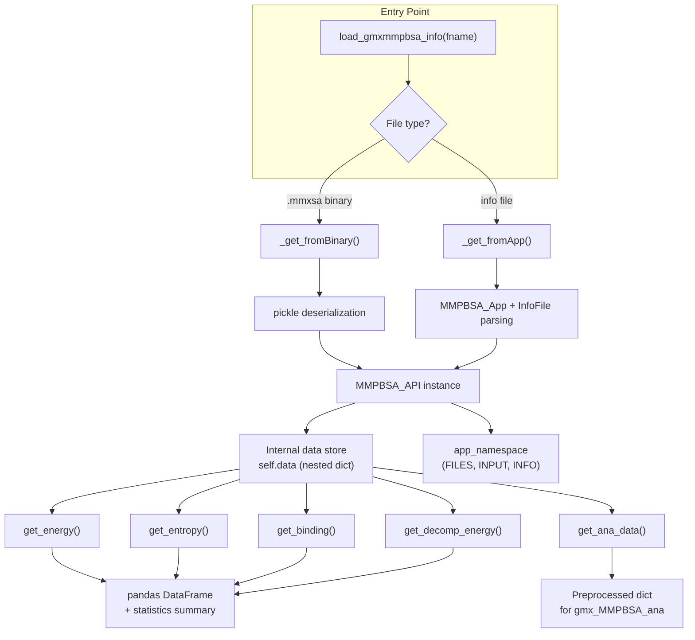

The gmx_MMPBSA Python API provides programmatic access to every energy term, entropy contribution, and decomposition result produced by a calculation — without rerunning any analysis. This enables custom post-processing workflows, integration with scientific Python ecosystems (NumPy, SciPy, Matplotlib), and automated reporting pipelines that go far beyond the built-in statistical summaries.

The API has evolved significantly between versions. The **v1.4.3 API** exposed raw data through a flat, dict-derived `mmpbsa_data` instance, while the **v1.5.x API** introduces `MMPBSA_API` — a fully-featured class with granular query methods that return pandas DataFrames with statistical summaries. Both APIs share the same entry point: the `load_gmxmmpbsa_info` function in [GMXMMPBSA/API.py](GMXMMPBSA/API.py#L983-L1051).

## Architecture Overview



The architecture is organized around a single class, `MMPBSA_API`, defined at [line 195 of GMXMMPBSA/API.py](GMXMMPBSA/API.py#L195-L197). It acts as both the data store and the query engine. The internal `self.data` dictionary holds all parsed results in a hierarchical structure that mirrors the calculation's organizational logic: *entity type* → *solvent model* → *molecular component* → *energy term*. All public retrieval methods operate on this structure and return pandas DataFrames.

## Loading Calculation Results

The sole entry point is the `load_gmxmmpbsa_info` function, which accepts a path to either a `_GMXMMPBSA_info` file or a `.mmxsa` binary cache file. The function creates an `MMPBSA_API` instance internally, populates it, and returns the energy data along with the application namespace containing input parameters and file references.

Sources: [GMXMMPBSA/API.py](GMXMMPBSA/API.py#L983-L1051)

```python
from GMXMMPBSA import API as gmxMMPBSAapi

energy_data, app_namespace = gmxMMPBSAapi.load_gmxmmpbsa_info("_GMXMMPBSA_info")
```

### Two loading strategies

The `MMPBSA_API` class supports two distinct backends, selected automatically based on file extension at [line 230](GMXMMPBSA/API.py#L230-L252):

| Backend | File Extension | Method | Description |
|:--------|:--------------|:-------|:------------|
| **App** | No suffix (default) | `_get_fromApp()` | Instantiates full `MMPBSA_App`, reads info file, parses all output files from disk. Requires topology files at original paths. |
| **Binary** | `.mmxsa` | `_get_fromBinary()` | Deserializes pickled data — no topology files needed. Faster for repeated access. |

> [!TIP]
> The App backend calls `os.chdir()` to the info file's parent directory [line 233](GMXMMPBSA/API.py#L233). If your workflow requires a stable working directory, use the Binary backend (`.mmxsa`) or call `setup_file()` and `load_file()` separately to control the load sequence.

### The `MMPBSA_API` constructor and lifecycle

For finer control over initialization, you can instantiate `MMPBSA_API` directly. The constructor accepts an optional `settings` dictionary that controls internal behavior, validated against four known keys at [lines 198–214](GMXMMPBSA/API.py#L198-L214):

| Setting Key | Type | Default | Purpose |
|:------------|:-----|:--------|:--------|
| `data_on_disk` | bool | `False` | Store large DataFrames on disk rather than in memory |
| `create_temporal_data` | bool | `True` | Create temporary preprocessed data files |
| `use_temporal_data` | bool | `True` | Reuse existing temporal data if available |
| `overwrite_temp` | bool | `True` | Overwrite stale temporal data |

The recommended lifecycle for programmatic use is:

```python
api = gmxMMPBSAapi.MMPBSA_API()
api.setting_time(timestart=0, timestep=100, timeunit='ps')
api.setup_file("_GMXMMPBSA_info")
api.load_file()
# Query methods are now available
```

The `setting_time` method at [line 219](GMXMMPBSA/API.py#L219-L222) configures the time axis for returned DataFrames, translating frame numbers into physical time units. This is critical for producing publication-quality plots with correct axis labels.

## Accessing Metadata: INFO, INPUT, and FILES

Three accessor methods expose the full calculation context through the `app_namespace`, a `SimpleNamespace` object constructed at [lines 897–930](GMXMMPBSA/API.py#L897-L930). This namespace wraps all configuration data from the original calculation.

| Method | Returns | Content |
|:-------|:--------|:--------|
| `get_info()` | `dict` | Fixed PDB content, input file text, output file text, mutant index, frame counts, MPI size, chamber flag, decomposition output |
| `get_input()` | `dict` | Complete nested input configuration: `general`, `gb`, `pb`, `rism`, `nmode`, `ala`, `decomp`, `gbnsr6` namelists |
| `get_files()` | `SimpleNamespace` | All file paths: trajectories, topologies, output files, fixed structures, masks |

Sources: [GMXMMPBSA/API.py](GMXMMPBSA/API.py#L253-L275)

These accessors enable scripts that adapt their behavior based on the original calculation configuration. For example, checking `api.get_input()['decomp']['decomprun']` tells you whether decomposition data is available without risking a KeyError on a missing data branch.

## Energy Data Retrieval

The `get_energy()` method is the primary interface for retrieving free energy terms. It accepts a set of optional filtering tuples that let you drill down to exactly the data subset you need, returning a structured dictionary with three entries: `map` (available keys), `data` (per-frame DataFrames), and `summary` (statistical summaries).

Sources: [GMXMMPBSA/API.py](GMXMMPBSA/API.py#L294-L373)

### Method signature and parameters

```python
def get_energy(self, etype=None, model=None, mol=None, term=None,
               remove_empty_terms=True, threshold=0.01,
               startframe=None, endframe=None, interval=1, verbose=True)
```

| Parameter | Type | Default | Purpose |
|:----------|:-----|:--------|:--------|
| `etype` | tuple | `('normal', 'mutant', 'mutant-normal')` | Entity types to include |
| `model` | tuple | All energy models present | Solvent models (e.g., `gb`, `pb`, `rism std`) |
| `mol` | tuple | All components present | Molecular components (`complex`, `receptor`, `ligand`, `delta`) |
| `term` | tuple | All terms present | Energy terms (`VDWAALS`, `EEL`, `EGB`, `TOTAL`, etc.) |
| `remove_empty_terms` | bool | `True` | Exclude terms whose absolute mean is below threshold |
| `threshold` | float | `0.01` | Cutoff in kcal/mol for "empty" term removal |
| `startframe` | int | First frame | Frame range start (frame number or index) |
| `endframe` | int | Last frame | Frame range end |
| `interval` | int | `1` | Stride between analyzed frames |

### Return structure

The method returns a dictionary with the following shape:

```python
{
    'map': {etype: {model: {mol: [term_list]}}},  # Available key tree
    'data': {etype: {model: DataFrame}},           # Per-frame energy values
    'summary': {etype: {model: DataFrame}},        # Average, SD, SEM
    'correlation': {etype: {model: DataFrame}}     # ΔGeff for correlation plots
}
```

The `data` DataFrames include all selected frames as rows and a `MultiIndex` of `(mol, term)` as columns. The `summary` DataFrames contain exactly three rows: `Average`, `SD`, and `SEM`, computed via the `_model2df` helper at [line 374](GMXMMPBSA/API.py#L374-L381). This helper uses `std(ddof=0)` for population standard deviation and `std(ddof=0) / sqrt(n)` for the standard error of the mean.

### Available energy term keys

The valid `term` keys depend on the solvent model (`model`). The internal mapping is maintained in `GMXMMPBSA/utils.py` through the `emapping` utility, and the output classes in [GMXMMPBSA/amber_outputs.py](GMXMMPBSA/amber_outputs.py#L65-L70) define the full set per model.

| Description | GB (`gb`) | PB (`pb`) | RISM (`rism std`/`rism gf`) |
|:------------|:---------:|:---------:|:----------------------------:|
| Bond energy | `BOND` | `BOND` | `BOND` |
| Angle energy | `ANGLE` | `ANGLE` | `ANGLE` |
| Dihedral energy | `DIHED` | `DIHED` | `DIHED` |
| 1-4 van der Waals | `1-4 VDW` | `1-4 VDW` | `1-4 VDW` |
| 1-4 Electrostatic | `1-4 EEL` | `1-4 EEL` | `1-4 EEL` |
| van der Waals | `VDWAALS` | `VDWAALS` | `VDWAALS` |
| Electrostatic | `EEL` | `EEL` | `EEL` |
| Polar solvation | `EGB` | `EPB` | `POLAR SOLV` |
| Non-polar solvation | `ESURF` | `ENPOLAR` | `APOLAR SOLV` |
| Total solvation | `G solv` | `G solv` | `G solv` |
| Gas phase energy | `G gas` | `G gas` | `G gas` |
| **Total energy** | **`TOTAL`** | **`TOTAL`** | **`TOTAL`** |

Terms marked with `*` in the full output class hierarchy (`UB`, `IMP`, `CMAP`, `ESCF`) are specific to CHARMM force fields loaded via the chamber topology path. They are always present as zero-valued arrays for standard Amber topologies.

### Example: Extracting total GB energy for binding

```python
api = gmxMMPBSAapi.MMPBSA_API()
api.setup_file("_GMXMMPBSA_info")
api.load_file()

result = api.get_energy(etype=('normal',), model=('gb',), mol=('delta',), term=('TOTAL',))
df = result['data']['normal']['gb']
# df columns: MultiIndex [('delta', 'TOTAL')]
# df rows: frame indices (or time values if setting_time was called)
print(df.describe())
```

## Entropy Data Retrieval

Entropy calculations produce data with fundamentally different structures depending on the method. The API provides dedicated methods for each, plus a unified `get_entropy()` aggregator.

Sources: [GMXMMPBSA/API.py](GMXMMPBSA/API.py#L383-L527)

### Method overview

| Method | Lines | Entropy Type | Notes |
|:-------|:------|:-------------|:------|
| `get_nmode_entropy()` | [383–416](GMXMMPBSA/API.py#L383-L416) | Normal mode analysis | Uses separate `nmstartframe`/`nmendframe`/`nminterval` range |
| `get_qh_entropy()` | [418–441](GMXMMPBSA/API.py#L418-L441) | Quasi-harmonic | Single-value per (mol, term) — no frame-level data |
| `get_c2_entropy()` | [443–469](GMXMMPBSA/API.py#L443-L469) | C2 entropy | Returns `c2` value and `sigma` (uncertainty) |
| `get_ie_entropy()` | [471–515](GMXMMPBSA/API.py#L471-L515) | Interaction entropy | Supports on-the-fly recalculation with custom `ie_segment` |
| `get_entropy()` | [524–553](GMXMMPBSA/API.py#L524-L553) | Unified aggregator | Merges results from all entropy methods present |

### Nmode and QH entropy

Normal mode entropy data shares the same `(mol, term)` structure as energy data, with terms: `Translational`, `Rotational`, `Vibrational`, and `Total`. Quasi-harmonic data is similar but is typically computed over the full trajectory (no per-frame breakdown). Both return the standard `{map, data, summary}` dictionary structure.

### Interaction Entropy and C2 Entropy

These methods are unique in two respects. First, they can **recalculate on-the-fly** if you provide frame range or segment parameters different from the original calculation — the recalculation is performed by instantiating `InteractionEntropyCalc` or `C2EntropyCalc` from [GMXMMPBSA/calculation.py](GMXMMPBSA/calculation.py#L761-L873) with the raw GGAS energy data at [lines 555–578](GMXMMPBSA/API.py#L555-L578).

Second, their return structure differs: IE returns `AccIntEnergy` (cumulative interaction energy per frame), `ie` (the interaction entropy computed over the last `ie_segment`% of frames), and `sigma` (the uncertainty). C2 returns `c2` and `sigma` similarly.

```python
# Recalculate interaction entropy with a different segment size
ie_result = api.get_ie_entropy(ie_segment=50)
# ie_result['data']['normal']['ie']['gb'] contains per-frame AccIntEnergy + IE
```

> [!TIP]
> When requesting entropy data via `get_entropy()`, the method dispatches to each individual entropy getter and merges results using `_merge_ent()` at [line 516](GMXMMPBSA/API.py#L516-L522). The `model` parameter here refers to entropy methods (`'nmode'`, `'qh'`, `'ie'`, `'c2'`), not solvent models.

## Binding Free Energy Assembly

The `get_binding()` method combines energy and entropy summaries into a single binding free energy estimate. It accepts pre-computed `energy_summary` and `entropy_summary` dictionaries (as returned by `get_energy()` and `get_entropy()`) and produces ΔG values by adding enthalpy and entropy contributions.

Sources: [GMXMMPBSA/API.py](GMXMMPBSA/API.py#L581-L620)

The method constructs a ΔG string key for each entropy method:

| Entropy Method | ΔG Key |
|:---------------|:-------|
| Interaction entropy | `ΔGie` |
| C2 entropy | `ΔGc2` |
| Normal mode | `ΔGnm` |
| Quasi-harmonic | `ΔGqh` |

For binding calculations (not stability), the energy data is taken from the `delta` component. For stability calculations, it uses `complex` directly. The uncertainty propagation uses `utils.get_std()` which implements standard error propagation assuming uncorrelated enthalpy and entropy estimates.

```python
energy = api.get_energy()
entropy = api.get_entropy()
binding = api.get_binding(energy['summary'], entropy['summary'])
# binding['data']['normal']['gb']['ie'] contains DataFrame with ΔH, -TΔS, ΔG columns
```

## Decomposition Energy Retrieval

The `get_decomp_energy()` method handles the more complex decomposition data hierarchy, supporting both per-residue (idecomp=1,2) and per-residue-pair (idecomp=3) analyses.

Sources: [GMXMMPBSA/API.py](GMXMMPBSA/API.py#L622-L748)

### Method signature

```python
def get_decomp_energy(self, etype=None, model=None, mol=None, contribution=None,
                      res1=None, res2=None, term=None, res_threshold=0.5,
                      startframe=None, endframe=None, interval=None, verbose=True)
```

| Parameter | Purpose |
|:----------|:--------|
| `contribution` | Decomposition component: `TDC` (total), `SDC` (sidechain), `BDC` (backbone) |
| `res1` | First residue identifier (e.g., `'R:ALA 45'` for receptor, `'L:SER 102'` for ligand) |
| `res2` | Second residue identifier (per-pair decomposition only, idecomp=3) |
| `term` | Energy terms: `int`, `vdw`, `eel`, `pol`, `sas`, `tot` |
| `res_threshold` | Minimum absolute mean `tot` value (kcal/mol) to include a residue |

The `etype` keys for decomposition are `decomp_normal` and `decomp_mutant` internally, which the method automatically maps to `normal` and `mutant` in the output. For per-pair decomposition, the internal loop at [lines 700–747](GMXMMPBSA/API.py#L700-L747) nests `res2` under `res1`, producing a four-level DataFrame index.

### Decomposition term keys

| Key | Description |
|:----|:------------|
| `int` | Internal energy (bond + angle + dihedral) |
| `vdw` | van der Waals contribution |
| `eel` | Electrostatic contribution |
| `pol` | Polar solvation contribution |
| `sas` | Non-polar (surface area) contribution |
| `tot` | Total contribution (sum of above) |

### Empty component handling

The method includes special handling for empty `BDC` (backbone decomposition) data at [lines 744–748](GMXMMPBSA/API.py#L744-L748), which can occur when the backbone contribution is identically zero across all frames. In such cases, the BDC key is silently removed with a warning, preventing downstream DataFrame construction errors.

## Unified Data Export: `get_ana_data()`

The `get_ana_data()` method is the single entry point used by `gmx_MMPBSA_ana` (the GUI analyzer) to prepare all data for visualization. It orchestrates calls to `get_energy()`, `get_entropy()`, `get_binding()`, and `get_decomp_energy()`, then preprocesses each result into a format suitable for plotting.

Sources: [GMXMMPBSA/API.py](GMXMMPBSA/API.py#L749-L864)

```python
def get_ana_data(self, energy_options=None, entropy_options=None, decomp_options=None,
                 performance_options=None, correlation=False, verbose=False)
```

| Parameter | Purpose |
|:----------|:--------|
| `energy_options` | Dict of kwargs forwarded to `get_energy()` |
| `entropy_options` | Dict of kwargs forwarded to `get_entropy()` |
| `decomp_options` | Dict of kwargs forwarded to `get_decomp_energy()` |
| `performance_options` | Dict with `jobs` (thread count) and `energy_memory`/`decomp_memory` (memory policy) |
| `correlation` | Whether to include correlation data (`ΔGeff` and `ΔG` values) |

The preprocessing is done via the `_setup_data()` helper at [line 99](GMXMMPBSA/API.py#L99-L183), which runs in a `ThreadPool` to parallelize the data transformation. Each processed chunk is stored under a composite key in the returned dictionary, organized by category: `enthalpy`, `entropy`, `binding`, and `decomposition`.

The return value is a dictionary where each category contains `map` (key hierarchy), `summary` (statistical tables), and `keys` (preprocessed data indexed by hierarchical tuples). This is the format consumed by the GUI analyzer's plotting engine.

## The Legacy v1.4.3 Data Structure

The legacy API (documented in the existing [docs/api.md](docs/api.md) file) is still accessible through the `load_gmxmmpbsa_info` function, which in v1.5.x wraps `MMPBSA_API` and returns only the energy map and namespace. The legacy data model used a nested dictionary with the access pattern:

```python
data['calc_key']['system_component']['energy_term']
```

This maps directly to the v1.5.x `self.data` internal dictionary. The key differences between the two APIs:

| Feature | v1.4.3 (Legacy) | v1.5.x (`MMPBSA_API`) |
|:--------|:-----------------|:----------------------|
| **Access pattern** | Direct dict nesting | Method calls with filtering |
| **Return type** | numpy arrays / `array.array` | pandas DataFrames |
| **Statistics** | Manual computation required | Built-in Average/SD/SEM |
| **Frame selection** | Slice arrays manually | `startframe`/`endframe`/`interval` params |
| **Entropy** | Separate dict branches | Dedicated methods with recalculation support |
| **Decomposition** | `data['decomp'][model][mol][comp][res]` | `get_decomp_energy()` with filtering |
| **Operator support** | In-place `+=` for concatenation | Not supported (use Binary backend) |

## Interaction with Internal Subsystems

The API layer sits above several internal modules that it imports and delegates to. Understanding these dependencies clarifies error sources and extension points.

| Module | Role in API | Key Classes/Functions |
|:-------|:------------|:----------------------|
| [`main.py`](GMXMMPBSA/main.py#L64-L70) | `MMPBSA_App` instantiation for App backend | `MMPBSA_App`, `parse_output_files()` |
| [`infofile.py`](GMXMMPBSA/infofile.py) | Info file parsing and validation | `InfoFile` |
| [`amber_outputs.py`](GMXMMPBSA/amber_outputs.py#L65-L70) | Output file parsers for each energy method | `GBout`, `PBout`, `RISMout`, `NMODEout`, `IEout`, `C2out`, `DecompOut`, etc. |
| [`calculation.py`](GMXMMPBSA/calculation.py#L761-L873) | On-the-fly IE/C2 recalculation | `InteractionEntropyCalc`, `C2EntropyCalc` |
| [`input_parser.py`](GMXMMPBSA/input_parser.py#L395-L664) | Input file schema and defaults | `input_file`, `Variable`, `Namelist` |
| [`utils.py`](GMXMMPBSA/utils.py) | Utilities: `emapping`, `flatten`, `mask2list`, `get_std` | Various helper functions |

When using the App backend, the full `MMPBSA_App` pipeline runs through `parse_output_files()` at [main.py line 1164](GMXMMPBSA/main.py#L1164-L1276), which iterates over all calculation types and populates the internal data structures. This is why the App backend requires all original output files and topology files to be accessible at their recorded paths.

## Practical Workflows

### Autocorrelation analysis for statistical quality

A common use case is evaluating whether trajectory snapshots are statistically independent — a prerequisite for meaningful SEM values. This example computes the autocorrelation of total GB energy for both normal and mutant systems.

```python
import numpy as np
import matplotlib.pyplot as plt
from GMXMMPBSA import API as gmxMMPBSAapi

api = gmxMMPBSAapi.MMPBSA_API()
api.setup_file("_GMXMMPBSA_info")
api.load_file()

# Extract total GB complex energy
result = api.get_energy(model=('gb',), mol=('complex',), term=('TOTAL',))
total_normal = result['data']['normal']['gb'][('complex', 'TOTAL')].copy()

# Compute normalized autocorrelation
total_normal -= total_normal.mean()
total_normal /= total_normal.std()
acor = np.correlate(total_normal, total_normal / len(total_normal), 'full')

lag = np.arange(len(total_normal))
plt.plot(lag, acor[len(acor) // 2:])
plt.xlabel('Lag (frames)')
plt.ylabel('Autocorrelation')
plt.title('Total GB Energy Autocorrelation')
plt.show()
```

### Multi-system ΔΔG comparison

```python
systems = ['WT/_GMXMMPBSA_info', 'Y23F/_GMXMMPBSA_info', 'Y25F/_GMXMMPBSA_info']

for name, path in systems:
    api = gmxMMPBSAapi.MMPBSA_API()
    api.setup_file(path)
    api.load_file()
    energy = api.get_energy(mol=('delta',), term=('TOTAL',))
    delta_g = energy['summary']['normal']['gb'].loc['Average', ('delta', 'TOTAL')]
    sem = energy['summary']['normal']['gb'].loc['SEM', ('delta', 'TOTAL')]
    print(f"{name}: ΔG = {delta_g:.2f} ± {sem:.2f} kcal/mol")
```

### Exporting decomposition data for heatmap visualization

```python
api = gmxMMPBSAapi.MMPBSA_API()
api.setup_file("_GMXMMPBSA_info")
api.load_file()

decomp = api.get_decomp_energy(
    contribution=('TDC',), term=('tot',), res_threshold=0.1
)
df = decomp['data']['normal']['gb']
# df has MultiIndex columns: (mol, 'TDC', residue_name)
# Suitable for direct use with seaborn heatmap
```

---

The Python API transforms gmx_MMPBSA from a batch calculation tool into a programmable component within computational chemistry pipelines. For the full data flow from GROMACS trajectories through to these API-accessible results, see [Architecture Overview](5-architecture-overview). To understand how specific energy models produce the data you query here, refer to [GB and PB Solvers](10-gb-and-pb-solvers) and [Entropy Methods](11-entropy-methods). For interactive visualization of API results, see [Interactive Visualization](16-interactive-visualization).