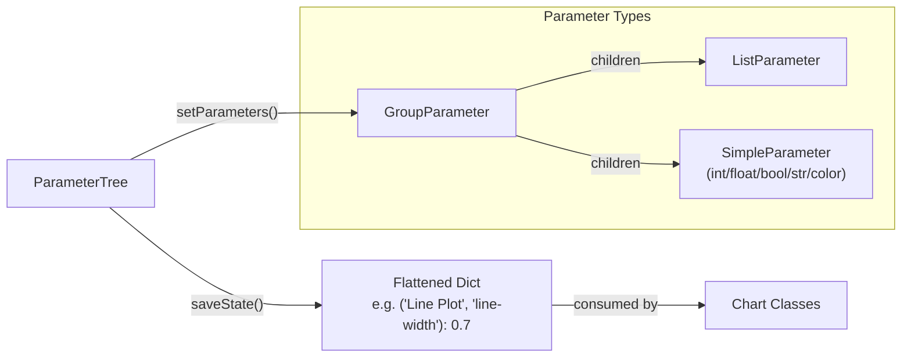

The gmx_MMPBSA analyzer is a PyQt5/6-based desktop application that transforms raw calculation output into a navigable, multi-plot visual environment. Rather than parsing CSV files or writing custom scripts, users interact with a tree-based interface where every energy term, decomposition result, and statistical summary is one click away from a publication-quality chart. This page explains how the analyzer is architecturally organized, how the charting engine works, and how the real-time settings pipeline connects UI controls to plot updates.

## Analyzer Architecture Overview

The analyzer is built around a **single main window** (`GMX_MMPBSA_ANA`) that orchestrates an MDI (Multiple Document Interface) workspace, a parameter-driven options panel, and a threaded data loading pipeline. The design separates concerns cleanly: tree items define *what* can be plotted, chart classes define *how* it is rendered, and the settings system defines *what it looks like*.

Sources: [gui.py](GMXMMPBSA/analyzer/gui.py#L44-L46), [plots.py](GMXMMPBSA/analyzer/plots.py#L122-L123)

```mermaid
graph TB
    subgraph Main Window ["GMX_MMPBSA_ANA (QMainWindow)"]
        Init["InitDialog<br/>System Selection & Config"]
        TW["QTreeWidget<br/>System Tree"]
        MDI["QMdiArea<br/>Chart Workspace"]
        OP["Options Panel<br/>Tabs: Charts | Frames"]
    end

    subgraph Chart Engine ["Plot Classes (QMdiSubWindow)"]
        LC["LineChart"]
        BC["BarChart"]
        HC["HeatmapChart"]
        MHC["MHeatmap<br/>Clustered Heatmap"]
        RC["RegChart<br/>Regression"]
        TB["Tables"]
        OF["OutputFiles"]
    end

    subgraph Settings System
        CS["ChartSettings<br/>(dict subclass)"]
        PT["ParameterTree<br/>(pyqtgraph-derived)"]
        CP["Palettes<br/>(60+ colormaps)"]
    end

    subgraph Threading
        W["worker (QThread)"]
        PB["ProcessingProgressBar"]
    end

    Init -->|"systems data"| TW
    TW -->|"CustomItem buttons"| Chart Engine
    OP -->|"Parameter.create()"| PT
    PT -->|"flattened dict"| CS
    CS -->|"options dict"| Chart Engine
    W -->|"Queue results"| PB
    W -->|"parsed data"| TW
```

The entry point flows from the `InitDialog` — where the user selects `.FINAL_RESULTS_MMPBSA.dat` files and configures RAM allocation — into the main window. Systems are loaded into a `QTreeWidget` where each node is a `CustomItem` carrying action buttons for every supported visualization mode. Charts open as `QMdiSubWindow` instances within the central MDI area, enabling simultaneous multi-plot tiled or cascaded layouts.

## The Chart Hierarchy

All chart widgets inherit from `ChartsBase`, which itself extends `QMdiSubWindow`. This base class encapsulates the common pattern of embedding a Matplotlib `FigureCanvas` inside a `QMainWindow` (to host the navigation toolbar), and provides the shared `draw()`, `setup_text()`, and `closeEvent()` lifecycle methods.

Sources: [plots.py](GMXMMPBSA/analyzer/plots.py#L122-L190)

| Chart Class | Data Input | Primary Use | Key Feature |
|---|---|---|---|
| `LineChart` | Per-frame energy series (parquet/DataFrame) | Temporal energy evolution | Rolling average overlay, cursor tracking |
| `BarChart` | Average ± error energy terms | Component comparison | Subplot-per-group mode, symlog scale |
| `HeatmapChart` | Per-residue or per-wise decomposition | Interaction mapping | Dual mode (per-wise/per-residue), receptor/ligand coloring |
| `MHeatmap` | Clustered heatmap | Annotated decomposition | Based on seaborn clustermap with tight_layout control |
| `RegChart` | Experimental vs. calculated ΔG | Validation | Pearson/Spearman coefficients, distribution marginals |
| `Tables` | Summary DataFrame | Data inspection | Color-coded energy terms, CSV/Excel export, clipboard copy |
| `OutputFiles` | Raw text output | Log inspection | Monospace read-only viewer |

The `NavigationToolbar` subclass is worth noting: it overrides Matplotlib's default save dialog to respect the user's configured **save format and DPI** from the chart settings, rather than using Matplotlib's global defaults. The save filename is automatically derived from the plot's window title, sanitized for filesystem safety.

Sources: [plots.py](GMXMMPBSA/analyzer/plots.py#L60-L119)

## Line Plots and Temporal Analysis

`LineChart` renders per-frame energy time series using seaborn's `lineplot`. It supports two operational modes: standard energy traces and **Interaction Entropy (IE/C2)** mode, where both the full accumulated interaction energy and the user-selected segment are plotted simultaneously.

Sources: [plots.py](GMXMMPBSA/analyzer/plots.py#L193-L249)

The rolling average system is particularly flexible. It exposes five configurable parameters: visibility toggle, line color, line style (solid/dashed/dashdot/dotted), line width, and window size. The `first_obs` parameter controls whether the moving average begins at frame zero ("start") or at the first complete window ("window"), which directly affects how the early transient region is displayed. A `Cursor` widget provides crosshair tracking that follows mouse movement across the plot.

## Bar Plots and Energy Component Decomposition

`BarChart` is the most configuration-dense chart class, handling everything from simple average-comparison bars to multi-panel grouped subplots. When the `subplot-components` option is enabled and energy groups are defined, the chart splits into horizontal sub-axes with shared Y-scales, each panel representing a category (e.g., gas-phase terms vs. solvation terms vs. total).

Sources: [plots.py](GMXMMPBSA/analyzer/plots.py#L251-L372)

For IE/C2 entropy calculations, the bar chart automatically color-codes the sigma indicator — a blue tone for reliable results (σ < 3.6 kcal/mol) and a different tone for non-reliable results — providing immediate visual feedback on convergence quality. Error bars are fully configurable: the representation can switch between standard deviation ("Std. Dev.") and standard error of the mean ("Std. Err."), with independent control over cap size, line width, and color.

The `_set_xticks` static method implements molecule-ID stripping: when `remove-molid` is enabled, prefixes like `R:` (receptor) and `L:` (ligand) are removed from X-axis labels, producing cleaner publication figures.

## Heatmaps and Residue-Level Mapping

The heatmap subsystem operates in two distinct modes, auto-detected from the data structure. **Per-wise mode** (type 1) is triggered when columns are non-numeric — typically residue-pair labels like "R:ALA:45-L:SER:102" — while **per-residue mode** (type 2) activates when columns represent individual residues.

Sources: [plots.py](GMXMMPBSA/analyzer/plots.py#L374-L492)

When `highlight-components` is enabled, the chart delegates to `MHeatmap`, a custom class modeled after seaborn's `clustermap`. This specialized renderer adds colored side bars distinguishing receptor rows from ligand rows, a configurable legend, and precise control over tight layout spacing — solving a known limitation of the standard seaborn clustermap in embedded Qt contexts.

> [!TIP]
> The `MHeatmap` class is specifically designed for Qt embedding. Standard `sns.clustermap` creates its own `Figure` with hardcoded layout constraints that conflict with `QMdiSubWindow` resizing. `MHeatmap` works around this by constructing the figure grid manually and returning the figure for canvas embedding.

## Regression Plots and Experimental Correlation

`RegChart` produces scatter plots of experimental ΔG versus calculated ΔG with linear regression fitting, computing both **Pearson** and **Spearman** correlation coefficients along with their p-values. The regression line equation is rendered directly in the legend using matplotlib's `Line2D` proxy artist pattern.

Sources: [plots.py](GMXMMPBSA/analyzer/plots.py#L675-L751)

The optional distribution panel uses seaborn's `JointGrid` to render marginal distributions (violin, histogram, box, or KDE) alongside the main scatter plot, giving a complete picture of how both experimental and calculated values are distributed. Error bars on scatter points can display either standard deviation or standard error.

## The Settings Pipeline: From UI to Plot

The chart configuration system is arguably the most architecturally significant subsystem. It connects a `ParameterTree` (derived from pyqtgraph's parametertree) to a `ChartSettings` dictionary, which then produces flattened option dicts consumed by all chart classes.

Sources: [chartsettings.py](GMXMMPBSA/analyzer/chartsettings.py#L299-L303), [gui.py](GMXMMPBSA/analyzer/gui.py#L429-L432)



Each setting carries an `action_type` flag that determines the update cost:

| Action Type | Constant | Behavior | Example |
|---|---|---|---|
| **D** (Drawable) | `1` | Rendered once at creation, never updated | X-tick font sizes |
| **U** (Updatable) | `2` | Applied in-place via `update_config()` without re-plotting | Toolbar visibility, save DPI |
| **R** (Re-plot) | `3` | Full chart reconstruction required | Theme change, line width, palette |

This three-tier system prevents unnecessary redraws. Changing the toolbar visibility (type U) simply calls `NavigationToolbar.update_options()` on existing chart instances, while changing the color palette (type R) triggers a complete chart teardown and rebuild.

> [!TIP]
> Settings can be persisted at three levels: developer defaults (hardcoded in `ChartSettings.default`), user defaults (saved globally via "Set as default"), and per-system configs (saved alongside each `.FINAL_RESULTS_MMPBSA.dat` file). The `is_changed()` method uses the action_type constants to determine whether a setting difference actually requires a visual update.

Sources: [chartsettings.py](GMXMMPBSA/analyzer/chartsettings.py#L713-L774)

The settings dictionary uses **tuples as keys** for hierarchical access. For example, `('Bar Plot', 'error-line', 'color')` navigates through Group → Group → SimpleParameter. The `flatten_dict()` utility converts the nested tree structure into this flat tuple-keyed format, which chart constructors consume directly.

## Palette System

The analyzer ships with over 60 colormaps organized into three families, each with a custom `Palette` class that extends Matplotlib's `LinearSegmentedColormap`:

Sources: [chartsettings.py](GMXMMPBSA/analyzer/chartsettings.py#L962-L1251)

| Family | Palettes | Use Case |
|---|---|---|
| **Cartoon (Diverging)** | ArmyRose, Geyser, Temps, TealRose, Tropic (5/7-step variants) | Heatmaps, decomposition maps |
| **cmocean (Diverging)** | Balance, Curl, Delta (5/7-step) | Scientific visualization |
| **ColorBrewer (Diverging)** | BrBG, PRGn, PiYG, PuOr, RdBu, RdGy (5/7-step) | Publication-quality heatmaps |
| **Matplotlib (Diverging)** | seismic, RdYlBu, RdYlGn, Spectral, coolwarm | General purpose |
| **Seaborn (Qualitative)** | deep, muted, bright, pastel, dark, colorblind | Bar plot multi-series coloring |
| **Matplotlib (Qualitative)** | tab10, tab20, Set1-3, Paired, Pastel, Accent, Dark2 | Categorical data |

The `Palettes` class provides two factory methods: `get_colormap(name)` returns a Matplotlib-compatible colormap for chart rendering, while `get_palette(name)` returns the full `Palette` object including color arrays for PyMOL integration.

## PyMOL Integration: Energy-to-B-Factor Mapping

Beyond 2D plots, the analyzer provides direct **3D molecular visualization** through PyMOL integration. Each `CustomItem` with decomposition data exposes a visualization button that maps per-residue energy values onto B-factors in the PDB structure.

Sources: [customitem.py](GMXMMPBSA/analyzer/customitem.py#L456-L560), [utils.py](GMXMMPBSA/analyzer/utils.py#L276-L341)

The pipeline works in four stages: (1) residue energy values are extracted from the bar plot DataFrame, (2) each residue's B-factor field is overwritten with its corresponding energy value, (3) a modified PDB is saved alongside a PyMOL script (`.pml`) that configures the color palette and representation, and (4) PyMOL is launched as a subprocess. The `QProcess` lifecycle is managed to prevent duplicate instances — attempting to launch a second PyMOL window while one is running triggers an error dialog.

## Threading and Data Loading

Data processing runs on background `QThread` workers to keep the GUI responsive. The `worker` class in both `gui.py` and `utils.py` implements a producer-consumer pattern using `Queue` objects: an input queue receives parsing tasks, and an output queue collects results. The `ProcessingProgressBar` dialog polls the output queue to update progress, and emits a completion signal when all jobs finish.

Sources: [gui.py](GMXMMPBSA/analyzer/gui.py#L1079-L1136), [dialogs.py](GMXMMPBSA/analyzer/dialogs.py#L583-L655)

## Frame Selection and Energy Recalculation

The Frames tab in the options panel provides independent frame-range controls for three calculation types: **Energy** (start/end/interval), **NMODE** (start/end/interval), and **IE** (percentage-based segment selection). Each group includes a reset button and a visual alert indicator that activates when the range differs from the default. Clicking the contextual "Update" button (whose label changes based on the active tab) triggers data re-parsing and chart refresh across all open windows.

Sources: [gui.py](GMXMMPBSA/analyzer/gui.py#L445-L593), [gui.py](GMXMMPBSA/analyzer/gui.py#L670-L838)

## Next Steps

To understand how the analyzer loads and parses raw output files into the data structures that feed these charts, see [Output Files Guide](4-output-files-guide). For the command-line alternative that drives the analyzer in headless mode, see [Multi-System Correlation](17-multi-system-correlation). To explore the Python API for scripting custom visualization workflows, proceed to [Python API](15-python-api).