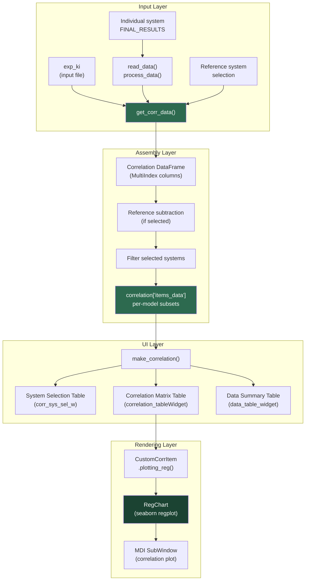

The Multi-System Correlation subsystem within `gmx_MMPBSA_ana` provides a statistically rigorous pipeline for comparing calculated binding free energies against experimental measurements across multiple molecular systems. It transforms individual MMPBSA results into publication-quality regression plots annotated with Pearson and Spearman correlation coefficients, enabling rapid assessment of computational protocol accuracy across wild-type and mutant variants.

## Architectural Overview

The correlation engine operates as a dedicated analysis pipeline within the GUI analyzer, distinct from the per-system energy visualization workflows. It assembles data from all loaded systems into a unified pandas DataFrame, applies optional reference-system subtraction for relative binding free energies, and dispatches to a specialized `RegChart` renderer built on seaborn's regression primitives.



## Data Ingestion and Experimental Values

The correlation pipeline begins with the `exp_ki` variable declared in the `general` namelist of the input file. This variable stores experimental inhibition constant values in nanomolar (nM) and supports a list-type format for dual-type systems (e.g., `Ki` and `IC50` simultaneously). During system loading, the `read_data` method in the main window passes the raw `exp_ki` dictionary and a `correlation` boolean flag into each system's metadata [input_parser.py](GMXMMPBSA/input_parser.py#L425-L425) [gui.py](GMXMMPBSA/analyzer/gui.py#L1094-L1104).

The critical conversion from Ki (nM) to standard free energy (kcal/mol) is handled by the `ki2energy` utility function, which applies the fundamental thermodynamic relation:

$$\Delta G = R \cdot T \cdot \ln(K_i)$$

where $R = 0.001987$ kcal/(mol·K), $T$ is the temperature from the system's input file, and $K_i$ is converted from nM to molar before the logarithm [utils.py](GMXMMPBSA/analyzer/utils.py#L342-L346). This temperature-dependent conversion ensures that each system's experimental value is computed at its own simulation temperature, which is critical when comparing systems simulated under different thermal conditions.

## Correlation Data Assembly

The `get_corr_data` method is the core orchestrator of the correlation pipeline. It iterates over every loaded system and constructs a unified pandas DataFrame with a MultiIndex column structure organized into two top-level groups: `System` (metadata) and the energy model (numeric data) [gui.py](GMXMMPBSA/analyzer/gui.py#L1028-L1078).

The method executes a three-phase assembly process. First, it builds a metadata DataFrame per system containing the system ID, calculation type (NORMAL/MUTANT), reference status, converted experimental ΔG, and selection state. Second, it concatenates each system's per-model correlation data (sourced from `correlation_data` stored during `process_data`) with this metadata. Third, it applies reference-system subtraction: when a reference system is designated, all other systems' energy values and standard deviations are recalculated relative to that reference using `utils.get_corrstd` for propagated error computation [gui.py](GMXMMPBSA/analyzer/gui.py#L1063-L1072).

The resulting `correlation['data']` dictionary is keyed by energy model and stores the assembled DataFrame. The `correlation['items_data']` dictionary stores pre-filtered subsets (excluding unselected and reference systems) keyed by `(model, method)` tuples, ready for direct plotting.

## Supported Energy Models

The correlation table widget exposes five energy models as columns, each representing a different treatment of the entropy contribution to the binding free energy:

| Column | Model | Formula | Entropy Source |
|:-------|:------|:--------|:---------------|
| **ΔGeff** | Effective | ΔG = ΔH | None (enthalpy only) |
| **ΔGie** | Interaction Entropy | ΔG = ΔH − TΔS_IE | Interaction Entropy method |
| **ΔGc2** | C2 Entropy | ΔG = ΔH − TΔS_C2 | C2 Entropy approximation |
| **ΔGnm** | Normal Modes | ΔG = ΔH − TΔS_NMODE | Quasi-harmonic normal mode analysis |
| **ΔGqh** | Quasi-Harmonic | ΔG = ΔH − TΔS_QH | Quasi-harmonic entropy from covariance |

Columns are conditionally shown or hidden based on which entropy methods were actually computed for the loaded systems. The header tooltips in the `correlation_tableWidget` provide LaTeX-formatted descriptions for each model, rendered as rich-text tooltips [gui.py](GMXMMPBSA/analyzer/gui.py#L124-L154).

## System Selection and Reference Handling

The system selection table (`corr_sys_sel_w`) provides fine-grained control over which systems participate in the correlation analysis. Each row corresponds to a loaded system and contains six columns: system ID, selection checkbox, reference radio button, calculation type, editable experimental Ki value, and system name [gui.py](GMXMMPBSA/analyzer/gui.py#L968-L1010).

The reference mechanism supports relative binding free energy calculations, a common approach in drug design where the goal is to correlate *differences* in binding rather than absolute values. When a system is marked as reference:

- Its calculated energy values serve as the baseline subtraction point
- All other systems' `Average` columns become `ΔΔG` values relative to the reference
- The `SD` column is transformed using `utils.get_corrstd`, which propagates error through the subtraction: `σ_ΔΔG = √(σ_system² + σ_reference²)`
- The transformed `SD` is also copied into the `SEM` column for error bar rendering

The `corr_sys_sel_itemchange` callback enforces a mutual-exclusion constraint on the reference radio button: unchecking a system's selection checkbox automatically disables its reference status and reassigns the reference to the nearest checked system [gui.py](GMXMMPBSA/analyzer/gui.py#L248-L263).

> [!TIP]
> The experimental Ki values in the selection table are **editable at runtime**. When a user modifies a Ki value, the `update_corr_fn` method recalculates all experimental ΔG values using the current system's temperature and refreshes the correlation data without requiring a full reload. This enables rapid sensitivity analysis of correlation metrics against experimental uncertainties.

## Regression Plot Rendering

The `RegChart` class, extending `ChartsBase`, is responsible for rendering the actual experimental-vs-calculated scatter plot with regression overlay. It leverages seaborn's `regplot` (or `JointGrid` when marginal distributions are enabled) and computes three statistical metrics simultaneously [plots.py](GMXMMPBSA/analyzer/plots.py#L675-L750).

### Statistical Computation

Three independent correlation measures are computed from the filtered data:

1. **Pearson correlation** (`scipy.stats.pearsonr`): Measures linear dependence between experimental and calculated ΔG, returning both the coefficient and two-tailed p-value.
2. **Spearman rank correlation** (`scipy.stats.spearmanr`): Measures monotonic relationship strength using rank-based comparison, returning coefficient and p-value.
3. **Linear regression** (`scipy.stats.linregress`): Computes slope, intercept, R², p-value, and standard error of the estimated slope.

All three metrics are computed from the same `data['ExpΔG']` and `data['Average']` columns and displayed as legend entries when their respective display toggles are enabled [plots.py](GMXMMPBSA/analyzer/plots.py#L686-L688).

### Plotting Modes

The renderer supports two distinct visualization modes controlled by the `Distribution > show` option:

**Joint Grid mode** (distribution enabled): Uses `sns.JointGrid` to render the regression scatter in the central panel and marginal distributions along both axes. The distribution type is configurable among `hist` (histogram), `kde` (kernel density estimate), `violin`, and `box`. For histograms, additional sub-options control fill, KDE overlay, and element style (bars, step, poly) [plots.py](GMXMMPBSA/analyzer/plots.py#L697-L704).

**Standard mode** (distribution disabled): Renders a simple `sns.regplot` in a single axes, suitable for cleaner presentations or when marginal distributions are not informative.

### Error Bar Overlay

When the `Scatter > error-line > show` option is enabled, error bars are overlaid on the scatter points using `matplotlib.axes.Axes.errorbar`. The error representation is selectable between `SD` (standard deviation) and `SEM` (standard error of the mean), with configurable line width, cap size, and color [plots.py](GMXMMPBSA/analyzer/plots.py#L711-L717).

> [!TIP]
> A minimum of **4 valid data points** (non-NaN in both ExpΔG and Average columns) is enforced before rendering. The `CustomCorrItem.plotting_reg` method performs this validation and displays an error dialog if the threshold is not met, preventing misleading correlation coefficients from small sample sizes [customitem.py](GMXMMPBSA/analyzer/customitem.py#L82-L93).

## Correlation Chart Configuration

All visual parameters for regression plots are managed by the `CorrChartSettings` class, a dedicated settings dictionary independent from the per-system `ChartSettings`. It defines a hierarchical parameter tree with three action types controlling re-render behavior [chartsettings.py](GMXMMPBSA/analyzer/chartsettings.py#L778-L960):

| Action Type | Value | Behavior |
|:------------|:------|:---------|
| **D** (Drawable) | 1 | Applied during initial draw only |
| **U** (Updatable) | 2 | Applied via live update without re-plot |
| **R** (Re-plot) | 3 | Triggers full chart re-rendering |

The configuration hierarchy is organized into two primary groups:

**General settings**: Theme selection (`darkgrid`, `whitegrid`, `dark`, `white`, `ticks`), toolbar visibility, figure DPI (plot-time and save-time), and save format (svg, png, pdf, tiff, eps, pgf, and others) [chartsettings.py](GMXMMPBSA/analyzer/chartsettings.py#L784-L817).

**Regression Plot settings**: A nested group controlling regression line width and color, confidence interval (0–100%), display toggles for Pearson/Spearman/equation legend entries, scatter point appearance (color, alpha, marker size), error bar properties (show, width, color, cap size, SD vs SEM representation), marginal distribution type and sub-options, font sizes for all text elements, and figure dimensions [chartsettings.py](GMXMMPBSA/analyzer/chartsettings.py#L819-L920).

The `get_changes` method performs a flattened dictionary comparison between current and previous states, setting the `changes` attribute to the highest action type encountered, which the `update_corr_fn` method uses to decide whether to re-plot or perform a lightweight update [chartsettings.py](GMXMMPBSA/analyzer/chartsettings.py#L939-L950).

## Update and Re-render Pipeline

The `update_corr_fn` method serves as the central dispatch point for correlation chart updates, triggered by the "Update" button in the correlation dock widget. It operates in two mutually exclusive branches depending on the active options tab [gui.py](GMXMMPBSA/analyzer/gui.py#L774-L826).

**Chart Options tab**: Compares current parameter tree state against stored state using `is_changed`. If changed, it calls `get_changes` to determine the action type and marks the correlation data as stale (`changes = True`), which signals downstream `CustomCorrItem` instances to re-render their regression windows on next activation.

**Selections tab**: Recalculates all system-level modifications — selection checkboxes, reference radio buttons, and experimental Ki values — and rebuilds the `correlation['items_data']` dictionary with freshly filtered subsets. It then iterates over all correlation table widget cells, toggling any active regression chart buttons off and immediately back on to trigger re-rendering with the new data.

## End-to-End Workflow

The canonical workflow for multi-system correlation analysis consists of three stages: computation, loading, and interactive analysis.

**Stage 1 — Computation**: Run `gmx_MMPBSA` independently for each system (wild-type and mutants) using shared topology and trajectory files but system-specific input files that include `exp_ki` values. A shell loop handles batch execution:

```bash
for i in */
do
  cd $i
  gmx_MMPBSA -O -i mmpbsa.in -cs ../com.tpr -ci ../index.ndx \
    -cg 20 21 -ct ../com_traj.xtc -o FINAL_RESULTS_MMPBSA.dat \
    -eo FINAL_RESULTS_MMPBSA.csv -nogui
  cd ..
done
```

**Stage 2 — Loading**: Launch `gmx_MMPBSA_ana -r` from the parent directory to recursively discover all `*_MMPBSA*` output files. The correlation dock widget is automatically populated if at least one loaded system contains `exp_ki` data.

**Stage 3 — Interactive analysis**: Select/deselect systems, designate a reference for relative ΔΔG, edit experimental values, choose an energy model, and render the regression plot. All statistical metrics (Pearson, Spearman, R²) update in real time as selections change.

The Correlation example in the repository demonstrates this workflow with 7 systems — wild-type (WT) and six mutants (H15, S32, T13, W34, Y23, Y25) — all sharing common topology and trajectory files, each with a system-specific `mmpbsa.in` containing mutation definitions and experimental Ki values [examples/Correlation/README.md](examples/Correlation/README.md#L1-L94).