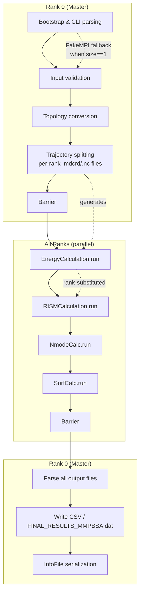
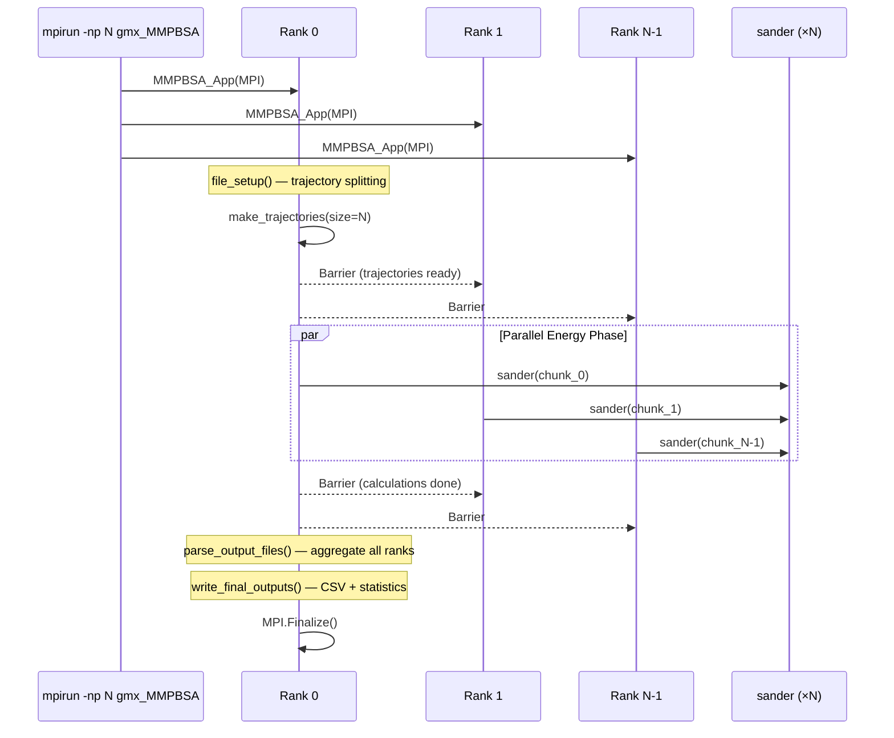

gmx_MMPBSA employs an **embarrassingly parallel** MPI strategy: trajectory frames are statically partitioned across ranks at startup, and each rank independently drives its own AMBER energy calculations. There is no inter-rank communication during the compute phase—only barrier synchronization at well-defined phase boundaries. This design makes the parallelism straightforward to reason about, trivially correct under most failure modes, and inherently scalable for the dominant cost (sander/PB/RISM per-frame energy evaluation).

## Architectural Overview

The parallel execution model has four distinct phases, each separated by an MPI barrier. Three of them execute on the **master rank only**; only the calculation phase runs simultaneously across all ranks.



Sources: [app.py](GMXMMPBSA/app.py#L40-L113), [main.py](GMXMMPBSA/main.py#L109-L210)

## MPI Bootstrap and the FakeMPI Pattern

The entry point in [app.py](GMXMMPBSA/app.py#L55-L57) first attempts to import `mpi4py.MPI`. If the process was launched without `mpirun` (so `COMM_WORLD.size == 1`), it immediately replaces the real MPI object with the **fake MPI** from [fake_mpi.py](GMXMMPBSA/fake_mpi.py#L28-L68). This ensures that the single-process code path is byte-identical to the MPI path—no `if MPI:` branches clutter the core logic.

The `FakeMPI.MPI` class provides a `Communicator` with stub implementations of all MPI primitives used by gmx_MMPBSA:

| Method | Real MPI (`mpi4py`) | FakeMPI | Purpose in gmx_MMPBSA |
|--------|---------------------|---------|-----------------------|
| `Get_rank()` | Returns 0…N−1 | Always `0` | Determines output file suffix (`%d`) |
| `Get_size()` | Returns N | Always `1` | Controls frame partition count |
| `Barrier()` | Collective sync | No-op | Phase boundary synchronization |
| `bcast(inp, root)` | Broadcasts value | Returns `inp` unchanged | (Reserved for future use) |
| `Abort(status)` | Kills all ranks | Calls `sys.exit` | Fatal error propagation |
| `Finalize()` | Cleans up MPI | No-op | End-of-run teardown |

Sources: [fake_mpi.py](GMXMMPBSA/fake_mpi.py#L28-L68), [app.py](GMXMMPBSA/app.py#L55-L57)

The `MMPBSA_App.__init__` constructor receives whichever MPI object was resolved, extracts `mpi_rank`, `mpi_size`, and a boolean `master` flag, then **redirects stdout to `/dev/null` on all non-master ranks** ([main.py](GMXMMPBSA/main.py#L94-L96)). This is the sole mechanism preventing duplicated log output—it is not a performance optimization.

Sources: [main.py](GMXMMPBSA/main.py#L70-L103)

## Static Frame Partitioning

Before any energy calculation begins, the master rank invokes `make_trajectories()` ([make_trajs.py](GMXMMPBSA/make_trajs.py#L43-L317)), which splits every trajectory (complex, receptor, ligand, nmode) into rank-specific chunks via cpptraj. The partitioning algorithm is straightforward integer division with remainder distribution:

```python
frames_per_rank = total_frames // mpi_size
extras = total_frames - frames_per_rank * mpi_size
# rank i gets frames_per_rank + (1 if i < extras else 0) frames
```

This produces rank-specific trajectory files named with the pattern `_GMXMMPBSA_complex.mdcrd.%d` where `%d` is the rank index. The same scheme applies to `.nc` (NetCDF), `.inpcrd` (restart), and nmode trajectories.

> [!TIP]
> The code enforces a **hard constraint** that `total_frames >= mpi_size` and raises `MMPBSA_Error` otherwise ([make_trajs.py](GMXMMPBSA/make_trajs.py#L87-L88)). Requesting more processors than available frames is a configuration error, not a graceful degradation scenario.

When using the **multiple trajectory protocol (MTP)**, each component trajectory (complex, receptor, ligand) is partitioned independently. When using the **single trajectory protocol (STP)**, receptor and ligand trajectories are derived by stripping from the complex trajectory, so all components share the same frame count and partition.

Sources: [make_trajs.py](GMXMMPBSA/make_trajs.py#L73-L178), [main.py](GMXMMPBSA/main.py#L130-L153)

## Rank-Substituted File I/O in Calculations

Every `Calculation` subclass uses a **filename template containing `%d`** that is resolved at execution time. When `Calculation.run(rank, ...)` is invoked ([calculation.py](GMXMMPBSA/calculation.py#L238-L287)), it iterates through `command_args` and performs `arg %= rank` for any string containing `%d`. This means the same `EnergyCalculation` object, instantiated once, produces rank-specific input/output paths for sander without any subclass logic.

For example, the complex GB calculation is constructed with:
- Trajectory: `_GMXMMPBSA_complex.mdcrd.%d`
- Output: `_GMXMMPBSA_complex_gb.mdout.%d`
- Restart: `_GMXMMPBSA_restrt.%d`

The restart file deserves special attention: `EnergyCalculation.setup()` explicitly provides a **unique restart file per rank** because sander always writes a restart file, and concurrent writes from multiple ranks to the same path would corrupt it ([calculation.py](GMXMMPBSA/calculation.py#L308-L313)).

Sources: [calculation.py](GMXMMPBSA/calculation.py#L238-L287), [calculation.py](GMXMMPBSA/calculation.py#L300-L313)

## CalculationList: Sequential Execution Within Each Rank

The `CalculationList` class ([calculation.py](GMXMMPBSA/calculation.py#L88-L149)) is an ordered list of `Calculation` instances. Its `run(rank, ...)` method iterates **sequentially** through all calculations for the given rank. Within a single rank, there is no parallelism—GB runs before PB, which runs before RISM, which runs before nmode, etc. The parallelism is exclusively **inter-rank** (across frames), not intra-rank (across calculation types).

During iteration, `CalculationList` spawns a **monitoring thread** for each energy calculation that polls all rank output directories and updates a `tqdm` progress bar ([calculation.py](GMXMMPBSA/calculation.py#L125-L137)). This thread calls the `pb()` helper function ([calculation.py](GMXMMPBSA/calculation.py#L53-L87)), which scans every rank's output files (using glob patterns like `_GMXMMPBSA_complex_gb.mdout.%d`) counting `FINAL RESULTS` markers. This provides the user with a live frame-completion counter despite each rank running independently.

Sources: [calculation.py](GMXMMPBSA/calculation.py#L88-L149), [calculation.py](GMXMMPBSA/calculation.py#L53-L87)

## Barrier Synchronization Points

Synchronization occurs at exactly three points in the execution lifecycle, all mediated by `MPI.COMM_WORLD.Barrier()` or the convenience method `sync_mpi()` ([main.py](GMXMMPBSA/main.py#L1160-L1161)):

| Barrier Location | Before | After | Rationale |
|------------------|--------|-------|-----------|
| Post-trajectory creation | cpptraj output files exist | Energy phase begins | All rank-specific trajectory files must be written before calculations read them |
| Post-energy calculations | All `mdout` files exist | Output parsing begins | The master rank needs all rank outputs to aggregate statistics |
| Post-mutant trajectory creation | Mutant trajectories ready | Energy phase (mutant) | Ensures alanine-scanning trajectories are available |

> [!TIP]
> Between barrier points, ranks execute completely independently with **zero MPI communication**. This means a rank crash during the energy phase does not propagate to other ranks—they will continue computing until they hit the next barrier (which will hang indefinitely). For robustness, the `excepthook` in [main.py](GMXMMPBSA/main.py#L1491-L1508) calls `MPI.COMM_WORLD.Abort()` on uncaught exceptions, killing all ranks.

Sources: [main.py](GMXMMPBSA/main.py#L1160-L1161), [main.py](GMXMMPBSA/main.py#L1491-L1508), [main.py](GMXMMPBSA/main.py#L143-L154)

## Calculation-Type Specific MPI Behavior

Not all calculation types interact with MPI identically. The table below summarizes how each major calculation class handles the rank parameter:

| Calculation Class | Parallelism Strategy | Rank Usage | Notes |
|-------------------|---------------------|------------|-------|
| `EnergyCalculation` (GB) | Frame-level | Rank selects trajectory chunk | Unique restart file per rank |
| `PBEnergyCalculation` | Frame-level | Rank selects trajectory chunk | Overrides `run()` to capture PBSA stderr; each PB run is memory-intensive |
| `ListEnergyCalculation` (GBNSR6) | Frame-level (multi-step) | Rank selects inpcrd directory | GBNSR6 outputs large decomp files per frame; `mdout2json` compresses them post-run |
| `RISMCalculation` | Frame-level | Rank selects trajectory chunk | Heavy memory usage per rank; warning logged when `mpi_size > 1` |
| `NmodeCalc` | Frame-level | Rank selects nmode trajectory chunk | Very memory-heavy; warning logged when `mpi_size > 1` |
| `QuasiHarmCalc` | Not rank-parallelized | Runs on master only | Uses full (unsplit) trajectory for covariance analysis |
| `SurfCalc` (LCPO/Molsurf) | Frame-level | Rank selects trajectory chunk | Uses cpptraj; lightweight |
| `InteractionEntropyCalc` | Not rank-parallelized | Runs on master only | Post-hoc calculation on already-collected GGAS data |
| `C2EntropyCalc` | Not rank-parallelized | Runs on master only | Post-hoc calculation on already-collected GGAS data |

Sources: [calculation.py](GMXMMPBSA/calculation.py#L300-L530), [main.py](GMXMMPBSA/main.py#L230-L238)

## Output Aggregation: Master-Only Post-Processing

After the final barrier, only the master rank proceeds to `parse_output_files()` and `write_final_outputs()` ([main.py](GMXMMPBSA/main.py#L735-L761)). The master iterates over all rank-specific output files (e.g., `_GMXMMPBSA_complex_gb.mdout.0` through `_GMXMMPBSA_complex_gb.mdout.N-1`), parses each one using the appropriate parser class (e.g., `GBout`, `PBout`, `NMODEout` from [amber_outputs.py](GMXMMPBSA/amber_outputs.py)), and aggregates statistics using `BindingStatistics`.

The `InfoFile` object ([infofile.py](GMXMMPBSA/infofile.py)) serializes all results to disk, which the [Python API](15-python-api) later reads for custom analysis. This serialized file is the bridge between the MPI-parallel CLI execution and the serial API/Analyzer post-processing.

Sources: [main.py](GMXMMPBSA/main.py#L735-L761), [main.py](GMXMMPBSA/main.py#L1164-L1276)

## Execution Model Summary



## Practical Guidance

**Launching with MPI**: The standard invocation uses `mpirun` (or `mpiexec`) with the desired process count. Since v1.4.2, running without `mpirun` automatically falls back to serial mode via FakeMPI—no special flags are needed.

```bash
# 8-way parallel
mpirun -np 8 gmx_MMPBSA -O -i mmpbsa.in -cs com.tpr -cp topol.top \
       -ci index.ndx -ct complex_traj.xtc

# Serial (automatic fallback)
gmx_MMPBSA -O -i mmpbsa.in -cs com.tpr -cp topol.top \
           -ci index.ndx -ct complex_traj.xtc
```

**Memory considerations**: PB, RISM, and nmode calculations are memory-intensive. The code emits a warning when `mpi_size > 1` and any of these are enabled ([main.py](GMXMMPBSA/main.py#L224-L225)). Each rank loads a full copy of the topology into the sander process, so total RAM usage scales linearly with process count for these methods. For a 100,000-atom membrane protein with PB, a good rule of thumb is to budget ~2–4 GB per rank.

**Diminishing returns**: Because the parallelism is purely frame-level, the speedup is `frames / max(frames_per_rank, overhead)`. Amdahl's law applies: the serial phases (trajectory splitting, output parsing, topology conversion) become dominant bottlenecks as `N` approaches the frame count. For 100 frames with 64 ranks, only 36 ranks will have useful work while the overhead of creating 64 trajectory chunks and parsing 64 output files grows linearly.

**Failure handling**: If any rank dies during the energy phase, the barrier will hang indefinitely. The global exception hook calls `MPI.Abort()` for uncaught Python exceptions, but a sander segfault within a subprocess will only kill that rank's subprocess—the Python parent process will detect the non-zero exit code and raise `CalcError`, which triggers the abort.

For deeper architectural context on how calculations are structured, see [Calculation Class Hierarchy](9-calculation-class-hierarchy). To understand how the trajectory files consumed by each rank are produced, see [Trajectory Processing](7-trajectory-processing).