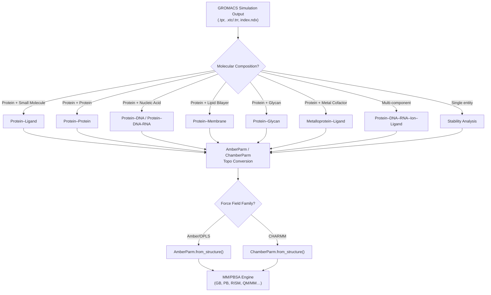
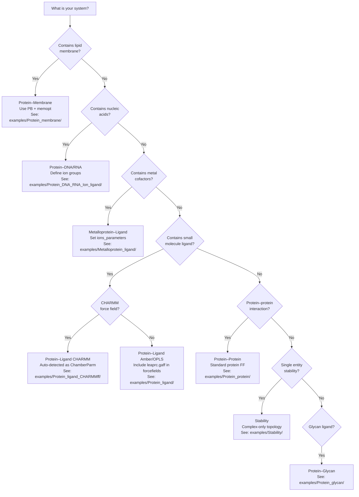

gmx_MMPBSA bridges the GROMACS and AMBER ecosystems, enabling MM/PBSA free energy calculations on systems simulated with GROMACS-based workflows. The tool recognizes distinct **biomolecular compositions**, **force field families**, and **trajectory protocols** — each imposing specific requirements on topology conversion, index definition, and calculation configuration. This page catalogs every system type supported by the codebase, maps each to its concrete input requirements, and traces the internal code paths that make them work.

## System Composition Taxonomy

At the highest level, gmx_MMPBSA classifies systems by their molecular constituents. The `MMPBSA_System` class in [parm_setup.py](GMXMMPBSA/parm_setup.py#L62-L101) orchestrates the complex/receptor/ligand partition, while `CheckMakeTop.buildTopology()` in [make_top.py](GMXMMPBSA/make_top.py#L119-L260) handles the GROMACS-to-AMBER topology conversion for all of them. The diagram below illustrates how system composition flows into the pipeline:

### Protein–Ligand Systems

The most common use case. A protein receptor binds a small organic ligand — typically parameterized with GAFF/GAFF2. The `forcefields` variable in the input file must include `leaprc.gaff` or `leaprc.gaff2` when a ligand `mol2` is supplied, enforced by the validation check at [main.py#L944-L952](GMXMMPBSA/main.py#L944-L952). Two topology approaches exist: the **Single Trajectory Protocol (STP)** where only the complex trajectory is needed (the receptor/ligand topologies are derived by stripping atoms from the complex), and the **Multiple Trajectory Protocol (MTP)** where separate receptor and ligand `.tpr` files are required, as shown in the topology branching logic at [make_top.py#L646-L652](GMXMMPBSA/make_top.py#L646-L652). Example configurations are provided in [examples/Protein_ligand/](examples/Protein_ligand/) (both ST and MT subdirectories).

### Protein–Protein Systems

Two proteins interacting at an interface. No small molecule force fields are needed — standard protein force fields like `ff99SB` suffice. The index file must define three groups: complex (all protein atoms), receptor (protein A), and ligand (protein B). The tool generates separate Amber topologies for each by stripping residues from the complex parameter set. See [examples/Protein_protein/](examples/Protein_protein/) for a complete worked example.

### Protein–DNA and Protein–DNA–RNA–Ion–Ligand Systems

Nucleic acid systems introduce additional atom types and charge states. gmx_MMPBSA handles these through the same ParmEd-based pipeline, with the force field list in the `general` namelist specifying appropriate nucleic acid parameters (e.g., `leaprc.ff14SB` which includes DNA/RNA). The multi-component variant — Protein–DNA–RNA–Ion–Ligand — demonstrated in [examples/Protein_DNA_RNA_Ion_ligand/](examples/Protein_DNA_RNA_Ion_ligand/) — supports defining ions as part of the ligand group, enabling calculations where metal ions are treated as part of the binding partner. The `cleantop` method at [make_top.py#L819-L875](GMXMMPBSA/make_top.py#L819-L875) removes SOL and IONS groups from GROMACS topologies before conversion.

### Protein–Membrane Systems

Membrane-embedded protein systems can leverage the **implicit membrane** model available in the Poisson-Boltzmann solver. The `pb` namelist exposes membrane-specific parameters defined at [input_parser.py#L519-L524](GMXMMPBSA/input_parser.py#L519-L524): `memopt` (enable membrane optimization), `emem` (membrane dielectric constant), `mthick` (membrane thickness in Å), `mctrdz` (Z-axis offset), and `poretype` (channel protein exclusion region). A validation check at [main.py#L1041-L1044](GMXMMPBSA/main.py#L1041-L1044) ensures `emem` falls between `indi` and `exdi`. Dedicated examples exist for both Amber and CHARMM force field membranes at [examples/Protein_membrane/](examples/Protein_membrane/) and [examples/Protein_membrane_CHARMMff/](examples/Protein_membrane_CHARMMff/).

### Protein–Glycan Systems

Glycoprotein systems where the ligand is a glycan chain. These require careful handling of sugar residue nomenclature during the GROMACS-to-AMBER conversion, as sugar ring atom names differ between force fields. The `fixparm2amber` method at [make_top.py#L950-L1015](GMXMMPBSA/make_top.py#L950-L1015) performs residue name remapping to ensure compatibility with the AMBER topology format. A complete example is available at [examples/Protein_glycan/](examples/Protein_glycan/).

### Metalloprotein–Ligand Systems

Systems containing metal cofactors (zinc, iron, copper, etc.) coordinated to the protein and/or ligand. The ions parameter system in [make_top.py#L63-L75](GMXMMPBSA/make_top.py#L63-L75) provides 16 predefined ion parameter sets (`ions_parameters` variable, values 1–16, validated at [main.py#L954-L955](GMXMMPBSA/main.py#L954-L955)) that map to appropriate AMBER ion force field files. See [examples/Metalloprotein_ligand/](examples/Metalloprotein_ligand/).

### Single-System Stability Analysis

Not all calculations require a receptor–ligand partition. When running **stability analysis**, only the complex topology and trajectory are used — the tool evaluates the conformational energy of a single molecular entity across the trajectory frames. The `_stability_mask` method in [parm_setup.py#L207-L250](GMXMMPBSA/parm_setup.py#L207-L250) handles mask generation for this mode. An example is provided at [examples/Stability/](examples/Stability/).

## Force Field Compatibility Matrix

The topology conversion pipeline in [make_top.py#L580-L591](GMXMMPBSA/make_top.py#L580-L591) automatically detects the force field family by checking for CHARMM-specific parameter types (`impropers` or `urey_bradleys`), then routes to either `AmberParm` or `ChamberParm`:

| Force Field Family | ParmEd Class | Topology Parameter | PBRadii Options | Example Directory |
|---|---|---|---|---|
| **Amber (ff99SB, ff14SB, etc.)** | `AmberParm` | Standard AMBER | All (1–7) | `Protein_ligand/`, `Protein_protein/` |
| **OPLS-AA/OPLS-AA/L** | `AmberParm` | Standard AMBER | All (1–7) | `OPLS/` |
| **CHARMM36/CHARMM22** | `ChamberParm` | CHAMBER format | 1–6 (not 7) | `Protein_ligand_CHARMMff/`, `Protein_membrane_CHARMMff/` |
| **CHARMM + LPH atoms** | `ChamberParm` | CHAMBER + modified | 1–6 | `Protein_ligand_LPH_atoms_CHARMMff/` |

The validation at [make_top.py#L602-L605](GMXMMPBSA/make_top.py#L602-L605) explicitly blocks PBRadii=7 (`mbondi_pb3`) for Amber/OPLS topologies, while the consistency check at [make_top.py#L631-L638](GMXMMPBSA/make_top.py#L631-L638) raises an error if the complex and receptor use mismatched parameter formats (Amber vs. CHAMBER).

> [!TIP]
> **Force field mixing is forbidden.** If your complex uses a CHARMM force field (detected via `impropers`/`urey_bradleys`), the receptor and ligand topologies must also be CHARMM-based. The tool performs a cross-check and raises `GMXMMPBSA_ERROR` on mismatch at [make_top.py#L631-L638](GMXMMPBSA/make_top.py#L631-L638). This constraint applies regardless of whether you use STP or MTP.

## Trajectory Protocol Comparison

The trajectory protocol determines how many independent simulations are required and how topologies are generated. The distinction is enforced at [main.py#L175-L177](GMXMMPBSA/main.py#L175-L177), which validates that all three trajectories have equal frame counts for MTP.

| Feature | Single Trajectory (STP) | Multiple Trajectory (MTP) |
|---|---|---|
| **Required inputs** | Complex `.tpr` + complex trajectory | Complex, receptor, and ligand `.tpr` + their trajectories |
| **Index groups** | Complex, receptor, ligand (all from one index file) | Same, plus receptor/ligand topology files |
| **Topologies generated** | Receptor/ligand derived from complex | Independent topologies for each component |
| **Entropy cancellation** | Bonded terms cancel in ΔG | No cancellation — all terms computed independently |
| **Typical accuracy** | Higher (less noise from independent sampling) | Lower variance only if each component is well-sampled |
| **Use case** | Standard binding free energy | When components have significant conformational change |

## Calculation Method Compatibility by System Type

Not every calculation method is applicable to every system type. The following matrix summarizes which advanced features are available across the supported system compositions, based on the input validation logic in [main.py#L933-L1050](GMXMMPBSA/main.py#L933-L1050) and the output class hierarchy in [amber_outputs.py](GMXMMPBSA/amber_outputs.py):

| Calculation Method | Protein–Ligand | Protein–Protein | Protein–DNA | Protein–Membrane | Protein–Glycan | Metalloprotein |
|---|:---:|:---:|:---:|:---:|:---:|:---:|
| **GB (igb 1,2,5,7,8)** | ✅ | ✅ | ✅ | ✅ | ✅ | ✅ |
| **GBNSR6** | ✅ | ✅ | ✅ | ✅ | ✅ | ✅ |
| **PB (Linear)** | ✅ | ✅ | ✅ | ✅ | ✅ | ✅ |
| **PB (NonLinear)** | ✅ | ✅ | ✅ | ✅ | ✅ | ✅ |
| **PB (APBS)** | ✅ | ✅ | ✅ | ✅ | ✅ | ✅ |
| **3D-RISM** | ✅ | ✅ | ✅ | ⚠️ | ✅ | ✅ |
| **QM/MM-GBSA** | ✅ | ✅ | ✅ | ⚠️ | ⚠️ | ⚠️ |
| **Per-residue Decomp** | ✅ | ✅ | ✅ | ✅ | ✅ | ✅ |
| **Pairwise Decomp** | ✅ | ✅ | ✅ | ✅ | ✅ | ✅ |
| **Alanine Scanning** | ✅ | ✅ | ✅ | ✅ | ✅ | ✅ |
| **Normal Mode Entropy** | ✅ | ✅ | ✅ | ✅ | ✅ | ✅ |
| **Quasi-harmonic Entropy** | ✅ | ✅ | ✅ | ✅ | ✅ | ✅ |
| **Interaction Entropy** | ✅ | ✅ | ✅ | ✅ | ✅ | ✅ |
| **C2 Entropy** | ✅ | ✅ | ✅ | ✅ | ✅ | ✅ |
| **Implicit Membrane (PB)** | — | — | — | ✅ | — | — |

*✅ = Fully supported; ⚠️ = Supported but requires careful parameter selection; — = Not applicable*

Two critical incompatibilities are enforced by the codebase: **QM/MM and decomposition analysis cannot run simultaneously** (checked at [main.py#L1025-L1026](GMXMMPBSA/main.py#L1025-L1026)), and **ALPB is incompatible with igb=8** (checked at [main.py#L985-L986](GMXMMPBSA/main.py#L985-L986)).

> [!TIP]
> **Implicit membrane is PB-only.** The `memopt` parameter lives exclusively in the `pb` namelist at [input_parser.py#L520](GMXMMPBSA/input_parser.py#L520). GB-based methods (igb variants) do not have a membrane model. If your protein–membrane system requires implicit solvation with a membrane, you must use PB and set `memopt = 1` with appropriate `mthick` and `emem` values.

## NAMD PSF/DCD Input Support

Beyond GROMACS-native inputs, gmx_MMPBSA also accepts **CHARMM/NAMD** system files in PSF/DCD format, demonstrated in [examples/psf_dcd/](examples/psf_dcd/). This pathway bypasses GROMACS tooling entirely — the tool uses ParmEd to load `.psf` files directly into `ChamberParm` objects, then proceeds with the standard AMBER calculation engine. Three sub-examples cover `protein_ligand`, `protein_protein`, and `multicomponent_system` variants.

## Multi-System Comparative Workflows

gmx_MMPBSA supports two higher-order workflows that combine multiple system types:

- **Comparative Receptor** ([examples/Comp_receptor/](examples/Comp_receptor/)) — evaluates the same ligand against different receptor conformations or mutants, producing side-by-side binding energy comparisons.
- **Correlation Analysis** ([examples/Correlation/](examples/Correlation/)) — computes binding energies across multiple systems (e.g., wild-type + point mutants) and correlates them with experimental data. The `exp_ki` variable in the `general` namelist at [input_parser.py#L425](GMXMMPBSA/input_parser.py#L425) accepts experimental Kᵢ values in nM for this purpose.

These workflows are orchestrated through the `MMPBSA_API` class in [API.py#L195](GMXMMPBSA/API.py#L195), which provides `get_binding()` and `get_energy()` methods for programmatic access to multi-system results.

## Decision Guide for New Users

## Required Input Files Summary

Regardless of system type, gmx_MMPBSA requires a consistent set of input files validated by `CheckMakeTop.checkFiles()` at [make_top.py#L114-L117](GMXMMPBSA/make_top.py#L114-L117):

| File | Format | Required | Description |
|---|---|---|---|
| **Structure file** (`.tpr`) | GROMACS binary | Always | Full system topology + coordinates |
| **Trajectory** (`.xtc`/`.trr`) | GROMACS compressed/raw | Always | Simulation frames for analysis |
| **Index file** (`.ndx`) | GROMACS index | Always | Defines complex/receptor/ligand atom groups |
| **Receptor topology** (`.tpr`) | GROMACS binary | MTP only | Separate receptor for multi-trajectory |
| **Ligand topology** (`.tpr`) | GROMACS binary | MTP only | Separate ligand for multi-trajectory |
| **Ligand structure** (`.mol2`) | Tripos MOL2 | GAFF ligands | Provides atom types for `tleap` |
| **Input file** (`mmpbsa.in`) | gmx_MMPBSA format | Always | Calculation parameters |
| **GROMACS topology** (`.top`) | GROMACS text | Optional | Enables direct `.top` → `.prmtop` conversion |

When a GROMACS `.top` file is provided, the tool uses the direct `gmxtop2prmtop()` pathway at [make_top.py#L562-L563](GMXMMPBSA/make_top.py#L562-L563), which automatically sets `radiopt = 0`. Otherwise, it falls back to the PDB → `tleap` pathway via `pdb2prmtop()` and `makeToptleap()` at [make_top.py#L762-L767](GMXMMPBSA/make_top.py#L762-L767).

---

For implementation details on how these system types flow through the topology conversion pipeline, see [Topology Conversion Pipeline](6-topology-conversion-pipeline). To understand how the energy calculation engine processes each converted system, refer to [Calculation Class Hierarchy](9-calculation-class-hierarchy). For guidance on writing input files tailored to your system type, consult [Input File Reference](3-input-file-reference).