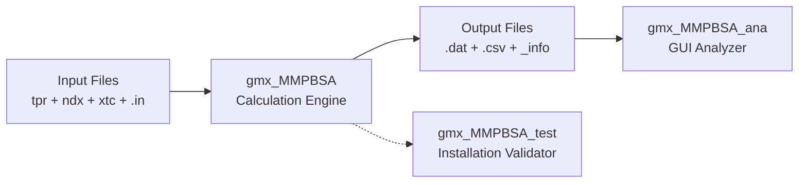
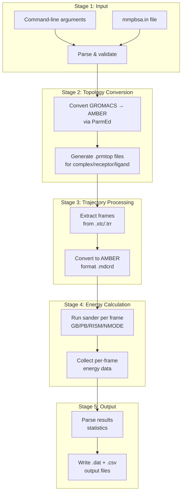

This guide walks you through your first binding free energy calculation with **gmx_MMPBSA** — from installation to results — in the shortest path possible. By the end, you will understand the full execution pipeline, the required input files, and how to interpret the output.

## The gmx_MMPBSA Suite at a Glance

gmx_MMPBSA is not a single tool but a suite of three complementary applications, each registered as a console script entry point in [setup.py](setup.py#L52-L56):

| Command | Purpose | Entry Point |
|:--------|:--------|:------------|
| `gmx_MMPBSA` | Core calculation engine — performs MM/PB(GB)SA free energy analyses | `GMXMMPBSA.app:gmxmmpbsa` |
| `gmx_MMPBSA_ana` | Interactive GUI analyzer — visualizes and compares results | `GMXMMPBSA.app:gmxmmpbsa_ana` |
| `gmx_MMPBSA_test` | Validation runner — tests installation with real examples | `GMXMMPBSA.app:gmxmmpbsa_test` |

The relationship between these components follows a linear pipeline: **prepare inputs → run calculation → analyze results**.



Sources: [setup.py](setup.py#L52-L56), [app.py](GMXMMPBSA/app.py#L41-L167)

## Prerequisites

Before running any calculation, ensure your system meets these requirements:

**Software dependencies:**

| Dependency | Minimum Version | Purpose |
|:-----------|:----------------|:--------|
| Python | 3.11 | Runtime environment (hard requirement) |
| GROMACS | 4.x / 5.x / 20xx.x | Provides topology and trajectory files |
| AmberTools | ≥ 20 | Provides sander/PB solvers and ParmEd |
| MPI library | OpenMPI | Required for parallel calculations |

The Python version constraint is enforced programmatically at install time — the setup script will refuse to install on any Python version other than 3.11 [setup.py](setup.py#L26-L27). The full conda environment specification is available in [env.yml](docs/env.yml#L1-L25).

> [!TIP]
> **Installation shortcut**: Download the [env.yml](docs/env.yml) file and run `conda env create --file env.yml && conda activate gmxMMPBSA` to create a fully configured environment with GROMACS, AmberTools, and all Python dependencies in one step. This is the recommended approach over manual AmberTools compilation.

For detailed installation instructions covering conda, pip, and AmberTools compilation paths, see [Installation](1-overview).

## Understanding the Execution Pipeline

A gmx_MMPBSA calculation proceeds through a well-defined sequence of stages. Understanding this pipeline helps you diagnose issues when things go wrong.



The entry point function in [app.py](GMXMMPBSA/app.py#L41-L105) orchestrates this entire flow: it instantiates `MMPBSA_App`, parses arguments, reads the input file, converts topologies via `make_prmtops()`, processes trajectories via `file_setup()`, runs calculations via `run_mmpbsa()`, and writes final outputs. The `main.MMPBSA_App` class ([main.py](GMXMMPBSA/main.py#L64-L65)) is the central driver that holds all state throughout the pipeline.

## Preparing Your Files

gmx_MMPBSA expects a specific set of input files prepared from your GROMACS MD simulation. Here is the complete checklist:

### Required Files

| File | Flag | Format | Description |
|:-----|:-----|:-------|:------------|
| Input parameters | `-i` | `.in` | Calculation configuration (namelist format) |
| Structure file | `-cs` | `.tpr` or `.pdb` | Complex structure with coordinates and topology |
| Index file | `-ci` | `.ndx` | GROMACS index defining receptor/ligand groups |
| Trajectory | `-ct` | `.xtc`, `.trr`, or `.pdb` | Fitted, PBC-removed MD trajectory |

### Required Parameters

| Parameter | Flag | Format | Description |
|:----------|:-----|:-------|:------------|
| Receptor group | `-cg` | integer | Group number for receptor in index file |
| Ligand group | `-cg` | integer | Group number for ligand in index file (second value) |

### Conditionally Required Files

| File | Flag | When Needed |
|:-----|:-----|:------------|
| Topology | `-cp` | When no `.mol2` is provided for the ligand |
| Ligand `.mol2` | `-lm` | Protein–small-molecule complexes without `-cp` |
| Reference structure | `-cr` | When chain ID assignment matters (recommended) |

The command-line argument definitions are centralized in [commandlineparser.py](GMXMMPBSA/commandlineparser.py#L174-L234), where each flag has a type-checking decorator ensuring only valid file extensions are accepted.

### Trajectory Preprocessing

Your trajectory must be **fitted and PBC-removed** before feeding it to gmx_MMPBSA. The standard GROMACS workflow:

```bash
# Create a combined group for centering (assuming receptor=1, ligand=12)
gmx make_ndx -n index.ndx -o new_index.ndx
# > 1 | 12
# > q

# Remove PBC and center
gmx trjconv -s md.tpr -f md.xtc -o md_noPBC.xtc -pbc mol -center -n new_index.ndx -ur compact
# center: 20  (the combined group)
# output: 0

# Fit to reference (optional but recommended)
gmx trjconv -s md.tpr -f md_noPBC.xtc -o md_fit.xtc -n new_index.ndx -fit rot+trans
# fit: 20
# output: 0
```

## Creating the Input File

The input file uses Amber's **namelist format** — Fortran-style `&namelist /` blocks containing key-value pairs. The full schema is defined in [input_parser.py](GMXMMPBSA/input_parser.py#L396-L664) with eight namelists: `general`, `gb`, `pb`, `gbnsr6`, `rism`, `ala`, `decomp`, and `nmode`.

### Minimal Input File for GB Calculation

Create a file named `mmpbsa.in`:

```fortran
&general
sys_name="Prot-Lig",
startframe=1,
endframe=10,
/
&gb
igb=5, saltcon=0.150,
/
```

This is the exact format used in the shipped examples ([Protein_ligand/ST/mmpbsa.in](examples/Protein_ligand/ST/mmpbsa.in#L1-L14)).

### Input File Parameters Explained

| Namelist | Key Parameter | Default | Meaning |
|:---------|:-------------|:--------|:--------|
| `&general` | `startframe` | 1 | First frame to analyze |
| `&general` | `endframe` | 9999999 | Last frame to analyze |
| `&general` | `interval` | 1 | Frame sampling stride |
| `&general` | `forcefields` | `oldff/leaprc.ff99SB, leaprc.gaff` | AMBER force fields for topology conversion |
| `&gb` | `igb` | 5 | GB model (1=GB1, 2=OBC1, 5=OBC2, 7=OBC2 w/ NL, 8=GBNeck) |
| `&gb` | `saltcon` | 0.0 | Salt concentration in M |
| `&pb` | `ipb` | 2 | PB solver (1=Linear, 2=Linear w/ optimize) |

> [!TIP]
> **Quick template generation**: Instead of writing input files manually, use `gmx_MMPBSA --create_input gb` to auto-generate a complete template file named `mmpbsa.in` with all available options documented inline. Other valid choices are `pb`, `rism`, `ala`, `decomp`, `nmode`, and `all`.

For the complete parameter reference including PB, RISM, decomposition, and entropy options, proceed to [Input File Reference](3-input-file-reference).

## Running Your First Calculation

### Serial Execution

Navigate to the directory containing all your input files and run:

```bash
gmx_MMPBSA -O -i mmpbsa.in -cs com.tpr -ct com_traj.xtc \
  -ci index.ndx -cg 3 4 -cp topol.top \
  -o FINAL_RESULTS_MMPBSA.dat -eo FINAL_RESULTS_MMPBSA.csv
```

| Flag | Meaning |
|:-----|:--------|
| `-O` | Overwrite existing output files |
| `-i` | Input parameters file |
| `-cs` | Complex structure (.tpr) |
| `-ct` | Complex trajectory (.xtc) |
| `-ci` | Index file (.ndx) |
| `-cg 3 4` | Receptor=group 3, Ligand=group 4 |
| `-cp` | Complex topology (.top) |
| `-o` | Final statistics output (.dat) |
| `-eo` | Per-frame CSV output (all energies) |

### Parallel Execution (Recommended)

MPI parallelism distributes frames across processors, dramatically reducing wall-clock time:

```bash
mpirun -np 4 gmx_MMPBSA -O -i mmpbsa.in -cs com.tpr -ct com_traj.xtc \
  -ci index.ndx -cg 3 4 -cp topol.top \
  -o FINAL_RESULTS_MMPBSA.dat -eo FINAL_RESULTS_MMPBSA.csv
```

**Important caveats about MPI execution:**

- MPI is used **only for the energy calculation stage** (sander invocations). Topology conversion, trajectory splitting, and output parsing all run on a single thread regardless of processor count.
- You do **not** need GROMACS compiled with MPI — `gmx` (non-MPI) works correctly since only `sander` from AmberTools is parallelized via `mpirun`.
- Parallel scaling degrades when the number of threads approaches the frame count, and 3D-RISM calculations may actually run **slower** in parallel because they lose the convergence benefit of using previous solutions as initial guesses.

Sources: [gmx_MMPBSA_running.md](docs/gmx_MMPBSA_running.md#L100-L167)

### Stability Mode

For protein stability calculations (no binding partner), add the `-s` flag and provide only complex parameters:

```bash
gmx_MMPBSA -O -i mmpbsa.in -s -cs com.tpr -ct com_traj.xtc \
  -ci index.ndx -cg 3 4 -cp topol.top -o FINAL_RESULTS_MMPBSA.dat
```

The `-s` / `--stability` flag ([commandlineparser.py](GMXMMPBSA/commandlineparser.py#L168-L172)) tells gmx_MMPBSA to skip the receptor/ligand separation and treat the entire complex as a single entity.

## Verifying with Built-in Examples

gmx_MMPBSA ships with over 20 complete example systems in the [`examples/`](examples/) directory. The `gmx_MMPBSA_test` command automates running these to verify your installation:

```bash
# Run fast tests (default) — 9 quick systems
gmx_MMPBSA_test

# Run a specific example (e.g., Protein-Ligand single trajectory)
gmx_MMPBSA_test -t 3

# Run minimal set to validate installation
gmx_MMPBSA_test -t 1

# Run all examples (takes a long time)
gmx_MMPBSA_test -t 0
```

Test identifiers are defined in [commandlineparser.py](GMXMMPBSA/commandlineparser.py#L269-L303). The most useful IDs for beginners:

| ID | System | Speed |
|:---|:-------|:------|
| 2 | Fast test set (default, 9 systems) | Fast |
| 3 | Protein–Ligand (single trajectory) | Fast |
| 4 | Protein–Protein | Fast |
| 5 | Protein–DNA | Fast |
| 6 | Protein–Membrane | Slow |
| 14 | Decomposition Analysis | Fast |
| 17 | Normal Mode Entropy | Slow |

## Understanding the Output

After a successful calculation, gmx_MMPBSA produces several output files:

### Primary Output Files

| File | Default Name | Content |
|:-----|:-------------|:--------|
| Statistics summary | `FINAL_RESULTS_MMPBSA.dat` | Mean, standard deviation, and error for every energy term |
| Per-frame energies | `FINAL_RESULTS_MMPBSA.csv` | Every energy component for every frame (only if `-eo` specified) |
| Calculation info | `* _info` | Machine-readable pickle of the full calculation state |

### Key Energy Terms in the Statistics Output

The output `.dat` file contains the standard MM/PB(GB)SA thermodynamic decomposition. The binding free energy is computed as:

```
ΔG_bind = ΔE_MM + ΔG_solv - TΔS
        = (ΔE_vdw + ΔE_ele) + (ΔG_GB/PB + ΔG_SA) - TΔS
```

Each term is reported with mean, standard deviation, and standard error of the mean across all analyzed frames. The `write_final_outputs` method in [main.py](GMXMMPBSA/main.py#L735-L760) handles generation of these statistics.

### Launching the Analyzer

Unless you used the `-nogui` flag, the interactive analyzer (`gmx_MMPBSA_ana`) launches automatically upon calculation completion. You can also launch it manually:

```bash
# Analyze a specific info file
gmx_MMPBSA_ana -f FINAL_RESULTS_MMPBSA_info

# Analyze all info files in current directory recursively
gmx_MMPBSA_ana -f . -r
```

The analyzer requires PyQt5 or PyQt6 and provides interactive charts, energy term comparisons, and publication-quality figure export. For a full walkthrough, see [Interactive Visualization](16-interactive-visualization).

## Quick Reference: Common Command Patterns

| Scenario | Command |
|:---------|:--------|
| Generate input template | `gmx_MMPBSA --create_input gb` |
| List all input options | `gmx_MMPBSA --input-file-help` |
| Run GB calculation (serial) | `gmx_MMPBSA -O -i mmpbsa.in -cs com.tpr -ct traj.xtc -ci index.ndx -cg 1 13` |
| Run with topology file | `gmx_MMPBSA -O -i mmpbsa.in -cs com.tpr -ct traj.xtc -ci index.ndx -cg 1 13 -cp topol.top` |
| Run with MPI | `mpirun -np 4 gmx_MMPBSA -O -i mmpbsa.in -cs com.tpr -ct traj.xtc -ci index.ndx -cg 1 13` |
| Stability calculation | `gmx_MMPBSA -O -s -i mmpbsa.in -cs com.tpr -ct traj.xtc -ci index.ndx -cg 1 13` |
| Clean temporary files | `gmx_MMPBSA --clean` |
| Re-parse existing output | `gmx_MMPBSA --rewrite-output` |
| Test installation | `gmx_MMPBSA_test -t 2` |
| Enable shell autocompletion | `source /path/to/GMXMMPBSA/GMXMMPBSA.sh` |

The autocompletion script [GMXMMPBSA.sh](GMXMMPBSA/GMXMMPBSA.sh#L1-L112) provides tab-completion for all flags and file extensions in bash — a small productivity boost that prevents typos in long command lines.

## Next Steps

Now that you have run your first calculation, these pages will deepen your understanding:

- **[Input File Reference](3-input-file-reference)** — Complete documentation of all namelist parameters across GB, PB, RISM, decomposition, entropy, and alanine scanning modes
- **[Output Files Guide](4-output-files-guide)** — Detailed breakdown of every output file format, CSV column meanings, and statistics interpretation
- **[Topology Conversion Pipeline](6-topology-conversion-pipeline)** — How gmx_MMPBSA bridges the GROMACS → AMBER format gap using ParmEd
- **[Architecture Overview](5-architecture-overview)** — The full class hierarchy and module interaction diagram for advanced users and contributors