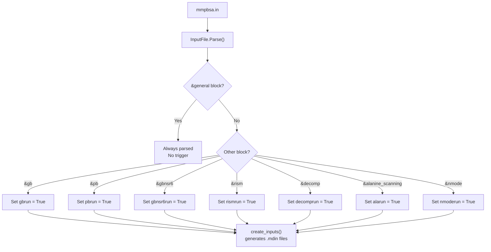
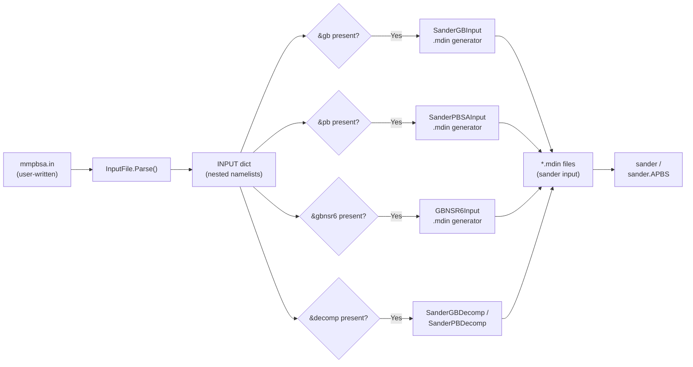

The input file is the single point of configuration that drives every gmx_MMPBSA calculation. It tells the program which solvation models to run, how to handle your GROMACS topology, which frames to process, and what optional analyses to perform. This page covers the file's architecture, every namelist and its variables, and the conventions you need to follow when writing or modifying one.

## Architecture of the Input File

At the parsing level, the input file is an ordered collection of **namelists**—Fortran-derived blocks introduced by `&name` and terminated by `/`. Each namelist groups logically related variables, and the parser (`InputFile` class in [input_parser.py](/Valdes-Tresanco-MS/gmx_MMPBSA/blob/master/GMXMMPBSA/input_parser.py#L171-L394)) matches blocks by comparing the user-provided name against the first *N* characters of the registered full name. The `&general` namelist is always present; the remaining namelists are each guarded by a **trigger variable** (e.g., `gbrun`, `pbrun`, `decomprun`) that the parser flips to `True` when it encounters that block, signalling downstream code to activate the corresponding calculation [input_parser.py](/Valdes-Tresanco-MS/gmx_MMPBSA/blob/master/GMXMMPBSA/input_parser.py#L230-L253).



Sources: [input_parser.py](/Valdes-Tresanco-MS/gmx_MMPBSA/blob/master/GMXMMPBSA/input_parser.py#L171-L253), [input_parser.py](/Valdes-Tresanco-MS/gmx_MMPBSA/blob/master/GMXMMPBSA/input_parser.py#L395-L663)

## File Format and Conventions

gmx_MMPBSA accepts two stylistic variants that are semantically identical. The **new format** places one `variable = value` pair per line with inline comments, resembling GROMACS `*.mdp` files. The **old (classic Amber) format** places multiple comma-separated assignments on the same line. You can even mix both styles within a single file. Strings must be enclosed in single or double quotes; integers and floats are typed as-is; list values are comma- or semicolon-delimited [input_parser.py](/Valdes-Tresanco-MS/gmx_MMPBSA/blob/master/GMXMMPBSA/input_parser.py#L55-L105).

=== "New format (recommended)"

```title="mmpbsa.in"
&general
  sys_name             = "MySystem"
  startframe           = 1
  endframe             = 100
  interval             = 1
  forcefields          = "leaprc.protein.ff14SB"
/

&gb
  igb                  = 5
  saltcon              = 0.150
/
```

=== "Classic Amber format"

```title="mmpbsa.in"
&general
  sys_name = "MySystem", startframe = 1, endframe = 100,
  interval = 1, forcefields = "leaprc.protein.ff14SB"
/

&gb
  igb = 5, saltcon = 0.150
/
```

> [!TIP]
> Every namelist except `&general` is **optional**. Only include the namelists for the calculations you actually want to perform. Including `&gb` automatically activates the GB calculation; including `&pb` activates PB, and so on.

Sources: [input_parser.py](/Valdes-Tresanco-MS/gmx_MMPBSA/blob/master/GMXMMPBSA/input_parser.py#L55-L105)

## Generating Input Files from the Command Line

You don't have to write an input file from scratch. The `--create_input` flag generates a template pre-populated with sensible defaults for any combination of calculations. This is the recommended starting point for beginners [docs/input_file.md](/Valdes-Tresanco-MS/gmx_MMPBSA/blob/master/docs/input_file.md#L29-L62).

```bash
# Generate a GB-only template
gmx_MMPBSA -i mmpbsa.in --create_input gb

# Generate a template with GB, PB, and decomposition
gmx_MMPBSA -i mmpbsa.in --create_input gb pb decomp

# Generate all possible sections
gmx_MMPBSA -i mmpbsa.in --create_input all
```

The generated file includes every variable with its default value and a descriptive comment. Review it carefully—some parameters such as `forcefields`, `PBRadii`, and `startframe`/`endframe` must be adjusted for your specific system before running.

## Namelist Overview

The following table summarises every namelist, its trigger, and its purpose. Multiple namelists can coexist in the same input file, enabling combined analyses such as GB + alanine scanning, PB + decomposition, or GB + entropy methods.

| Namelist | Short Form | Trigger Variable | Purpose |
|----------|-----------|-------------------|---------|
| `&general` | `general` | *(always active)* | System-wide settings, topology conversion, entropy flags |
| `&gb` | `gb` | `gbrun` | Generalized Born solvation (also contains QM/MM options) |
| `&gbnsr6` | `gbnsr6` | `gbnsr6run` | GBNSR6 surface-area-free solvation model |
| `&pb` | `pb` | `pbrun` | Poisson-Boltzmann solvation (linear, non-linear, membrane) |
| `&rism` | `rism` | `rismrun` | 3D-RISM integral equation solvation |
| `&alanine_scanning` | `ala` | `alarun` | In-silico alanine/glycine scanning mutagenesis |
| `&decomp` | `decomp` | `decomprun` | Per-residue energy decomposition analysis |
| `&nmode` | `nmode` | `nmoderun` | Normal-mode vibrational entropy approximation |

Sources: [input_parser.py](/Valdes-Tresanco-MS/gmx_MMPBSA/blob/master/GMXMMPBSA/input_parser.py#L402-L663)

---

## `&general` Namelist

This namelist controls everything that is **not specific to a single solvation model**—frame selection, AMBER topology construction from GROMACS files, entropy methods, and miscellaneous runtime behaviour. It is always parsed regardless of which other namelists are present [input_parser.py](/Valdes-Tresanco-MS/gmx_MMPBSA/blob/master/GMXMMPBSA/input_parser.py#L402-L433).

### Basic Options

| Variable | Type | Default | Description |
|----------|------|---------|-------------|
| `sys_name` | `str` | `""` | A short label for your system. Appears in output file headers and plots. |
| `startframe` | `int` | `1` | First trajectory frame to analyse (1-based). |
| `endframe` | `int` | `9999999` | Last trajectory frame to analyse. Set lower than the total frames for faster testing. |
| `interval` | `int` | `1` | Stride between analysed frames. `interval = 2` skips every other frame. |

Sources: [input_parser.py](/Valdes-Tresanco-MS/gmx_MMPBSA/blob/master/GMXMMPBSA/input_parser.py#L405-L408)

### Parameter Options

These variables govern how gmx_MMPBSA converts your GROMACS topology into an AMBER-compatible one via ParmEd. Choosing the correct `forcefields` entry is critical—if it doesn't match the force field used in your GROMACS simulation, the resulting energies will be meaningless [input_parser.py](/Valdes-Tresanco-MS/gmx_MMPBSA/blob/master/GMXMMPBSA/input_parser.py#L410-L416).

| Variable | Type | Default | Description |
|----------|------|---------|-------------|
| `forcefields` | `list` | `"oldff/leaprc.ff99SB, leaprc.gaff"` | Comma-separated Amber leaprc files used to build the topology. Must match your GROMACS force field. Common values: `leaprc.protein.ff14SB`, `leaprc.protein.ff19SB`, `leaprc.gaff`, `leaprc.lipid17`. |
| `ions_parameters` | `int` | `1` | Selects the ion parameter set (1 = default Jensen/Joung ions). |
| `PBRadii` | `int` | `3` | Selects the Bondi/mbondi radii set for PB and GB calculations. Values: 1–6. |
| `temperature` | `float` | `298.15` | System temperature in Kelvin. Used for entropy calculations and thermochemical corrections. |

> [!TIP]
> The `forcefields` parameter is the single most important setting in the `&general` namelist. For CHARMM-based simulations, use `leaprc.protein.ff14SB` with additional CHARMM-specific leaprc files. See the [Protein_ligand_CHARMMff](/Valdes-Tresanco-MS/gmx_MMPBSA/tree/master/examples/Protein_ligand_CHARMMff) example for the exact configuration.

Sources: [input_parser.py](/Valdes-Tresanco-MS/gmx_MMPBSA/blob/master/GMXMMPBSA/input_parser.py#L410-L416)

### Entropy Options

gmx_MMPBSA supports four entropy approximations, toggled by flags in the `&general` namelist. These flags instruct the program to perform additional calculations beyond the standard MM/PBSA or MM/GBSA energies [input_parser.py](/Valdes-Tresanco-MS/gmx_MMPBSA/blob/master/GMXMMPBSA/input_parser.py#L418-L421).

| Variable | Type | Default | Description |
|----------|------|---------|-------------|
| `qh_entropy` | `int` | `0` | Set to `1` to perform quasi-harmonic entropy calculation via cpptraj. |
| `interaction_entropy` | `int` | `0` | Set to `1` to compute Interaction Entropy (IE) from trajectory fluctuations. |
| `ie_segment` | `int` | `25` | Number of frames per segment for the IE moving-average window. |
| `c2_entropy` | `int` | `0` | Set to `1` to compute the C2 entropy correction. |

Note that `qh_entropy` and `c2_entropy` are independent of the `&nmode` namelist, while normal-mode entropy requires the separate `&nmode` block. You can combine interaction entropy with any solvation model (GB, PB, GBNSR6, or RISM) by simply setting `interaction_entropy = 1` alongside the corresponding solvation namelist.

Sources: [input_parser.py](/Valdes-Tresanco-MS/gmx_MMPBSA/blob/master/GMXMMPBSA/input_parser.py#L418-L421)

### Miscellaneous Options

| Variable | Type | Default | Description |
|----------|------|---------|-------------|
| `assign_chainID` | `int` | `0` | Set to `1` to assign chain identifiers from the structure. Useful for CHARMM systems or when chain info was lost during GROMACS preprocessing. |
| `exp_ki` | `list` | `[0.0]` | Experimental inhibition constant(s) in nM. Used to correlate computed ΔG with experimental data. |
| `full_traj` | `int` | `0` | Set to `1` to print the full concatenated trajectory plus per-thread trajectories. |
| `gmx_path` | `str` | `""` | Explicit path to the GROMACS executable. Leave empty for auto-detection. |
| `keep_files` | `int` | `2` | Controls post-calculation file retention. `0` = delete all, `1` = keep essential files, `2` = keep everything. |
| `netcdf` | `int` | `0` | Set to `1` to use NetCDF format for intermediate trajectory files (smaller, faster I/O). |
| `solvated_trajectory` | `int` | `1` | Set to `1` if the input trajectory contains solvent (the default). Set to `0` if the trajectory is already stripped of water and ions. |
| `verbose` | `int` | `1` | Controls output verbosity. `0` = minimal, `1` = standard (all energy terms), `2` = detailed. |

Sources: [input_parser.py](/Valdes-Tresanco-MS/gmx_MMPBSA/blob/master/GMXMMPBSA/input_parser.py#L424-L433)

---

## `&gb` Namelist

The Generalized Born namelist configures the GB implicit-solvent model used by the AMBER sander engine. It also contains QM/MMGBSA options when `ifqnt = 1` is set. Including this namelist activates the GB calculation (trigger: `gbrun`) [input_parser.py](/Valdes-Tresanco-MS/gmx_MMPBSA/blob/master/GMXMMPBSA/input_parser.py#L435-L470).

### Basic GB Options

| Variable | Type | Default | Description |
|----------|------|---------|-------------|
| `igb` | `int` | `5` | GB model selection. Common values: `1` (GB1), `2` (GB2/OBC1), `5` (GB5/OBC2), `7` (GB7), `8` (GB8). Model 5 is the most widely used default. |
| `intdiel` | `float` | `1.0` | Internal (solute) dielectric constant. Higher values reduce electrostatic interactions. |
| `extdiel` | `float` | `78.5` | External (solvent) dielectric constant. 78.5 approximates water at 25 °C. |
| `saltcon` | `float` | `0.0` | Salt concentration in mol/L. Use `0.150` for physiological conditions. |
| `surften` | `float` | `0.0072` | Surface tension (kcal/mol/Ų) for the nonpolar solvation term (LCPO method). |
| `surfoff` | `float` | `0.0` | Surface tension offset (kcal/mol) added to the nonpolar term. |
| `molsurf` | `int` | `0` | Set to `1` to use the Connolly molecular surface (`molsurf`) instead of LCPO for the nonpolar term. |
| `msoffset` | `float` | `0.0` | Offset for the molsurf nonpolar calculation. |
| `probe` | `float` | `1.4` | Solvent probe radius in Å for surface area computation. |
| `alpb` | `int` | `0` | Set to `1` to use the Analytical Linearized Poisson-Boltzmann (ALPB) model instead of standard GB. |
| `arad_method` | `int` | `1` | Method to estimate effective electrostatic size when `alpb = 1`. |

Sources: [input_parser.py](/Valdes-Tresanco-MS/gmx_MMPBSA/blob/master/GMXMMPBSA/input_parser.py#L437-L470)

### QM/MMGBSA Options

These variables activate quantum mechanical treatment of selected residues within the GB framework [input_parser.py](/Valdes-Tresanco-MS/gmx_MMPBSA/blob/master/GMXMMPBSA/input_parser.py#L448-L466).

| Variable | Type | Default | Description |
|----------|------|---------|-------------|
| `ifqnt` | `int` | `0` | Set to `1` to enable QM/MM calculation. |
| `qm_theory` | `str` | `""` | Semi-empirical QM method: `PM3`, `PM6`, `PM6-PDDG`, `DFTB`, `AM1`, etc. |
| `qm_residues` | `str` | `""` | Residue selection for the QM region. Supports Amber mask syntax or distance-based selection (recommended: `"within 4"`). Must include at least one residue from both receptor and ligand. |
| `com_qmmask` | `str` | `""` | Explicit Amber mask for QM atoms in the complex. Alternative to `qm_residues`. |
| `rec_qmmask` | `str` | `""` | Explicit Amber mask for QM atoms in the receptor. |
| `lig_qmmask` | `str` | `""` | Explicit Amber mask for QM atoms in the ligand. |
| `qmcut` | `float` | `9999` | Cutoff (Å) for QM region interactions. |
| `scfconv` | `float` | `1.0e-8` | SCF convergence criterion in kcal/mol. |
| `peptide_corr` | `int` | `0` | Set to `1` to apply MM correction to peptide linkages in the QM region. |
| `writepdb` | `int` | `1` | Write a PDB file showing the selected QM region. |

> [!TIP]
> When using QM/MMGBSA, the `qm_residues = "within 4"` distance-based selection is strongly recommended over explicit residue lists. It automatically adapts as your structure changes across trajectory frames. See the [QM_MMGBSA example](/Valdes-Tresanco-MS/gmx_MMPBSA/tree/master/examples/QM_MMGBSA) for a complete working configuration.

Sources: [input_parser.py](/Valdes-Tresanco-MS/gmx_MMPBSA/blob/master/GMXMMPBSA/input_parser.py#L448-L466)

---

## `&gbnsr6` Namelist

The GBNSR6 namelist configures the **GBNSR6** solvation model, a surface-area-free approach that uses the R6 integral to compute nonpolar solvation without an explicit surface term. It was introduced in sander and provides an alternative to the standard GB+SA combination. Including this block activates the GBNSR6 calculation (trigger: `gbnsr6run`) [input_parser.py](/Valdes-Tresanco-MS/gmx_MMPBSA/blob/master/GMXMMPBSA/input_parser.py#L473-L497).

| Variable | Type | Default | Description |
|----------|------|---------|-------------|
| `b` | `float` | `0.028` | Uniform offset to the inverse effective radii. |
| `alpb` | `int` | `1` | ALPB correction toggle (enabled by default in GBNSR6). |
| `epsin` | `float` | `1.0` | Solute (internal) dielectric constant. |
| `epsout` | `float` | `78.5` | Solvent (external) dielectric constant. |
| `istrng` | `float` | `0.0` | Ionic strength in mol/L. |
| `rs` | `float` | `0.52` | Dielectric boundary shift relative to the molecular surface (for CHAGB). |
| `dprob` | `float` | `1.4` | Solvent probe radius in Å. |
| `space` | `float` | `0.5` | Grid spacing (Å) for solute molecular surface resolution. |
| `arcres` | `float` | `0.2` | Arc resolution for numerical surface integration. |
| `radiopt` | `int` | `0` | Intrinsic atomic radii set selection (for CHAGB option). |
| `chagb` | `int` | `0` | Set to `1` to use the CHAGB variant. |
| `roh` | `int` | `1` | RzOH parameter for the CHAGB model (maps to predefined values). |
| `tau` | `float` | `1.47` | τ parameter for the CHAGB model. |
| `cavity_surften` | `float` | `0.005` | Surface tension for the cavity/nonpolar term in GBNSR6. |

Sources: [input_parser.py](/Valdes-Tresanco-MS/gmx_MMPBSA/blob/master/GMXMMPBSA/input_parser.py#L473-L497)

---

## `&pb` Namelist

The Poisson-Boltzmann namelist is the most parameter-rich block, governing the numerical finite-difference solver for implicit solvation. It supports linear and non-linear PB, implicit membrane environments, and multiple solver options. Including this block activates the PB calculation (trigger: `pbrun`) [input_parser.py](/Valdes-Tresanco-MS/gmx_MMPBSA/blob/master/GMXMMPBSA/input_parser.py#L498-L569).

### Basic PB Options

| Variable | Type | Default | Description |
|----------|------|---------|-------------|
| `ipb` | `int` | `2` | PB dielectric model. `1` = constant dielectric, `2` = two-concentration model. |
| `inp` | `int` | `1` | Nonpolar solvation method. `1` = standard (cavity+dispersion), `2` = only cavity from SASA. |
| `sander_apbs` | `int` | `0` | Set to `1` to use APBS as the external PB solver instead of the built-in solver. |
| `indi` | `float` | `1.0` | Internal dielectric constant. |
| `exdi` | `float` | `80.0` | External dielectric constant. |
| `istrng` | `float` | `0.0` | Ionic strength in mol/L. |
| `radiopt` | `int` | `1` | Radii set: `0` = Bondi, `1` = mbondi (recommended), `2` = mbondi2, `3` = mbondi3. |
| `prbrad` | `float` | `1.4` | Probe radius in Å for the PB calculation. |
| `npbopt` | `int` | `0` | Set to `1` for non-linear PB (NLPB). `0` = linear PB. |
| `solvopt` | `int` | `1` | Iterative solver. `1` = CG, `2` = relaxed GS, `3` = Sharper GS. |
| `accept` | `float` | `0.001` | Convergence criterion (relative to initial residual). |
| `linit` | `int` | `1000` | Maximum number of SCF iterations. |
| `fillratio` | `float` | `4.0` | Ratio of longest grid dimension to solute dimension. |
| `scale` | `float` | `2.0` | Grid spacing = 1/scale Å. Higher scale = finer grid. |
| `nfocus` | `int` | `2` | Number of electrostatic focusing calculations. |
| `nbuffer` | `float` | `0.0` | Buffer distance (grid units) from solute to grid boundary. |

### Implicit Membrane Options

gmx_MMPBSA supports membrane-embedded proteins through the PB implicit membrane model, where a low-dielectric slab represents the lipid bilayer [input_parser.py](/Valdes-Tresanco-MS/gmx_MMPBSA/blob/master/GMXMMPBSA/input_parser.py#L520-L525).

| Variable | Type | Default | Description |
|----------|------|---------|-------------|
| `memopt` | `int` | `0` | Set to `1` to enable the implicit membrane model. |
| `emem` | `float` | `4.0` | Membrane dielectric constant (typically 2–8). |
| `mthick` | `float` | `40.0` | Membrane thickness in Å. |
| `mctrdz` | `float` | `0.0` | Z-axis offset of the membrane centre from the solute centre. |
| `mprob` | `float` | `2.70` | Membrane probe radius in Å. |
| `poretype` | `int` | `1` | Set to `1` to use an exclusion region for channel/pore proteins. |

### Nonpolar and Output Options

| Variable | Type | Default | Description |
|----------|------|---------|-------------|
| `cavity_surften` | `float` | `0.0378` | Surface tension (kcal/mol/Ų) for the nonpolar cavity term. |
| `cavity_offset` | `float` | `-0.5692` | Offset (kcal/mol) for the nonpolar term. |
| `decompopt` | `int` | `2` | Decomposition scheme when `inp = 2`. |
| `npbverb` | `int` | `0` | Verbose PB output. `1` prints additional solver diagnostics. |

Sources: [input_parser.py](/Valdes-Tresanco-MS/gmx_MMPBSA/blob/master/GMXMMPBSA/input_parser.py#L498-L569)

---

## `&rism` Namelist

The 3D-RISM namelist configures the integral-equation theory of solvation, which provides both polar and nonpolar solvation free energies from the 3D site distribution functions of solvent molecules. Including this block activates the RISM calculation (trigger: `rismrun`) [input_parser.py](/Valdes-Tresanco-MS/gmx_MMPBSA/blob/master/GMXMMPBSA/input_parser.py#L572-L628).

| Variable | Type | Default | Description |
|----------|------|---------|-------------|
| `closure` | `list` | `["kh"]` | Closure approximation. `kh` = KH, `kh3` = KH with modified closure, etc. |
| `gfcorrection` | `int` | `0` | Gaussian fluctuation excess chemical potential. |
| `pcpluscorrection` | `int` | `0` | PC+ 3D-RISM correction. |
| `noasympcorr` | `int` | `1` | Toggle for long-range asymptotic corrections. |
| `buffer` | `float` | `14` | Distance (Å) between solute and grid edge. |
| `grdspc` | `list` | `[0.5, 0.5, 0.5]` | Grid spacing in x, y, z (Å). |
| `tolerance` | `list` | `[1.0e-5]` | Convergence tolerance for the iterative solver. |
| `maxstep` | `int` | `10000` | Maximum number of iterative steps. |
| `mdiis_del` | `float` | `0.7` | MDIIS step size. |
| `mdiis_nvec` | `int` | `5` | Number of MDIIS history vectors. |
| `polardecomp` | `int` | `0` | Set to `1` to decompose solvation energy into polar and nonpolar terms. |
| `rism_verbose` | `int` | `0` | RISM output verbosity level. |

Sources: [input_parser.py](/Valdes-Tresanco-MS/gmx_MMPBSA/blob/master/GMXMMPBSA/input_parser.py#L572-L628)

---

## `&alanine_scanning` Namelist

This namelist enables in-silico alanine (or glycine) scanning mutagenesis, where each specified residue is sequentially mutated and the binding energy difference is computed. The calculation runs on top of a GB or PB calculation—both namelists must be present. Including this block activates alanine scanning (trigger: `alarun`) [input_parser.py](/Valdes-Tresanco-MS/gmx_MMPBSA/blob/master/GMXMMPBSA/input_parser.py#L630-L640).

| Variable | Type | Default | Description |
|----------|------|---------|-------------|
| `mutant_res` | `str` | `""` | Residue(s) to mutate. Format: `"ChainID:ResNum"` (e.g., `"R:23"`, `"A:45,A:78"`). |
| `mutant` | `str` | `"ALA"` | Mutation type: `"ALA"` for alanine scanning, `"GLY"` for glycine scanning. |
| `mutant_only` | `int` | `0` | Set to `1` to compute only the mutant energies (skip wild-type). |
| `cas_intdiel` | `int` | `0` | Set to `1` to automatically adjust `intdiel` based on the amino acid being mutated. |
| `intdiel_nonpolar` | `int` | `1` | Internal dielectric for nonpolar residue mutations (when `cas_intdiel = 1`). |
| `intdiel_polar` | `int` | `3` | Internal dielectric for polar residue mutations. |
| `intdiel_positive` | `int` | `5` | Internal dielectric for positively charged residue mutations. |
| `intdiel_negative` | `int` | `5` | Internal dielectric for negatively charged residue mutations. |

Sources: [input_parser.py](/Valdes-Tresanco-MS/gmx_MMPBSA/blob/master/GMXMMPBSA/input_parser.py#L630-L640)

---

## `&decomp` Namelist

The decomposition namelist enables per-residue energy decomposition, breaking down the total binding energy into contributions from individual residues. It requires either `&gb` or `&pb` to also be present. Including this block activates decomposition (trigger: `decomprun`) [input_parser.py](/Valdes-Tresanco-MS/gmx_MMPBSA/blob/master/GMXMMPBSA/input_parser.py#L642-L648).

| Variable | Type | Default | Description |
|----------|------|---------|-------------|
| `idecomp` | `int` | `0` | Decomposition scheme: `1` = 1-body (no pairwise), `2` = 2-body pairwise (gas phase), `3` = 2-body with GB/PB, `4` = 2-body with sidechain decomposition. |
| `dec_verbose` | `int` | `0` | Controls how many energy terms are printed per residue in the decomposition output. |
| `print_res` | `str` | `"within 6"` | Residue selection for detailed output. Supports Amber mask syntax. `"within 6"` selects all residues within 6 Å of the binding interface (recommended). |
| `csv_format` | `int` | `1` | Set to `1` to write decomposition data in CSV format for easy downstream analysis. |

> [!TIP]
> When using `print_res`, always ensure at least one residue from **both** the receptor and the ligand is included. The `"within N"` syntax automatically satisfies this requirement. Explicit residue lists like `"A:45,B:12"` require manual verification.

Sources: [input_parser.py](/Valdes-Tresanco-MS/gmx_MMPBSA/blob/master/GMXMMPBSA/input_parser.py#L642-L648)

---

## `&nmode` Namelist

The normal-mode namelist configures the vibrational entropy calculation using the AMBER nmode program. It performs a minimisation followed by Hessian diagonalisation for selected frames. Including this block activates the nmode calculation (trigger: `nmoderun`) [input_parser.py](/Valdes-Tresanco-MS/gmx_MMPBSA/blob/master/GMXMMPBSA/input_parser.py#L650-L663).

| Variable | Type | Default | Description |
|----------|------|---------|-------------|
| `nmstartframe` | `int` | `1` | First frame for normal-mode analysis (1-based, relative to the general frame selection). |
| `nmendframe` | `int` | `1000000` | Last frame for normal-mode analysis. |
| `nminterval` | `int` | `1` | Stride between frames selected for nmode. Allows subsampling from the general frame range. |
| `nmode_igb` | `int` | `1` | GB model for the nmode minimisation step. Must be compatible with `igb` in `&gb`. |
| `nmode_istrng` | `float` | `0.0` | Ionic strength for the GB model in nmode (mol/L). |
| `dielc` | `float` | `1.0` | Dielectric constant for the nmode calculation. |
| `drms` | `float` | `0.001` | RMS gradient convergence criterion for minimisation (kcal/mol/Å). |
| `maxcyc` | `int` | `10000` | Maximum number of minimisation cycles. For production runs, `50000` is typical. |

Note that nmode is extremely computationally expensive—each frame requires a full minimisation and Hessian calculation. For testing, reduce `maxcyc` and increase `nminterval` to process fewer frames.

Sources: [input_parser.py](/Valdes-Tresanco-MS/gmx_MMPBSA/blob/master/GMXMMPBSA/input_parser.py#L650-L663)

---

## Sample Input Files

The following examples are taken directly from the repository's example directory and illustrate real, working configurations for each calculation type. They are designed for quick testing with the bundled trajectory files—note that some parameters (e.g., `maxcyc`, `endframe`) are deliberately relaxed for speed.

### Basic GB Calculation

This is the simplest possible MM/GBSA setup for a protein-protein system [mmpbsa.in](/Valdes-Tresanco-MS/gmx_MMPBSA/blob/master/examples/Protein_protein/mmpbsa.in).

```title="examples/Protein_protein/mmpbsa.in"
&general
sys_name="Prot-Prot",
startframe=1,
endframe=10,
forcefields="leaprc.protein.ff14SB",
/
&gb
igb=2, saltcon=0.150,
/
```

### GBNSR6 Calculation

Replaces the standard GB model with GBNSR6—no surface area term needed [mmpbsa.in](/Valdes-Tresanco-MS/gmx_MMPBSA/blob/master/examples/GBNSR6/mmpbsa.in).

```title="examples/GBNSR6/mmpbsa.in"
&general
sys_name="GBNSR6",
startframe=1,
endframe=10,
forcefields="leaprc.protein.ff14SB"
/
&gbnsr6
istrng=0.15
/
```

### QM/MMGBSA Calculation

Treats residues within 4 Å of the binding interface quantum mechanically using the PM3 method [mmpbsa.in](/Valdes-Tresanco-MS/gmx_MMPBSA/blob/master/examples/QM_MMGBSA/mmpbsa.in).

```title="examples/QM/MMGBSA/mmpbsa.in"
&general
sys_name="QM/MMGBSA",
startframe=5,
endframe=14,
PBRadii=2,
forcefields="oldff/leaprc.ff99SB,leaprc.gaff"
/
&gb
igb=1, saltcon=0.150,
ifqnt=1, qm_theory=PM3,
qm_residues="within 4"
/
```

### PB with Implicit Membrane

Configures the Poisson-Boltzmann solver with an implicit lipid bilayer for membrane-embedded proteins [mmpbsa.in](/Valdes-Tresanco-MS/gmx_MMPBSA/blob/master/examples/Protein_membrane/mmpbsa.in).

```title="examples/Protein_membrane/mmpbsa.in"
&general
sys_name="Prot-Memb",
startframe=1,
endframe=4,
/
&pb
memopt=1, emem=7.0, indi=4.0,
mctrdz=-10.383, mthick=36.086, poretype=1,
radiopt=0, istrng=0.150, fillratio=1.25, inp=2,
sasopt=0, solvopt=2, ipb=1, bcopt=10, nfocus=1,
linit=1000, eneopt=1, cutfd=7.0, cutnb=99.0,
maxarcdot=15000, npbverb=1,
/
```

### Alanine Scanning

Combines a GB calculation with per-residue alanine scanning for residue R:23 [mmpbsa.in](/Valdes-Tresanco-MS/gmx_MMPBSA/blob/master/examples/Alanine_scanning/mmpbsa.in).

```title="examples/Alanine_scanning/mmpbsa.in"
&general
sys_name="Alanine_Scanning",
startframe=1,
endframe=10,
forcefields="leaprc.protein.ff14SB",
PBRadii=4,
/
&gb
igb=8, saltcon=0.150,
/
&alanine_scanning
mutant='ALA', mutant_res='R:23', cas_intdiel=1
/
```

### Decomposition Analysis

Per-residue decomposition using the pairwise scheme with GB [mmpbsa.in](/Valdes-Tresanco-MS/gmx_MMPBSA/blob/master/examples/Decomposition_analysis/mmpbsa.in).

```title="examples/Decomposition_analysis/mmpbsa.in"
&general
sys_name="Decomposition",
startframe=1,
endframe=10,
forcefields="leaprc.protein.ff14SB"
/
&gb
igb=5, saltcon=0.150,
/
&decomp
idecomp=2, dec_verbose=3,
print_res="within 4"
/
```

### Interaction Entropy

Combines a GB calculation with the Interaction Entropy approximation [mmpbsa.in](/Valdes-Tresanco-MS/gmx_MMPBSA/blob/master/examples/Entropy_calculations/Interaction_Entropy/mmpbsa.in).

```title="examples/Entropy_calculations/Interaction_Entropy/mmpbsa.in"
&general
sys_name="IE",
startframe=1,
endframe=10,
interaction_entropy=1, ie_segment=50, temperature=303.15
/
&gb
igb=2, saltcon=0.150,
/
```

### Normal-Mode Entropy

Full MM/GBSA + nmode entropy pipeline [mmpbsa.in](/Valdes-Tresanco-MS/gmx_MMPBSA/blob/master/examples/Entropy_calculations/nmode/mmpbsa.in).

```title="examples/Entropy_calculations/nmode/mmpbsa.in"
&general
sys_name="NMode",
startframe=1,
endframe=10,
forcefields="leaprc.protein.ff14SB",
PBRadii=2,
/
&gb
igb=1, saltcon=0.150,
/
&nmode
nmstartframe=3,
nmendframe=10,
nminterval=1,
maxcyc=5, drms=2,
/
```

---

## Validation and Parsing Pipeline

Understanding how your input file is consumed helps you debug issues faster. The following diagram shows the end-to-end flow from file on disk to the `.mdin` files consumed by sander:



The `create_inputs()` function in [createinput.py](/Valdes-Tresanco-MS/gmx_MMPBSA/blob/master/GMXMMPBSA/createinput.py#L49-L310) orchestrates this process. It inspects the parsed `INPUT` dictionary, checks which triggers are active, and instantiates the appropriate sander input writer class. Each writer class (e.g., `SanderGBInput`, `SanderPBSAInput`) constructs the Amber-format `.mdin` file that sander reads at runtime.

Sources: [createinput.py](/Valdes-Tresanco-MS/gmx_MMPBSA/blob/master/GMXMMPBSA/createinput.py#L49-L310)

---

## What to Read Next

Now that you understand the input file structure, the following pages will help you progress through the gmx_MMPBSA workflow:

- **[Output Files Guide](4-output-files-guide)** — Understand what gmx_MMPBSA produces after reading your input file, including energy tables, CSV data, and final statistics.
- **[GB and PB Solvers](10-gb-and-pb-solvers)** — Deep dive into how each solvation model is computed internally and how your namelist choices affect accuracy and performance.
- **[Decomposition Analysis](13-decomposition-analysis)** — Learn how to interpret per-residue decomposition output and select the right `idecomp` scheme for your scientific question.
- **[Alanine Scanning](14-alanine-scanning)** — Explore the full alanine scanning workflow, including how to select residues and interpret ΔΔG results.
- **[Supported System Types](19-supported-system-types)** — A comprehensive guide to which input parameters are needed for each system type (protein–ligand, membrane, DNA, metalloproteins, etc.).