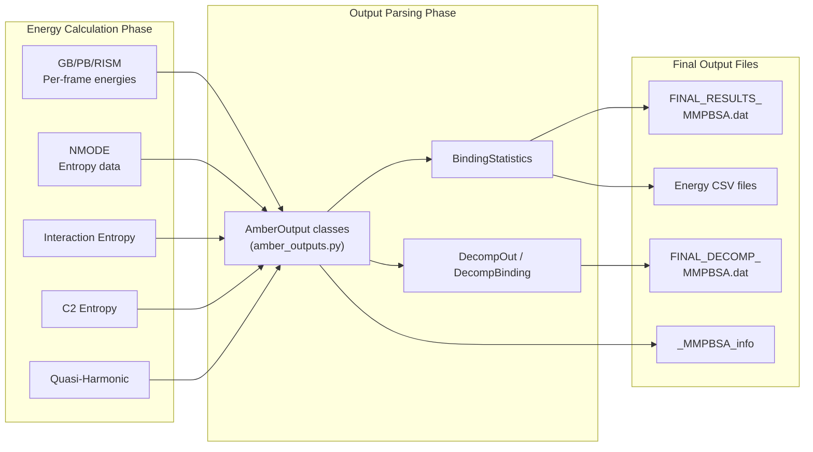

Every gmx_MMPBSA calculation produces a structured set of output files that capture everything from raw energy vectors to final statistical summaries. Understanding these files is essential for interpreting your binding free energy results, diagnosing calculation issues, and feeding data into downstream analysis tools. This guide walks through each output file, explains its internal structure, and shows you how to locate the numbers that matter.

## Output File Landscape

The output system is orchestrated by two primary functions in [output_file.py](GMXMMPBSA/output_file.py): `write_outputs` for the main results file and `write_decomp_output` for decomposition analysis. Both functions are invoked at the end of the calculation pipeline in [app.py](GMXMMPBSA/app.py#L109-L110) after `parse_output_files()` has collected and organized the per-frame energy data. The following diagram shows how raw computation results flow into the files you will actually read.



Sources: [output_file.py](GMXMMPBSA/output_file.py#L53-L54), [output_file.py](GMXMMPBSA/output_file.py#L395-L396), [app.py](GMXMMPBSA/app.py#L109-L110)

## The Main Results File

The primary output of any gmx_MMPBSA run is the final results file, named **`FINAL_RESULTS_MMPBSA.dat`** by default (configurable via the `output` input variable). This file is written by the `write_outputs` function in [output_file.py](GMXMMPBSA/output_file.py#L53) using the `OutputFile` class defined at [line 494](GMXMMPBSA/output_file.py#L494). It contains a complete record of your calculation: input parameters, entropy results, per-component energy tables, and the final binding free energy values.

### File Header

The file opens with metadata that uniquely identifies the calculation session. The `OutputFile.write_date()` method [writes a timestamp](GMXMMPBSA/output_file.py#L533-L536), followed by `print_file_info()` which [lists every input file](GMXMMPBSA/output_file.py#L540-L606) — the GROMACS TPR structure, topology files, AMBER prmtop files, and initial trajectory paths. For binding calculations (not stability), the receptor and ligand masks are also printed along with the ligand residue name when the ligand is a single residue.

Below the file listing, a block of descriptive comments records the calculation parameters:

- **Number of frames** used for each calculation type
- **Solvent model** (GB surface area method: LCPO or molsurf)
- **PB solver** type (internal PBSA or iAPBS interface)
- **Temperature** in Kelvin
- **Units** declaration (all values in kcal/mol)
- **Statistics methodology** note explaining SD vs SD(Prop.)

Sources: [output_file.py](GMXMMPBSA/output_file.py#L67-L117), [output_file.py](GMXMMPBSA/output_file.py#L540-L606)

### Entropy Results Section

If any entropy approximation was requested, those results appear first in the output file. The `write_outputs` function processes entropy results [before free energy results](GMXMMPBSA/output_file.py#L119-L267) in this order:

1. **Quasi-Harmonic (QH) entropy** — printed via `QHout.summary_output()` [at line 129](GMXMMPBSA/output_file.py#L129)
2. **Interaction Entropy (IE)** — printed per-method (GB, PB, RISM, GBNSR6) [at lines 154-193](GMXMMPBSA/output_file.py#L154-L193)
3. **C2 Entropy** — printed per-method [at lines 195-228](GMXMMPBSA/output_file.py#L195-L228)
4. **Normal Mode (NMODE) entropy** — printed [at lines 231-265](GMXMMPBSA/output_file.py#L231-L265)

Each entropy section reports the model used, the interaction energy standard deviation σ, the entropy value itself, its standard deviation, and the 95% confidence interval. For C2 entropy, the confidence interval is obtained through bootstrapping with 2000 re-samplings.

> [!TIP]
> **Critical reliability check**: If the interaction energy standard deviation σ exceeds 3.6 kcal/mol (~15 kJ/mol), gmx_MMPBSA automatically prints a **WARNING** [at line 190](GMXMMPBSA/output_file.py#L190-L193) indicating that the IE or C2 entropy values are not reliable. This threshold is based on published recommendations. Always verify this before citing entropy-corrected binding free energies.

### Free Energy Results Section

After entropy data, the main energy tables appear. The `write_outputs` function [iterates through solvation models](GMXMMPBSA/output_file.py#L268-L273) in order: GB, PB, 3D-RISM (standard, Gaussian fluctuation, PC+), and GBNSR6. Each model's results are written in a structured block with a section header like `GENERALIZED BORN:` or `POISSON BOLTZMANN:`.

For **binding** calculations, each solvation model produces four energy tables:

| Table | Description | Corresponding Code |
|-------|-------------|--------------------|
| **Complex** | Energy components for the full complex | `app.calc_types.normal[key]['complex'].summary_output()` [L286](GMXMMPBSA/output_file.py#L286) |
| **Receptor** | Energy components for the isolated receptor | `app.calc_types.normal[key]['receptor'].summary_output()` [L287](GMXMMPBSA/output_file.py#L287) |
| **Ligand** | Energy components for the isolated ligand | `app.calc_types.normal[key]['ligand'].summary_output()` [L288](GMXMMPBSA/output_file.py#L288) |
| **Delta (Complex − Receptor − Ligand)** | Binding energy decomposition | `sys_norm.summary_output()` [L289](GMXMMPBSA/output_file.py#L289) |

For **stability** calculations, only the Complex table is printed.

### Understanding the Energy Components

Each energy table contains rows for individual energy terms, composite sums, and five statistical columns. Here is what each term represents:

| Energy Term | Full Name | Description |
|------------|-----------|-------------|
| **BOND** | Bond stretching | Harmonic bond potential energy |
| **ANGLE** | Angle bending | Harmonic angle potential energy |
| **DIHED** | Dihedral torsion | Torsional and improper dihedral energy |
| **VDWAALS** | van der Waals | Lennard-Jones 6-12 potential |
| **EEL** | Electrostatic | Coulombic electrostatic energy |
| **1-4 VDW** | 1-4 van der Waals | Non-bonded VDW for atoms separated by 3 bonds |
| **1-4 EEL** | 1-4 Electrostatic | Non-bonded electrostatics for 1-4 atom pairs |
| **EGB** / **EPB** | Polar solvation | Electrostatic contribution to solvation free energy |
| **ESURF** / **ENPOLAR + EDISPER** | Non-polar solvation | Surface area and dispersion terms |
| **GGAS** | Gas-phase energy | = BOND + ANGLE + DIHED + VDWAALS + EEL + 1-4 VDW + 1-4 EEL |
| **GSOLV** | Solvation free energy | = EGB (or EPB) + ESURF |
| **TOTAL** | Total free energy | = GGAS + GSOLV |

### Statistics Columns

Each energy term is reported with five statistical measures. These are computed in the `BindingStatistics` class within [amber_outputs.py](GMXMMPBSA/amber_outputs.py#L956-L1135):

| Column | Meaning | Method |
|--------|---------|--------|
| **Average** | Mean energy across all frames | Simple arithmetic mean |
| **SD** | Sample standard deviation | Computed from the frame-by-frame array of values |
| **SEM** | Standard error of the mean | SD / √N from the frame array |
| **SD(Prop.)** | Propagated standard deviation | Error propagation formula for f = A − B − C |
| **SEM(Prop.)** | Propagated standard error | SD(Prop.) / √N |

For the delta (binding) energies, two standard deviations are reported because the delta is a derived quantity (Complex − Receptor − Ligand). The **SD** and **SEM** columns are computed from the array of per-frame delta values. The **SD(Prop.)** and **SEM(Prop.)** columns use the propagation of uncertainty formula, which treats each term's variance independently. When a single-trajectory protocol is used, bond, angle, dihedral, and 1-4 terms should be identically zero in the delta — if they are not, an inconsistency warning is printed [via `report_inconsistency()`](GMXMMPBSA/output_file.py#L284-L285).

### Final Binding Free Energy

At the bottom of each solvation model section, if an entropy approximation was enabled, gmx_MMPBSA combines the TOTAL energy with the entropy correction to produce the final binding free energy:

**ΔG binding = ΔTOTAL − TΔS**

This is printed for each applicable entropy method (NMODE, IE, C2, QH) [at lines 297-316](GMXMMPBSA/output_file.py#L297-L316). For example, when C2 entropy is used with GB, the output will show:

```
Using C2 Entropy Approximation:
ΔG binding =  -48.07 +/-  2.20
```

The uncertainty combines the variance from the TOTAL energy and the entropy term using the `utils.calc_sum` helper function.

Sources: [output_file.py](GMXMMPBSA/output_file.py#L268-L316), [amber_outputs.py](GMXMMPBSA/amber_outputs.py#L956-L1135)

### Alanine Scanning Results

When alanine scanning is enabled (via the `ala` namelist), the output file includes additional sections for the **mutant** system and the **ΔΔ** comparison. The structure mirrors the normal results:

1. **Mutant energy tables** — Complex, Receptor, Ligand, and Delta for the mutated system [L318-L334](GMXMMPBSA/output_file.py#L318-L334)
2. **ΔΔH binding** — the difference between mutant and wild-type binding enthalpies [L360-L361](GMXMMPBSA/output_file.py#L360-L361)
3. **ΔΔG binding** — if entropy was calculated, ΔΔG is also reported for each entropy method [L363-L386](GMXMMPBSA/output_file.py#L363-L386)

> [!TIP]
> **Alanine scanning output structure**: The mutant-specific output blocks appear immediately after each solvation model's normal results. If `mutant_only` is set (via `mutant_only=1` in the input file), the normal system results are skipped entirely and only mutant data is printed.

## The Decomposition Output File

When decomposition analysis is enabled (`decomprun=1`), a separate file named **`FINAL_DECOMP_MMPBSA.dat`** is created. This file is written by the `write_decomp_output` function [at line 395](GMXMMPBSA/output_file.py#L395-L491) and can be produced in either **ASCII** or **CSV** format (controlled by `csv_format` in the `decomp` namelist, defaulting to CSV since v1.5.0).

### Decomposition Table Structure

For each solvation model (GB, PB, or GBNSR6), the decomposition output contains per-residue energy breakdowns across three subsystems (Complex, Receptor, Ligand) and three decomposition types, plus the delta values:

| Section | Decomposition Type | Description |
|---------|-------------------|-------------|
| **Total Energy Decomposition** | TDC | Full residue energy = Sidechain + Backbone |
| **Sidechain Energy Decomposition** | SDC | Only sidechain atom contributions |
| **Backbone Energy Decomposition** | BDC | Only backbone atom contributions |
| **Delta Energies** | Δ | Complex − Receptor − Ligand for each decomposition type |

Each residue row reports six energy columns — **Internal** (bonded terms), **van der Waals**, **Electrostatic**, **Polar Solvation**, **Non-Polar Solvation**, and **TOTAL** — each with Average, Std. Dev., and Std. Err. of Mean. The delta section additionally includes a **Location** column (R for receptor residue, L for ligand residue) to identify the origin of each residue.

### Decomposition Output Modes

The `csv_format` parameter in the `decomp` namelist [controls the output format](GMXMMPBSA/input_parser.py#L647):

- **`csv_format=1`** (default): Writes a CSV file with comma-separated values, easily importable into spreadsheet software or plotting tools
- **`csv_format=0`**: Writes a human-readable ASCII table format with aligned columns

Sources: [output_file.py](GMXMMPBSA/output_file.py#L410-L443), [input_parser.py](GMXMMPBSA/input_parser.py#L642-L648)

## Energy Vector CSV Files

In addition to the formatted output files, gmx_MMPBSA can produce **CSV files containing per-frame energy vectors**. These are raw data files where each row corresponds to one snapshot and each column is an energy term. This is particularly useful for custom analysis, plotting in external tools, or statistical testing.

There are two energy vector output files:

| File | Controlled By | Contains |
|------|--------------|----------|
| Main energy CSV | `force_norest` / default naming | Per-frame energies for Complex, Receptor, Ligand, and Delta |
| Decomposition energy CSV | `dec_energies` naming | Per-frame per-residue decomposition energies |

These files are generated when `FILES.energyout` or `FILES.dec_energies` are set, and the data is dumped via `_print_vectors()` methods on the respective output classes [L291-L294](GMXMMPBSA/output_file.py#L291-L294). The `BindingStatistics._print_vectors()` method [at line 1016](GMXMMPBSA/amber_outputs.py#L1016-L1047) handles the main energy CSV output.

Sources: [output_file.py](GMXMMPBSA/output_file.py#L88-L92), [amber_outputs.py](GMXMMPBSA/amber_outputs.py#L1016-L1047)

## The Info File (_MMPBSA_info)

The `_MMPBSA_info` file is a serialized backup of the entire calculation state, created by the `InfoFile` class in [infofile.py](GMXMMPBSA/infofile.py#L63-L139). Its purpose is to enable **post-processing** — re-running the output generation or analysis without re-executing the full energy calculation. The `write_info` method [at line 86](GMXMMPBSA/infofile.py#L86-L137) saves all input variables, file paths, frame counts, and calculation configuration. The `read_info` method [at line 139](GMXMMPBSA/infofile.py#L139-L218) restores this state into the `MMPBSA_App` object.

When you use the `--rewrite-output` flag, gmx_MMPBSA skips the entire calculation phase and instead loads the info file to regenerate the final output files [L103-L106](GMXMMPBSA/app.py#L103-L106):

```python
info = InfoFile(app, True)
info.read_info()
app.loadcheck_prmtops()
# Then proceeds to parse_output_files() and write_final_outputs()
```

This is useful when you want to change output formatting or verbosity without spending hours recomputing energies.

Sources: [infofile.py](GMXMMPBSA/infofile.py#L63-L139), [app.py](GMXMMPBSA/app.py#L103-L106)

## The Compact Results File

gmx_MMPBSA also generates a **`COMPACT_MMXSA_RESULTS.mmxsa`** file via the `data2pkl` function [at line 31](GMXMMPBSA/output_file.py#L31-L51). This is a Python pickle file that bundles the input parameters, file information, calculation types, and the full text content of the output files into a single binary object. It is designed for use with the **gmx_MMPBSA analyzer** GUI tool, which reads this file to enable interactive visualization without requiring access to the original calculation data.

Sources: [output_file.py](GMXMMPBSA/output_file.py#L31-L51)

## Log File

The **`gmx_MMPBSA.log`** file captures all logging output from the calculation. It is initialized at the start of the `gmxmmpbsa()` function [at line 49](GMXMMPBSA/app.py#L49) with both DEBUG-level file logging and INFO-level console output. This file is your primary resource for diagnosing calculation failures, understanding which steps completed successfully, and tracing any warnings or errors that occurred during topology conversion, trajectory processing, or energy computation.

Sources: [app.py](GMXMMPBSA/app.py#L41-L50)

## Complete Output File Summary

The table below consolidates every output file you may encounter, its default naming, format, and content:

| File | Default Name | Format | Content |
|------|-------------|--------|---------|
| Main results | `FINAL_RESULTS_MMPBSA.dat` | ASCII text | Header, entropy results, energy tables, binding free energies |
| Decomposition results | `FINAL_DECOMP_MMPBSA.dat` | ASCII or CSV | Per-residue decomposition energies by subsystem |
| Main energy vectors | (configurable) | CSV | Per-frame energy values for all terms |
| Decomp energy vectors | (configurable) | CSV | Per-frame per-residue decomposition values |
| Info file | `_MMPBSA_info` | Serialized | Full calculation state for post-processing |
| Compact results | `COMPACT_MMXSA_RESULTS.mmxsa` | Python pickle | Bundled data for the analyzer GUI |
| Log file | `gmx_MMPBSA.log` | Text | All runtime logging messages |

## Reading Your Results: A Quick Checklist

After a successful calculation, follow these steps to interpret your output:

1. **Check the header** — verify the input files, masks, and number of frames are correct
2. **Look for warnings** — scan for "WARNING" lines, especially about interaction energy σ > 3.6 kcal/mol or inconsistency flags
3. **Review entropy values** — confirm they are physically reasonable (typically −TΔS between −5 and −30 kcal/mol for protein-ligand systems)
4. **Examine the delta energy table** — the ΔVDWAALS and ΔEEL rows reveal the driving forces behind binding
5. **Read the final ΔG binding** — this is the bottom-line result that combines ΔTOTAL with entropy
6. **For decomposition** — open the CSV in a spreadsheet to identify hotspot residues with large favorable or unfavorable contributions

For interactive visualization of these results, see the [Interactive Visualization](16-interactive-visualization) guide. To understand how these energies were computed from your GROMACS trajectories, continue to the [Architecture Overview](5-architecture-overview). For detailed parameter control over output formatting, refer to the [Input File Reference](3-input-file-reference).