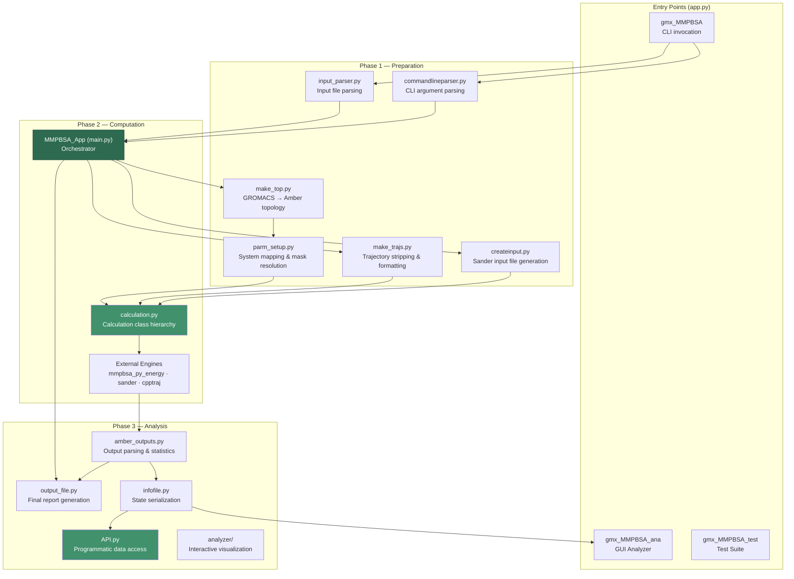
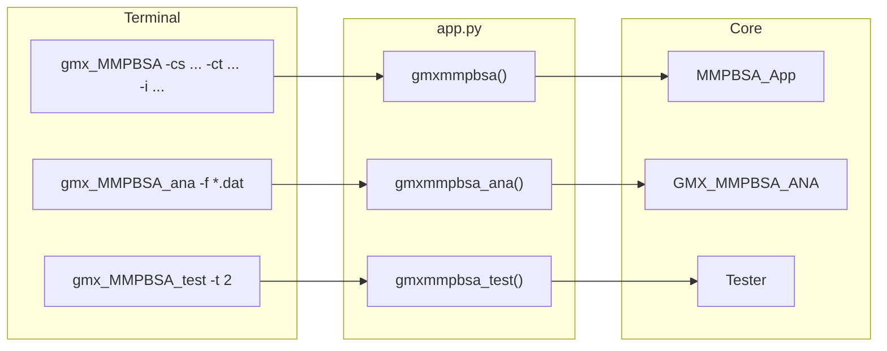
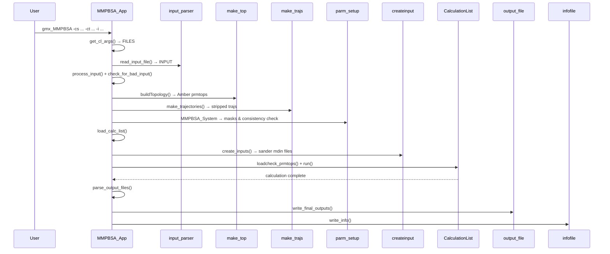
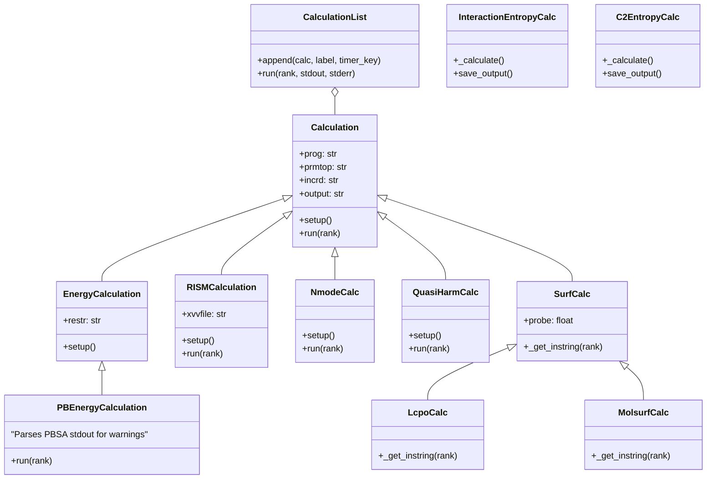

gmx_MMPBSA is an end-state free energy calculation tool that bridges the GROMACS molecular dynamics ecosystem with AMBER's MM/PBSA methodology. Its architecture follows a **sequential pipeline pattern** where user-supplied GROMACS coordinates and topologies are converted into AMBER-compatible formats, processed through solvation energy calculations, and distilled into statistical free energy estimates. Understanding this pipeline is essential for anyone looking to extend the tool, debug calculation failures, or integrate its results into custom analysis workflows.

## High-Level Pipeline

The entire system can be understood as a directed pipeline with three distinct phases — **preparation**, **computation**, and **analysis** — each encapsulated by dedicated module clusters. The entry points funnel through a single application class, ensuring all configuration, validation, and orchestration logic remains centralized.

This diagram reveals the most important architectural truth about gmx_MMPBSA: the `MMPBSA_App` class in [main.py](GMXMMPBSA/main.py#L64-L76) is the **single orchestrator** that owns the entire calculation lifecycle. Every other module is a worker invoked by or through this class.

## Module Inventory and Responsibilities

The codebase comprises approximately 20 Python modules within the `GMXMMPBSA/` package, each with a clearly delineated responsibility. The following table maps each module to its architectural role and approximate complexity:

| Module | Role | Key Class/Function | Lines |
|---|---|---|---|
| [main.py](GMXMMPBSA/main.py#L64-L76) | **Central orchestrator** | `MMPBSA_App` | ~1526 |
| [app.py](GMXMMPBSA/app.py#L40-L114) | **Entry point router** | `gmxmmpbsa()`, `gmxmmpbsa_ana()` | 167 |
| [commandlineparser.py](GMXMMPBSA/commandlineparser.py#L103-L243) | CLI definition & validation | `GMXMMPBSA_ArgParser` | 313 |
| [input_parser.py](GMXMMPBSA/input_parser.py#L171-L663) | Input file schema & parsing | `InputFile`, `Namelist`, `Variable` | 664 |
| [make_top.py](GMXMMPBSA/make_top.py#L76-L1746) | GROMACS → Amber topology conversion | `CheckMakeTop` | 1758 |
| [make_trajs.py](GMXMMPBSA/make_trajs.py#L43-L747) | Trajectory processing via cpptraj | `Trajectory`, `make_trajectories()` | 747 |
| [parm_setup.py](GMXMMPBSA/parm_setup.py#L62-L869) | Complex/receptor/ligand system mapping | `MMPBSA_System` | 878 |
| [createinput.py](GMXMMPBSA/createinput.py#L49-L803) | Sander input file generation | `SanderInput` hierarchy | 805 |
| [calculation.py](GMXMMPBSA/calculation.py#L88-L1226) | Energy calculation dispatch & execution | `CalculationList`, `Calculation` hierarchy | 1226 |
| [amber_outputs.py](GMXMMPBSA/amber_outputs.py#L65-L1917) | Output file parsing & statistics | `AmberOutput`, `BindingStatistics`, etc. | 1917 |
| [output_file.py](GMXMMPBSA/output_file.py#L53-L631) | Final report formatting | `OutputFile` | 631 |
| [infofile.py](GMXMMPBSA/infofile.py#L63-L262) | Calculation state serialization | `InfoFile` | 262 |
| [API.py](GMXMMPBSA/API.py#L195-L983) | Programmatic data access layer | `MMPBSA_API` | 1051 |
| [analyzer/gui.py](GMXMMPBSA/analyzer/gui.py#L44-L1399) | PyQt5-based interactive visualization | `GMX_MMPBSA_ANA` | 1399 |
| [fake_mpi.py](GMXMMPBSA/fake_mpi.py#L28-L68) | MPI transparency layer | `FakeMPI` | 71 |
| [exceptions.py](GMXMMPBSA/exceptions.py#L25-L179) | Typed exception hierarchy | `MMPBSA_Error` family | 181 |
| [utils.py](GMXMMPBSA/utils.py#L52-L919) | Shared utilities | `EnergyVector`, `Residue`, `find_progs()` | 919 |
| [timer.py](GMXMMPBSA/timer.py#L27-L128) | Performance profiling | `Timer` | 128 |
| [alamdcrd.py](GMXMMPBSA/alamdcrd.py#L152-L432) | Alanine scanning trajectory mutation | `MutantMdcrd`, `GlyMutantMdcrd` | 456 |

## Entry Point Architecture

The project defines three console scripts in [setup.py](setup.py#L52-L56) — `gmx_MMPBSA`, `gmx_MMPBSA_ana`, and `gmx_MMPBSA_test` — all routed through [app.py](GMXMMPBSA/app.py#L40-L167) as lightweight dispatch functions. The `gmx_MMPBSA` function instantiates `MMPBSA_App` with either real MPI (when `mpi4py` is available) or the `FakeMPI` stub, then calls the orchestration sequence. The `gmx_MMPBSA_ana` function launches the PyQt5 GUI analyzer directly. This separation ensures the calculation engine and visualization layer are independently invocable, a design that supports headless batch processing on HPC clusters without requiring a display server.

## The Central Orchestrator: `MMPBSA_App`

The `MMPBSA_App` class defined at [main.py:64](GMXMMPBSA/main.py#L64) is the architectural spine of the entire system. It follows a **template method pattern** where the high-level calculation flow is fixed, but individual stages delegate to specialized modules. The class maintains two critical state dictionaries throughout its lifecycle:

- **`INPUT`** — populated from the input file via `input_parser.py`, contains all calculation parameters organized by namelist (`general`, `gb`, `pb`, `rism`, `decomp`, `nmode`, `ala`, `gbnsr6`).
- **`FILES`** — populated from CLI arguments via `commandlineparser.py`, contains paths to all structure files, trajectories, index files, and output destinations.

The orchestration sequence within [`run_mmpbsa()`](GMXMMPBSA/main.py#L184) follows a strict order:

## Configuration System: Dual-Channel Input

gmx_MMPBSA uses a two-channel configuration model that cleanly separates **file paths** (CLI) from **calculation parameters** (input file). The CLI parser in [commandlineparser.py](GMXMMPBSA/commandlineparser.py#L103) defines arguments for structure files (`-cs`, `-rs`, `-ls`), trajectories (`-ct`, `-rt`, `-lt`), index files (`-ci`, `-ri`, `-li`), topology files (`-cp`, `-rp`, `-lp`), and output destinations (`-o`, `-do`, `-eo`). The input file parser in [input_parser.py](GMXMMPBSA/input_parser.py#L171) defines a `Namelist`-based schema with eight named sections, each triggered by a boolean flag in the `general` namelist.

| Namelist | Trigger Variable | Purpose |
|---|---|---|
| `general` | *(always active)* | System name, frame selection, force field, entropy flags |
| `gb` | `gbrun` | Generalized Born parameters (igb, saltcon, QM/MM options) |
| `pb` | `pbrun` | Poisson-Boltzmann parameters (solver, grid, membrane options) |
| `rism` | `rismrun` | 3D-RISM parameters (closure, grid, convergence) |
| `decomp` | `decomprun` | Per-residue decomposition parameters |
| `nmode` | `nmoderun` | Normal mode entropy parameters |
| `ala` | `alarun` | Alanine/glycine scanning parameters |
| `gbnsr6` | `gbnsr6run` | GBNSR6 implicit solvent model parameters |

The `Variable` and `Namelist` classes in [input_parser.py](GMXMMPBSA/input_parser.py#L30-L171) provide type-safe parameter definitions with defaults, descriptions, and optional trigger dependencies. This design prevents invalid configurations from propagating into the calculation engine.

## Topology Conversion Pipeline

The most architecturally complex subsystem is the GROMACS-to-AMBER topology conversion, handled entirely by the `CheckMakeTop` class in [make_top.py](GMXMMPBSA/make_top.py#L76). This ~1750-line module performs a multi-stage conversion:

1. **PDB extraction** via `gmx2pdb()` — converts GROMACS `.tpr` files to PDB format
2. **Topology cleaning** via `cleantop()` — strips solvent and ions from `.top` files
3. **Amber topology generation** via `makeToptleap()` — writes tleap input scripts and invokes `tleap` to produce `.prmtop` files
4. **Structure fixing** via `fixparm2amber()` — reconciles GROMACS-specific conventions with Amber requirements
5. **System validation** via `check_structures()` — verifies complex/receptor/ligand atom correspondence

For alanine scanning, the [`makeMutTop()`](GMXMMPBSA/make_top.py#L1073) method generates mutated topology files where specified residues are replaced with alanine or glycine. The corresponding trajectory mutation is handled separately by [`MutantMdcrd`](GMXMMPBSA/alamdcrd.py#L152) in `alamdcrd.py`.

> [!TIP]
> The topology conversion relies on **ParmEd** as the intermediate representation layer. GROMACS `.top` files are never parsed directly into Amber format — instead, they are converted to PDB, then loaded through `parmed.load_file()` and finalized via `tleap`. This indirection allows the tool to support both Amber and CHARMM force fields by swapping the `forcefields` parameter in the input file.

## Calculation Class Hierarchy

The computation engine in [calculation.py](GMXMMPBSA/calculation.py#L88) uses a **composable command pattern**. The `CalculationList` class (a list subclass) maintains an ordered sequence of `Calculation` objects, each representing a single invocation of an external program. When `run()` is called, each calculation executes sequentially, with MPI-aware frame distribution handled by rank-based file suffixes.

The [`load_calc_list()`](GMXMMPBSA/main.py#L212) method in `MMPBSA_App` dynamically assembles the `CalculationList` based on which flags are set in the INPUT dictionary. For example, if both `gbrun=1` and `decomprun=1`, the list will contain GB energy calculations for complex, receptor, and ligand, plus corresponding decomposition calculations. This dynamic composition is what makes the tool capable of handling a wide variety of analysis types from a single codebase.

## Output Parsing and Statistics Engine

The [amber_outputs.py](GMXMMPBSA/amber_outputs.py#L65) module is the second-largest in the codebase (~1917 lines) and implements a **parallel class hierarchy** to the calculation classes. Where `EnergyCalculation` produces output files, `GBout` parses them. Where `NmodeCalc` produces entropy output, `NMODEout` parses it. The base [`AmberOutput`](GMXMMPBSA/amber_outputs.py#L65) class handles frame-by-frame parsing of sander output, with specialized subclasses overriding `_get_energies()` for format-specific parsing logic.

The statistics compilation layer uses [`BindingStatistics`](GMXMMPBSA/amber_outputs.py#L956) to compute ΔG values via thermodynamic cycles — combining complex, receptor, and ligand energies into binding free energy estimates with standard deviations and standard errors. The [`DecompOut`](GMXMMPBSA/amber_outputs.py#L1321) and [`PairDecompOut`](GMXMMPBSA/amber_outputs.py#L1532) classes handle per-residue and pairwise decomposition, respectively, while [`BindingStatistics`](GMXMMPBSA/amber_outputs.py#L956) and [`DeltaDeltaStatistics`](GMXMMPBSA/amber_outputs.py#L1136) handle binding and alanine-scanning ΔΔG statistics.

> [!TIP]
> The custom [`EnergyVector`](GMXMMPBSA/utils.py#L52) class (a NumPy ndarray subclass) is the fundamental data container throughout the output pipeline. It overloads arithmetic operators to carry standard deviations alongside energy values, so that `vector1 - vector2` propagates uncertainty via `corr_sub()` using correlation-aware error analysis. This is critical for the statistical correctness of binding free energy estimates.

## MPI Parallelism Model

gmx_MMPBSA supports MPI-based frame parallelism through a **transparency layer** implemented in [fake_mpi.py](GMXMMPBSA/fake_mpi.py#L28). When `mpi4py` is available, real MPI is used to distribute trajectory frames across ranks. When it is not, `FakeMPI` provides a no-op `Communicator` that makes the entire codebase run correctly in single-process mode. The [`MMPBSA_App.__init__()`](GMXMMPBSA/main.py#L70) constructor accepts an MPI object as its first argument, and all frame distribution logic uses rank-based file naming (e.g., `_GMXMMPBSA_complex_gb.mdout.0`, `.1`, `.2`). The `sync_mpi()` method inserts barriers at critical synchronization points. The analyzer (`gmx_MMPBSA_ana`) and API (`MMPBSA_API`) are always single-process.

## Data Persistence: The Info File

The [`InfoFile`](GMXMMPBSA/infofile.py#L63) class serializes the complete calculation state — both `INPUT` and `FILES` dictionaries — into a plain-text `_MMPBSA_info` file after every calculation. This serves two architectural purposes: first, it enables the `--rewrite-output` flag to regenerate formatted reports without re-running energy calculations; second, it is the primary data source for both the GUI analyzer and the Python API. The `MMPBSA_API` class reads this file directly via [`load_file()`](GMXMMPBSA/API.py#L230), parses output CSV files, and exposes all results through pandas DataFrames.

## Dependency Map

The runtime dependencies, declared in [setup.py](setup.py#L46-L51), reveal the tool's position in the scientific Python ecosystem:

| Dependency | Version | Role |
|---|---|---|
| `numpy` | 1.26.4 | Array operations, `EnergyVector` base class |
| `pandas` | 1.5.3 | DataFrames in API, CSV output, analyzer |
| `matplotlib` | 3.7.3 | Plotting in analyzer GUI |
| `seaborn` | 0.11.2 | Statistical visualizations |
| `scipy` | 1.14.1 | Statistical tests in API |
| `mpi4py` | 4.0.1 | MPI parallelism (with FakeMPI fallback) |
| `parmed` | ≥4.2.2 | Structure manipulation, topology conversion |
| `tqdm` | latest | Progress bars during calculation |

External executables — `sander`, `mmpbsa_py_energy`, `cpptraj`, and `tleap` — are discovered at runtime by [`find_progs()`](GMXMMPBSA/utils.py#L724) based on the `INPUT` configuration, and their paths are validated before any calculation begins.

## Navigating Forward

This overview establishes the architectural foundation. To deepen your understanding of specific subsystems, proceed through the catalog in logical order:

- **Topology Conversion Pipeline** — [Topology Conversion Pipeline](6-topology-conversion-pipeline) explores the GROMACS → Amber conversion in detail
- **Trajectory Processing** — [Trajectory Processing](7-trajectory-processing) covers frame selection, solvent stripping, and cpptraj integration
- **Calculation Class Hierarchy** — [Calculation Class Hierarchy](9-calculation-class-hierarchy) provides an in-depth look at the energy calculation dispatch system
- **Python API** — [Python API](15-python-api) demonstrates programmatic access to results for custom analysis workflows