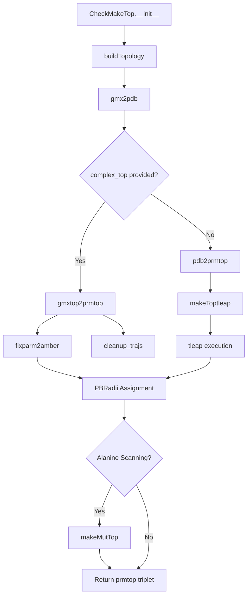

The topology conversion pipeline is the foundational preprocessing stage of gmx_MMPBSA. It transforms GROMACS-format molecular structures and (optionally) topologies into AMBER-compatible `prmtop`/`inpcrd` files that the downstream energy calculation engine requires. This pipeline handles the entire spectrum of complexity — from small-molecule ligands with GAFF parameters to multi-chain protein–membrane systems with CHARMM force fields — while resolving the fundamental incompatibilities between the GROMACS and AMBER molecular modeling ecosystems.

## Architectural Overview

The pipeline is orchestrated by the `CheckMakeTop` class defined in [make_top.py](GMXMMPBSA/make_top.py#L76-L112), which acts as the central state machine. It receives validated input files and configuration, then drives a deterministic sequence of extraction, cleaning, conversion, and validation steps. The class is instantiated in the main calculation flow and its `buildTopology()` method ([make_top.py](GMXMMPBSA/make_top.py#L119-L260)) serves as the single entry point for the entire conversion process.

The pipeline produces up to six output files — a `prmtop`/`inpcrd` pair each for complex, receptor, and ligand (and their mutant counterparts when alanine scanning is enabled). These are written as `COM.prmtop`, `REC.prmtop`, `LIG.prmtop` (and `MUT_COM.prmtop`, etc.) in the working directory, with filenames configurable via the prefix system ([make_top.py](GMXMMPBSA/make_top.py#L99-L110)).

## Input Validation and Prerequisite Checking

The `CheckMakeTop` constructor ([make_top.py](GMXMMPBSA/make_top.py#L77-L112)) performs an immediate consistency check via `checkFiles()`, which requires four essential inputs: the complex TPR structure, the GROMACS index file, trajectory files, and group definitions. If any of these are missing, the pipeline terminates with a descriptive error. The constructor also captures references to external GROMACS executables (`make_ndx`, `trjconv`, `editconf`) and AMBER tools (`tleap`, `parmchk2`) that will be invoked as subprocesses throughout the pipeline.

The class maintains internal state for disulfide bond tracking across complex/receptor/ligand structures (`cys_bonds` dict at [make_top.py](GMXMMPBSA/make_top.py#L89)), mutation indexing (`com_mut_index`), and whether temporary receptor structures are needed for decomposition analysis (`use_temp`). This state is accumulated across pipeline stages and consumed during topology assembly.

## Stage 1: PDB Structure Extraction (`gmx2pdb`)

The first substantive stage extracts PDB coordinate files from GROMACS binary structures. The `gmx2pdb()` method ([make_top.py](GMXMMPBSA/make_top.py#L263-L526)) orchestrates a series of GROMACS tool invocations through piped subprocess calls, following a consistent pattern: pipe selection commands via `echo` into `make_ndx` or `trjconv`, which reads the TPR/trajectory and writes a PDB.

The process begins by constructing a combined gmx_MMPBSA index file that merges the user-specified receptor and ligand groups under standardized names (`GMXMMPBSA_REC`, `GMXMMPBSA_LIG`). The merged group enables extracting the full complex as a single PDB without periodicity artifacts. The extraction uses `trjconv -dump 0` to grab frame zero from the first trajectory file, ensuring coordinates are consistent with the production simulation.

### Multi-Template vs. Single-Template Approach

The pipeline distinguishes between two structural input configurations that significantly affect downstream behavior:

| Feature | Multi-Template (MT) | Single-Template (ST) |
|---------|---------------------|----------------------|
| **Required files** | Separate TPR/index/trajectory for receptor and ligand | Only complex TPR/index/trajectory |
| **Group extraction** | Each structure extracted independently from its own TPR | Receptor and ligand extracted from complex using index groups |
| **Consistency risk** | Lower — each topology is self-contained | Higher — structure splitting must match topology partitioning |
| **Use case** | Flexible binding, protein–protein, separate simulations | Standard protein–ligand, single simulation |

When receptor/ligand TPR files are provided (MT), the pipeline extracts PDB files from each independently ([make_top.py](GMXMMPBSA/make_top.py#L373-L436) for receptor, [make_top.py](GMXMMPBSA/make_top.py#L439-L526) for ligand). When they are absent (ST), the receptor and ligand PDB files are carved from the complex using the group selections defined in the index file.

### Ligand Parameterization

If a `mol2` file is provided via `-lm`, the pipeline runs `parmchk2` ([make_top.py](GMXMMPBSA/make_top.py#L324-L336)) to generate missing force field parameters. The GAFF version is auto-detected from the `forcefields` configuration string — `leaprc.gaff2` maps to GAFF2 (`-s 2`), otherwise GAFF1 (`-s 1`). The resulting `.frcmod` file is stored for later use during tleap topology assembly. This step is critical for non-standard ligands that lack pre-parameterized entries in the selected force field.

## Stage 2: Dual Conversion Paths

After PDB extraction, the pipeline branches into one of two fundamentally different conversion strategies, determined by whether the user provided a GROMACS topology file ([make_top.py](GMXMMPBSA/make_top.py#L124-L128)).

### Path A: Direct Topology Conversion (`gmxtop2prmtop`)

When a GROMACS `.top` file is available, the `gmxtop2prmtop()` method ([make_top.py](GMXMMPBSA/make_top.py#L562-L750)) performs a ParmEd-based conversion that preserves the original force field parameters encoded in the GROMACS topology. This is the preferred path when available, as it eliminates the approximation inherent in re-parameterizing through tleap.

The conversion proceeds through a multi-phase process. First, `cleantop()` ([make_top.py](GMXMMPBSA/make_top.py#L820-L875)) creates a sanitized version of the GROMACS topology by stripping solvent and ion entries from the `[ molecules ]` section. It recognizes a comprehensive list of solvent/ion identifiers including `SOL`, `TIP3P`, `TIP4PEW`, `SPCE`, `OPC`, `NA`, `CL`, `K`, `SOD`, `CLA`, and their variants ([make_top.py](GMXMMPBSA/make_top.py#L839-L849)). The cleaned topology is then loaded via `parmed.gromacs.GromacsTopologyFile` and atom indices from the GROMACS index file are mapped to residue ranges, which are used to `strip()` the structure down to only the selected residues.

Next, the pipeline detects the force field format by checking for CHARMM-specific parameter types (`impropers` and `urey_bradleys`). If present, the structure is converted via `parmed.amber.ChamberParm.from_structure()` ([make_top.py](GMXMMPBSA/make_top.py#L581)); otherwise, `parmed.amber.AmberParm.from_structure()` is used ([make_top.py](GMXMMPBSA/make_top.py#L589)). This detection is performed once for the complex and then enforced for consistency across receptor and ligand — a mismatch between complex and sub-structure force field types triggers a fatal error ([make_top.py](GMXMMPBSA/make_top.py#L631-L638)).

For the ST variant (no separate receptor/ligand topology files), the receptor and ligand `AmberParm` objects are derived by stripping the complex topology using Amber mask syntax. The receptor is extracted with `strip(f'!:{rec_indexes_string}')` and the ligand with `strip(f':{rec_indexes_string}')`, effectively partitioning the complex by residue selection ([make_top.py](GMXMMPBSA/make_top.py#L650-L700)).

> [!TIP]
> When using the direct topology conversion path (Path A), the `radiopt` parameter is automatically forced to `0` regardless of user configuration ([make_top.py](GMXMMPBSA/make_top.py#L563-L564)). This is because GROMACS-converted topologies lack the optimized radii data that `radiopt > 0` requires. Users should be aware that PB calculations will use standard bondi/mbondi radii rather than optimized values.

### Path B: PDB-to-AMBER via tLEaP (`pdb2prmtop` → `makeToptleap`)

When no GROMACS topology is provided, the pipeline must reconstruct AMBER topology from scratch using the extracted PDB structures and user-specified force fields. The `pdb2prmtop()` method ([make_top.py](GMXMMPBSA/make_top.py#L762-L818)) first applies `fixparm2amber()` to all three structures (complex, receptor, ligand), then splits the complex into individual residue PDB files that will be reassembled by tleap.

The `fixparm2amber()` method ([make_top.py](GMXMMPBSA/make_top.py#L950-L1016)) performs a critical naming convention translation between GROMACS and AMBER formats. The conversions include:

| GROMACS Name | AMBER Name | Context |
|--------------|------------|---------|
| `OC1` | `O` | C-terminal carbonyl oxygen |
| `OC2` | `OXT` | C-terminal carboxyl oxygen (triggers `ter=True`) |
| `ILE:CD` | `CD1` | Isoleucine delta carbon |
| `LYS` (missing HZ3) | `LYN` | Neutral lysine |
| `ASP` (has HD2) | `ASH` | Protonated aspartate |
| `GLU` (has HE2) | `GLH` | Protonated glutamate |
| `HIS` variants | `HIP/HID/HIE` | Based on HD1/HE2 hydrogen presence |
| `CYS` (S-S bonded) | `CYX` | Disulfide-bonded cysteine |

The disulfide bond detection at [make_top.py](GMXMMPBSA/make_top.py#L986-L1004) scans each cysteine's sulfur atom (`SG`) for bonded partners and updates both residues to `CYX`. These bonds are recorded in the `cys_bonds` dictionary and later re-established as explicit `bond` commands in the tleap input file.

The `makeToptleap()` method ([make_top.py](GMXMMPBSA/make_top.py#L1560-L1731) then generates a complete tleap input script that sources the user's force fields, loads individual residue PDB files, combines them into receptor/ligand/complex units, re-establishes disulfide bonds, and writes AMBER topology/coordinate files. The tleap process is launched with the gmx_MMPBSA data directory (containing force field files and libraries) added to the search path via `-I` ([make_top.py](GMXMMPBSA/make_top.py#L1732-L1744)).

## PB Radii Assignment

Both conversion paths conclude with PB radii assignment. The `PBRadii` mapping at [make_top.py](GMXMMPBSA/make_top.py#L55) defines seven supported radii sets, applied via ParmEd's `ChRad` action. The `charmm_radii` set (index 7) is restricted to CHARMM-format topologies only and will trigger an error if applied to Amber/OPLS structures ([make_top.py](GMXMMPBSA/make_top.py#L602-L605)). Modified radii sets (`mbondi_pb2`, `mbondi_pb3`, indices 5 and 6) receive special handling — the tleap-generated topologies are post-processed with an additional `ChRad` pass after tleap completes ([make_top.py](GMXMMPBSA/make_top.py#L1614-L1637)).

## Post-Conversion: Structure Validation and Chain Assignment

After topology generation, the pipeline runs `check_structures()` ([make_top.py](GMXMMPBSA/make_top.py#L1396-L1447)) to validate structural integrity and assign chain identifiers. Chain assignment follows a three-tier priority system:

1. **Reference structure** (`-cs` flag): Chain IDs are copied directly from the reference, with a residue-by-residue consistency check ([make_top.py](GMXMMPBSA/make_top.py#L1402-L1424))
2. **Existing chain IDs**: Detected from the PDB and preserved or overridden based on the `assign_chainID` configuration (0=auto-only-if-missing, 1=keep-existing, 2=force-reassign)
3. **Auto-assignment** (`_assign_chains_IDs`, [make_top.py](GMXMMPBSA/make_top.py#L1449-L1516)): Uses residue numbering gaps and C-terminal `OXT` atoms as chain boundary heuristics, cycling through uppercase ASCII letters

## Mutation Topology Generation (Alanine Scanning)

When alanine scanning is enabled, `makeMutTop()` ([make_top.py](GMXMMPBSA/make_top.py#L1073-L1334)) creates mutant topology variants by performing an in-place side-chain truncation on the wild-type AmberParm structure. The method strips all atoms beyond the backbone (N, H, CA, HA, C, O, HN) and CB, then renames remaining side-chain atoms to their alanine equivalents. For non-GLY→ALA mutations, the first heavy atom beyond CB (e.g., CG, OG, SG, CG1, CG2) is repositioned at 1.09 Å from CB and renamed to HB2/HB3 ([make_top.py](GMXMMPBSA/make_top.py#L1218-L1250)).

The hydrogen atom charges are position-dependent: C-terminal residues receive 0.0764 e, N-terminal 0.0300 e, and internal 0.0603 e, matching AMBER14SB charge conventions ([make_top.py](GMXMMPBSA/make_top.py#L1125-L1136)). Both Amber and CHARMM atom types are supported, with appropriate LJ parameters for each ([make_top.py](GMXMMPBSA/make_top.py#L1112-L1153)).

The `cas_intdiel` feature ([make_top.py](GMXMMPBSA/make_top.py#L1252-L1272)) dynamically sets the GB internal dielectric constant based on the mutated residue's physicochemical class — polar, nonpolar, positively charged, or negatively charged — enabling more physically meaningful alanine scanning energies.

## Downstream Integration with `MMPBSA_System`

Once the topology files are generated, the `MMPBSA_System` class in [parm_setup.py](GMXMMPBSA/parm_setup.py#L62-L868) takes ownership of the AMBER topology objects. It builds a residue mapping between complex, receptor, and ligand, enabling conversion of user-specified residue selections into Amber mask strings for energy calculations. The `CheckConsistency()` method ([parm_setup.py](GMXMMPBSA/parm_setup.py#L825-L867) validates that charge definitions remain consistent across all three prmtop files — a critical safeguard since topology conversion can introduce subtle charge discrepancies.

The topology files produced by this pipeline feed directly into the energy calculation classes defined in [calculation.py](GMXMMPBSA/calculation.py#L300-L332), where `EnergyCalculation` objects consume `prmtop`, `inpcrd`, and trajectory inputs to invoke `mmpbsa_py_energy`. The conversion pipeline's correctness directly determines the reliability of every downstream energy estimate.

## Summary of Pipeline Outputs

| Output File | Description | Produced By |
|-------------|-------------|-------------|
| `COM.prmtop` | Complex AMBER topology | Both paths |
| `COM.inpcrd` | Complex coordinates | Both paths |
| `REC.prmtop` | Receptor AMBER topology | Both paths |
| `REC.inpcrd` | Receptor coordinates | Both paths |
| `LIG.prmtop` | Ligand AMBER topology | Both paths |
| `LIG.inpcrd` | Ligand coordinates | Both paths |
| `MUT_COM.prmtop` | Mutant complex topology | Alanine scanning only |
| `MUT_REC.prmtop` / `MUT_LIG.prmtop` | Mutant sub-structure topology | Alanine scanning only |
| `COM_FIXED.pdb` | Chain-corrected complex structure | Always |
| `*_COM_index.ndx` / `*_REC_index.ndx` / `*_LIG_index.ndx` | Renamed GROMACS index files | Always |

Sources: [make_top.py](GMXMMPBSA/make_top.py#L1-L1758), [parm_setup.py](GMXMMPBSA/parm_setup.py#L62-L868), [calculation.py](GMXMMPBSA/calculation.py#L300-L332)

---

**Next Steps**: With topologies in hand, the pipeline proceeds to trajectory processing. See [Trajectory Processing](7-trajectory-processing) for how GROMACS trajectories are converted and frame-aligned. For the ParmEd data structures that underpin this entire pipeline, see [ParmEd Structure Handling](8-parmed-structure-handling).