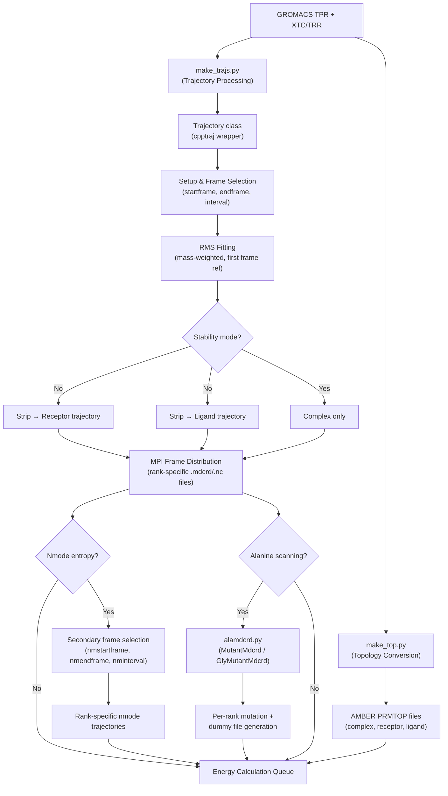
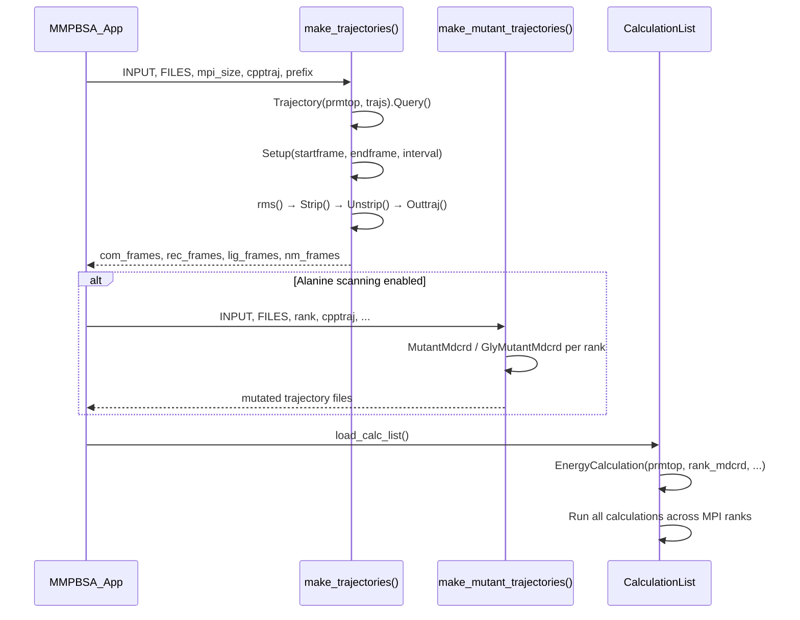

Trajectory processing is the critical bridge between GROMACS-format molecular dynamics outputs and the AMBER-compatible coordinate files required by the MMPBSA.py energy engine. This subsystem transforms raw simulation trajectories into frame-sliced, RMS-fitted, component-separated coordinate streams — distributing them across MPI ranks for parallel energy evaluation. Understanding this pipeline is essential for diagnosing frame-count mismatches, debugging stripping errors, and optimizing throughput for large-scale binding free energy calculations.

## Architectural Overview

The trajectory processing subsystem lives primarily in two modules: [make_trajs.py](GMXMMPBSA/make_trajs.py) orchestrates the cpptraj-driven trajectory manipulation pipeline, while [alamdcrd.py](GMXMMPBSA/alamdcrd.py) handles the coordinate-level mutation required for alanine/glycine scanning. Both are invoked from the main application class [MMPBSA_App](GMXMMPBSA/main.py#L64) during the pre-calculation phase, before any energy evaluation begins.



The overall flow follows a strict ordering: topology conversion must complete before trajectory processing begins, and all trajectory artifacts must be on disk before the calculation engine enqueues its first energy evaluation task. This dependency chain is enforced in [MMPBSA_App.run_mmpbsa()](GMXMMPBSA/main.py#L184-L219), where `load_calc_list()` assumes that all `_MMPBSA_*.mdcrd` (or `.nc`) files already exist.

## The Trajectory Class: A Command-Building Abstraction

The [`Trajectory`](GMXMMPBSA/make_trajs.py#L456-L747) class is not a data container — it is a **command builder** that accumulates cpptraj actions into an ordered list and executes them as a batch. This design minimizes subprocess invocations: rather than spawning cpptraj once per operation (strip, fit, output), all actions are concatenated into a single input script and dispatched in one `Popen` call via [`Run()`](GMXMMPBSA/make_trajs.py#L700-L736).

### Initialization and Frame Discovery

Upon instantiation, the constructor accepts a prmtop path, a list of trajectory files, and the cpptraj executable path. It immediately calls [`Query()`](GMXMMPBSA/make_trajs.py#L624-L663), which spawns cpptraj for each trajectory file to extract frame counts via regex matching against the `Frames: (\d+)` pattern in the output. The total frame count across all files is stored in `self.total_frames`, and per-file counts are kept in `self.traj_sizes`. This information is critical for the frame distribution logic that follows.

Sources: [make_trajs.py](GMXMMPBSA/make_trajs.py#L490-L510), [make_trajs.py](GMXMMPBSA/make_trajs.py#L624-L663)

### Frame Selection and MPI Distribution

The [`Setup()`](GMXMMPBSA/make_trajs.py#L512-L615) method is where the most intricate logic resides. Given `startframe`, `endframe`, and `interval` parameters from the input file's `[general]` namelist, it computes per-trajectory start/end pairs and generates `trajin` directives for cpptraj. The method handles multi-file trajectories correctly: if the user's start frame falls in the middle of a trajectory file, only the relevant portion is loaded, and the remainder cascades to subsequent files with proper interval alignment.

The resulting `self.processed_frames` count is then used by the caller ([`make_trajectories()`](GMXMMPBSA/make_trajs.py#L43-L318)) to distribute frames across MPI ranks. The distribution algorithm uses integer division with remainder:

```python
frames_per_rank = processed_frames // size
extras = processed_frames - frames_per_rank * size
frame_count = [frames_per_rank for i in range(size)]
for i in range(size):
    if i < extras: frame_count[i] += 1
```

This ensures that when frames don't divide evenly by processor count, the first `extras` ranks each receive one additional frame. A sanity check raises `MMPBSA_Error` if the total frames are fewer than the processor count.

Sources: [make_trajs.py](GMXMMPBSA/make_trajs.py#L512-L615), [make_trajs.py](GMXMMPBSA/make_trajs.py#L43-L80)

### Action Queue Methods

The `Trajectory` class provides a layered set of action accumulators:

| Method | cpptraj Directive | Purpose |
|--------|-------------------|---------|
| [`Strip(mask)`](GMXMMPBSA/make_trajs.py#L684-L690) | `strip :mask` | Remove atoms matching an Amber mask |
| [`StripSolvent(stripmask)`](GMXMMPBSA/make_trajs.py#L616-L622) | `strip :WAT,Cl*,...` | Remove solvent and ions (stores mask for re-application) |
| [`Unstrip(restrip_solvent)`](GMXMMPBSA/make_trajs.py#L692-L699) | `unstrip` → `strip :WAT,...` | Restore all atoms, optionally re-strip solvent |
| [`rms(mask)`](GMXMMPBSA/make_trajs.py#L678-L683) | `rmsd mask mass first` | Mass-weighted RMS fit to the first frame |
| [`Image()`](GMXMMPBSA/make_trajs.py#L664-L676) | `autoimage` | Correct periodic boundary artifacts |
| [`Outtraj(filename, frames, ...)`](GMXMMPBSA/make_trajs.py#L733-L747) | `outtraj ... onlyframes ... nobox` | Queue a trajectory output for specific frames |

The default strip mask — defined as a module-level constant — covers common water models and ions: `':WAT,Cl*,CIO,Cs+,IB,K*,Li+,MG*,Na+,Rb+,CS,RB,NA,F,CL'` ([make_trajs.py#L40](GMXMMPBSA/make_trajs.py#L40)).

> [!TIP]
> The `Unstrip()` method is essential when generating both receptor and ligand from a single complex trajectory. After stripping the ligand to produce the receptor trajectory, `Unstrip(restrip_solvent=True)` restores all atoms and re-applies the solvent strip, preparing the state for the subsequent ligand strip operation. This two-pass approach avoids loading the trajectory twice.

Sources: [make_trajs.py](GMXMMPBSA/make_trajs.py#L616-L747)

## Normal Trajectory Generation

The [`make_trajectories()`](GMXMMPBSA/make_trajs.py#L43-L318) function is the primary entry point for non-mutant trajectory processing. It follows a branching strategy based on whether the user provides separate receptor/ligand trajectories or expects them to be extracted from the complex.

### Single-Trajectory vs. Multi-Trajectory Mode

In **single-trajectory mode** (the default, when `FILES.receptor_trajs` and `FILES.ligand_trajs` are `None`), the function operates on the complex trajectory exclusively. It strips the ligand using `INPUT['general']['ligand_mask']` to produce the receptor trajectory, then unstrips and strips the receptor using `INPUT['general']['receptor_mask']` to produce the ligand trajectory. All three outputs (complex, receptor, ligand) are generated in a **single cpptraj invocation**, which is the most efficient approach.

In **multi-trajectory mode** (when the user provides separate trajectory files for receptor and ligand), each is processed independently via separate `Trajectory` instances and separate cpptraj runs. Each trajectory gets its own frame count validation — if any trajectory has fewer frames than MPI ranks, an error is raised.

Sources: [make_trajs.py](GMXMMPBSA/make_trajs.py#L100-L320)

### Output File Naming Convention

All trajectory files are prefixed with the `pre` parameter (typically `_MMPBSA_`). The naming pattern encodes the component, format, and MPI rank:

| File Pattern | Description | Condition |
|-------------|-------------|-----------|
| `_MMPBSA_complex.{mdcrd\|nc}` | Full complex trajectory | `full_traj=1` or `qh_entropy=1` |
| `_MMPBSA_complex.{mdcrd\|nc}.{rank}` | Rank-specific complex trajectory | Always generated |
| `_MMPBSA_receptor.{mdcrd\|nc}.{rank}` | Rank-specific receptor trajectory | Not stability mode |
| `_MMPBSA_ligand.{mdcrd\|nc}.{rank}` | Rank-specific ligand trajectory | Not stability mode |
| `_MMPBSA_complex.pdb` | First-frame PDB of complex | Always generated (dummy file) |
| `_MMPBSA_dummycomplex.inpcrd` | First-frame restart of complex | Always generated (dummy file) |
| `_MMPBSA_complex_nm.{mdcrd\|nc}.{rank}` | Nmode-specific complex trajectory | `nmoderun=1` |

The file format suffix is determined by `INPUT['general']['netcdf']`: `.nc` for NetCDF (binary, more compact) or `.mdcrd` for ASCII (human-readable, required for alanine scanning).

Sources: [make_trajs.py](GMXMMPBSA/make_trajs.py#L57-L100)

### Nmode Trajectory Sub-Selection

When normal mode entropy is requested (`INPUT['nmode']['nmoderun'] = 1`), a **secondary frame selection pass** is performed on the already-split rank-specific trajectories. This uses separate parameters — `nmstartframe`, `nmendframe`, `nminterval` — from the `[nmode]` namelist ([input_parser.py#L650-L663](GMXMMPBSA/input_parser.py#L650-L663)). The output files follow the pattern `_MMPBSA_complex_nm.{suffix}.{rank}`, `_MMPBSA_receptor_nm.{suffix}.{rank}`, and `_MMPBSA_ligand_nm.{suffix}.{rank}`. Because nmode calculations are extremely expensive (requiring minimization and Hessian computation per frame), this sub-selection typically uses a much sparser sampling than the main energy calculation.

> [!TIP]
> Nmode trajectory generation reads from the already-split rank-specific files (`complex.mdcrd.{i}`), not the original trajectory. This means the `nmstartframe` and `nmendframe` values are relative to the rank's assigned frames, not the global trajectory — a subtle but important distinction when setting up multi-rank nmode calculations.

Sources: [make_trajs.py](GMXMMPBSA/make_trajs.py#L254-L318)

### GBNSR6 Restart File Generation

When GBNSR6 is enabled (`INPUT['gbnsr6']['gbnsr6run'] = 1`), the pipeline additionally generates per-frame restart (`.inpcrd`) files for each MPI rank. These are placed in rank-specific subdirectories (`_MMPBSA_inpcrd_{i}/`) and are required because the GBNSR6 solver consumes coordinate data differently from the standard AMBER energy module. This path has a `FIXME` note indicating that `pbsa.cuda`, APBS, and PBDelphi solvers are not yet supported in this code path.

Sources: [make_trajs.py](GMXMMPBSA/make_trajs.py#L85-L100)

## Mutant Trajectory Generation

Alanine and glycine scanning introduces a fundamentally different trajectory processing path. Instead of cpptraj manipulation, the [`make_mutant_trajectories()`](GMXMMPBSA/make_trajs.py#L319-L455) function delegates to coordinate-level mutation in [alamdcrd.py](GMXMMPBSA/alamdcrd.py), which operates directly on ASCII trajectory files.

### Mutation Detection and Validation

The [`MutantMdcrd`](GMXMMPBSA/alamdcrd.py#L152-L369) class accepts two ParmEd topology objects — the original and the mutant — and uses [`FindMutantResidue()`](GMXMMPBSA/alamdcrd.py#L168-L192) to locate the mutation by comparing `RESIDUE_LABEL` arrays. It enforces strict constraints:

- Both topologies must have **identical residue counts**
- Exactly **one residue** may differ between the two topologies
- The mutated residue in the new topology **must be ALA** (otherwise a `MutantResError` is raised, which triggers fallback to `GlyMutantMdcrd` for glycine scanning)

If the mutant residue is not ALA, the caller in `make_mutant_trajectories()` catches the `MutantResError` and instantiates [`GlyMutantMdcrd`](GMXMMPBSA/alamdcrd.py#L371-L456) instead — this is how the system differentiates between alanine and glycine scanning at the trajectory level.

Sources: [make_trajs.py](GMXMMPBSA/make_trajs.py#L395-L410), [alamdcrd.py](GMXMMPBSA/alamdcrd.py#L168-L192)

### Coordinate Mutation Algorithm

The [`MutateTraj()`](GMXMMPBSA/alamdcrd.py#L193-L309) method performs a **line-by-line, coordinate-by-coordinate** rewrite of the ASCII mdcrd file. The algorithm uses a state machine with three locations: `0` (before the mutated residue), `1` (during the mutated residue), and `2` (after the mutated residue). For each frame in the trajectory:

1. It identifies the coordinate range of the target residue using `RESIDUE_POINTER` from the original topology
2. It extracts the raw coordinates of the residue
3. It calls [`_mutate()`](GMXMMPBSA/alamdcrd.py#L311-L369) to transform the coordinates from the original amino acid to alanine (or glycine)
4. It writes the new coordinates back, adjusting the box coordinate (if `ifbox > 0`) for the reduced atom count

The mutation itself is a **geometric operation**, not a force-field-based optimization. The [`_mutate()`](GMXMMPBSA/alamdcrd.py#L311-L369) method handles three categories of amino acids differently, based on side-chain topology:

| Category | Residues | Strategy |
|----------|----------|----------|
| **List one** (standard) | ARG, ASN, ASP, CYS, GLU, GLN, HIS, LEU, LYS, MET, PHE, SER, TRP, TYR | Keep backbone + CB, rebuild CB→CG bond at 1.09 Å |
| **List two** (β-branched) | ILE, THR, VAL | Keep backbone + CB, rebuild two bonds at 1.09 Å |
| **List three** (cyclic) | PRO | Keep backbone, add N→H bond at 1.01 Å, relocate ring |

The [`_scaledistance()`](GMXMMPBSA/alamdcrd.py#L42-L69) helper performs the actual geometry: it translates a coordinate pair to the origin, scales the distance to the target bond length, and translates back. This preserves the spatial orientation of the side chain while adjusting for the shorter alanine side chain.

Sources: [alamdcrd.py](GMXMMPBSA/alamdcrd.py#L193-L369)

### Per-Rank Mutation and Selective Copying

A critical design choice in `make_mutant_trajectories()` is that **each MPI rank mutates its own trajectory slice independently**. This avoids the bottleneck of a single-rank mutation followed by redistribution. The function also implements selective copying: if the mutation is in the receptor, the ligand trajectory files are simply copied (via `shutil.copyfile`) rather than reprocessed, and vice versa. This is handled by the [`CopyCalc`](GMXMMPBSA/calculation.py#L703-L727) class in the calculation engine.

Sources: [make_trajs.py](GMXMMPBSA/make_trajs.py#L411-L445)

### NetCDF Incompatibility

A hard constraint exists for alanine/glycine scanning: NetCDF trajectories are **not supported**. The function explicitly raises `TypeError('Alanine/Glycine scanning requires ASCII trajectories (netcdf=0)')` if `INPUT['general']['netcdf']` is set ([make_trajs.py#L335-L337](GMXMMPBSA/make_trajs.py#L335-L337)). This is because the mutation algorithm operates on the line-oriented ASCII format of mdcrd files and cannot parse the binary NetCDF format.

Sources: [make_trajs.py](GMXMMPBSA/make_trajs.py#L331-L337)

## Input Parameters Controlling Trajectory Processing

The following parameters from the input file directly influence trajectory processing behavior:

### `[general]` Namelist

| Parameter | Type | Default | Effect on Trajectory Processing |
|-----------|------|---------|--------------------------------|
| `startframe` | int | 1 | First frame to include from the trajectory |
| `endframe` | int | 9999999 | Last frame to include (clamped to actual frame count) |
| `interval` | int | 1 | Stride between consecutive frames |
| `netcdf` | int | 0 | Output format: 0=ASCII (.mdcrd), 1=NetCDF (.nc) |
| `full_traj` | int | 0 | Also output the full (non-split) complex trajectory |
| `qh_entropy` | int | 0 | Triggers full trajectory output for quasi-harmonic analysis |

### `[nmode]` Namelist

| Parameter | Type | Default | Effect on Trajectory Processing |
|-----------|------|---------|--------------------------------|
| `nmstartframe` | int | 1 | First frame for nmode sub-selection |
| `nmendframe` | int | 1000000 | Last frame for nmode sub-selection |
| `nminterval` | int | 1 | Stride for nmode sub-selection |

### `[ala]` Namelist

| Parameter | Type | Default | Effect on Trajectory Processing |
|-----------|------|---------|--------------------------------|
| `alarun` | int | 0 | Enables alanine/glycine scanning trajectory mutation |
| `mutant` | str | 'ALA' | Target mutation type (ALA or GLY) |

Sources: [input_parser.py](GMXMMPBSA/input_parser.py#L402-L432), [input_parser.py](GMXMMPBSA/input_parser.py#L650-L663), [input_parser.py](GMXMMPBSA/input_parser.py#L630-L640)

## Integration with the Calculation Pipeline

Trajectory processing is the second major phase in the gmx_MMPBSA execution lifecycle, occurring after topology conversion ([make_top.py](GMXMMPBSA/make_top.py)) and before energy evaluation ([calculation.py](GMXMMPBSA/calculation.py)). The `MMPBSA_App` class manages this sequence, and the [`CalculationList`](GMXMMPBSA/calculation.py#L88-L149) executor consumes the trajectory files produced by this subsystem.



The frame counts returned by `make_trajectories()` are stored as `self.numframes` and `self.numframes_nmode` on the application object. These are passed to the [`CalculationList`](GMXMMPBSA/calculation.py#L88-L149) constructor to drive progress reporting during the calculation phase, ensuring that the TQDM progress bars accurately reflect the total workload.

Sources: [main.py](GMXMMPBSA/main.py#L184-L232), [calculation.py](GMXMMPBSA/calculation.py#L88-L149)

## Error Handling and Common Pitfalls

The trajectory processing subsystem raises several domain-specific exceptions that propagate to the top-level error handler:

| Exception | Condition | Resolution |
|-----------|-----------|------------|
| `MMPBSA_Error('Must have at least as many frames as processors!')` | Total frames < MPI rank count | Reduce `nproc` or increase trajectory length |
| `MMPBSA_Error('Too many procs for receptor/ligand snapshots')` | Component trajectory < MPI ranks (multi-traj mode) | Reduce `nproc` or extend component trajectory |
| `TrajError('Cannot have startframe > endframe')` | Invalid frame range in input file | Correct `startframe`/`endframe` values |
| `MutateError('Trying to mutate GLY to ALA!')` | Glycine cannot be mutated to alanine (fewer atoms) | Use glycine scanning instead, or skip this residue |
| `TypeError('Alanine/Glycine scanning requires ASCII trajectories')` | `netcdf=1` with `alarun=1` | Set `netcdf=0` in the input file |

Sources: [make_trajs.py](GMXMMPBSA/make_trajs.py#L80-L82), [make_trajs.py](GMXMMPBSA/make_trajs.py#L535-L540), [make_trajs.py](GMXMMPBSA/make_trajs.py#L335-L337), [alamdcrd.py](GMXMMPBSA/alamdcrd.py#L204-L205)

## Next Steps

- **[Topology Conversion Pipeline](6-topology-conversion-pipeline)** — Understand how GROMACS TPR/topol files are converted to AMBER PRMTOP before trajectory processing begins
- **[ParmEd Structure Handling](8-parmed-structure-handling)** — Deep dive into the ParmEd topology objects that the Trajectory class queries for atom counts, residue labels, and box information
- **[Calculation Class Hierarchy](9-calculation-class-hierarchy)** — See how the trajectory files produced here are consumed by `EnergyCalculation`, `NmodeCalc`, and `SurfCalc` classes
- **[Alanine Scanning](14-alanine-scanning)** — Full treatment of the mutation workflow including topology generation, energy comparison, and results interpretation
- **[MPI Parallelism](18-mpi-parallelism)** — How frame distribution across ranks integrates with the overall parallel execution strategy