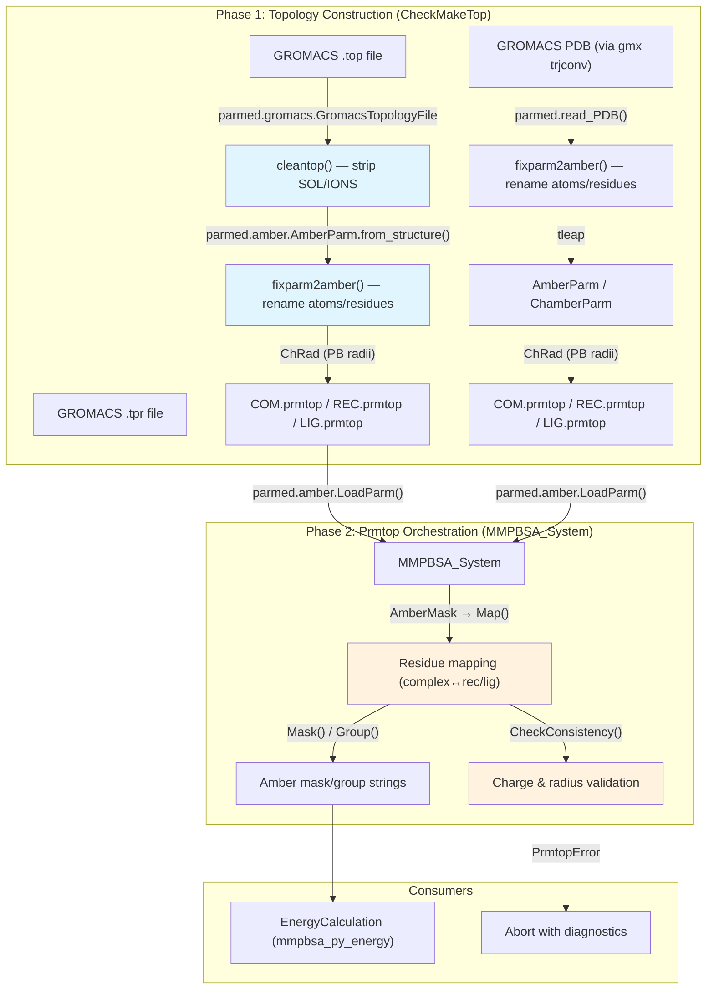

ParmEd is the structural backbone of gmx_MMPBSA, serving as the sole interface between GROMACS molecular descriptions and the AMBER energy calculation engine. Every topology conversion, residue remapping, mutation operation, and validation check flows through ParmEd's `Structure` hierarchy. This page dissects the two core modules that orchestrate ParmEd interactions—`CheckMakeTop` for topology construction and `MMPBSA_System` for post-conversion prmtop orchestration—and traces the data transformations that make cross-format MM/PBSA possible.

## Architectural Overview

gmx_MMPBSA employs ParmEd across a strict two-phase pipeline: **construction** (GROMACS → AMBER topology creation) and **orchestration** (prmtop mask/group generation and consistency validation). The construction phase lives entirely in `CheckMakeTop` ([make_top.py](GMXMMPBSA/make_top.py#L76-L110)), while orchestration resides in `MMPBSA_System` ([parm_setup.py](GMXMMPBSA/parm_setup.py#L62-L93)). These two classes never directly reference each other; instead, they communicate through the `.prmtop` files written to disk by the construction phase and consumed by the orchestration phase during calculation setup.

## ParmEd Structure Types in the Pipeline

gmx_MMPBSA uses a subset of ParmEd's type hierarchy, selected to represent both source and target molecular descriptions. The critical distinction is between **generic structures** (which carry coordinates and connectivity but may lack AMBER-specific force field sections) and **AMBER parametrized structures** (which contain the complete `parm_data` dictionaries required by the energy engine).

| ParmEd Type | Source | Used In | Key Capability |
|---|---|---|---|
| `parmed.gromacs.GromacsTopologyFile` | GROMACS `.top` | `cleantop()` | Reads GROMACS molecule definitions, atom types, and bonds |
| `parmed.Structure` (via `read_PDB`) | PDB files | `molstr()` | Lightweight coordinate holder; no force field data |
| `parmed.amber.AmberParm` | `AmberParm.from_structure()` | `gmxtop2prmtop()`, `makeToptleap()` | Full AMBER topology with `parm_data`, `ptr()`, atom lists |
| `parmed.amber.ChamberParm` | `ChamberParm.from_structure()` | `gmxtop2prmtop()` | CHARMM-compatible AMBER topology (impropers, urey_bradleys) |
| `parmed.amber.LoadParm()` | `.prmtop` files | `MMPBSA_System.__init__()` | Deserializes written topology back into manipulable objects |
| `parmed.amber.AmberMask` | Mask strings | `MMPBSA_System.Map()` | Parses Amber selection syntax (`:1-50`, `@CA`) against a topology |

The force field detection logic that decides between `AmberParm` and `ChamberParm` is straightforward: if a `Structure` object possesses `impropers` or `urey_bradleys` attributes, it originated from a CHARMM force field and must be wrapped in `ChamberParm` ([make_top.py](GMXMMPBSA/make_top.py#L580-L591)). This check is enforced consistently across complex, receptor, and ligand topologies, and a mismatch between any pair triggers an immediate abort ([make_top.py](GMXMMPBSA/make_top.py#L631-L638)).

> [!TIP]
> The `from_structure()` conversion is a one-way operation that reorganizes ParmEd's internal data arrays into the AMBER `parm_data` dictionary format. After conversion, modifications to the structure (e.g., adding atoms in `makeMutTop`) manipulate the `AmberParm` object directly, not the original GROMACS data.

## Phase 1: Topology Construction in CheckMakeTop

### The cleantop() Entry Point

When a user provides a GROMACS topology file, the pipeline begins with `cleantop()`, a static method that performs two critical operations: stripping solvent/ion molecule entries from the `[ molecules ]` section of the `.top` file, then using ParmEd's `GromacsTopologyFile` to load the cleaned topology and apply an atom-index-based residue strip ([make_top.py](GMXMMPBSA/make_top.py#L820-L875)).

The method writes a temporary topology file with solvent lines removed (recognizing both standard GROMACS names like `SOL`, `NA`, `CL` and CHARMM-GUI variants like `TIP3P`, `SOD`, `Na+`), then loads it via `parmed.gromacs.GromacsTopologyFile` and calls `rtemp_top.strip()` with an Amber-style residue mask constructed from the user's index group selections. This is the first point where ParmEd's Amber mask syntax operates on a GROMACS-derived structure.

### GROMACS-to-AMBER Naming Convention Fixes

The `fixparm2amber()` method is a systematic residue-by-residue, atom-by-atom transformer that bridges the naming divergences between GROMACS and AMBER conventions ([make_top.py](GMXMMPBSA/make_top.py#L950-L1016)). Its transformations fall into three categories:

**Atom renames.** GROMACS C-terminal atoms `OC1`/`OC2` become `O`/`OXT` respectively, with the latter marking a terminal residue via `residue.ter = True`. ILE's `CD` atom is renamed to `CD1` to match AMBER's branched nomenclature.

**Protonation state detection.** HIS-family residues are reclassified by examining hydrogen atom names: if both `HD1` and `HE2` hydrogens are present, the residue becomes `HIP` (doubly protonated); if only `HD1`, it becomes `HID`; if only `HE2`, it becomes `HIE`. LYS residues lacking `HZ3` are renamed to `LYN` (neutral lysine), ASP residues possessing `HD2` become `ASH`, and GLU residues with `HE2` become `GLH`.

**Disulfide bond detection.** For CYS/CYX/CYM residues, the method scans SG atom bond partners: if two cysteine SG atoms are bonded to each other, both residues are renamed to `CYX`. Disulfide pair coordinates are recorded in `self.cys_bonds` for later use in tleap `bond` commands ([make_top.py](GMXMMPBSA/make_top.py#L986-L1005)).

A fourth operation handles a GROMACS 4.x compatibility edge case: when PDB files lack element columns, ParmEd assigns `atomic_number = 0` to hydrogen atoms. The method detects this and corrects the atomic number to 1, which is essential for subsequent `strip('@/H')` operations that rely on element-based selection ([make_top.py](GMXMMPBSA/make_top.py#L1006-L1015)).

### The Two Construction Pathways

`buildTopology()` dispatches to one of two pathways based on whether the user provided a GROMACS topology file ([make_top.py](GMXMMPBSA/make_top.py#L119-L128)):

**Pathway A: `gmxtop2prmtop()` (Multiple Topology approach).** Used when `FILES.complex_top` is defined. This method calls `cleantop()` separately for complex, receptor, and ligand topologies, validates atom/residue counts against the structure coordinates, applies `fixparm2amber()`, wraps in the appropriate `AmberParm` or `ChamberParm`, assigns PB radii via `parmed.tools.changeradii.ChRad`, and writes `.prmtop` files. For receptor/ligand topologies not provided by the user, it falls back to **stripping** the complex topology using an Amber mask (e.g., `rec_amb_prm.strip(f'!:{rec_indexes_string}')`) ([make_top.py](GMXMMPBSA/make_top.py#L646-L652)).

**Pathway B: `pdb2prmtop()` + `makeToptleap()` (Single Topology approach).** Used when only `.tpr` files are available (no separate `.top` file). This pathway generates PDB structures from GROMACS, applies naming fixes, splits receptor and ligand into separate PDB fragments, and delegates parametrization entirely to AmberTools' `tleap`. The `makeToptleap()` method generates a `leap.in` script that loads PDB fragments via `loadpdb`, combines them, assigns disulfide bonds, and calls `saveamberparm` ([make_top.py](GMXMMPBSA/make_top.py#L1560-L1611)).

| Aspect | MT (gmxtop2prmtop) | ST (pdb2prmtop + makeToptleap) |
|---|---|---|
| Input requirement | GROMACS `.top` file + index | Only `.tpr` + index |
| Force field source | Preserved from GROMACS topology | User-specified via `forcefields` list |
| Parametrization engine | ParmEd `from_structure()` conversion | AmberTools `tleap` |
| CHARMM FF support | Direct (via `ChamberParm`) | Via tleap with CHARMM parameter files |
| Non-protein ligand handling | Via topology conversion | Via `loadmol2` + `frcmod` ([make_top.py](GMXMMPBSA/make_top.py#L1572-L1575)) |
| PB radii modification | Post-conversion via `ChRad` | Post-tleap via `ChRad` for modified radii (5, 6) ([make_top.py](GMXMMPBSA/make_top.py#L1613-L1637)) |

> [!TIP]
> The MT pathway automatically sets `radiopt = 0` ([make_top.py](GMXMMPBSA/make_top.py#L563-L564)) because topology-converted structures may not carry the high-quality radii needed for optimized PB solvers. This is a deliberate trade-off: conversion preserves the full bonded parameter set at the cost of PB solver precision.

## Phase 2: Prmtop Orchestration in MMPBSA_System

### Residue Mapping via AmberMask

After construction produces `.prmtop` files, `MMPBSA_System` loads them via `parmed.amber.LoadParm()` and establishes the bidirectional residue correspondence through `Map()` ([parm_setup.py](GMXMMPBSA/parm_setup.py#L117-L180)). This method applies `parmed.amber.AmberMask` to the complex prmtop using the receptor and ligand mask strings, producing binary selection arrays. It then validates three invariants before constructing the mapping:

1. **Completeness**: `sum(rmask) + sum(lmask) == natom` — every atom must be assigned to either receptor or ligand ([parm_setup.py](GMXMMPBSA/parm_setup.py#L138-L140))
2. **Exclusivity**: No atom may be selected by both masks simultaneously ([parm_setup.py](GMXMMPBSA/parm_setup.py#L147-L153))
3. **Cardinality**: The receptor mask must select exactly `receptor_prmtop.natom` atoms, and similarly for ligand ([parm_setup.py](GMXMMPBSA/parm_setup.py#L141-L144))

The resulting `res_list` is an array of `Residue` objects, each carrying three indices: `number` (complex-residue position, 1-based), `receptor_number`, and `ligand_number`. Only one of the latter two is populated per residue, depending on which subsystem it belongs to. This mapping is the foundation for all subsequent mask generation, group input creation, and charge consistency checks.

### Mask and Group Generation

The `Mask()` and `Group()` methods translate user-friendly selection strings (e.g., `"1-50, 100-150"`) into Amber-compatible syntax for the energy engine. Both methods branch on the `stability` flag—when stability mode is active (no receptor/ligand split), masks operate on the full complex; otherwise, they decompose into per-component selections ([parm_setup.py](GMXMMPBSA/parm_setup.py#L185-L456)).

For binding free energy calculations, `_binding_mask()` resolves each selected residue against the mapped `res_list` to produce three mask strings: one for the complex (using complex residue numbers), one for the receptor (using receptor-local numbers), and one for the ligand (using ligand-local numbers). The `_binding_group()` counterpart generates Amber group input format strings (`GROUP 1 RES ...`) used by decomposition analysis.

### Consistency Validation

`CheckConsistency()` performs two critical post-mapping validations ([parm_setup.py](GMXMMPBSA/parm_setup.py#L825-L867)):

**Radius set uniformity.** It reads `RADIUS_SET` from each prmtop's `parm_data` and verifies all three are identical. If any prmtop lacks implicit radii (KeyError), it aborts with instructions to add radii via `xparmed.py`.

**Per-atom charge consistency.** For every atom in the complex prmtop, it locates the corresponding atom in either the receptor or ligand prmtop (using the residue mapping) and compares charges. A deviation exceeding `TINY = 0.0001` triggers a `PrmtopError`. This catches subtle issues where topology conversion or splitting may have altered partial charges.

## In-Place Mutation via ParmEd

The `makeMutTop()` method demonstrates the most advanced ParmEd manipulation in the codebase: in-place alanine scanning on a live `AmberParm` or `ChamberParm` object ([make_top.py](GMXMMPBSA/make_top.py#L1073-L1305)). The procedure is a multi-step geometric and parametric transformation:

1. **Side chain stripping.** Using an Amber mask that preserves only backbone atoms (`N, H, CA, HA, C, O, HN`), terminal atoms, and (for non-GLY targets) the CB atom, the method removes all side chain atoms via `mut_top.strip()`.

2. **Atom repurposing for GLY.** When mutating to GLY, the CB atom is repurposed as HA2 (the second alpha hydrogen). Its coordinates are scaled to a C–H bond distance of 1.09 Å using `_scaledistance()`, and its atom type, mass, and charge are overwritten with GLY-appropriate values from Amber14SB parameters.

3. **Atom repurposing for ALA.** When mutating to ALA, side chain atoms beyond CB are repurposed as HB1/HB2/HB3 hydrogen atoms. The method handles structural diversity: for VAL/ILE/THR, CG2 becomes HB2; for all other residues, CG/OG/SG/CG1/OG1 become HB3 (or HB1 if HB3 is already occupied). Bond distances are scaled to 1.09 Å, and LJ parameters are assigned from predefined `AtomType` objects.

4. **Position-dependent charge assignment.** Charges depend on whether the mutated residue is N-terminal, C-terminal, or internal—a requirement from AMBER's charge model where the backbone hydrogen charge varies by position.

5. **Conditional dielectric override.** If `cas_intdiel` is enabled, the method classifies the *original* (wild-type) residue into polar/nonpolar/positive/negative categories and sets the GB/PB interior dielectric constant accordingly for the mutation calculation ([make_top.py](GMXMMPBSA/make_top.py#L1252-L1305)).

## Periodicity and Structural Sanitization

The `_check_periodicity()` method addresses a subtle incompatibility: some force fields (particularly those converted from GROMACS) produce dihedral parameters with `periodicity = 0`, which is invalid for AMBER's energy engine and causes nmode calculations to fail ([make_top.py](GMXMMPBSA/make_top.py#L545-L560)). The method iterates over `parm.dihedral_types` and resets any zero periodicity to 1, logging a warning with the count of corrections.

Additionally, the `com_amb_prm.box = None` assignment ([make_top.py](GMXMMPBSA/make_top.py#L594)) explicitly removes periodic box information from the converted topology. This is not merely cosmetic—`make_trajs.py` will error if box dimensions are present in the prmtop, since MM/PBSA calculations operate on extracted (non-periodic) snapshots.

## Reading Progression

This page covered the ParmEd-mediated transformations that prepare structures for energy evaluation. The next logical step is understanding how these prepared topologies are consumed:

- **[Calculation Class Hierarchy](9-calculation-class-hierarchy)** — How `EnergyCalculation`, `NmodeCalc`, and other classes receive prmtop paths and invoke the AMBER energy engine
- **[Decomposition Analysis](13-decomposition-analysis)** — How the mask/group strings generated by `MMPBSA_System` drive per-residue energy decomposition
- **[Alanine Scanning](14-alanine-scanning)** — The full workflow from mutation definition through `makeMutTop()` to binding free energy comparison
- **[Topology Conversion Pipeline](6-topology-conversion-pipeline)** — The broader GROMACS-to-AMBER pipeline context, including the preprocessing steps that precede ParmEd involvement
