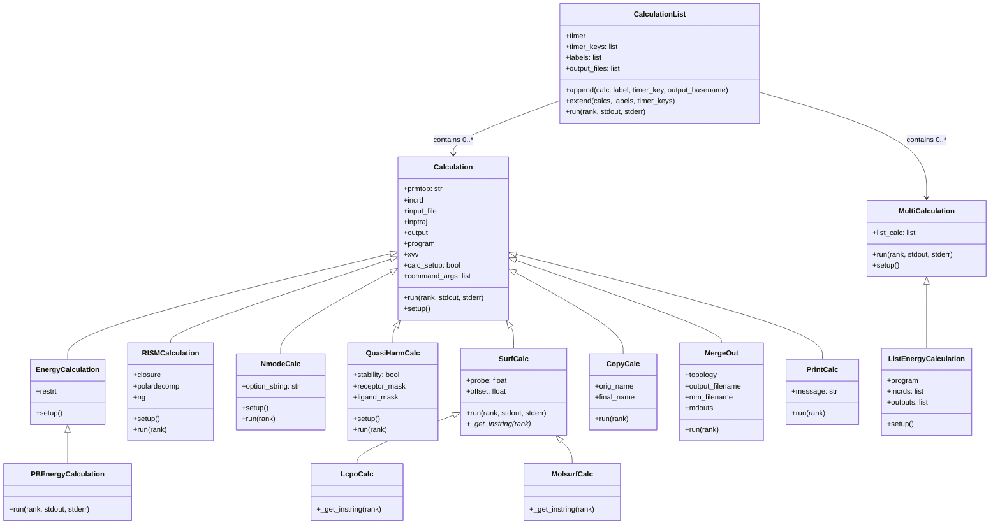
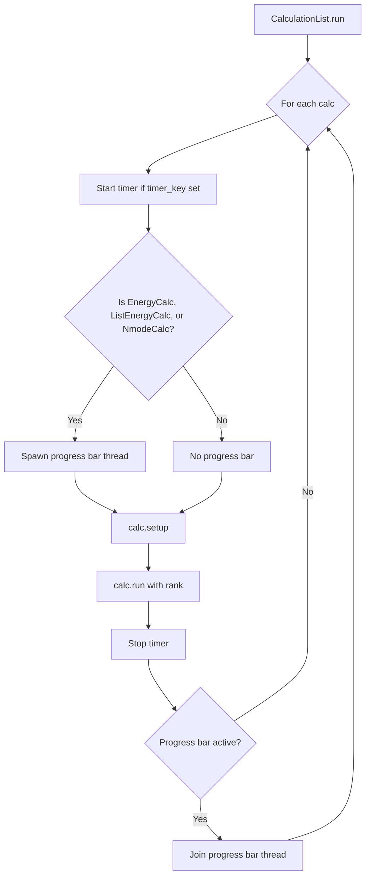
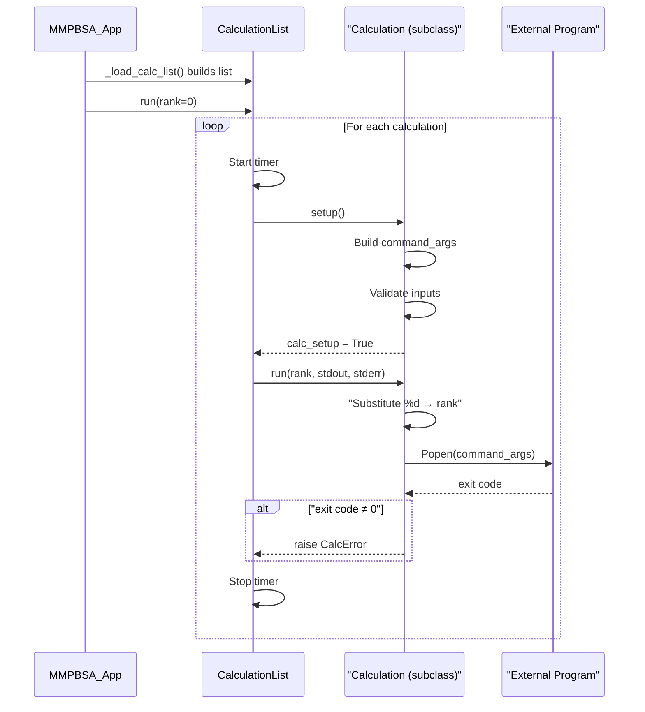

The energy calculation engine in gmx_MMPBSA is built around an object-oriented class hierarchy that maps each distinct computational method to a dedicated class. This design enforces a uniform **setup → run** lifecycle for every calculation type while allowing subclasses to specialize how they construct command-line arguments and handle external program I/O. Understanding this hierarchy is essential for anyone extending gmx_MMPBSA with new solvers, entropy methods, or custom post-processing steps.

## Architectural Overview

The calculation subsystem lives in a single module — [calculation.py](GMXMMPBSA/calculation.py) — and is orchestrated by the main application class [`MMPBSA_App`](GMXMMPBSA/main.py#L64) through its [`_load_calc_list`](GMXMMPBSA/main.py#L233) method. Every executable calculation is instantiated, appended to a `CalculationList`, and then executed sequentially by that list's [`run`](GMXMMPBSA/calculation.py#L114) method. The output parsing side is handled by a parallel hierarchy in [amber_outputs.py](GMXMMPBSA/amber_outputs.py), which is covered on the [Output Files Guide](4-output-files-guide) page.

The full inheritance diagram reveals three distinct layers: an **orchestration layer**, an **abstract execution layer**, and **concrete calculation classes**.

## The Two Base Classes: `Calculation` and `MultiCalculation`

Every executable calculation descends from one of two base classes. [`Calculation`](GMXMMPBSA/calculation.py#L218) represents a **single-process invocation** — it stores one `command_args` list and runs exactly one subprocess via `Popen`. [`MultiCalculation`](GMXMMPBSA/calculation.py#L151) represents a **batch of sequential subprocess calls** — it holds a `list_calc` list of argument arrays and iterates through them in its own `run` method. Both enforce the same two-phase contract:

1. **`setup()`** — builds the command-line argument list and validates inputs (e.g., checks that input files exist). Sets `self.calc_setup = True` on success.
2. **`run(rank, stdout, stderr)`** — guards against calling before `setup()`, performs `%d` → rank substitution in file paths, launches subprocesses, and raises `CalcError` on non-zero exit codes.

The `%d` substitution pattern is central to MPI parallelism: file paths containing `%d` are rewritten per-rank at runtime, allowing each MPI rank to operate on its own slice of trajectory frames without any explicit locking. This is detailed further on the [MPI Parallelism](18-mpi-parallelism) page.

Sources: [calculation.py](GMXMMPBSA/calculation.py#L218-L298), [calculation.py](GMXMMPBSA/calculation.py#L151-L216)

## The Orchestration Layer: `CalculationList`

[`CalculationList`](GMXMMPBSA/calculation.py#L88) extends Python's built-in `list` and acts as a **typed, annotated sequence** of calculations. Its [`append`](GMXMMPBSA/calculation.py#L99) method enforces that only instances of `Calculation` or `MultiCalculation` are accepted, and it tracks parallel metadata — timer keys for profiling, human-readable labels for logging, and output basename patterns for progress bar monitoring.

The [`run`](GMXMMPBSA/calculation.py#L114) method orchestrates the entire execution pipeline:

Progress bars are launched as daemon threads that poll output files for completion markers — the string `FINAL RESULTS` for energy calculations and `Total:` for nmode. This non-blocking design keeps the main thread free to manage subprocess execution and MPI coordination.

Sources: [calculation.py](GMXMMPBSA/calculation.py#L88-L149)

## Energy Calculation Branch

### `EnergyCalculation`

[`EnergyCalculation`](GMXMMPBSA/calculation.py#L300) is the workhorse class for all AMBER sander/mmpbsa_py_energy invocations. It extends `Calculation` with a `restrt` parameter (the AMBER restart file required by MPI builds of sander) and constructs a standard sander command-line in its [`setup`](GMXMMPBSA/calculation.py#L308) method: `-O -i -p -c -o -y -r -xvv`. The `-r` (restart) flag is critical — MPI sander *always* writes a restart file, and without rank-unique filenames, concurrent threads corrupt each other's output.

### `PBEnergyCalculation`

[`PBEnergyCalculation`](GMXMMPBSA/calculation.py#L572) inherits from `EnergyCalculation` but completely overrides the `run` method. Unlike the base class, which pipes stdout to a file, `PBEnergyCalculation` captures stdout via `PIPE` and parses it with a regex matching `pb (?:bomb)|(?:warning)` patterns. On failure, it extracts PBSA-specific error messages and forwards them to the user, providing far more actionable diagnostics than a generic exit code. This is the only subclass that performs **runtime output introspection**.

Sources: [calculation.py](GMXMMPBSA/calculation.py#L300-L332), [calculation.py](GMXMMPBSA/calculation.py#L572-L632)

### `ListEnergyCalculation`

[`ListEnergyCalculation`](GMXMMPBSA/calculation.py#L334) descends from `MultiCalculation` rather than `Calculation`. It accepts parallel arrays of coordinate files and output files, then builds one command-args list per coordinate in its [`setup`](GMXMMPBSA/calculation.py#L344) method. This is used when multiple coordinate snapshots must be processed through the same topology and input file — a pattern particularly relevant to GB-NSR6 decomposition calculations, where each frame's output can be very large and the `MultiCalculation.run` method automatically calls [`mdout2json`](GMXMMPBSA/utils.py#L829) to compress the results.

> [!TIP]
> The `MultiCalculation.run` method contains an implicit post-processing hook at [line 201](GMXMMPBSA/calculation.py#L201): after each subprocess completes, if the program name contains `gbnsr6`, it automatically calls `mdout2json()` to convert verbose decomposition output into compact JSON. This is the mechanism that keeps GB-NSR6 disk usage manageable.

Sources: [calculation.py](GMXMMPBSA/calculation.py#L334-L365)

## Entropy Calculation Branch

### `NmodeCalc`

[`NmodeCalc`](GMXMMPBSA/calculation.py#L482) computes entropy via the normal mode approximation using AMBER's `mmpbsa_py_nmode`. Its constructor builds an `option_string` from the input configuration, computing `kappa` from the ionic strength and selecting either constant (`diel=C`) or distance-dependent (`diel=R`) dielectric based on the `nmode_igb` flag. The command-line structure is notably different from `EnergyCalculation` — positional arguments rather than flagged options — reflecting that `mmpbsa_py_nmode` has its own CLI convention.

### `QuasiHarmCalc`

[`QuasiHarmCalc`](GMXMMPBSA/calculation.py#L519) implements quasi-harmonic entropy analysis using cpptraj. Its [`setup`](GMXMMPBSA/calculation.py#L534) method performs a **pre-calculation step**: it invokes cpptraj to generate an average PDB structure from the trajectory before running the actual quasi-harmonic analysis. The class also tracks a `stability` flag — when both receptor and ligand masks are empty, the system is treated as a stability calculation (no binding decomposition). Quasi-harmonic output is sufficiently non-standard that it has its own dedicated output class [`QHout`](GMXMMPBSA/amber_outputs.py#L361) that does *not* inherit from `AmberOutput`.

Sources: [calculation.py](GMXMMPBSA/calculation.py#L482-L570)

## Statistical Entropy: `InteractionEntropyCalc` and `C2EntropyCalc`

These two classes at [lines 761–870](GMXMMPBSA/calculation.py#L761-L870) are architecturally distinct from the rest of the hierarchy — they **do not inherit from `Calculation`** and do not launch any external subprocesses. Instead, they perform pure-Python computation on energy vectors already loaded into memory.

**[`InteractionEntropyCalc`](GMXMMPBSA/calculation.py#L761)** implements the Interaction Entropy (IE) method. It iterates through gas-phase energy frames, computing a running cumulative average and applying the Boltzmann-weighted exponential formula `−TΔS = kT · ln(⟨e^{ΔE_int/kT}⟩)`. The calculation uses the last N% of frames (controlled by `ie_segment`) for the final estimate. Importantly, it includes overflow protection: if the exponential overflows due to large energy fluctuations, the method gracefully logs a warning and disables IE for the remainder of the run.

**[`C2EntropyCalc`](GMXMMPBSA/calculation.py#L833)** computes the C2 entropy approximation using a much simpler formula: `C2 = σ²_ELEC / (2TR)`. It includes bootstrap-style uncertainty estimation via 2000 random resampling iterations with trimmed confidence intervals (discarding the top/bottom 5%).

Sources: [calculation.py](GMXMMPBSA/calculation.py#L761-L871)

## Surface Area Calculation Branch

[`SurfCalc`](GMXMMPBSA/calculation.py#L634) is the abstract base for solvent-accessible surface area computations using cpptraj. It defines a **Template Method pattern**: the base class handles subprocess management and rank substitution in [`run`](GMXMMPBSA/calculation.py#L649), while subclasses implement `_get_instring(rank)` to provide the specific cpptraj input script.

| Class | Method | Key Parameters |
|-------|--------|----------------|
| [`LcpoCalc`](GMXMMPBSA/calculation.py#L675) | `surf :*` | No probe/offset (uses LCPO analytical method) |
| [`MolsurfCalc`](GMXMMPBSA/calculation.py#L688) | `molsurf :*` | Configurable `probe` (default 1.4 Å) and `offset` (default 0.0) |

Both feed their cpptraj input via `stdin` (`PIPE`), not as files, making the surface area calculations fully self-contained per invocation. The results are parsed separately by the [`_get_cpptraj_surf`](GMXMMPBSA/amber_outputs.py#L1904) function in the output layer.

Sources: [calculation.py](GMXMMPBSA/calculation.py#L634-L700)

## Utility Calculation Classes

Three lightweight classes serve infrastructure roles within the calculation pipeline but inherit from `Calculation` to maintain list compatibility.

**[`CopyCalc`](GMXMMPBSA/calculation.py#L703)** handles file duplication for alanine scanning scenarios — when a mutation is in the receptor, the ligand energy files are identical and must be copied rather than recalculated. It performs rank substitution on both source and destination paths.

**[`MergeOut`](GMXMMPBSA/calculation.py#L729)** delegates to [`MergeGBNSR6Output`](GMXMMPBSA/calculation.py#L929) for consolidating GB-NSR6 decomposition output from multiple MPI ranks into a unified file. The merge class handles per-residue and pairwise decomposition formats.

**[`PrintCalc`](GMXMMPBSA/calculation.py#L746)** is the simplest class in the hierarchy — it prints a message to the log on rank 0 only. This allows the calculation pipeline to emit user-facing status messages at specific points without breaking the sequential execution model.

Sources: [calculation.py](GMXMMPBSA/calculation.py#L703-L759)

## Class Selection Matrix

The following table summarizes which class is instantiated for each user-configured calculation type, linking input configuration to runtime dispatch:

| Input Configuration | Calculation Class | External Program | Subprocess Method |
|---|---|---|---|
| `&gb` with `igb` (GB models) | `EnergyCalculation` | `mmpbsa_py_energy` | Single `Popen` |
| `&gb` with `igb=5` or `igb=6` | `PBEnergyCalculation` | `mmpbsa_py_energy` (PBSA) | Single `Popen` + stdout capture |
| `&gbnsr6` (GB-NSR6) | `ListEnergyCalculation` | `mmpbsa_py_energy` (GB-NSR6) | Batch `Popen` + JSON conversion |
| `&rism` | `RISMCalculation` | `rism3d.snglpnt` | Single `Popen` |
| `&nmode` | `NmodeCalc` | `mmpbsa_py_nmode` | Single `Popen` |
| `&qh` (quasi-harmonic) | `QuasiHarmCalc` | `cpptraj` (×2 passes) | Single `Popen` |
| `interaction_entropy = 1` | `InteractionEntropyCalc` | None (pure Python) | In-process |
| `c2_entropy = 1` | `C2EntropyCalc` | None (pure Python) | In-process |
| Surface area (default) | `LcpoCalc` | `cpptraj` | Single `Popen` via stdin |
| Surface area (`molsurf`) | `MolsurfCalc` | `cpptraj` | Single `Popen` via stdin |

> [!TIP]
> When adding a new calculation type, the `CalculationList.append` method at [line 101](GMXMMPBSA/calculation.py#L101) enforces that only `Calculation` or `MultiCalculation` subclasses are accepted. If your new calculation is a pure-Python computation (like `InteractionEntropyCalc`), it does not need to inherit from `Calculation` — but it also cannot be placed directly in the calculation list for sequential execution.

Sources: [calculation.py](GMXMMPBSA/calculation.py#L88-L112)

## How Calculations Are Dispatched

The [`_load_calc_list`](GMXMMPBSA/main.py#L233) method in `MMPBSA_App` is the central dispatch point. It examines the `INPUT` dictionary to determine which calculation types are requested, instantiates the appropriate classes with rank-parameterized file paths, and appends them to the `CalculationList` with labels and timer keys. The method is called once per MPI rank, and each rank receives the same calculation list — the `%d` substitution in file paths ensures that different ranks operate on different frames without any race conditions.

The complete lifecycle for a single calculation is therefore:

## Next Steps

This page covered the **execution-time** class hierarchy. To understand how the results of these calculations are parsed, stored, and turned into statistical summaries, continue to:

- **[GB and PB Solvers](10-gb-and-pb-solvers)** — details on how `EnergyCalculation` and `PBEnergyCalculation` configure solver-specific parameters
- **[Entropy Methods](11-entropy-methods)** — deeper treatment of `NmodeCalc`, `QuasiHarmCalc`, and the statistical entropy methods
- **[Decomposition Analysis](13-decomposition-analysis)** — how per-residue and pairwise decomposition integrate with the calculation pipeline
- **[MPI Parallelism](18-mpi-parallelism)** — how rank-based file substitution enables parallel frame processing