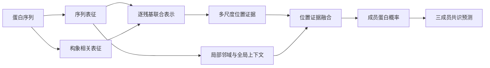

# PhaseLACE

**Local–global Augmentation with Consensus Ensembling**

PhaseLACE 是面向生物分子凝聚体研究的蛋白序列预测模型，用于识别液–液相分离（liquid–liquid phase separation，LLPS）相关蛋白，并提供序列内部的局部预测证据。它将预训练的序列与构象相关表征、可学习的邻域模式和全蛋白上下文结合起来，通过多成员共识输出蛋白级预测。

PhaseLACE 关注两个相互联系的问题：**哪些蛋白值得优先开展相分离实验，以及蛋白内部哪些片段值得进一步研究。** 蛋白级分数支持候选序列排序，局部分数支持无序区、低复杂度区及其他候选功能片段的分析。

- **联合表征：**同时利用蛋白语言模型提供的序列信息和构象预测模型提供的隐藏表示。
- **局部–全局建模：**用可学习的残基邻域特征结合全序列上下文，形成位置相关的判别证据。
- **多尺度共识：**在三个序列窗口上整合证据，再对三个独立训练成员的蛋白概率取平均。

本仓库提供模型定义、数据准备、训练、推理和评价源码。运行所需的数据、特征矩阵和权重由使用者单独提供；训练入口会生成可供推理的权重文件。

## 模型如何工作

PhaseLACE 从蛋白序列提取固定的逐残基表示，再训练下游预测器。整体流程如下：



**序列–构象编码。** ESM2-8M提供每个残基的320维序列表征；ALBATROSS的三个构象预测网络分别提供110维隐藏表示，组合为330维构象相关表征。拼接后的输入为 `[L,650]`，其中 `L` 是蛋白长度。

**多尺度位置证据。** 模型使用33、129、257 aa三个窗口进行边界校正的均值汇聚，并由共享的650→20→5→1网络产生位置分数。该分支首先训练，在后续残差学习阶段固定。

**局部–全局残差。** 局部分支将序列表征投影为64维，通过两层深度可分离卷积学习邻域模式；全局分支将全序列表示汇聚为32维上下文。两者在各尺度、各位置拼接，经96→20→1网络生成残差，以0.3的系数修正位置分数。残差输出层零初始化，使训练从已学习的多尺度证据出发。

**共识读出。** 每个成员在各尺度取位置最大值、转换为概率后平均；PhaseLACE再对三个成员的蛋白概率取等权平均。每个成员有42,377个可训练残差参数，下游预测器共55,508个参数。

扩展版本 **PhaseLACE-Fusion** 将三个增强成员与三个跨内层划分训练的多尺度证据成员等权融合。它与PhaseLACE共享模型组件，以六成员共识输出最终概率。

## 主要结果

蛋白级评价包含17,643条非人蛋白，其中375条LLPS相关正例、17,268条背景蛋白。正例合并自组装型与伙伴依赖型蛋白，形成统一的蛋白级判别任务。

| 模型 | AUROC | 完整背景AUPR | AP | 平衡抽样AUPR |
|---|---:|---:|---:|---:|
| PhaseLACE（三成员） | **0.834791** | 0.162194 | 0.168105 | 0.838702 |
| PhaseLACE-Fusion（六成员） | **0.837802** | 0.175487 | 0.181172 | 0.843276 |

在匹配三个成员、模型种子与数据划分的比较中，PhaseLACE相对多尺度基础预测器的AUROC提高**1.47个百分点**，平衡抽样AUPR提高**1.06个百分点**。

表中结果先在每个外层折内计算，再取五折均值。AUPR为PR曲线梯形积分，AP为average precision；平衡抽样与完整背景使用不同类别比例，分别报告。局部分数用于候选片段分析，区域评价有独立的标注和汇总流程。

## 安装

Python 3.10及以上：

```bash
python -m pip install -r requirements.txt
```

本实现的推理入口接收已经提取的逐残基特征矩阵。[数据与编码资源](#数据与编码资源)提供从序列生成NPY文件的示例。

## 预测一个蛋白

准备 `embeddings/protein.npy` 和同一外层折的三个成员权重，然后运行：

```bash
python predict.py --features embeddings/protein.npy \
  --checkpoints member1.pt member2.pt member3.pt --output prediction.json
```

输入矩阵为float32的 `[L,650]`，通道次序为：ESM2-8M第6层320维，随后是ALBATROSS的asphericity、scaled radius of gyration、scaled end-to-end distance隐藏表示各110维。

输出JSON包含蛋白级预测分数 `probability`、各成员分数 `member_probabilities`、与序列等长的33 aa局部分数均值 `residue_33aa_mean`。权重支持训练脚本导出的 `inference.pt` 或兼容的外部 `safetensors` 文件。

使用Fusion时，另传 `--baseline-checkpoints base1.pt base2.pt base3.pt`。这三个权重来自同一外层折、不同内层划分的多尺度证据模型。局部分数均值用于描述性分析；论文区域结果按单成员和指定折汇总协议评价。

## 数据准备与训练

准备包含以下字段的CSV：

| 字段 | 含义 |
|---|---|
| `feature_file` | 相对于特征目录的NPY文件路径 |
| `accession` | 蛋白标识 |
| `label` | 0/1背景或LLPS相关蛋白标签 |
| `category` | 原数据来源类别，用于内层分层 |
| `sequence_sha256` | 输入氨基酸序列的SHA-256 |
| `fold`、`original_row` | 可选的固定外层折与原始行标识 |

未提供 `fold` 时，采用 `KFold(5, shuffle=True, random_state=711016)`。复现上述结果时，应使用相同的数据成员、类别和外层划分。

```bash
python prepare_data.py --table metadata.csv --features-dir embeddings --output cache

# 阶段一：训练多尺度位置证据分支
python train.py --stage baseline --cache cache/pooled --output runs/base --device cuda:0

# 阶段二：固定证据分支，训练局部–全局残差成员
python train.py --stage phaselace --cache cache/raw --baseline-root runs/base \
  --output runs/phaselace --device cuda:0
```

默认使用模型种子711016、711017、711018，内层划分种子20260904和五个外层折。训练采用Adam，初始学习率0.003、最多80轮；内层训练按1:1循环采样背景，完整覆盖背景后按内层AP选模，patience=8、min_delta=0.002。恢复时在同一命令后添加 `--resume`。

每个训练任务输出 `best.pt`、`last.pt` 和用于推理的纯张量 `inference.pt`。准备缓存前会检查磁盘空间，训练期间保存状态和恢复信息。

训练Fusion的额外成员时，固定模型种子711016，分别使用内层种子20260916、20260917、20260918和独立输出目录。例如：

```bash
python train.py --stage baseline --cache cache/pooled --seeds 711016 \
  --inner-seed 20260916 --output runs/inner20260916 --device cuda:0
```

## 评价

```bash
python evaluate.py --predictions "runs/phaselace/*/outer_predictions.csv" \
  --members 3 --output metrics.json
```

脚本展开通配符，校验成员的样本身份和覆盖，平均成员概率后计算各折指标。输入CSV需含 `row,label,probability,fold`；没有fold列时，提供 `--index cache/raw/train_index.csv`。Fusion传入三组增强成员和三组跨内层划分证据成员的预测，设 `--members 6`。

评价报告AUROC、AUPR、AP、Brier，以及100次平衡抽样的折均值。每次每类无放回抽取少数类样本数的80%，种子为2026091600+fold。模型选择使用内层AP，外层预测用于最终评价。

局部区域评价：

```bash
python evaluate_regions.py --scores local_scores.npy --annotations intervals.json \
  --coordinate-mode author --output region_metrics.json
```

`local_scores.npy`为一维33 aa局部概率；注释为1-based闭区间列表，如 `[[10,30],[70,90]]`。`author`兼容既有评价代码的 `mask[start:end]`，`standard`采用 `mask[start-1:end]`作坐标敏感性分析。两种结果分别报告；未注释位置作为注释比较背景。

## 代码文件

| 文件 | 内容 |
|---|---|
| `model.py` | PhaseLACE模型组件与前向计算 |
| `train.py`、`protocol.py`、`utils.py` | 训练流程、划分、采样、状态与恢复 |
| `prepare_data.py` | 特征矩阵与训练缓存准备 |
| `predict.py` | 三成员或Fusion推理 |
| `evaluate.py`、`evaluate_regions.py` | 蛋白与局部区域评价 |

## 数据与编码资源

序列编码使用 [ESM](https://github.com/facebookresearch/esm)，构象相关编码使用 [ALBATROSS / Sparrow](https://github.com/idptools/sparrow)。本研究使用的联合特征提取方式与蛋白级数据视图沿用 [PSTP论文代码仓库](https://github.com/Morvan98/paper_code_PSTP)；其原始输入和缓存用于上述固定数据评价。

先按[特征提取软件的安装说明](https://github.com/Morvan98/PSTP#python-requirements)准备编码器兼容环境，再从氨基酸序列生成矩阵。该环境可与本仓库的训练环境分开，生成的NPY文件用于后续数据准备或推理。

```python
from pathlib import Path
import numpy as np
from pstp.pstp_collections import pstp_embedding_by_batch

# 示例序列用于演示文件生成；实际使用时替换为待研究蛋白。
sequences = ["ACDEFGHIKLMNPQRSTVWY"]
matrices = pstp_embedding_by_batch(sequences)
Path("embeddings").mkdir(exist_ok=True)
np.save("embeddings/protein.npy", np.asarray(matrices[0], dtype=np.float32))
```

局部区域注释来源为 [PhaSePro](https://phasepro.elte.hu/)。请保留输入序列、构建体边界和坐标约定，以对应蛋白级与区域级评价。

## 许可与引用

MIT许可及上游署名见 `LICENSE`。PhaseLACE的多尺度证据路径沿用PSTP的读出定义；本模型的局部–全局残差路径和多成员共识在这一联合表征基础上完成LLPS判别。外部数据与编码器依其原始条款获取。

- 序列–构象相分离预测基础：Feng et al., *Briefings in Bioinformatics* (2025), [10.1093/bib/bbaf171](https://doi.org/10.1093/bib/bbaf171).
- 蛋白语言模型：Lin et al., *Science* (2023), [10.1126/science.ade2574](https://doi.org/10.1126/science.ade2574).
- 构象预测模型：Lotthammer et al., *Nature Methods* (2024), [10.1038/s41592-023-02159-5](https://doi.org/10.1038/s41592-023-02159-5).
- 区域注释：Mészáros et al., *Nucleic Acids Research* (2020), [10.1093/nar/gkz848](https://doi.org/10.1093/nar/gkz848).
