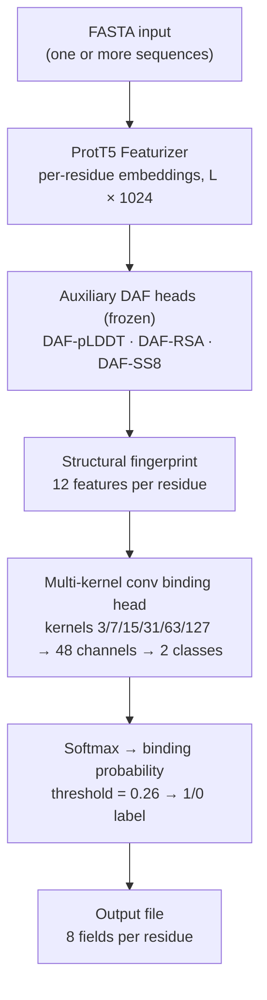

DARUMA-binding is a machine-learning tool that identifies **binding sites within intrinsically disordered regions (IDRs)** of proteins. IDRs are stretches of a protein that do not fold into a rigid 3D structure — yet many of them carry out important work by *binding* to other molecules. Instead of predicting a whole-protein structure, DARUMA-binding works at the **residue level**: for every amino acid in your input sequence, it answers the question *"how likely is this single amino acid to participate in binding?"*

This page gives you a beginner-friendly map of the entire repository: what the tool produces, how the pieces fit together architecturally, the two ways to run it, and where the datasets live. No prior knowledge of deep learning is assumed — deeper technical pages are linked at the end.

Sources: [README.md](README.md#L1-L3), [caid/DARUMA-binding/README.md](caid/DARUMA-binding/README.md#L1-L8)

## What DARUMA-binding Predicts

You provide a **FASTA file** (the standard text format for amino acid sequences, e.g. `>protein1 / MEKVYQ...`), containing one or more sequences. For each sequence, DARUMA-binding writes an output file with eight pieces of per-residue information:

| # | Output field | What it means for a beginner |
|---|---|---|
| 1 | Accession / FASTA header | The name of the protein you submitted |
| 2 | Amino acid sequence | The sequence itself, echoed back |
| 3 | Binding probability | A number between 0 and 1 per residue — higher means more likely to bind |
| 4 | Binary binding prediction | The probability converted to `1` (binding) or `0` (non-binding) using a fixed **threshold of 0.26** |
| 5 | Predicted pLDDT | A per-residue confidence-like structural score (a concept borrowed from AlphaFold) |
| 6 | Predicted RSA | Relative solvent accessibility — how "exposed" each residue is |
| 7 | Predicted SS3 | Three-state secondary structure: `H` (helix), `S` (strand), `C` (coil) |
| 8 | Predicted SS8 | A finer, eight-state secondary structure classification |

Fields 5–8 are "bonus" structural predictions that the model computes internally as intermediate features — they are included in the output so you can inspect them. The full output format is documented step-by-step in [Output Format Reference](3-output-format-reference).

Sources: [README.md](README.md#L26-L53)

## How It Works at a Glance

Internally, DARUMA-binding is a small ensemble of **1-D convolutional neural networks** operating on protein language model embeddings. The big picture:

1. **Featurization** — Each input sequence is converted into per-residue vectors using **ProtT5** (`Rostlab/prot_t5_xl_half_uniref50-enc`), a pre-trained protein language model. Every amino acid becomes a 1024-dimensional numeric vector.
2. **Auxiliary feature extraction** — Three frozen ("DAF") sub-networks predict pLDDT, RSA, and 8-state secondary structure from those embeddings, compressing them into a compact **12-feature-per-residue** structural fingerprint.
3. **Binding head** — A **multi-kernel convolutional module** scans that fingerprint at six different window sizes (kernels of width 3, 7, 15, 31, 63, and 127 residues) and produces a final two-class score per residue: binding vs. non-binding.
4. **Decision** — The score becomes a probability via softmax; probabilities ≥ **0.26** are labeled as binding residues.
5. **Output** — A result writer records everything into your output file, one line per residue.



The command-line entry point `src/daruma_binding/predict.py` wires these stages together: it reads the FASTA, builds the featurizer on your chosen device (CPU or GPU), loads the trained weights (`daruma_binding_weight.pth`), runs each sequence, and streams results to disk.

Sources: [src/daruma_binding/predict.py](src/daruma_binding/predict.py#L54-L71), [src/daruma_binding/backend/models.py](src/daruma_binding/backend/models.py#L136-L187), [caid/DARUMA-binding/README.md](caid/DARUMA-binding/README.md#L10-L25), [README.md](README.md#L29-L30)

> [!TIP]
> The auxiliary DAF heads run under `torch.no_grad()` inside the binding head — they are treated as a fixed, pre-trained feature extractor, not as trainable parts of the final model. This is why their predictions can safely be exported as extra outputs.

## Two Ways to Run DARUMA-binding

The same predictive core is packaged in **two delivery modes**, aimed at different audiences:

| Aspect | Native CLI (`src/`) | CAID 4 Docker (`caid/`) |
|---|---|---|
| Who it's for | Developers running predictions locally | CAID 4 benchmark participants |
| Input | FASTA file only — ProtT5 embedding is generated automatically inside the pipeline | FASTA file **plus** a precomputed ProtT5 embedding (NumPy `.npy`, shape `L × 1024`) |
| Command style | `python src/daruma_binding/predict.py -i input.fasta -o output.txt -d cpu` | `docker run` with `--fasta`, `--embeddings`, `--output`, `--device` flags |
| Output format | Full 8-field per-residue report | Compact CAID format: `position · residue · probability · binary` |
| Sample assets | `examples/example.fasta` + `examples/predict_example.sh` | `caid/DARUMA-binding/sample_data/` (DP03914 fasta + npy + expected caid output) |

The native mode is the recommended starting point for beginners because the language model embedding step is handled for you. Docker mode exists specifically because the CAID community experiment requires standardized, containerized submissions with embeddings supplied externally.

Sources: [src/daruma_binding/predict.py](src/daruma_binding/predict.py#L31-L36), [examples/README.md](examples/README.md#L3-L7), [examples/predict_example.sh](examples/predict_example.sh#L1-L4), [caid/DARUMA-binding/README.md](caid/DARUMA-binding/README.md#L10-L41), [caid/DARUMA-binding/README.md](caid/DARUMA-binding/README.md#L44-L52)

## Repository Map

The repository is organized into five top-level areas, each with a distinct role:

```
DARUMA-binding/
├── src/daruma_binding/      ← Core prediction package
│   ├── predict.py           ← CLI entry point
│   └── backend/             ← Model definitions + trained weights (.pth)
├── examples/                ← Minimal runnable example (fasta + shell script)
├── caid/DARUMA-binding/     ← CAID 4 Docker submission (self-contained copy)
├── data/                    ← Validation & test datasets (training data lives on Zenodo)
├── reproduction/            ← Scripts that regenerate the paper's figures & tables
├── requirements.txt         ← Python dependencies (PyTorch installed separately)
├── LICENSE
└── README.md
```

| Directory | Purpose | Key contents |
|---|---|---|
| `src/daruma_binding/` | Inference source code | `predict.py` CLI, `backend/models.py` (architecture), `backend/model_weights/daruma_binding_weight.pth` (trained weights), `backend/functions.py` (FASTA reading, featurizing, result writing) |
| `examples/` | Your first run | `example.fasta`, `predict_example.sh` |
| `data/` | Evaluation datasets | `training/`, `validation/`, `test/` subfolders |
| `reproduction/` | Paper reproducibility | `scripts/figure_2.py` … `figure_4.py`, `table_1.py` … plus processed `results/caid2/`, `results/caid3/`, `results/occlusion_analysis/` |
| `caid/DARUMA-binding/` | Docker image source | `Dockerfile`, `run_example_docker.sh`, `sample_data/` |

Sources: [README.md](README.md#L67-L74), [src/daruma_binding/predict.py](src/daruma_binding/predict.py#L27-L28), [examples/README.md](examples/README.md#L1-L13), [data/README.md](data/README.md#L3-L31), [reproduction/README.md](reproduction/README.md#L1-L2)

## Datasets and Benchmarks at a Glance

The data story splits into two tiers — everything needed to *evaluate* the model is in this repository, while the large *training* corpus is archived externally:

- **Training data** (`data/training/train_binding.txt` plus companion files for the DAF models): the full-scale training corpora are hosted on **Zenodo** (DOI `10.5281/zenodo.24127965`), keeping the repository lightweight.
- **Validation data** (`data/validation/`): paired `val_binding.txt`, `val_plddt.txt`, `val_rsa.txt`, `val_ss.txt` files used during model development.
- **Test data** (`data/test/`): three blind benchmark sequence sets obtained from the CAID Web Portal — **CAID 2 Binding**, **CAID 3 Binding**, and **CAID 3 Binding-IDR**.
- **Processed results** (`reproduction/results/`): ready-made prediction outputs (`caid2_DARUMA-binding.caid`, `caid3_DARUMA-binding.caid`, per-protein occlusion CSVs) so you can regenerate every figure and table of the paper without re-running inference.

The archived manuscript version itself is also on Zenodo (DOI `10.5281/zenodo.24133355`), and a hosted **web server** implementation is available at `https://antepontem.org/daruma_binding/` if you want to try predictions without installing anything.

Sources: [data/README.md](data/README.md#L9-L31), [README.md](README.md#L57-L62), [README.md](README.md#L77-L93), [get_repo_structure: reproduction/results](reproduction/results)

## Environment and Installation Requirements

DARUMA-binding is a Python 3 tool with a deliberately minimal dependency set — the only heavy requirement is **PyTorch, which you must install separately** so it matches your operating system, GPU, and CUDA version. After that, `pip install -r requirements.txt` pulls in NumPy, HuggingFace Transformers, SentencePiece, scikit-learn, SciPy, and Matplotlib. The environment officially validated by the authors is:

| Component | Version |
|---|---|
| OS | Ubuntu 18.04.5 LTS |
| Python | 3.10.19 |
| PyTorch | 1.12.1+cu102 |
| CUDA | 10.2 |
| transformers (ProtT5) | 4.30.2 |
| numpy | 1.26.4 |

Sources: [README.md](README.md#L10-L24), [README.md](README.md#L96-L101), [requirements.txt](requirements.txt#L1-L7)

## Where to Go Next

This repository follows a learn-by-doing path, and the documentation catalog mirrors it. A recommended reading order:

1. **[Quick Start](2-quick-start)** — install the dependencies and run your first prediction in minutes using `examples/predict_example.sh`.
2. **[Output Format Reference](3-output-format-reference)** — decode each column of the output file you just produced.
3. **[Docker and CAID Usage](4-docker-and-caid-usage)** — if you're participating in CAID 4, switch to the containerized workflow with precomputed embeddings.
4. **[Prediction Pipeline Architecture](5-prediction-pipeline-architecture)** — then descend into the architecture: the convolutional backbone ([FEU and PU](6-convolutional-backbone-feu-and-pu)), the [auxiliary structural feature heads](7-auxiliary-structural-feature-heads), and the [multi-kernel binding head](8-multi-kernel-conv-binding-head).
5. **[ProtT5 Embedding Chunking Strategy](9-prott5-embedding-chunking-strategy)** and **[Inference Orchestration and Decision Threshold](10-inference-orchestration-and-decision-threshold)** — how long sequences are handled and how the 0.26 cutoff is applied.
6. Finally, the evaluation side: [CAID Benchmark Datasets](11-caid-benchmark-datasets), [Training Data and Zenodo Archive](12-training-data-and-zenodo-archive), [Reproducing Paper Figures and Tables](13-reproducing-paper-figures-and-tables), [Evaluation Metrics: AUC, APS, Fmax](14-evaluation-metrics-auc-aps-fmax), and [Occlusion-Based Feature Attribution](15-occlusion-based-feature-attribution).

If you want to see the tool without any local setup at all, the public web server (`https://antepontem.org/daruma_binding/`) offers the same predictions through a browser.

Sources: [README.md](README.md#L26-L41), [README.md](README.md#L85-L88), [examples/predict_example.sh](examples/predict_example.sh#L1-L4)

> [!TIP]
> The trained weights ship *inside* the repository (`backend/model_weights/daruma_binding_weight.pth`) — you don't download anything extra to run inference. Only the large training corpora require the Zenodo archive, which keeps the clone-and-run experience fast.