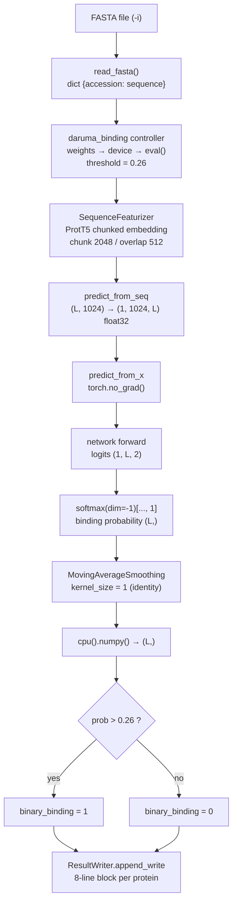
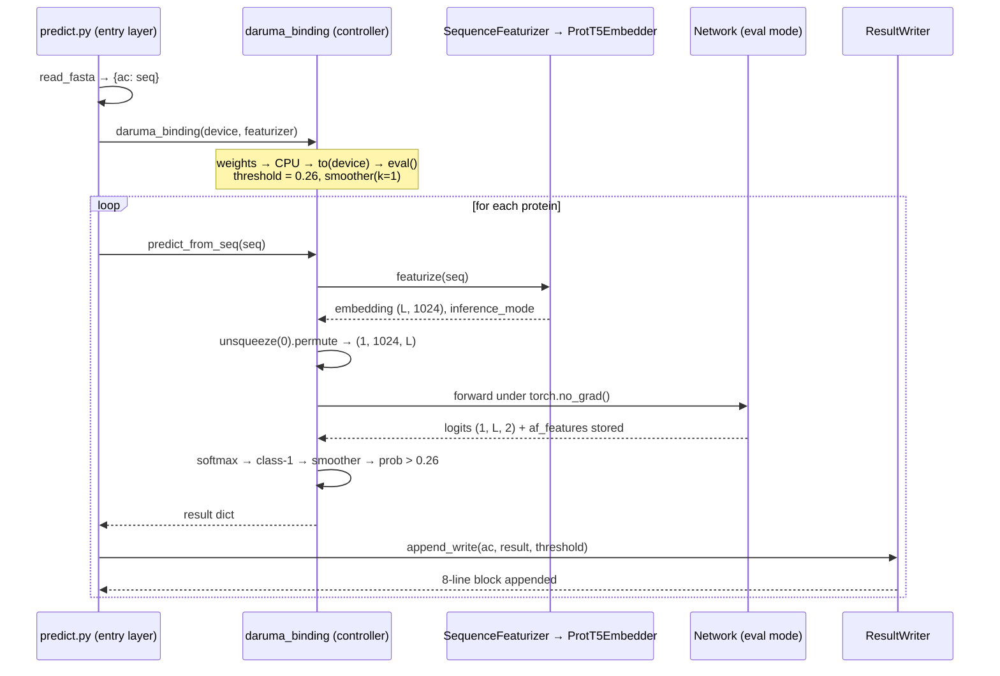
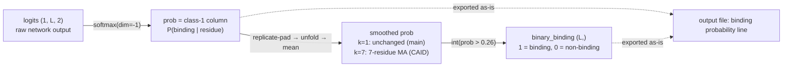

This page explains how DARUMA-binding turns a trained network into a per-residue prediction workflow: how sequences flow through the featurizer and the model controller, how raw logits become binding probabilities, and how those probabilities are binarized at the decision threshold of **0.26**. It covers the orchestration layers shared by the main package (`src/daruma_binding/`) and the CAID 4 submission (`caid/DARUMA-binding/`), including the one deliberate behavioral difference between them. Model internals (FEU/PU blocks, the multi-kernel conv head) are out of scope here — see [Convolutional Backbone: FEU and PU](6-convolutional-backbone-feu-and-pu) and [Multi-Kernel Conv Binding Head](8-multi-kernel-conv-binding-head).

Sources: [predict.py](src/daruma_binding/predict.py#L1-L17), [README.md](README.md#L22-L37)

## Three Orchestration Layers

Inference is organized into three cooperating layers with a clean separation of concerns. The **entry layer** (`predict.py`) resolves the compute device, reads the FASTA file into an accession→sequence dictionary, and iterates over proteins one at a time. The **controller layer** (`daruma_binding` class in `models.py`) owns the decision policy — the threshold and the probability smoother — and exposes two prediction entry points: `predict_from_seq(seq)` for raw sequences and `predict_from_x(x)` for pre-computed embeddings. The **featurization layer** (`SequenceFeaturizer` wrapping `ProtT5Embedder`) converts a sequence string into a `(L, 1024)` ProtT5 embedding using chunked inference with 2048-residue windows and 512-residue overlap.

Note that the featurizer is injected into the controller at construction time (`daruma_binding(device, featurizer=featurizer)`); the entry script never calls it directly. This injection pattern is what allows the CAID submission to reuse the identical controller with externally pre-computed `.npy` embeddings instead of raw sequences.

Sources: [predict.py](src/daruma_binding/predict.py#L44-L71), [models.py](src/daruma_binding/backend/models.py#L191-L257), [functions.py](src/daruma_binding/backend/functions.py#L123-L133), [functions.py](src/daruma_binding/backend/functions.py#L27-L42)

## Per-Protein Execution Sequence

The runtime interaction between the four participants follows a strict sequence. Weights are loaded to CPU first (`_load_weights_to_cpu` with `map_location='cpu'`) and then moved to the target device — a portable loading order that works regardless of the machine that trained the checkpoint. The controller sets the network to `eval()` mode, and both gradient-suppression mechanisms are used deliberately: `torch.inference_mode()` inside the ProtT5 embedder's chunk loop and `torch.no_grad()` around the entire `predict_from_x` call.

The orchestration contract is a strict **per-residue alignment**: a sequence of L residues produces exactly L probabilities and L binary predictions, because the network's internal padding and kernel geometry preserve sequence length. The controller guarantees the input cast to `float32` (ProtT5 embeddings are produced in half precision on GPU), and `predict_from_seq` additionally guards against a missing featurizer by raising a `ValueError` before any tensor work begins.

Sources: [models.py](src/daruma_binding/backend/models.py#L191-L203), [models.py](src/daruma_binding/backend/models.py#L245-L257), [functions.py](src/daruma_binding/backend/functions.py#L61-L117), [predict.py](src/daruma_binding/predict.py#L60-L71)

## From Logits to Binding Probability

The network emits two raw scores per residue with shape `(1, L, 2)`. The controller converts these to a probability via the shared `logit_to_prob` static method: `torch.softmax(logits, dim=-1)[..., 1]` — applying softmax across the two classes, then selecting the class-1 column, which corresponds to the *binding* state. The result is a length-L tensor where each element is P(binding | residue).

A subtle but important point for reproducibility: the softmax is applied **inside** `predict_from_x` after the forward pass, so the value written to output files is always a properly normalized probability, not a raw logit. This makes the downstream threshold comparison meaningful in absolute terms and lets downstream consumers compare probabilities against 0.26 without needing access to the model's score calibration.

Sources: [models.py](src/daruma_binding/backend/models.py#L77-L79), [models.py](src/daruma_binding/backend/models.py#L222-L228)

## Probability Smoothing: Identity by Default, Active in CAID

Both orchestration variants route the probability curve through a `MovingAverageSmoothing` object before thresholding, but with different kernel sizes. The smoother replicate-pads the sequence (preserving boundary values), unfolds it into overlapping windows via `tensor.unfold`, and averages each window. In the main package the smoother is instantiated with `kernel_size=1` — a mathematical identity, effectively disabling smoothing (the code comment reads "No smoothing for now"). The CAID submission ships with `kernel_size=7`, producing a 7-residue moving average that dampens isolated probability spikes before binarization.

This is the only behavioral divergence between the two shipped orchestration paths: probabilities published by the standalone package are raw network outputs, while CAID benchmark outputs are smoothed. Note that the raw (unsmoothed) probabilities are exported either way — smoothing affects only the binary line of the output, not the float probability line.

Sources: [models.py](src/daruma_binding/backend/models.py#L24-L32), [models.py](src/daruma_binding/backend/models.py#L198-L200), [models.py](caid/DARUMA-binding/daruma_binding/backend/models.py#L23-L32), [models.py](caid/DARUMA-binding/daruma_binding/backend/models.py#L193-L194)

## The Decision Threshold: 0.26

The decision threshold is the constant `self.threshold = 0.26`, annotated in the source with its provenance: *"The threshold of 0.26 is used, which maximizes the F1 score on the validation data."* It was therefore not chosen arbitrarily but tuned on the validation split (see [Training Data and Zenodo Archive](12-training-data-and-zenodo-archive) and [Evaluation Metrics: AUC, APS, Fmax](14-evaluation-metrics-auc-aps-fmax) for how F1-based selection interacts with the other reported metrics). The README confirms this value as the user-facing contract for the binary output line.

Binarization is applied at the **probability level, after smoothing**, using a **strict greater-than** comparison: `(prob > self.threshold).astype(int)`. A residue with probability exactly 0.260000 is classified as non-binding. The threshold is hard-coded in the controller class — neither entry point exposes it as a CLI argument — so tuning it requires editing `models.py` directly. For traceability, the threshold value is not silent: `ResultWriter` embeds it into the output file's comment header (`# Line4. ... threshold=0.26`), so every prediction file documents the exact rule used to derive its binary line.

| Call site | Expression | Binary dtype |
|---|---|---|
| Main package, `predict_from_x` | `(prob > self.threshold).astype(int)` | `int` |
| CAID controller, `predict_from_x` | `(prob > self.threshold).float()` | `float` |
| CAID entry script, output loop | `1 if p > model.threshold else 0` | `int` |

All three sites use the same strict `>` semantics, so a probability of exactly 0.26 is non-binding everywhere. The CAID entry script re-applies the threshold per residue when writing output (its `predict_from_x` returns a `(prob, pred)` tuple, and the writer recomputes the flag from `model.threshold`), keeping the controller and the file format in lockstep even if one is modified.

> [!TIP]
> The threshold lives in exactly one place per package — `models.py` (line 198 in `src/`, line 193 in `caid/`) — and is intentionally not CLI-configurable. If you adjust it, regenerate output files: the `ResultWriter` header stamps the threshold it was constructed with, so stale files expose stale thresholds, which is precisely what makes the header a useful audit trail.

Sources: [models.py](src/daruma_binding/backend/models.py#L198), [models.py](src/daruma_binding/backend/models.py#L229), [models.py](caid/DARUMA-binding/daruma_binding/backend/models.py#L196-L204), [predict.py](caid/DARUMA-binding/daruma_binding/predict.py#L96-L103), [functions.py](src/daruma_binding/backend/functions.py#L136-L147), [README.md](README.md#L52)

## Side-Channel Feature Extraction

Because the binding head consumes predicted structural features internally (see [Auxiliary Structural Feature Heads](7-auxiliary-structural-feature-heads)), the same forward pass that produces binding logits also produces the 12-channel feature tensor. When the network is constructed with `return_af_features=True`, its `forward()` stores the detached features on `self.af_features` — requiring gradients so that occlusion-based attribution can flow through them later. The controller then *reads back* this attribute after the forward call, slicing channels into interpretable outputs and scaling them into human-usable units.

| Feature | Channel slice | Post-processing |
|---|---|---|
| pLDDT | channel 0 (`plddt`) | × 100 to map to the 0–100 scale |
| RSA | channel 3 (`rsa`) | exported as-is |
| SS8 | channels 4–11 | argmax → one of 8 letters via `q8_to_char` |
| SS3 | helix = Σ channels 4–6, sheet = Σ channels 7–8, coil = Σ channels 9–12 | argmax → `H`/`S`/`C` via `q3_to_char` |

The channel ordering matches the documented `af_list` in the network (`plddt, 1-plddt, 1-rsa, rsa, ss0…ss7`), and the SS3 aggregation follows the standard collapse of eight DSSP states into three (the three helix states fold into `H`, `E`+`B` into `S`, the rest into `C`). The full result dictionary — `binding`, `binary_binding`, `plddt`, `rsa`, `ss8`, `ss3`, plus `seq` and the decoded `ss3_str`/`ss8_str` strings added by `predict_from_seq` — is what `ResultWriter` serializes into the eight-line-per-protein output block described in [Output Format Reference](3-output-format-reference).

> [!TIP]
> `predict_from_x` is stateful with respect to the last forward pass: it reads `self.model.af_features` populated during `forward()`, never as a return value. If you batch multiple sequences or reuse the controller, always consume the result dict immediately after each `predict_from_x` call — the side channel is overwritten on the next forward and `get_af_features()` will silently return features from the previous protein.

Sources: [models.py](src/daruma_binding/backend/models.py#L156-L181), [models.py](src/daruma_binding/backend/models.py#L170-L171), [models.py](src/daruma_binding/backend/models.py#L222-L257), [models.py](src/daruma_binding/backend/models.py#L205-L220)

## Main Package vs. CAID Submission: Orchestration Variants

The two shipped orchestration paths wrap the same controller logic but diverge in input mode, output contract, and smoothing policy. Understanding this table clarifies which artifacts in `reproduction/` were generated under which smoothing regime (see [Reproducing Paper Figures and Tables](13-reproducing-paper-figures-and-tables)).

| Property | Main package (`src/`) | CAID 4 submission (`caid/`) |
|---|---|---|
| Input mode | FASTA + built-in ProtT5 featurizer | Pre-computed `.npy` ProtT5 vectors |
| Featurizer | Injected, required | Absent (embeddings loaded directly) |
| Threshold | 0.26 | 0.26 |
| Smoother kernel | 1 (identity — disabled) | 7 (active moving average) |
| `predict_from_x` return | Result dict (6 keys) | Tuple `(prob, pred)` |
| Binary dtype | `int` | `float` |
| Batch handling | Loop over FASTA dict, per-protein | Single protein per invocation |
| Device default | GPU `0`, CPU fallback | `cpu`, CUDA opt-in |
| Threading | Library defaults | OMP/MKL pinned to 8, interop = 1 |
| Length validation | Implicit | Explicit `ValueError` (FASTA vs. `.npy` mismatch) |
| Output format | 8-line block per protein | 4 columns per residue (CAID style) |

The CAID variant's design constraints are visible in its entry script: thread counts are pinned before `torch` is imported for deterministic resource usage in the benchmark harness, the embedding tensor is validated against the optional FASTA sequence length, and a dash placeholder sequence is synthesized if no FASTA is supplied (so the residue column can still be written). These are benchmark-environment concerns rather than changes to the decision policy — the softmax → smooth → threshold sequence is identical in both variants.

Sources: [models.py](caid/DARUMA-binding/daruma_binding/backend/models.py#L186-L204), [predict.py](caid/DARUMA-binding/daruma_binding/predict.py#L26-L37), [predict.py](caid/DARUMA-binding/daruma_binding/predict.py#L70-L103), [predict.py](src/daruma_binding/predict.py#L31-L71)

## Where to Go Next

To understand how the ProtT5 embeddings feeding this pipeline are produced under GPU memory constraints, continue with [ProtT5 Embedding Chunking Strategy](9-prott5-embedding-chunking-strategy). For the exact serialization of the result dictionary into files, see [Output Format Reference](3-output-format-reference). To understand why 0.26 optimizes F1 and how that trade-off appears against AUC and APS, read [Evaluation Metrics: AUC, APS, Fmax](14-evaluation-metrics-auc-aps-fmax). Finally, the gradient-enabled `af_features` side channel described above is the foundation for [Occlusion-Based Feature Attribution](15-occlusion-based-feature-attribution).