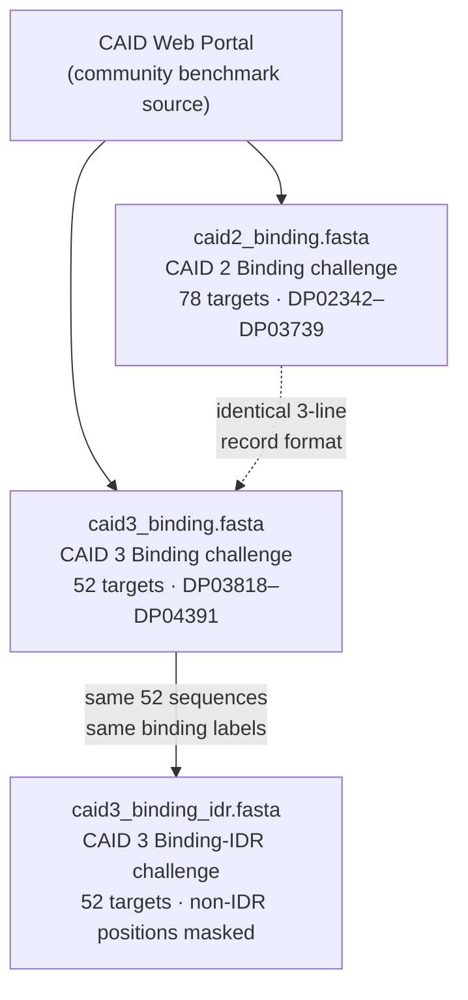
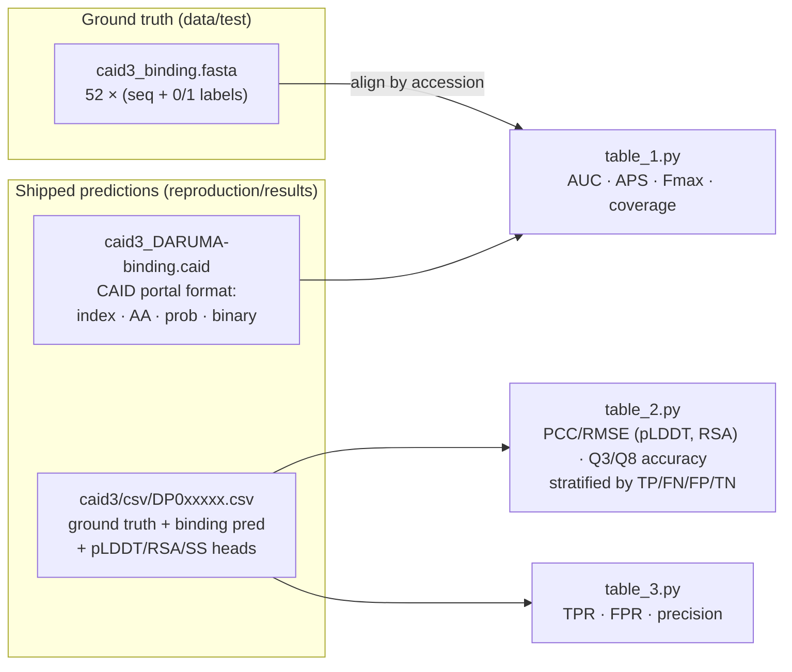

This page explains the three community-benchmark test sets under `data/test/` — their file format, the semantic difference between the Binding and Binding-IDR challenges, and how they flow into the evaluation scripts that reproduce the manuscript's headline numbers. These files are the *scoring instruments* of the repository: everything the model claims about binding-region prediction is measured against them. They are deliberately kept separate from training and validation data, whose provenance is covered in [Training Data and Zenodo Archive](12-training-data-and-zenodo-archive).

## The Three Benchmark Sets at a Glance

CAID (Critical Assessment of protein Intrinsic Disorder prediction) is a community-run evaluation in which predictors submit outputs for a fixed target set via the CAID Web Portal; the repository's README confirms all three test files were obtained from that portal. The repo ships one file per challenge edition: CAID 2's Binding challenge, CAID 3's Binding challenge, and CAID 3's Binding-IDR challenge. Each file follows the same underlying record format, which makes them directly interchangeable as scoring targets.

| File | Challenge | Targets | Record format | Role in repo |
|---|---|---|---|---|
| `caid2_binding.fasta` | CAID 2 Binding | 78 proteins (accessions `DP02342`–`DP03739`) | 3-line record | Ground-truth labels for CAID 2 evaluation |
| `caid3_binding.fasta` | CAID 3 Binding | 52 proteins (accessions `DP03818`–`DP04391`) | 3-line record | Ground-truth labels for CAID 3 evaluation |
| `caid3_binding_idr.fasta` | CAID 3 Binding-IDR | Same 52 proteins as above | 3-line record with `-` mask | Same labels, but evaluation restricted to annotated disordered regions |

The target counts are verifiable from file structure: `caid2_binding.fasta` spans 235 lines = 78 records × 3 lines + 1 trailing blank, and `caid3_binding.fasta` spans 157 lines = 52 × 3 + 1. The accession namespaces are also disjoint — CAID 3 targets occupy the higher `DP038xx`–`DP043xx` range, reflecting the newer ID space of the later experiment. Shipped prediction results for both challenges live in `reproduction/results/caid2/` and `reproduction/results/caid3/`, mirroring the benchmark split.

Sources: [data/README.md](data/README.md#L29-L36), [data/test/caid2_binding.fasta](data/test/caid2_binding.fasta#L1-L3), [data/test/caid3_binding.fasta](data/test/caid3_binding.fasta#L148-L157), [reproduction/README.md](reproduction/README.md#L5-L10)

The relationship between the three sets is a chain of increasing restriction — same record format, shrinking evaluation scope:

## Anatomy of a Benchmark Record

Every record in all three files is a fixed three-line block. Line 1 is the header (`>DP0xxxxx`, the CAID target accession). Line 2 is the full amino-acid sequence on a single line. Line 3 is a per-residue label string of exactly the same length as the sequence: `1` marks an experimentally annotated binding residue, `0` marks a non-binding residue, and (only in the Binding-IDR file) `-` marks a masked position. The evaluation parser in `table_1.py` consumes exactly this layout, taking line 2 as `aa` and mapping line 3 to an integer list as `label` — confirming that the label line is a first-class data field, not decoration.

| Line | Content | Example (from `DP03818`) |
|---|---|---|
| Header | `>` + CAID accession | `>DP03818` |
| Sequence | Single-line amino acids | `FVQWFSKFLGRIL` |
| Label | Position-aligned `0`/`1` (`-` = masked in Binding-IDR file) | `1111111111111` |

The example above is instructive because it is degenerate in a useful way: this 13-residue peptide is entirely disorder and entirely binding, so its label line is all `1`s in both CAID 3 files. At the other extreme, proteins like `DP03927` carry well-defined ordered domains with a single binding segment, and their label lines are mostly `0`s. This heterogeneity — short all-disordered peptides mixed with large multi-domain proteins — is characteristic of CAID target sets and is why per-residue metrics such as Fmax (rather than plain accuracy) dominate the evaluation.

Sources: [data/test/caid3_binding.fasta](data/test/caid3_binding.fasta#L1-L3), [data/test/caid2_binding.fasta](data/test/caid2_binding.fasta#L1-L6), [reproduction/scripts/table_1.py](reproduction/scripts/table_1.py#L29-L41)

## Binding vs. Binding-IDR: How the `-` Mask Restricts Evaluation

The two CAID 3 files contain byte-identical sequences and identical binding annotations — the *only* difference is that `caid3_binding_idr.fasta` replaces the label `0`/`1` with `-` at every position lying outside an annotated intrinsically disordered region (IDR). A masked position is excluded from scoring entirely; it is neither positive nor negative. This implements the premise of the Binding-IDR challenge: the model should be judged on whether it finds binding sites *within disordered context*, not penalized for (or credited with) behavior on structured segments.

Protein `DP03914` makes the semantics concrete. Its first 30 residues and everything after position ~66 are outside the annotated IDR, so in the IDR file those label positions become `-`, while the central binding segment `RREIESLIDSILSSSAG` (all `1`s) and its flanking disordered `0` residues survive. Note also that three proteins in the set (`DP03927`, `DP03930`, `DP03990`) are masked end-to-end in the IDR file — they carry no IDR annotation, so they contribute nothing to Binding-IDR scoring while remaining fully active in the plain Binding challenge.

| Segment of `DP03914` | Positions | Sequence | `caid3_binding` label | `caid3_binding_idr` label |
|---|---|---|---|---|
| Outside annotated IDR | 0–29 | `MQARREELLAKKARLAEIKRQRELRAQQA` | `0…0` | `-…-` (masked) |
| Disordered, non-binding | 30–48 | `GRSITPSELVSPTPSRANS` | `0…0` | `0…0` |
| Disordered, binding | 49–65 | `RREIESLIDSILSSSAG` | `1…1` | `1…1` |
| Outside annotated IDR | 66–end | remainder of sequence | `0…0` | `-…-` (masked) |

Sources: [data/test/caid3_binding.fasta](data/test/caid3_binding.fasta#L4-L6), [data/test/caid3_binding_idr.fasta](data/test/caid3_binding_idr.fasta#L4-L15), [data/README.md](data/README.md#L31-L33)

> [!TIP]
> The `-` mask is a genuine third label value, not cosmetic formatting. When you build your own evaluation against `caid3_binding_idr.fasta`, a naive `int(char)` parse will crash on `-` and, worse, silently treating `-` as `0` would flood the negative class with hundreds of structured residues and deflate your metrics relative to the official CAID scoring.

## Evaluation Data Flow: From Benchmark Files to Manuscript Numbers

The benchmark files never touch the model directly — instead, they are paired with shipped prediction artifacts in `reproduction/results/`. Predictions for CAID targets are stored in the official CAID submission format (`.caid`): a `>DP0xxxxx` header followed by one tab-separated line per residue carrying the zero-based index, amino acid, predicted probability (six decimals), and a binary prediction derived from the model's decision threshold — the same threshold mechanism configured in [Inference Orchestration and Decision Threshold](10-inference-orchestration-and-decision-threshold). For CAID 3 there is additionally a per-protein CSV layer (`caid3/csv/DP0xxxxx.csv`) that merges, residue by residue, the benchmark ground truth with both the binding prediction and the auxiliary structural heads, including AlphaFold-derived reference columns (`af_plddt`, `af_rsa`, `af_ss8`) that are empty where no reference exists.

Each reproduction script binds one benchmark set to one results directory: `table_1.py` loads the CAID 3 ground truth from `../../data/test/caid3_binding.fasta` and scores the `.caid` predictions against it; `table_2.py` and `table_3.py` glob the per-protein CSVs instead. All three scripts aggregate across proteins before computing metrics, which mirrors how CAID itself pools per-residue scores across the whole target set. The auxiliary-feature evaluation in `table_2.py` first applies a residue-level filter keeping only rows where `af_plddt` is non-empty — i.e., only positions with an AlphaFold reference are scored — and then partitions those residues into the four binding-confusion quadrants (TP/FN/FP/TN from the `y` vs. `db_preds` columns) to ask whether structural-head fidelity differs between correctly and incorrectly predicted binding residues.

| Script | Benchmark file consumed | Prediction artifact | Metrics computed |
|---|---|---|---|
| `table_1.py` | `data/test/caid3_binding.fasta` | `caid3_DARUMA-binding.caid` | AUC, APS, Fmax, coverage |
| `table_2.py` | (labels embedded in CSV) | `caid3/csv/*.csv` | PCC/RMSE for pLDDT & RSA, Q3/Q8 accuracy, per-quadrant breakdown |
| `table_3.py` | (labels embedded in CSV) | `caid3/csv/*.csv` | TPR, FPR, precision |

Sources: [reproduction/results/caid2/caid2_DARUMA-binding.caid](reproduction/results/caid2/caid2_DARUMA-binding.caid#L1-L8), [reproduction/results/caid3/csv/DP03818.csv](reproduction/results/caid3/csv/DP03818.csv#L1-L2), [reproduction/scripts/table_1.py](reproduction/scripts/table_1.py#L59-L74), [reproduction/scripts/table_2.py](reproduction/scripts/table_2.py#L57-L83), [reproduction/scripts/table_2.py](reproduction/scripts/table_2.py#L111-L115), [reproduction/scripts/table_3.py](reproduction/scripts/table_3.py#L42-L60)

> [!TIP]
> `table_1.py` computes coverage dynamically as `len(result_dict) / len(dataset_dict)` — the fraction of benchmark targets for which predictions exist — rather than assuming 1.0. This is the correct pattern for CAID-style evaluation because the community scoring pipeline allows partial submissions; if you regenerate predictions yourself and some targets fail, your coverage will diverge from the shipped run and headline AUC/APS figures are not directly comparable unless coverage matches.

## Critical Caveat: Benchmark Files Are Ground Truth, Not `predict.py` Input

The test FASTA files are a *superset* of FASTA, and this distinction matters operationally. The production reader in `backend/functions.py` treats everything after a header line as sequence: `read_fasta` splits records on `\n>` and then strips all newlines from the remainder. Fed `caid2_binding.fasta`, it would happily return the sequence with its entire `0`/`1` label string concatenated onto it — digits that are outside the amino-acid alphabet and would corrupt ProtT5 tokenization downstream. The three-line format is therefore parsed only by dedicated evaluation readers (`read_caid_dataset_file` in `table_1.py`), while `predict.py` is designed for plain FASTA like `examples/example.fasta`.

| Consumer | File type | Parse behavior |
|---|---|---|
| `src/daruma_binding/predict.py` → `read_fasta` | Plain FASTA (sequence only) | Header → accession; all remaining lines joined into sequence |
| `reproduction/scripts/table_1.py` → `read_caid_dataset_file` | 3-line benchmark record | Line 1 → accession, line 2 → `aa`, line 3 → integer label list |

If you want to score the benchmark sets with a fresh model run, strip line 3 (and, for the IDR file, decide your mask policy) before invoking `predict.py`, then align your probabilities back to the ground-truth label lines by accession exactly as `table_1.py` does. The detailed dataset-construction, redundancy-reduction, and splitting procedures are documented in the accompanying manuscript rather than in-code, per the data README.

Sources: [src/daruma_binding/backend/functions.py](src/daruma_binding/backend/functions.py#L12-L23), [src/daruma_binding/predict.py](src/daruma_binding/predict.py#L55-L73), [reproduction/scripts/table_1.py](reproduction/scripts/table_1.py#L29-L41), [data/README.md](data/README.md#L35-L37)

## Metrics Scored on These Sets (Primer)

Four numbers summarize the Binding challenge results: **AUC** (threshold-independent ranking quality over all residues), **APS** (area under the precision-recall curve, robust to the heavy class imbalance typical of binding annotations), **Fmax** (the maximum F-score swept over probability thresholds, the CAID convention for residue-level predictors), and **coverage** (fraction of targets predicted). Together they decouple three failure modes you can otherwise conflate: can the model rank binding residues high (AUC), does it concentrate precision where it matters (APS/Fmax), and did it run at all (coverage). The mathematical definitions, threshold-sweep mechanics, and imbalance behavior are treated fully in [Evaluation Metrics: AUC, APS, Fmax](14-evaluation-metrics-auc-aps-fmax); the step-by-step execution of the scoring scripts belongs to [Reproducing Paper Figures and Tables](13-reproducing-paper-figures-and-tables).

Sources: [reproduction/scripts/table_1.py](reproduction/scripts/table_1.py#L44-L74)

## Where to Go Next

A logical reading progression from here: learn how the model was fitted on complementary corpora in [Training Data and Zenodo Archive](12-training-data-and-zenodo-archive), then execute the scoring pipeline yourself with [Reproducing Paper Figures and Tables](13-reproducing-paper-figures-and-tables), ground the metric definitions in [Evaluation Metrics: AUC, APS, Fmax](14-evaluation-metrics-auc-aps-fmax), and finally explore the per-residue interpretability artifacts stored alongside the CAID 3 CSVs in [Occlusion-Based Feature Attribution](15-occlusion-based-feature-attribution). For the inference-side machinery that generated the `.caid` files being scored here — embedding chunking, thresholding, and output writing — see [ProtT5 Embedding Chunking Strategy](9-prott5-embedding-chunking-strategy) and [Inference Orchestration and Decision Threshold](10-inference-orchestration-and-decision-threshold).
