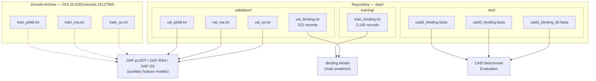

This page documents how DARUMA-binding's datasets are distributed across two locations: the GitHub repository (validation and benchmark data) and a Zenodo archive (the large training corpora). It specifies the on-disk record format, the label alphabet and its IDR-masking semantics, and the exact Zenodo identifiers needed to assemble a complete training environment.

## The Two-Tier Data Distribution Model

DARUMA-binding deliberately splits its data assets between the repository and Zenodo. The repository's `data/` directory carries everything needed for **evaluation and development sanity-checking** — the validation splits and the CAID benchmark test sets — while the large training corpora are archived separately on Zenodo. The repository README states this explicitly: `data/` contains "Validation and test datasets. Large training datasets are available separately from Zenodo" [README.md](README.md#L60-L66).

This split matters practically: the `data/README.md` documents **four** training files (`train_binding.txt`, `train_plddt.txt`, `train_rsa.txt`, `train_ss.txt`), yet only `train_binding.txt` actually exists in `data/training/`. The three auxiliary-feature training files are referenced in documentation but physically reside in the Zenodo archive — so reproducing training of the full model stack requires the archive download, not just the repository clone [data/README.md](data/README.md#L11-L20).

The following diagram shows the complete data landscape and how each compartment feeds the models:

The auxiliary model mapping is documented per file: `val_plddt.txt`, `val_rsa.txt`, and `val_ss.txt` are explicitly labeled as validation data for the **DAF-pLDDT**, **DAF-RSA**, and **DAF-SS** models respectively — the auxiliary structural feature heads covered in [Auxiliary Structural Feature Heads](7-auxiliary-structural-feature-heads) [data/README.md](data/README.md#L22-L27).

Sources: [README.md](README.md#L60-L66), [data/README.md](data/README.md#L11-L27)

## Repository Data Layout

The repository contains three data compartments, each in a fixed plain-text format:

| Path | Records* | Target Model | Role |
|---|---|---|---|
| `data/training/train_binding.txt` | 3,145 | Main binding predictor | Training split (in repo) |
| `data/validation/val_binding.txt` | 522 | Main binding predictor | Validation split |
| `data/validation/val_plddt.txt` | — | DAF-pLDDT | Auxiliary-feature validation |
| `data/validation/val_rsa.txt` | — | DAF-RSA | Auxiliary-feature validation |
| `data/validation/val_ss.txt` | — | DAF-SS | Auxiliary-feature validation |
| `data/test/caid2_binding.fasta` | 78 | Benchmark evaluation | CAID 2 Binding challenge |
| `data/test/caid3_binding.fasta` | — | Benchmark evaluation | CAID 3 Binding challenge |
| `data/test/caid3_binding_idr.fasta` | — | Benchmark evaluation | CAID 3 Binding-IDR challenge |

\*Record counts are derived arithmetically from verified total line counts: each file holds 3-line records terminated by a single trailing blank line (`train_binding.txt`: 9,436 lines → (9436−1)/3 = 3,145; `val_binding.txt`: 1,567 lines → 522; `caid2_binding.fasta`: 235 lines → 78). The auxiliary validation files were confirmed present in `data/validation/` via directory inspection but are not human-readable through a line-based viewer.

Sources: [data/README.md](data/README.md#L7-L9), [data/training/train_binding.txt](data/training/train_binding.txt#L9430-L9436), [data/validation/val_binding.txt](data/validation/val_binding.txt#L1560-L1567), [data/test/caid2_binding.fasta](data/test/caid2_binding.fasta#L228-L235)

## Record Format Specification

All binding datasets share one **three-line-per-record** convention. A record consists of: (1) a FASTA-style header beginning with `>`, (2) the full amino-acid sequence on a single unwrapped line, and (3) a per-residue label line of identical length. For example, record `DP00003` in the training file spans three lines — header, sequence, and its label string [data/training/train_binding.txt](data/training/train_binding.txt#L1-L3).

The label line uses a three-symbol alphabet, not plain binary:

| Symbol | Meaning | Training Effect |
|---|---|---|
| `1` | Binding residue (within IDR) | Positive training signal |
| `0` | Non-binding residue (within IDR) | Negative training signal |
| `-` | Masked residue (outside annotated IDR) | Excluded from loss computation |

> [!TIP]
> The `-` character is the key to understanding label semantics: it aligns the label string with IDR annotations. Record `IID90024` in the validation split shows the canonical pattern — `-` runs across the ordered regions, while an internal disordered segment carries `000000001111111` before returning to `-`. Only residues inside annotated IDR segments receive binding labels; everything else is masked, which is exactly why the model's decision boundary is scoped to intrinsically disordered regions.

Two evidence-backed observations about the corpus composition: first, accession headers come from two families — early records use `DP` prefixes (`DP00003`, `DP00004`, `DP00005`), while later records use `IID` prefixes (`IID90015`, `IID90024`, `IID90042`), reflecting multiple source databases merged during corpus construction [data/validation/val_binding.txt](data/validation/val_binding.txt#L1560-L1567). Second, entire proteins can be uniformly labeled: `DP00005` is all-`1` (fully binding IDR) and `IID90044` is all-`0`, so the corpus includes both extremes rather than only mixed records [data/training/train_binding.txt](data/training/train_binding.txt#L4-L6).

> [!TIP]
> The test files carry a `.fasta` extension but are **not standard FASTA**: every record contains a third line of per-residue ground-truth labels (`0`/`1`) after the sequence line, as seen in `DP02342` of the CAID 2 file [data/test/caid2_binding.fasta](data/test/caid2_binding.fasta#L1-L6). Any parser written against standard FASTA conventions will misinterpret these files — treat the label line as a required third field of each record.

Sources: [data/training/train_binding.txt](data/training/train_binding.txt#L1-L12), [data/validation/val_binding.txt](data/validation/val_binding.txt#L1560-L1567), [data/test/caid2_binding.fasta](data/test/caid2_binding.fasta#L1-L6)

## The Zenodo Archive

Two distinct Zenodo records are associated with this project, and they serve different purposes:

| Resource | DOI | Contents |
|---|---|---|
| Training data archive | `10.5281/zenodo.24127965` | Large training datasets, including `train_plddt.txt`, `train_rsa.txt`, `train_ss.txt` |
| Manuscript version archive | `10.5281/zenodo.24133355` | Versioned snapshot of DARUMA-binding corresponding to the manuscript (for citation) |

The training archive is the authoritative source for the corpora the repository omits. The README's Data Availability section states: "The large training datasets used in this study are available from Zenodo," followed by the training-data DOI, with the note that "Validation and test datasets used for evaluation are included in this repository where applicable" [README.md](README.md#L76-L82). The same DOI is repeated in the `data/` README beside the list of training files [data/README.md](data/README.md#L18-L20).

The second DOI serves reproducibility governance rather than data transfer: "The version of DARUMA-binding corresponding to the manuscript is archived on Zenodo" at `10.5281/zenodo.24133355` [README.md](README.md#L109-L113). This is the reference you cite when your work depends on the exact manuscript-era code state, independent of any subsequent repository changes.

**Practical assembly path for full training reproduction**: clone the repository (gives you `train_binding.txt`, all validation files, and benchmark sets) + download the training archive at `10.5281/zenodo.24127965` (gives you the three auxiliary training files) → place the auxiliary files alongside `train_binding.txt` to reconstruct the complete four-file training corpus.

Sources: [README.md](README.md#L76-L82), [README.md](README.md#L109-L113), [data/README.md](data/README.md#L18-L20)

## Provenance and Processing Boundaries

The benchmark test sets originate from the **CAID Web Portal**, with a one-to-one mapping documented in the data README: `caid2_binding.fasta` → CAID 2 Binding, `caid3_binding.fasta` → CAID 3 Binding, `caid3_binding_idr.fasta` → CAID 3 Binding-IDR [data/README.md](data/README.md#L29-L35). Their role in evaluation and scoring is covered in [CAID Benchmark Datasets](11-caid-benchmark-datasets) and [Evaluation Metrics: AUC, APS, Fmax](14-evaluation-metrics-auc-aps-fmax).

One scope boundary deserves emphasis: the repository documentation deliberately defers methodology to the manuscript. The data README closes with: "Detailed procedures for dataset construction, preprocessing, redundancy reduction, and dataset splitting are described in the associated manuscript" [data/README.md](data/README.md#L37). In other words, the repository documents *what* the data is and *where* it lives, but the *how* of redundancy reduction and train/validation/test partitioning is only verifiable in the paper — this documentation makes no claims about sequence identity thresholds or split construction beyond the splits' physical existence.

Sources: [data/README.md](data/README.md#L29-L37)

## Where to Go Next

With the data landscape mapped, the natural reading progression within this catalog is:

- [CAID Benchmark Datasets](11-caid-benchmark-datasets) — deep dive into the CAID 2/CAID 3 test sets introduced above, including challenge variants.
- [Auxiliary Structural Feature Heads](7-auxiliary-structural-feature-heads) — how the DAF-pLDDT/RSA/SS models consume the auxiliary feature files, which motivates the Zenodo-only training files.
- [Reproducing Paper Figures and Tables](13-reproducing-paper-figures-and-tables) — using the `reproduction/` scripts against the evaluation datasets in `data/test/`.
- [Evaluation Metrics: AUC, APS, Fmax](14-evaluation-metrics-auc-aps-fmax) — the metrics applied to those benchmark splits.
