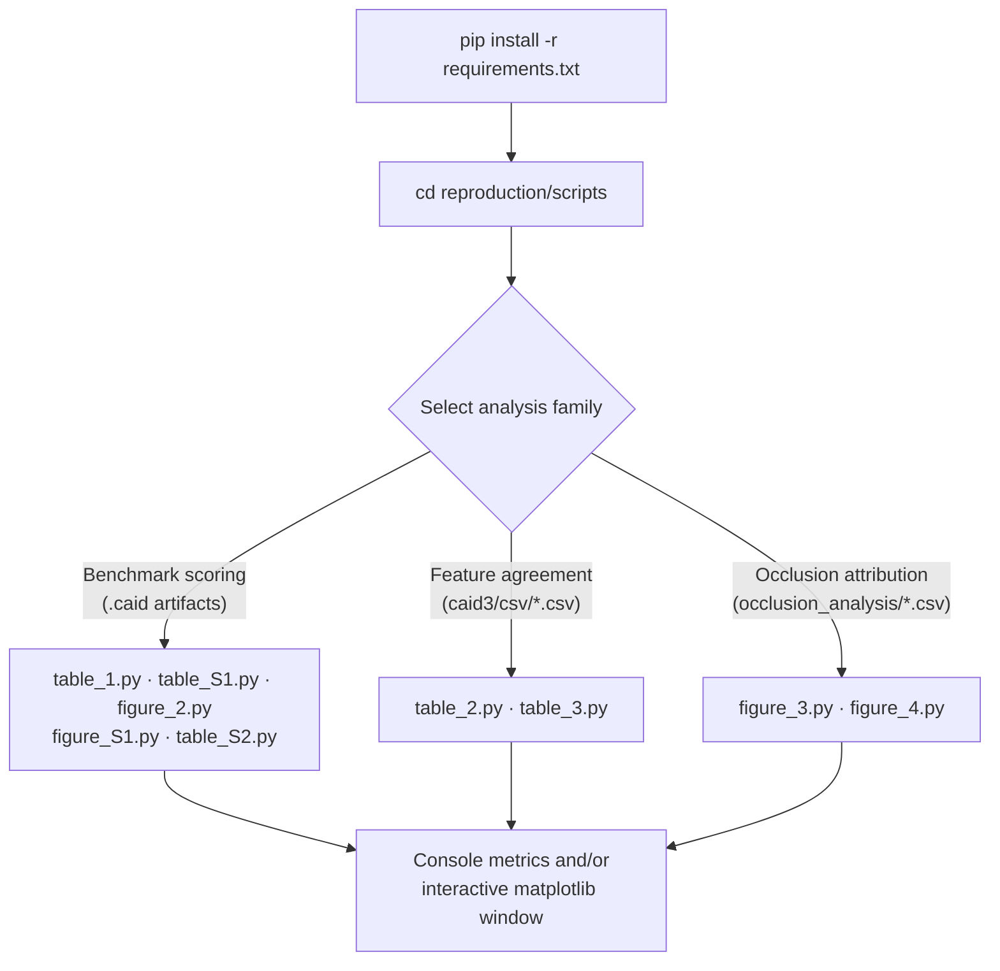
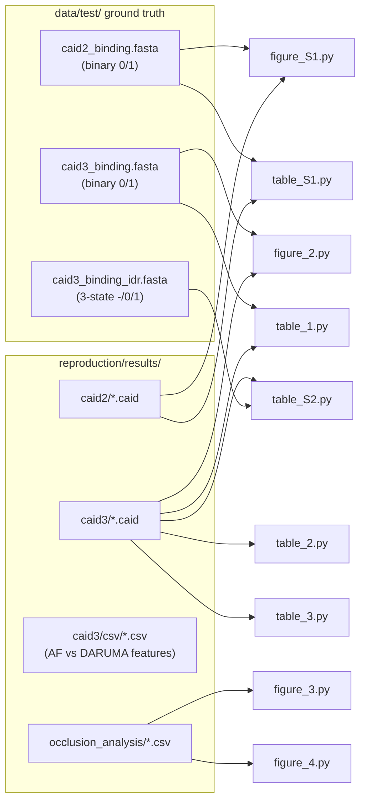

The `reproduction/` directory is the empirical validation layer of the DARUMA-binding repository: it pairs **pre-computed prediction artifacts** with nine standalone Python scripts that regenerate every figure and table from the manuscript. Because all heavy model inference has already been done and its outputs are committed to the repository, you can verify the paper's reported metrics on a laptop in seconds — no GPU, no ProtT5, no model weights. Each script is deliberately flat and self-contained (parsing, metric computation, and plotting in one file) so that every number printed to your console is traceable to a specific file and code path. This page explains the artifact inventory, the three analysis families, the exact execution procedure, and the pitfalls that arise from the scripts' path conventions.

## Repository Layout: Artifacts vs. Scripts

The directory separates **results** (immutable data artifacts) from **scripts** (evaluation logic). The README states this contract explicitly: each script uses the corresponding files in the `results/` directory [README](reproduction/README.md#L1-L24).

| Path | Role | Contents |
|---|---|---|
| `reproduction/results/caid2/` | Benchmark predictions, CAID 2 | `caid2_DARUMA-binding.caid` (67,247 lines of per-residue scores) |
| `reproduction/results/caid3/` | Benchmark predictions, CAID 3 | `caid3_DARUMA-binding.caid` + a `csv/` folder of per-protein files |
| `reproduction/results/occlusion_analysis/` | Feature attribution data | 50 per-protein CSVs (`DP03818_occlusion.csv` … `DP04391_occlusion.csv`) |
| `reproduction/scripts/` | Evaluation scripts | 4 figure scripts + 5 table scripts |

The structure maps one-to-one onto the three analysis families: CAID benchmark scoring (`.caid` files), structural-feature agreement (`csv/`), and occlusion-based attribution (`occlusion_analysis/`). Note the symmetry: `figure_2.py`/`table_1.py` handle CAID 3 while their structural twins `figure_S1.py`/`table_S1.py` handle CAID 2 — the same code pattern applied to a different benchmark.

Sources: [README.md](reproduction/README.md#L5-L10), [caid2_DARUMA-binding.caid](reproduction/results/caid2/caid2_DARUMA-binding.caid#L1-L4)

## The Reproduction Workflow

Every script follows the same three-stage contract: **read artifact → align with ground truth → emit metric or plot**. The execution procedure is identical for all nine scripts.

> [!TIP]
> The single most important execution detail: **all scripts use relative paths and must be run from inside `reproduction/scripts/`**. They reference artifacts as `../results/...` and ground truth as `../../data/test/...` (e.g., `Path("../results/caid3").glob("*.caid")` in [figure_2.py](reproduction/scripts/figure_2.py#L68-L71)). Running from the repository root will silently glob zero files or fail with `FileNotFoundError`.

The dependency footprint is intentionally small — only three of the six root requirements matter here: `numpy`, `scikit-learn` (metrics), and `matplotlib` (plots) [requirements.txt](requirements.txt#L1-L6). Table scripts print text only; figure scripts call `plt.show()`, which opens an interactive window rather than saving image files, so run them in an environment with a display (or set a matplotlib backend).

Sources: [figure_2.py](reproduction/scripts/figure_2.py#L68-L87), [requirements.txt](requirements.txt#L1-L6)

## Script Inventory and Data Flow

Each script consumes a specific artifact family and aligns it against ground-truth labels. The alignment logic keys predictions to labels by **accession code (AC)** — the string after `>` in both files — then concatenates all residues across proteins into flat arrays for corpus-level scoring [figure_2.py](reproduction/scripts/figure_2.py#L73-L84).

| Script | Artifact consumed | Ground truth | Output |
|---|---|---|---|
| `table_1.py` | `caid3/*.caid` | `caid3_binding.fasta` | AUC, APS, Fmax, Coverage |
| `table_S1.py` | `caid2/*.caid` | `caid2_binding.fasta` | AUC, APS, Fmax, Coverage |
| `table_S2.py` | `caid3/*.caid` | `caid3_binding_idr.fasta` | Same metrics, IDR-masked |
| `figure_2.py` | `caid3/*.caid` | `caid3_binding.fasta` | ROC + PR curves |
| `figure_S1.py` | `caid2/*.caid` | `caid2_binding.fasta` | ROC + PR curves |
| `table_2.py` | `caid3/csv/*.csv` | labels + AF features in CSV | PCC/RMSE/Q8/Q3, confusion-stratified |
| `table_3.py` | `caid3/csv/*.csv` | labels + AF features in CSV | TPR/FPR/Precision per AF quadrant |
| `figure_3.py` | `occlusion_analysis/*.csv` | self-contained | ROC curves + ΔAUC per feature |
| `figure_4.py` | `occlusion_analysis/*.csv` | self-contained | Δ-probability violin plots |

Sources: [README.md](reproduction/README.md#L12-L24), [figure_2.py](reproduction/scripts/figure_2.py#L73-L84)

## Input Artifact Formats

The three artifact families use distinct formats. Understanding them is prerequisite to interpreting or extending any script.

**CAID format** (`.caid`): comment lines starting with `#` are skipped; each protein begins with `>AC`; every subsequent line is tab-separated `index<TAB>amino_acid<TAB>probability<TAB>binary_prediction` [caid2_DARUMA-binding.caid](reproduction/results/caid2/caid2_DARUMA-binding.caid#L1-L4). The parser collects these into a dict keyed by AC with `probability` (float) and `binary_prediction` (int) lists [figure_2.py](reproduction/scripts/figure_2.py#L9-L27).

**Ground-truth FASTA**: a three-line block convention — `>AC`, then the sequence, then a label string of equal length where each character is a residue label (e.g., `DP03818` / `FVQWFSKFLGRIL` / `1111111111111`) [caid3_binding.fasta](data/test/caid3_binding.fasta#L1-L6). `table_S2.py` extends this to three states, mapping `-` to −1 (ignore), `0`, and `1`, which is the CAID 3 IDR-restricted evaluation [table_S2.py](reproduction/scripts/table_S2.py#L30-L43).

**Per-protein CSV** (`caid3/csv/`): a header plus one row per residue with ten columns comparing AlphaFold-derived reference features (`af_plddt`, `af_rsa`, `af_ss8` — empty where reference data is unavailable) against DARUMA-binding's auxiliary head outputs (`db_preds`, `db_plddt`, `db_rsa`, `db_ss3`, `db_ss8`) [DP03818.csv](reproduction/results/caid3/csv/DP03818.csv#L1-L6).

**Occlusion CSV** (`occlusion_analysis/`): per-residue rows with the ground-truth label `y`, the model's `original_probs`, and five re-prediction columns where each auxiliary input was occluded in turn (`plddt_occluded_probs`, `rsa_occluded_probs`, `helix/sheet/coil_occluded_probs`) [figure_3.py](reproduction/scripts/figure_3.py#L9-L35).

| Format | Delimiter | Key columns | Used by |
|---|---|---|---|
| CAID | tab | probability, binary_prediction | table_1/S1/S2, figure_2/S1 |
| Ground-truth FASTA | 3-line blocks | label string per residue | table_1/S1/S2, figure_2/S1 |
| Per-protein CSV | comma | af_* vs db_* feature pairs | table_2, table_3 |
| Occlusion CSV | comma | original vs 5 occluded prob columns | figure_3, figure_4 |

Sources: [DP03818.csv](reproduction/results/caid3/csv/DP03818.csv#L1-L6), [caid3_binding.fasta](data/test/caid3_binding.fasta#L1-L6)

## Family 1: Benchmark Scoring (Tables 1, S1, S2; Figures 2, S1)

The table scripts compute the four headline metrics — AUC via `roc_auc_score`, APS via `average_precision_score`, Fmax via a precision–recall sweep, and Coverage as the fraction of dataset proteins that received predictions [table_1.py](reproduction/scripts/table_1.py#L59-L74). The Fmax implementation scans `sklearn`'s `precision_recall_curve` output, guards the F-score denominator with a `1e-8` epsilon, and also returns the threshold that achieves the maximum [table_1.py](reproduction/scripts/table_1.py#L44-L49) — these are the exact metrics formalized in [Evaluation Metrics: AUC, APS, Fmax](14-evaluation-metrics-auc-aps-fmax).

`table_S2.py` is the subtle variant: because `caid3_binding_idr.fasta` uses three-state labels, it masks out every residue labeled `-` before pooling, so scoring is restricted to residues with confident ground truth [table_S2.py](reproduction/scripts/table_S2.py#L66-L73). This reproduces the manuscript's IDR-restricted CAID 3 comparison and complements the dataset definitions in [CAID Benchmark Datasets](11-caid-benchmark-datasets).

The figure scripts reuse identical parsing but render curves instead: `figure_2.py` plots ROC (with the diagonal chance line) and precision–recall curves for every `*.caid` file in `results/caid3/` [figure_2.py](reproduction/scripts/figure_2.py#L45-L65), while `figure_S1.py` performs the same on `results/caid2/` against `caid2_binding.fasta` [figure_S1.py](reproduction/scripts/figure_S1.py#L68-L87). Because they glob rather than hard-code filenames, dropping additional `.caid` files into the results folders automatically adds competitor curves.

## Family 2: Structural Feature Agreement (Tables 2, 3)

`table_2.py` quantifies how faithfully DARUMA-binding's auxiliary heads reproduce their AlphaFold-derived training targets. Part (a) pools all residues with available reference data and reports **PCC and RMSE** for pLDDT and RSA, plus 8-class (Q8) and 3-class (Q3) accuracy for secondary structure — the latter via an explicit Q8→Q3 collapse table (`H/G/I→H`, `E/B→S`, `T/S/C→C`) [table_2.py](reproduction/scripts/table_2.py#L85-L108). Part (b) repeats the same statistics stratified by the TP/FN/FP/TN confusion classes of the binding prediction [table_2.py](reproduction/scripts/table_2.py#L111-L128), revealing whether feature fidelity differs where the model is right versus wrong.

> [!TIP]
> Scripts `table_2.py` and `table_3.py` filter rows with `mask = np.array(full_result_dict["af_plddt"]) != None` before any comparison [table_2.py](reproduction/scripts/table_2.py#L81-L83). This relies on element-wise `!=` against `None` producing a boolean array under NumPy — residues without AlphaFold reference data are silently excluded, which is why their reported `n` counts are smaller than the raw residue totals.

`table_3.py` asks a different question: where does prediction quality concentrate relative to structural confidence? It thresholds reference features at **pLDDT > 70** and **RSA > 0.25** to define four quadrants — HH, HL, LH, LL — then reports residue counts, binding-residue counts, TPR, FPR, and Precision per quadrant [table_3.py](reproduction/scripts/table_3.py#L86-L100). The metric helpers here are hand-rolled from confusion counts rather than scikit-learn calls [table_3.py](reproduction/scripts/table_3.py#L42-L55), making the per-quadrant arithmetic directly inspectable.

## Family 3: Occlusion-Based Attribution (Figures 3, 4)

These scripts consume the 50 occlusion CSVs and require no external ground truth — each row carries its own label `y`. `figure_3.py` pools all proteins, plots one ROC curve per condition (original plus five occluded variants), then prints each feature's occluded AUC alongside the **delta AUC** against the original — a negative delta quantifies how much that auxiliary input contributes to binding discrimination [figure_3.py](reproduction/scripts/figure_3.py#L71-L88). The occlusion procedure that generated these files is described in [Occlusion-Based Feature Attribution](15-occlusion-based-feature-attribution).

`figure_4.py` transforms the same data into per-residue **Δ-probability distributions** (`original − occluded`) and renders violin plots with mean markers, first across all residues and then stratified by confusion class [figure_4.py](reproduction/scripts/figure_4.py#L80-L151). The stratification uses a hard-coded decision threshold of **0.26** to define TP/FN/FP/TN masks [figure_4.py](reproduction/scripts/figure_4.py#L100-L103) — this is the same deployment threshold derived and documented in [Inference Orchestration and Decision Threshold](10-inference-orchestration-and-decision-threshold), so any change to that threshold must be mirrored here for the figure to remain consistent with the manuscript.

## Common Pitfalls and Troubleshooting

| Symptom | Cause | Fix |
|---|---|---|
| `FileNotFoundError` on a `.caid` or `.fasta` path | Script run from repo root or elsewhere | `cd reproduction/scripts` first; all paths are relative to it |
| Figure script prints nothing / plots no curves | Glob matched zero files (wrong CWD, or results folder missing) | Verify `../results/...` resolves from your working directory |
| `plt.show()` hangs or errors on a headless server | Interactive backend with no display | Use `matplotlib.use("Agg")` + `plt.savefig(...)`, or run locally with X forwarding |
| `table_S2` scores differ from `table_1` on CAID 3 | Expected: S2 masks `-`-labeled IDR positions before pooling | Compare only against the manuscript's IDR-restricted table |
| Reproduced metrics deviate slightly | scikit-learn version drift affects `roc_curve`/`precision_recall_curve` tie handling | Pin the root `requirements.txt` versions (`scikit-learn==1.7.2`, `numpy==1.26.4`) |
| Figure 4 quadrant counts look small | Residues without AF reference data are masked out | This is intentional filtering of `af_plddt == None` rows |

Sources: [requirements.txt](requirements.txt#L1-L6), [table_S2.py](reproduction/scripts/table_S2.py#L66-L73)

## Where to Go Next

To understand *how* the `.caid` artifacts were produced — the model, the ProtT5 embedding pipeline, and the argmax/binary-threshold output stages these scripts decode — continue to [Prediction Pipeline Architecture](5-prediction-pipeline-architecture) and [Inference Orchestration and Decision Threshold](10-inference-orchestration-and-decision-threshold). For the construction and composition of the two benchmarks being scored here, see [CAID Benchmark Datasets](11-caid-benchmark-datasets); the formal definitions of AUC, APS, and the Fmax sweep appear in [Evaluation Metrics: AUC, APS, Fmax](14-evaluation-metrics-auc-aps-fmax). If you want to regenerate the occlusion artifacts themselves rather than only their figures, [Occlusion-Based Feature Attribution](15-occlusion-based-feature-attribution) covers the generation procedure that `figure_3.py` and `figure_4.py` visualize.
