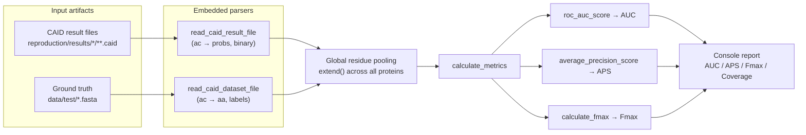
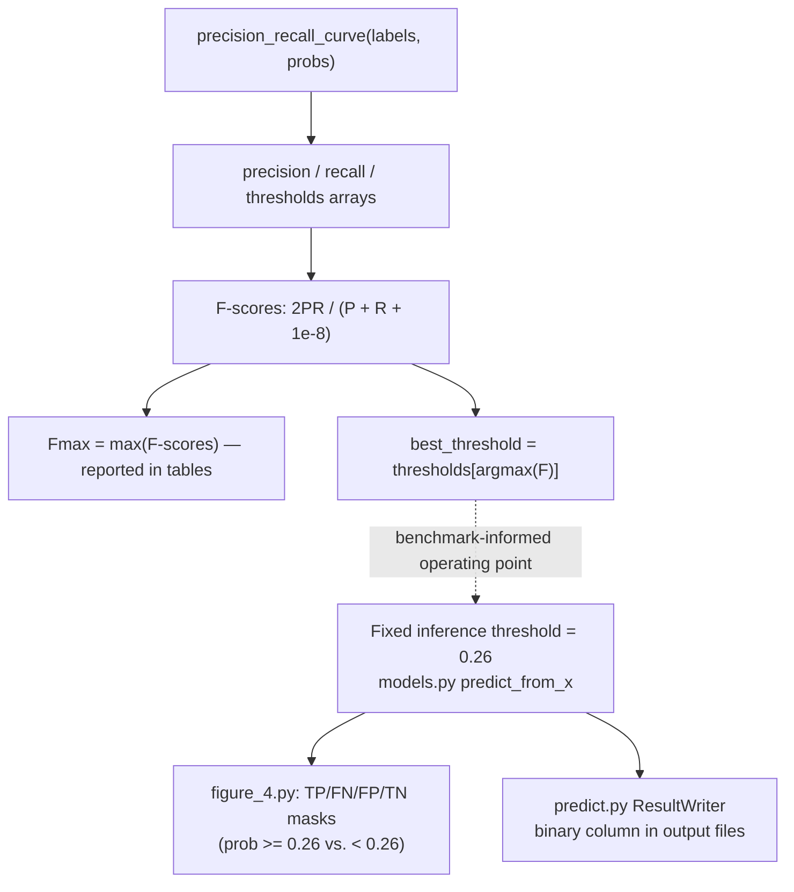
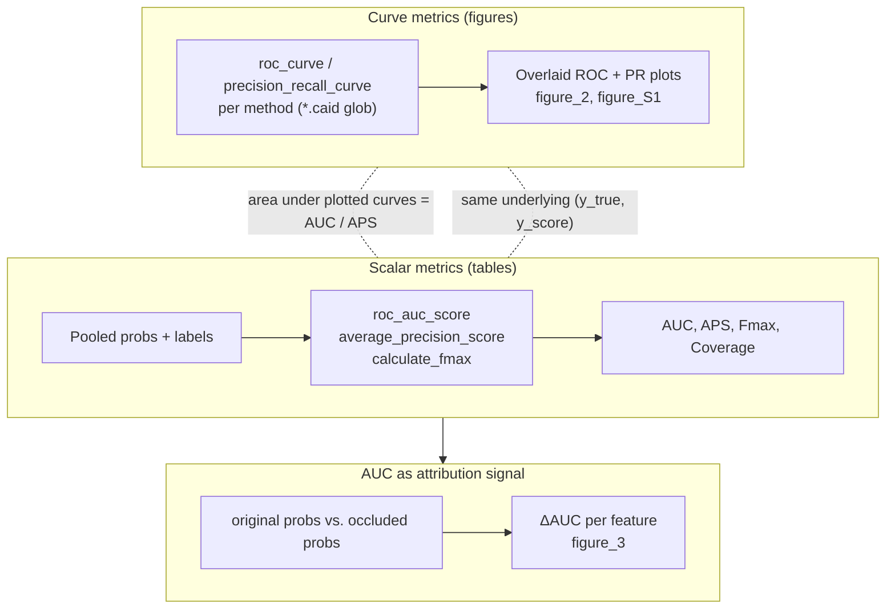

This page explains how DARUMA-binding is quantitatively evaluated. The repository does not ship metrics inside the inference package — all three headline metrics (AUC, APS, Fmax) are implemented in the `reproduction/scripts/` layer, where paper tables and figures are reproduced from archived prediction files. Here we trace the full path from CAID-format prediction files and ground-truth datasets to the final numbers, explain the mathematical definition and exact implementation of each metric, and document the benchmark variants (CAID 2, CAID 3, and the IDR-restricted subset) that share this machinery.

Sources: [README.md](/reproduction/README.md#L1-L24), [table_1.py](/reproduction/scripts/table_1.py#L44-L56)

## Where Metrics Live: The Reproduction Layer

A key architectural fact: neither the standalone predictor (`src/daruma_binding/`) nor the CAID submission package (`caid/DARUMA-binding/`) contains any evaluation code — the CAID package's `utils.py` is limited to FASTA parsing. Metric computation is deliberately isolated in the reproduction scripts, keeping inference and evaluation decoupled. Each script is self-contained: it embeds its own file parsers and metric helpers rather than importing from a shared metrics module, so the three table scripts (`table_1.py`, `table_S1.py`, `table_S2.py`) carry byte-identical copies of `calculate_fmax` and `calculate_metrics`. This duplication is intentional for reproducibility — every paper artifact can be regenerated from a single file.

The metric implementations and their consumers break down as follows:

| Script | Metrics computed | sklearn functions | Consumes | Benchmark |
| --- | --- | --- | --- | --- |
| `table_1.py` | AUC, APS, Fmax, Coverage | `roc_auc_score`, `average_precision_score`, `precision_recall_curve` | CAID3 `.caid` results | CAID 3 test set |
| `table_S1.py` | AUC, APS, Fmax, Coverage | same trio | CAID2 `.caid` results | CAID 2 test set |
| `table_S2.py` | AUC, APS, Fmax, Coverage (IDR subset) | same trio | CAID3 `.caid` results + IDR labels | CAID 3 IDR-only |
| `figure_2.py` / `figure_S1.py` | ROC curves, PR curves | `roc_curve`, `precision_recall_curve` | all `*.caid` files in results dir | CAID 3 / CAID 2 |
| `figure_3.py` | AUC + ΔAUC per occluded variant | `roc_auc_score` | occlusion analysis CSVs | CAID 3 (attribution) |
| `table_2.py` / `table_3.py` | PCC, RMSE, accuracy, TPR/FPR/Precision | manual numpy | per-protein CSVs | auxiliary features & operating regions |

The row for `table_2.py` (structural-feature agreement metrics) and `table_3.py` (fixed-threshold confusion-region analysis) belongs to the auxiliary heads and threshold topics covered in [Auxiliary Structural Feature Heads](7-auxiliary-structural-feature-heads) and [Inference Orchestration and Decision Threshold](10-inference-orchestration-and-decision-threshold); this page focuses on the threshold-free metrics of the first five rows.

Sources: [table_1.py](/reproduction/scripts/table_1.py#L1-L75), [utils.py](/caid/DARUMA-binding/daruma_binding/utils/utils.py#L1-L16), [table_S1.py](/reproduction/scripts/table_S1.py#L44-L56), [table_S2.py](/reproduction/scripts/table_S2.py#L47-L59)

## From Prediction Files to Pooled Scores

Every metric script follows the same three-stage pipeline: **parse → pool → score**. Two parsers establish the data contract. `read_caid_result_file` reads the CAID submission format: lines beginning with `>` start a new accession, comment lines starting with `#` are skipped, and each residue is a tab-separated quadruple of residue index, amino acid, probability, and binary prediction. `read_caid_dataset_file` reads the ground-truth FASTA, where each protein occupies three lines — header, sequence, and a per-residue binary label string.

A concrete example from the CAID 3 ground truth shows the format: protein `DP03818` is a 13-residue peptide whose label line `1111111111111` marks every residue as binding:

```
>DP03818
FVQWFSKFLGRIL
1111111111111
```

The critical evaluation decision happens in the pooling stage. Residues from *all* proteins are concatenated into a single flat array before scoring (`full_probabilities.extend(...)` / `full_labels.extend(...)`), so AUC, APS, and Fmax are computed as **global residue-level (micro-averaged) metrics**, not averages of per-protein scores. A protein with 300 residues contributes 300 data points; a 13-residue peptide contributes 13. Coverage is reported alongside as a separate, non-threshold statistic — the fraction of proteins in the dataset for which the predictor produced output (`len(result_dict) / len(dataset_dict)`).



Sources: [table_1.py](/reproduction/scripts/table_1.py#L8-L41), [caid3_binding.fasta](/data/test/caid3_binding.fasta#L1-L6), [table_1.py](/reproduction/scripts/table_1.py#L59-L74)

## The Three Metrics: Definition and Implementation

All three metrics are **threshold-free**: they evaluate the ranking quality of the raw probabilities rather than the binary predictions. This is why the metric scripts read the `probability` column of the CAID files and ignore `binary_prediction` entirely.

| Metric | Conceptual definition | Implementation | Interpretation |
| --- | --- | --- | --- |
| **AUC** | Area under the ROC curve (TPR vs. FPR swept over all thresholds); probability that a random binding residue outranks a random non-binding one | `roc_auc_score(labels, probabilities)` | Ranking quality; insensitive to class imbalance |
| **APS** | Average precision — area under the precision-recall curve, computed as the precision-weighted sum over recall increments | `average_precision_score(labels, probabilities)` | Ranking quality under imbalance; stricter baseline = positive rate |
| **Fmax** | Maximum F1 score over *all* possible thresholds: `max_t 2·P(t)·R(t) / (P(t)+R(t))` | `calculate_fmax` via `precision_recall_curve` | Best achievable operating point, post-hoc |
| Coverage | Fraction of proteins with predictions | `len(result_dict) / len(dataset_dict)` | Completeness of submission |

The canonical implementation, identical in all three table scripts, is compact:

```python
def calculate_fmax(all_labels, all_probs):
    precision, recall, thresholds = precision_recall_curve(all_labels, all_probs)
    f_scores = 2 * (precision * recall) / (precision + recall + 1e-8)
    fmax = np.max(f_scores)
    best_threshold = thresholds[np.argmax(f_scores)] if len(thresholds) > 0 else 0.5
    return fmax, best_threshold

def calculate_metrics(probabilities, labels):
    auc = roc_auc_score(labels, probabilities)
    aps = average_precision_score(labels, probabilities)
    fmax = calculate_fmax(labels, probabilities)[0]
    return auc, aps, fmax
```

> [!TIP]
> The `+ 1e-8` epsilon in the F-score denominator is what lets Fmax survive the sentinel point that sklearn appends to `precision_recall_curve` output (precision = 1, recall = 0, one element longer than `thresholds`). At that sentinel the F-score collapses to ≈ `2·1·0 / (1+0+1e-8) ≈ 0`, so `np.argmax` can never spuriously select it — the epsilon is both a division-by-zero guard and an implicit sentinel suppressor.

Sources: [table_1.py](/reproduction/scripts/table_1.py#L44-L56), [table_S1.py](/reproduction/scripts/table_S1.py#L44-L56), [table_S2.py](/reproduction/scripts/table_S2.py#L47-L59)

## Fmax and the Decision Threshold: Benchmark to Inference

`calculate_fmax` returns two values, and the second one matters beyond the benchmark. The `best_threshold` — the probability cutoff at which F1 peaks on the evaluation set — is the *empirical* counterpart of the *fixed* operating threshold the predictor ships with. At inference time, the model binarizes probabilities with a hardcoded threshold of **0.26** (`pred = (prob > self.threshold).astype(int)` in `predict_from_x`), a value documented in the main README and reused throughout reproduction scripts.

The relationship forms a deliberate design loop:



In other words, Fmax answers "how good could the operating point be?", while the shipped 0.26 threshold answers "how good is the deployed one?". The reproduction layer evaluates both worlds: the table scripts score threshold-free metrics, while `figure_4.py` slices occlusion deltas by the 0.26 boundary into TP/FN/FP/TN regions — linking attribution analysis directly to the deployed confusion matrix.

Sources: [table_1.py](/reproduction/scripts/table_1.py#L44-L49), [models.py](/src/daruma_binding/backend/models.py#L222-L240), [README.md](/README.md#L47-L57), [figure_4.py](/reproduction/scripts/figure_4.py#L100-L103), [predict.py](/src/daruma_binding/predict.py#L63-L71)

## Benchmark Variants: CAID 3, CAID 2, and the IDR Subset

The same metric core serves three evaluation contexts, differing only in inputs and one preprocessing step:

| Variant | Script | Result file | Ground truth | Special handling |
| --- | --- | --- | --- | --- |
| CAID 3, all residues | `table_1.py` | `results/caid3/caid3_DARUMA-binding.caid` | `data/test/caid3_binding.fasta` | none — all residues are labeled 0/1 |
| CAID 2, all residues | `table_S1.py` | `results/caid2/caid2_DARUMA-binding.caid` | `data/test/caid2_binding.fasta` | identical logic to `table_1.py` |
| CAID 3, IDR-only | `table_S2.py` | `results/caid3/caid3_DARUMA-binding.caid` | `data/test/caid3_binding_idr.fasta` | masks residues labeled `-1` before scoring |

The IDR variant is the only one requiring metric-relevant preprocessing. Its ground-truth reader maps labels through `{"-": -1, "0": 0, "1": 1}`, allowing three states; residues marked `-1` are excluded from the evaluation entirely by a boolean mask applied per protein before pooling:

```python
for ac in result_dict:
    mask = np.array(dataset_dict[ac]["label"]) != -1
    probabilities = np.array(result_dict[ac]["probability"])[mask]
    labels = np.array(dataset_dict[ac]["label"])[mask]
    full_probabilities.extend(probabilities)
    full_labels.extend(labels)
```

This is the correct way to handle unlabeled/ambiguous regions: excluded residues contribute to neither the numerator nor denominator of any metric, whereas feeding `-1` into `roc_auc_score` would either crash or silently distort the scores. Coverage here still uses raw protein counts, since it measures predictor completeness, not residue-level agreement.

Sources: [table_1.py](/reproduction/scripts/table_1.py#L59-L74), [table_S1.py](/reproduction/scripts/table_S1.py#L59-L74), [table_S2.py](/reproduction/scripts/table_S2.py#L30-L43), [table_S2.py](/reproduction/scripts/table_S2.py#L62-L77)

## Curve-Level Reproduction: ROC, PR, and AUC Deltas

Beyond scalar scores, two scripts render the curves from which AUC and APS are derived. `figure_2.py` (CAID 3) and `figure_S1.py` (CAID 2) share identical logic: they glob **every** `*.caid` file in the results directory, pool each one's probabilities against the same ground truth, and overlay one ROC curve and one precision-recall curve per file. The design is a comparison harness — the repository archives only `caid3_DARUMA-binding.caid`, but dropping additional methods' `.caid` files into `results/caid3/` plots them against DARUMA-binding with no code changes. The ROC helper also draws the diagonal chance line (`plt.plot([0, 1], [0, 1], "--")`) as a reference.

`figure_3.py` applies AUC as a *difference* instrument for feature attribution: it loads the occlusion-analysis CSVs, scores `roc_auc_score` for the original probabilities and for each feature-occluded variant, and reports `delta AUC = original_auc - occluded_auc` per feature. The magnitude of the drop quantifies how much each structural feature (pLDDT, RSA, helix, sheet, coil) contributes to binding ranking — the scalar-score counterpart to the curve work covered in [Occlusion-Based Feature Attribution](15-occlusion-based-feature-attribution).



Sources: [figure_2.py](/reproduction/scripts/figure_2.py#L45-L87), [figure_S1.py](/reproduction/scripts/figure_S1.py#L45-L87), [figure_3.py](/reproduction/scripts/figure_3.py#L79-L89), [README.md](/reproduction/README.md#L5-L10)

## Running the Evaluations Yourself

Each script runs standalone from the `reproduction/scripts/` directory and prints its metrics to stdout — no arguments, no configuration. The critical constraint is the **working directory**: all paths are relative (`../results/...`, `../../data/...`), so launching from the repo root will raise `FileNotFoundError`.

| Step | Command (from `reproduction/scripts/`) | Output | Dependencies |
| --- | --- | --- | --- |
| CAID 3 headline scores | `python table_1.py` | AUC / APS / Fmax / Coverage, 4-decimal floats | numpy, scikit-learn |
| CAID 2 headline scores | `python table_S1.py` | same four numbers | numpy, scikit-learn |
| CAID 3 IDR-only scores | `python table_S2.py` | same four numbers on `-1`-masked labels | numpy, scikit-learn |
| CAID 3 curves | `python figure_2.py` | ROC + PR windows (one line per `.caid` file) | numpy, scikit-learn, matplotlib |
| CAID 2 curves | `python figure_S1.py` | ROC + PR windows | numpy, scikit-learn, matplotlib |
| Attribution ΔAUC | `python figure_3.py` | AUC and ΔAUC per occluded feature | numpy, scikit-learn |

The archived artifacts are complete — `results/caid2/caid2_DARUMA-binding.caid`, `results/caid3/caid3_DARUMA-binding.caid` plus 50 per-protein CSVs, and 50 occlusion CSVs — so every metric reported in the manuscript can be regenerated without rerunning the model. When verifying a reproduction, compare your console output digit-for-digit against the paper's Table 1/S1/S2 values; the metric functions are deterministic given identical input files.

> [!TIP]
> If you adapt these metrics to your own predictor, reuse the exact `calculate_fmax` implementation (epsilon and all) rather than substituting `f1_score` from sklearn — the epsilon changes the numerics at the fourth decimal place, which is the same precision at which the paper reports (`{:.4f}`), so a mismatch is visible and breaks comparability with published numbers.

Sources: [table_1.py](/reproduction/scripts/table_1.py#L59-L75), [table_S2.py](/reproduction/scripts/table_S2.py#L62-L85), [figure_2.py](/reproduction/scripts/figure_2.py#L68-L88), [README.md](/reproduction/README.md#L12-L24)

## Summary and Reading Path

Three principles summarize this evaluation layer. First, **metrics live apart from inference**: the predictor emits probabilities and a fixed-threshold binary column; scoring happens exclusively in `reproduction/scripts/`. Second, **threshold-free metrics dominate**: AUC, APS, and Fmax all rank raw probabilities over globally pooled residues, with Fmax additionally exposing the optimal threshold that contextualizes the shipped 0.26 cutoff. Third, **one metric core, three contexts**: identical functions evaluate CAID 3, CAID 2, and the IDR subset, with only label masking (`-1` exclusion) varying between them.

To continue through this catalog in dependency order: the datasets these metrics score are described in [CAID Benchmark Datasets](11-caid-benchmark-datasets) and [Training Data and Zenodo Archive](12-training-data-and-zenodo-archive), the mechanics of reproducing full figures and tables are in [Reproducing Paper Figures and Tables](13-reproducing-paper-figures-and-tables), the threshold that Fmax contextualizes is detailed in [Inference Orchestration and Decision Threshold](10-inference-orchestration-and-decision-threshold), and the ΔAUC attribution methodology previewed here is fully developed in [Occlusion-Based Feature Attribution](15-occlusion-based-feature-attribution).
