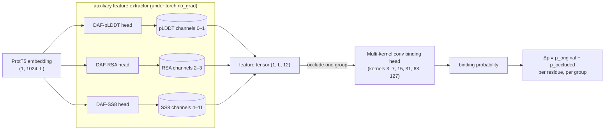
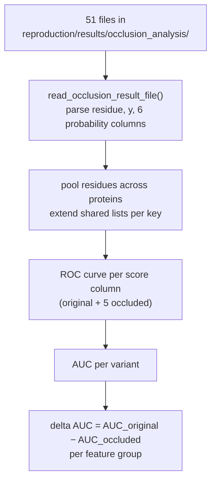

This page explains how DARUMA-binding quantifies *which predicted structural features actually drive its binding predictions* through an occlusion analysis. Rather than attributing importance to input residues (as saliency methods do), the analysis removes entire groups of predicted structural signals — pLDDT, RSA, and secondary-structure classes — and measures how the binding probability reacts. The repository ships the resulting per-protein artifacts under `reproduction/results/occlusion_analysis/` together with the two scripts (`figure_3.py`, `figure_4.py`) that turn them into manuscript Figures 3 and 4.

Sources: [reproduction/README.md](reproduction/README.md#L1-L24), [figure_3.py](reproduction/scripts/figure_3.py#L1-L8), [figure_4.py](reproduction/scripts/figure_4.py#L1-L3)

## Why Occlusion Fits This Architecture: A Clean Causal Probe

Occlusion is an intervention-based attribution method: a candidate information source is removed, the model is re-run, and the change in output is credited to that source. In most architectures this is messy — masking part of the input perturbs every downstream computation at once. DARUMA-binding's architecture makes the intervention unusually clean, because the binding head never sees the raw ProtT5 embedding. The three auxiliary structural heads (DAF-pLDDT, DAF-RSA, DAF-SS8) run inside a `torch.no_grad()` block, their softmax outputs are concatenated into a 12-channel tensor, and the multi-kernel convolution binding head consumes *only* that tensor:

Because the features are computed with `torch.no_grad()` and then `detach().requires_grad_(True)` before entering the binding head, they act as frozen constants from the binding head's perspective. An occlusion experiment therefore modifies a genuine input of the binding head — not a gradient artifact — making the resulting Δp a direct causal measure of each feature group's contribution at every residue. This is also why the analysis targets *feature groups* rather than residues: the 12-channel tensor is the only interface through which structural information reaches the binding decision.

Sources: [models.py](src/daruma_binding/backend/models.py#L175-L188), [models.py](src/daruma_binding/backend/models.py#L137-L153), [models.py](src/daruma_binding/backend/models.py#L157-L166)

> [!TIP]
> The `no_grad()` + `detach()` boundary at models.py#L176-L181 is what makes occlusion here well-defined: interventions on the 12-channel tensor cannot back-propagate into the auxiliary heads or ProtT5, and with `dropout_rate=0` the frozen heads are deterministic — so any probability change measured after occlusion is attributable solely to the masked channels.

## The Five Occlusion Targets over Twelve Channels

The channel vocabulary is declared explicitly in the model as `af_list`, and the SS3 collapse in `predict_from_x` confirms how the 8-state channels group into helix/sheet/coil. The occlusion study covers exactly five groups — one per structural concept — rather than all 12 channels individually:

| Occlusion group | Channels (index: semantic name) | Structural meaning | Equivalent SS3 view | Code evidence |
|---|---|---|---|---|
| **pLDDT** | 0: `plddt`, 1: `1-plddt` | per-residue structural confidence | — | softmax output of DAF-pLDDT |
| **RSA** | 2: `1-rsa`, 3: `rsa` | relative solvent accessibility | — | softmax output of DAF-RSA |
| **Helix** | 4: `ss0(Alphahelix)`, 5: `ss1(Helix_3)`, 6: `ss2(Helix_5)` | helical structure | SS3 `H` | `af_feature[..., 4:7].sum(-1)` |
| **Sheet** | 7: `ss3(Strand)`, 8: `ss4(BetaBridge)` | extended/β structure | SS3 `S` | `af_feature[..., 7:9].sum(-1)` |
| **Coil** | 9: `ss5(Turn)`, 10: `ss6(Bend)`, 11: `ss7(other)` | non-regular structure | SS3 `C` | `af_feature[..., 9:12].sum(-1)` |

Note that the Helix/Sheet/Coil groupings mirror the q8→q3 reduction the model itself performs when writing SS3 output (`H`/`G`/`I` → helix; `E`/`B` → sheet; `T`/`S`/`-` → coil), so the attribution is expressed in the same terms as the model's human-readable structural outputs.

Sources: [models.py](src/daruma_binding/backend/models.py#L171-L172), [models.py](src/daruma_binding/backend/models.py#L231-L238), [models.py](src/daruma_binding/backend/models.py#L205-L220)

## The Occlusion Artifacts: 51 Per-Protein CSV Files

The intervention results are stored as one CSV per protein — 51 files named `DP03818_occlusion.csv` through `DP04391_occlusion.csv`. The `DP`-prefixed accessions identify proteins from the CAID3 Binding challenge test set: `DP03818` is the first entry of `data/test/caid3_binding.fasta`, and its 13 residues (`FVQWFSKFLGRIL`, all labeled binding) match the CSV rows one-to-one, including the per-residue ground-truth label `y`. Each file records, for every residue, the baseline probability plus one probability per occluded feature group:

| Column | Type | Meaning |
|---|---|---|
| `residue` | single-letter string | amino acid at the position |
| `y` | int (0/1) | ground-truth binding annotation from CAID3 |
| `original_probs` | float | baseline binding probability, all 12 channels present |
| `plddt_occluded_probs` | float | probability with the pLDDT channel pair occluded |
| `rsa_occluded_probs` | float | probability with the RSA channel pair occluded |
| `helix_occluded_probs` | float | probability with helix channels 4–6 occluded |
| `sheet_occluded_probs` | float | probability with sheet channels 7–8 occluded |
| `coil_occluded_probs` | float | probability with coil channels 9–11 occluded |

One methodological caveat for advanced readers: the repository ships the *results* of the intervention, not the intervention script itself. The exact replacement convention applied to the masked channels (e.g., zeroing versus mean-substitution) is not encoded in any shipped file; only the downstream consumers and their CSV inputs are in the tree. When extending the corpus, any re-implementation should preserve the schema above, since both figure scripts parse it positionally.

Sources: [reproduction/README.md](reproduction/README.md#L1-L24), [DP03818_occlusion.csv](reproduction/results/occlusion_analysis/DP03818_occlusion.csv#L1-L2), [caid3_binding.fasta](data/test/caid3_binding.fasta#L1-L4), [data/README.md](data/README.md#L24-L27), [figure_4.py](reproduction/scripts/figure_4.py#L9-L35)

> [!TIP]
> Before reusing these CSVs in your own analyses, verify row alignment against the FASTA: `DP03818_occlusion.csv` rows map 1:1 to `caid3_binding.fasta`'s sequence line and its `1111111111111` label line. This residue/label correspondence check is the fastest way to catch corpus or schema drift when new proteins are added.

## Figure 3: Global Importance via ROC Degradation and ΔAUC

`figure_3.py` answers the dataset-wide question: *if a feature group is removed, how much binding discrimination does the model lose?* The pipeline pools every residue from all 51 files, then treats each probability column (original plus five occluded variants) as an independent score against the shared `y` labels:

The script prints the original AUC alongside each occluded AUC and its delta (`original_auc - auc`), so the group with the largest ΔAUC is the one whose removal most damages discrimination over the whole corpus. Overlaid ROC curves additionally show *where* along the FPR/TPR trade-off each occlusion hurts — a pair of channels (pLDDT, RSA) versus the three- or two-channel SS3-derived groups can be compared on identical residue sets because the `y` labels never change across variants.

Sources: [figure_3.py](reproduction/scripts/figure_3.py#L9-L35), [figure_3.py](reproduction/scripts/figure_3.py#L38-L47), [figure_3.py](reproduction/scripts/figure_3.py#L71-L88)

## Figure 4: Per-Residue Delta Probabilities Stratified by Prediction Outcome

`figure_4.py` complements Figure 3 with a local, signed quantity. For every residue and every group it computes the delta probability `Δp = original_probs − <group>_occluded_probs`:

- **Δp > 0** — occluding the group *lowered* the score: the feature argued for binding at that residue.
- **Δp ≈ 0** — the group was unused at that residue.
- **Δp < 0** — occluding the group *raised* the score: the feature argued against binding there.

Distributions of Δp per group are drawn as violin plots (with per-group means marked by stars), first over the full corpus and then stratified by the confusion-matrix class of the baseline prediction using the production decision threshold of **0.26** — the same threshold baked into `daruma_binding` because it maximizes F1 on validation data:

| Stratum | Mask condition | Analytical question answered |
|---|---|---|
| True Positive (4b) | `y == 1` and `p ≥ 0.26` | which features *sustain* correctly detected binding sites |
| False Negative (4c) | `y == 1` and `p < 0.26` | which missing feature evidence let true sites slip through |
| False Positive (4d) | `y == 0` and `p ≥ 0.26` | which features *drove* the false alarms |
| True Negative (4e) | `y == 0` and `p < 0.26` | which features keep non-binding residues suppressed |

Comparing the four strata turns raw feature importance into error diagnosis — for example, a feature group with large positive Δp among false negatives indicates a structural cue the model fails to exploit where it matters most, while large positive Δp among false positives pinpoints the evidence responsible for over-prediction. This strata view is the per-residue counterpart to the global ΔAUC: Figure 3 ranks the groups in aggregate, Figure 4 explains *whose* predictions each group moves, and in which direction.

Sources: [figure_4.py](reproduction/scripts/figure_4.py#L80-L86), [figure_4.py](reproduction/scripts/figure_4.py#L38-L53), [figure_4.py](reproduction/scripts/figure_4.py#L99-L104), [figure_4.py](reproduction/scripts/figure_4.py#L106-L153), [models.py](src/daruma_binding/backend/models.py#L199)

## The Two-Lens Design: Comparing the Analyses

The two figure scripts form a deliberate attribution pipeline over the same artifacts — understanding their division of labor helps when interpreting or extending the results:

| Aspect | Figure 3 (`figure_3.py`) | Figure 4 (`figure_4.py`) |
|---|---|---|
| Signal analyzed | raw probabilities (original vs. each occluded variant) | signed delta `Δp = original − occluded` |
| Aggregation | dataset-wide ROC/AUC over pooled residues | per-residue distributions, split by confusion stratum |
| Primary output | ranking of feature groups by ΔAUC | shape/mean of Δp per group per TP/FN/FP/TN class |
| Question | which group, when removed, most degrades discrimination? | how does each group shift individual scores, for which outcomes? |

Sources: [figure_3.py](reproduction/scripts/figure_3.py#L71-L88), [figure_4.py](reproduction/scripts/figure_4.py#L80-L86)

## What the Analysis Establishes — and Its Limits

Read together, the two analyses attribute the binding head's behavior entirely to five predicted structural signals, because no other information path exists between the ProtT5 embedding and the binding decision. Positive delta mass concentrated in specific groups reveals which structural concepts the binding head has learned to exploit; negative deltas expose evidence the head actively discounts. Three limitations should frame any interpretation. First, attribution is at feature-group granularity — the paired softmax channels and SS3-derived sums cannot be decomposed further without re-running the intervention at single-channel resolution. Second, the artifacts were generated against the CAID3 binding test distribution; Δp magnitudes are not guaranteed to transfer to other protein classes. Third, as noted above, the masking convention lives outside the shipped code, so exact reproduction of the CSVs requires the manuscript's protocol rather than this repository alone.

Sources: [models.py](src/daruma_binding/backend/models.py#L157-L188), [reproduction/README.md](reproduction/README.md#L1-L24), [figure_4.py](reproduction/scripts/figure_4.py#L106-L153)

## Where to Go Next

To fully leverage this page, the following catalog entries supply the architectural and evaluation context the occlusion results depend on:

- Understand the 12-channel producer: [Auxiliary Structural Feature Heads](7-auxiliary-structural-feature-heads) — how DAF-pLDDT, DAF-RSA, and DAF-SS8 are trained and frozen.
- Understand the 12-channel consumer: [Multi-Kernel Conv Binding Head](8-multi-kernel-conv-binding-head) — the receptive fields that integrate occluded features.
- The threshold used for TP/FN/FP/TN stratification: [Inference Orchestration and Decision Threshold](10-inference-orchestration-and-decision-threshold).
- Where the occlusion corpus comes from: [CAID Benchmark Datasets](11-caid-benchmark-datasets).
- Running every figure script end-to-end: [Reproducing Paper Figures and Tables](13-reproducing-paper-figures-and-tables).
- Formal definitions behind AUC-based importance: [Evaluation Metrics: AUC, APS, Fmax](14-evaluation-metrics-auc-aps-fmax).