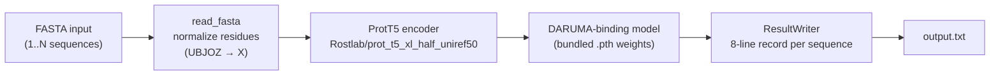
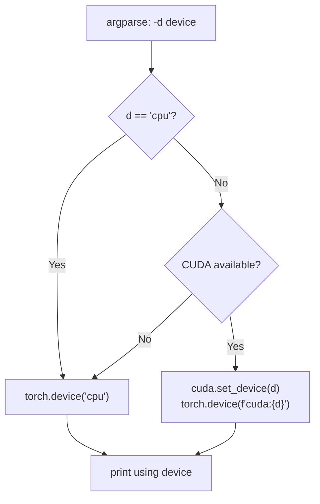

This page gets you from a fresh clone to your first binding-site prediction in four steps: install dependencies, verify what ships in the box, run the bundled example, and inspect the output. It covers only the **local installation path** — Docker-based execution is covered in [Docker and CAID Usage](4-docker-and-caid-usage), and the detailed per-line output schema is documented in [Output Format Reference](3-output-format-reference).

DARUMA-binding predicts, for **each residue** in a protein sequence, whether it is likely to be a **binding site within an intrinsically disordered region (IDR)**. You feed it a FASTA file; it writes a plain-text report with binding probabilities, binary calls (threshold `0.26`), and auxiliary predicted structural features (pLDDT, RSA, SS3, SS8).

## Step 0 — What Happens When You Run It

Before typing any commands, it helps to know what the pipeline does end-to-end. The diagram below is the complete runtime flow of `predict.py`: no external servers, no manual feature engineering — everything from embedding to writing results happens in one command.



Two facts from this flow matter for your first run: the DARUMA model weights are **bundled inside the repository** (`backend/model_weights/daruma_binding_weight.pth`), but the ProtT5 encoder is fetched **from the Hugging Face Hub on first run** — so your machine needs internet access the first time only.

Sources: [predict.py](src/daruma_binding/predict.py#L54-L73), [functions.py](src/daruma_binding/backend/functions.py#L26-L56), [README.md](README.md#L60-L66)

## Step 1 — Install Dependencies

Clone the repository and install the Python dependencies. The critical detail: **PyTorch is installed separately** because the correct build depends on your operating system and CUDA environment — the `requirements.txt` intentionally does not pin it.

```bash
git clone https://github.com/antepontem/DARUMA-binding.git
cd DARUMA-binding
# 1. Install PyTorch for your OS/CUDA from pytorch.org
# 2. Then install the rest:
pip install -r requirements.txt
```

The declared dependencies and the environment the authors actually tested on are summarized below:

| Dependency | Pinned Version | Role in This Tool |
|---|---|---|
| numpy | 1.26.4 | Numerical array handling |
| transformers | 4.30.2 | ProtT5 tokenizer + encoder (`T5Tokenizer`, `T5EncoderModel`) |
| sentencepiece | 0.2.1 | Tokenizer backend required by T5 |
| scikit-learn | 1.7.2 | Metric utilities |
| scipy | 1.15.3 | Scientific computing |
| matplotlib | 3.10.8 | Plotting utilities |

| Tested Environment Component | Value |
|---|---|
| OS | Ubuntu 18.04.5 LTS |
| Python | 3.10.19 |
| PyTorch | 1.12.1+cu102 |
| CUDA | 10.2 |

If your CUDA/OS combination differs from the tested environment, install the matching PyTorch build for your hardware; the code itself adapts at runtime (see device selection in Step 3).

Sources: [README.md](README.md#L5-L20), [requirements.txt](requirements.txt#L1-L7), [README.md](README.md#L94-L103)

## Step 2 — Verify What Ships in the Box

After cloning, your working tree contains exactly what you need to run inference — nothing to download or compile manually. The layout relevant to Quick Start is:

```
DARUMA-binding/
├── requirements.txt                  # installable dependencies
├── src/daruma_binding/
│   ├── predict.py                    # ← the CLI entry point
│   └── backend/
│       ├── functions.py              # FASTA parsing, ProtT5 embedder, result writer
│       ├── models.py                 # model definition
│       └── model_weights/
│           └── daruma_binding_weight.pth   # ← trained weights, bundled
├── examples/
│   ├── example.fasta                 # ← ready-made input (3 human proteins)
│   └── predict_example.sh            # one-line example launcher
└── data/                             # benchmark datasets (not needed to run)
```

> [!TIP]
> **First-run network requirement**: the DARUMA weights load locally from `backend/model_weights/`, but `T5Tokenizer.from_pretrained("Rostlab/prot_t5_xl_half_uniref50-enc")` and `T5EncoderModel.from_pretrained(...)` download the ~1.2B-parameter half-precision ProtT5 encoder from the Hugging Face Hub the first time you run. It is cached locally afterwards, so subsequent runs work offline.

The `examples/` directory is your fastest path: `example.fasta` contains three well-known human IDP proteins — p53 (P04637), 4EBP1 (Q13541), and CREB1 (P16220) — each in standard multi-line FASTA format.

Sources: [README.md](README.md#L60-L66), [functions.py](src/daruma_binding/backend/functions.py#L44-L51), [example.fasta](examples/example.fasta#L1-L9)

## Step 3 — Run Your First Prediction

The single entry point for inference is `src/daruma_binding/predict.py`. Run the bundled example:

```bash
cd examples
bash predict_example.sh
```

This executes `python3 ../src/daruma_binding/predict.py -i example.fasta -o example.out`. Note the script uses a **relative path** (`../src/...`), so it must be launched from inside the `examples/` directory. For arbitrary inputs, call the script directly from the repository root:

```bash
python src/daruma_binding/predict.py -i your_sequences.fasta -o results.txt
```

The complete CLI contract is small — three flags, one of them with default behavior worth understanding:

| Flag | Long Form | Required | Default | Behavior |
|---|---|---|---|---|
| `-i` | `--input` | No* | — | Path to input FASTA file |
| `-o` | `--output` | **Yes** | — | Path where predictions are written |
| `-d` | `--device` | No | `0` | `"cpu"` for CPU, or GPU index `0`, `1`, ... |

*\*Although `-i` is not marked `required=True` in the argument parser, the script fails immediately without it when `read_fasta` attempts to open the file.*

**Device selection logic** (worth reading before your first GPU run): if you pass `-d cpu`, prediction runs on CPU. If you pass a GPU index (or accept the default `0`) and CUDA is available, that GPU is used. If CUDA is **not** available, the script silently falls back to CPU — it will still work, just slower:



What happens next is a per-sequence loop: each FASTA record is embedded with ProtT5, passed through the DARUMA-binding model, and written to disk. Processing continues across all sequences in the file — with `example.fasta`, expect three "Processing ..." progress lines before completion.

> [!TIP]
> **Silent CPU fallback is a feature and a trap**: if your PyTorch build lacks CUDA (e.g., you installed the CPU-only wheel), `-d 0` does **not** error — it quietly runs on CPU. If your run seems unusually slow, check the printed `Using <device> device.` line at startup to confirm where the work is happening.

Sources: [predict_example.sh](examples/predict_example.sh#L1-L4), [examples/README.md](examples/README.md#L1-L13), [predict.py](src/daruma_binding/predict.py#L31-L51), [predict.py](src/daruma_binding/predict.py#L66-L71)

## Step 4 — Verify the Output

Open `examples/example.out`. It is plain text, self-documenting: the file begins with a comment block describing its layout, followed by an 8-line record per input sequence. Here is the schema at a glance:

| Line | Content | Format |
|---|---|---|
| 1 | Accession / FASTA header | after `>` prefix |
| 2 | Amino acid sequence | single line, concatenated |
| 3 | Binding probability per residue | comma-separated floats, 4 decimals |
| 4 | Binary binding call per residue | comma-separated `1`/`0`, threshold = **0.26** |
| 5 | Predicted pLDDT per residue | comma-separated floats |
| 6 | Predicted relative solvent accessibility (RSA) | comma-separated floats |
| 7 | Three-state secondary structure (SS3) | `H` helix / `S` strand / `C` coil |
| 8 | Eight-state secondary structure (SS8) | `H, G, I, E, B, T, S, -` |

The header comments are written programmatically by `ResultWriter` at file creation, so every output file carries its own legend — you never need to memorize the schema. For the full field-by-field interpretation guide (including what the SS8 letters mean and how to parse the files), continue to [Output Format Reference](3-output-format-reference).

Sources: [functions.py](src/daruma_binding/backend/functions.py#L136-L158), [README.md](README.md#L45-L58)

## Input Requirements

Your only obligation as a user is a valid FASTA file — one or more sequences, headers beginning with `>`. Three parsing behaviors are worth knowing upfront:

| Concern | Behavior | Notes |
|---|---|---|
| Multiple sequences | Supported | All records in the file are processed sequentially |
| Sequence line breaks | Handled | Newlines and spaces within a sequence are stripped |
| Non-standard residues (`U`, `B`, `J`, `O`, `Z`) | Remapped to `X` | Applied at both parsing and embedding stages |
| Sequence length | No practical limit | ProtT5 embedding automatically chunks at 2048 residues with 512 overlap |

The last row means you can submit very long proteins without splitting them yourself — the chunking is internal to the embedder.

Sources: [README.md](README.md#L39-L43), [functions.py](src/daruma_binding/backend/functions.py#L12-L23), [functions.py](src/daruma_binding/backend/functions.py#L61-L62)

## Troubleshooting

These are the failure modes a first-time runner is most likely to hit, mapped to causes and fixes:

| Symptom | Likely Cause | Fix |
|---|---|---|
| `ModuleNotFoundError: torch` | PyTorch not installed separately | Install PyTorch for your OS/CUDA **before** `pip install -r requirements.txt` |
| `ModuleNotFoundError: sentencepiece` | `requirements.txt` not installed | Run `pip install -r requirements.txt` |
| Run hangs at start on first execution | ProtT5 encoder downloading from Hugging Face | Expected on first run (~GB download); ensure network access. Later runs use the local cache |
| `FileNotFoundError` on `-i` path | Input path does not exist, or `-i` omitted | Verify the path; note `-o` is the only flag the parser marks required, so a missing `-i` surfaces as a file error, not an argparse error |
| Prediction unexpectedly slow | CUDA unavailable → silent CPU fallback | Check the `Using ... device.` startup line; install a CUDA-enabled PyTorch build or pass `-d cpu` explicitly |
| `bash predict_example.sh` fails from repo root | Script uses relative path `../src/...` | Run it from inside the `examples/` directory, or call `predict.py` directly with paths relative to your current directory |

Sources: [predict.py](src/daruma_binding/predict.py#L31-L51), [functions.py](src/daruma_binding/backend/functions.py#L44-L51), [predict_example.sh](examples/predict_example.sh#L1-L4)

## No Installation? Try the Web Server

If you only need a quick prediction without setting up an environment, DARUMA-binding is also hosted as a web server at **https://antepontem.org/daruma_binding/**. The local installation described on this page is for batch processing, automation, and reproducibility.

Sources: [README.md](README.md#L88-L92)

## Where to Go Next

You have now produced and read your first prediction file. The recommended progression through this documentation:

1. **[Output Format Reference](3-output-format-reference)** — decode every line of `example.out`, including SS3/SS8 state definitions and probability semantics.
2. **[Docker and CAID Usage](4-docker-and-caid-usage)** — the containerized path and the CAID competition submission variant.
3. **[Prediction Pipeline Architecture](5-prediction-pipeline-architecture)** — how FASTA input becomes a binding map, step by step.
4. **[Inference Orchestration and Decision Threshold](10-inference-orchestration-and-decision-threshold)** — why `0.26` is the binary cut-off and how the prediction loop is orchestrated.

If your goal is benchmarking or paper reproduction rather than running predictions, jump to [CAID Benchmark Datasets](11-caid-benchmark-datasets) or [Reproducing Paper Figures and Tables](13-reproducing-paper-figures-and-tables).
