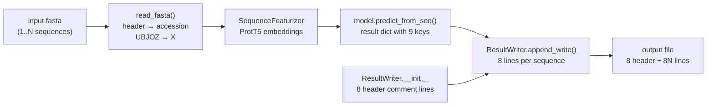

This page is the complete field manual for the file that DARUMA-binding writes when you run a prediction: what each line means, how values are formatted, and how to parse the result back into your own scripts. It covers the **native output format** produced by `src/daruma_binding/predict.py`, the multi-sequence file layout, and the separate CAID benchmark format that appears in the Docker submission code. Everything here is derived directly from the writing code, so you can treat this page as ground truth for building parsers.

Sources: [predict.py](src/daruma_binding/predict.py#L15-L16), [README.md](README.md#L45-L58)

## The Output Pipeline: From FASTA to Result File

Understanding where the output file comes from makes its structure predictable. When you run `predict.py`, your FASTA file passes through four stages, and the final stage is the one that decides the file format. The header lines are written once when the file is created; each input sequence then appends one fixed 8-line block. This means the output size is always deterministic: **8 header lines + 8 lines per input sequence**.



The prediction loop is deliberately simple: for every accession in the input dictionary, `predict_from_seq(seq)` returns a result dictionary, and `result_writer.append_write()` immediately flushes it to disk. There is no batching or post-hoc file rewriting — each sequence is appended in input order.

Sources: [predict.py](src/daruma_binding/predict.py#L63-L71), [models.py](src/daruma_binding/backend/models.py#L245-L257)

## File Anatomy: Header Block and Per-Sequence Blocks

The writer is implemented in the `ResultWriter` class. Its constructor opens the output path in write mode and stamps **eight comment lines** (each starting with `#`) that act as a built-in legend describing the eight lines that follow for every sequence. Its `append_write` method then appends exactly eight lines per sequence. Both blocks are shown in the table below.

| Position | Content | Format | Written by |
|---|---|---|---|
| Header 1–8 | Self-describing legend (one `#` line per data line type) | Plain text, `#` prefix | `ResultWriter.__init__` |
| Block line 1 | Accession / FASTA header | `>{accession}` | `append_write` |
| Block line 2 | Amino acid sequence | Raw one-letter codes, no separators | `append_write` |
| Block line 3 | Binding probability per residue | Comma-separated, 4 decimal places | `append_write` |
| Block line 4 | Binary binding prediction | Comma-separated `1` / `0` | `append_write` |
| Block line 5 | Predicted pLDDT | Comma-separated, 4 decimal places | `append_write` |
| Block line 6 | Predicted RSA | Comma-separated, 4 decimal places | `append_write` |
| Block line 7 | SS3 secondary structure | Comma-separated letters `H`/`S`/`C` | `append_write` |
| Block line 8 | SS8 secondary structure | Comma-separated letters `H`/`G`/`I`/`E`/`B`/`T`/`S`/`-` | `append_write` |

> [!TIP]
> Because the 8-line block layout is fixed, any per-residue line (lines 3–8) must contain **exactly one value per residue** — split on `,` and you get a list whose length equals the sequence length on line 2. This invariant is the simplest sanity check for a parser.

Sources: [functions.py](src/daruma_binding/backend/functions.py#L136-L158), [README.md](README.md#L47-L58)

## Line-by-Line Field Reference

### Line 1 — Accession

The first line of each block repeats the FASTA header exactly as parsed, prefixed with `>`. The `read_fasta` parser takes the whole header line (everything up to the first newline) as the accession key, so a UniProt-style header like `sp|P04637|P53_HUMAN Cellular tumor antigen p53 ...` is preserved in full. If your input headers are long, expect long output headers — nothing is truncated or reformatted.

Sources: [functions.py](src/daruma_binding/backend/functions.py#L12-L23), [example.fasta](examples/example.fasta#L1-L8)

### Line 2 — Sequence

Line 2 is the sequence actually used for prediction, not necessarily byte-identical to your input. The reader concatenates wrapped FASTA lines (removing newlines and spaces) and rewrites the ambiguous/non-standard residues `U`, `B`, `J`, `O`, `Z` as `X` before prediction. The same `X`-substitution is applied again inside the embedding step, so line 2 always reflects the model-facing sequence.

Sources: [functions.py](src/daruma_binding/backend/functions.py#L12-L23), [functions.py](src/daruma_binding/backend/functions.py#L61-L62)

### Line 3 — Binding Probability

Each residue's binding probability is written as a float with **exactly 4 decimal places** (Python's `{x:.4f}` format), comma-separated. Values are produced by applying softmax over the model's two output classes and taking the binding-class probability, so every value lies in `[0.0, 1.0]`.

Sources: [functions.py](src/daruma_binding/backend/functions.py#L153), [models.py](src/daruma_binding/backend/models.py#L77-L79)

### Line 4 — Binary Binding Prediction

Line 4 is the discretized version of line 3: a residue is `1` (binding) if its probability is **strictly greater than 0.26**, and `0` (non-binding) otherwise. The code applies `(prob > self.threshold).astype(int)`, and the threshold itself is stored on the model as `0.26`, chosen to maximize the F1 score on validation data. The exact value is also echoed in the header legend, so parsers never need to hard-code it.

| Probability value | Line 3 text | Line 4 text | Interpretation |
|---|---|---|---|
| 0.2599 | `0.2599` | `0` | Below threshold → non-binding |
| 0.2600 | `0.2600` | `0` | Equal to threshold → non-binding (strict `>`) |
| 0.2601 | `0.2601` | `1` | Above threshold → binding |

> [!TIP]
> The comparison is **strictly greater than** (`>`), so a probability of exactly 0.26 rounds down to non-binding. When filtering segments by line 4, remember that line 4 is a rounded view of line 3: a value printed as `0.2600` could be anything in `[0.26000, 0.26005)` — always re-derive decisions from line 3 if exactness matters.

Sources: [models.py](src/daruma_binding/backend/models.py#L198), [models.py](src/daruma_binding/backend/models.py#L228-L229), [functions.py](src/daruma_binding/backend/functions.py#L143)

### Line 5 — pLDDT

Predicted pLDDT (per-residue structural confidence) is written with 4 decimal places, but note the scale: the model stores it as a probability and multiplies it by 100 before returning, so **pLDDT values range from 0 to 100**, not 0 to 1. A value like `57.3920` means moderate confidence; values near 90+ indicate high model confidence in that residue's structural position.

Sources: [models.py](src/daruma_binding/backend/models.py#L232), [functions.py](src/daruma_binding/backend/functions.py#L155)

### Line 6 — RSA

Predicted relative solvent accessibility is written with 4 decimal places and **stays on the probability scale (0 to 1)** — unlike pLDDT, it is not rescaled. Together, lines 5 and 6 expose the auxiliary structural features the model computes internally from dedicated pLDDT and RSA heads, which is why the README describes them as "predicted structural features used by the model."

Sources: [models.py](src/daruma_binding/backend/models.py#L233), [README.md](README.md#L53-L58)

### Lines 7–8 — SS3 and SS8 Secondary Structure

The final two lines give secondary structure as one character per residue, comma-separated. SS3 uses the `q3_to_char` mapping, and SS8 uses `q8_to_char` applied to the argmax of the model's 8-way structure head. The SS3 prediction is not a separate model output: helix, sheet, and coil are derived by summing the corresponding groups of SS8 probabilities and taking the argmax.

| SS3 letter | Meaning | SS8 letter | Meaning |
|---|---|---|---|
| `H` | Helix | `H` | Alpha helix |
| `S` | Sheet / strand | `G` | 3-10 helix |
| `C` | Coil | `I` | pi helix |
| | | `E` | Extended strand |
| | | `B` | Isolated beta bridge |
| | | `T` | Turn |
| | | `S` | Bend |
| | | `-` | Other (coil) |

Sources: [models.py](src/daruma_binding/backend/models.py#L205-L220), [models.py](src/daruma_binding/backend/models.py#L234-L238), [functions.py](src/daruma_binding/backend/functions.py#L146-L147)

## Worked Example (Schematic)

The repository ships a three-sequence example input (`example.fasta`, containing human p53, 4EBP1, and CREB1) and a shell script that produces the output file `example.out`. The output file itself is generated when you run the script, so it is not committed — the block below is a schematic (truncated, values illustrative) showing exactly how one sequence block looks on disk:

```text
# Line1. accession
# Line2. sequence
# Line3. binding probability (float)
# Line4. binding prediction (1:binding, 0:non-binding), threshold=0.26
# Line5. pLDDT (float)
# Line6. RSA (float)
# Line7. SS3 (H:Helix, S:Strand, C:Coil)
# Line8. SS8 (H:Alpha helix, G:3-10 helix, I:pi helix, E:Extended strand, B:Isolated beta bridge, T:Turn, S:Bend, -:Other (coil))
>sp|P04637|P53_HUMAN Cellular tumor antigen p53 OS=Homo sapiens OX=9606 GN=TP53 PE=1 SV=4
MEEPQSDPSVEPPLSQETF...
0.0123,0.0098,0.0105,...
0,0,0,...
34.2211,35.0098,33.8875,...
0.3312,0.3098,0.2905,...
C,C,C,...
-,C,C,...
```

Read each block as an aligned column view of the same residues: position *i* of the sequence corresponds to position *i* in every comma-separated list below it. The seven lines after `>` are strictly parallel — same length, same residue order.

Sources: [examples/README.md](examples/README.md#L3-L13), [predict_example.sh](examples/predict_example.sh#L1-L4), [example.fasta](examples/example.fasta#L1-L8)

## Multi-Sequence Output and Parsing Tips

Input files may contain any number of sequences, and all of them land in one output file in input order. A three-sequence FASTA like `example.fasta` therefore produces 8 header lines followed by 24 data lines. Because the header legend is written only once at file creation, downstream parsers should skip `#` lines and treat every `>` line as the start of a new block. The following beginner-friendly snippet recovers all eight fields per sequence:

```python
blocks = {}
with open("example.out") as f:
    for raw in f:
        line = raw.rstrip("\n")
        if line.startswith("#"):
            continue                      # header legend (appears once)
        if line.startswith(">"):
            accession = line[1:]          # new block begins
            blocks[accession] = []
        else:
            blocks[accession].append(line)

for ac, lines in blocks.items():
    seq    = lines[1]                                        # raw sequence
    prob   = [float(v) for v in lines[2].split(",")]         # binding probability
    binary = [int(v)   for v in lines[3].split(",")]         # 1/0 binding
    plddt  = [float(v) for v in lines[4].split(",")]         # 0–100 scale
    rsa    = [float(v) for v in lines[5].split(",")]         # 0–1 scale
    ss3    = lines[6].split(",")                             # H/S/C per residue
    ss8    = lines[7].split(",")                             # H/G/I/E/B/T/S/- per residue
```

| Gotcha | Detail |
|---|---|
| Line 2 has no commas | Only lines 3–8 are comma-separated; `split(",")` on line 2 would give garbage |
| pLDDT vs RSA scales | pLDDT is ×100 (0–100), RSA is a raw probability (0–1) |
| Threshold is strict `>` | 0.2600 exactly → `0`; re-derive from line 3 if precision matters |
| Sequence was normalized | `UBJOZ` → `X` and line-joining mean line 2 may differ from your raw input |
| Header legend appears once | 8 `#` lines total regardless of sequence count, not per block |

Sources: [predict.py](src/daruma_binding/predict.py#L66-L71), [functions.py](src/daruma_binding/backend/functions.py#L149-L158)

## DARUMA Native Format vs. CAID Format

Do not confuse the native format above with the **CAID benchmark format**, which is produced only by the CAID 4 submission code in `caid/DARUMA-binding/` (run through Docker with precomputed embeddings). That format emits one line *per residue* with tab-separated columns, as verified in the sample result `DP03914.caid`:

```text
>DP3914
1	M	0.331179	1
2	Q	0.335192	1
```

| Dimension | Native format (`predict.py`) | CAID format (`caid/` Docker) |
|---|---|---|
| Layout | 8 lines per sequence (residue values inline) | L lines per sequence (one row per residue) |
| Columns per residue | Probability, binary, pLDDT, RSA, SS3, SS8 as lists | Position, residue, probability, binary |
| Delimiter | Commas (probability/binary/pLDDT/RSA), commas (SS letters) | Whitespace / tabs |
| Extra structural outputs | pLDDT, RSA, SS3, SS8 included | Not included |
| Header legend | 8 `#` comment lines at top | None |
| Input requirement | FASTA only (embeddings computed internally) | FASTA + precomputed ProtT5 `.npy` embedding |

Sources: [caid/DARUMA-binding/README.md](caid/DARUMA-binding/README.md#L44-L52), [DP03914.caid](caid/DARUMA-binding/sample_data/DP03914.caid#L1-L6)

One related format warning: the files in `data/training/train_binding.txt` look superficially similar (header, sequence, labels) but are **training labels**, not predictions — their binary lines are plain `0`/`1` strings without commas or probability values. Use them as benchmark/training references only.

Sources: [train_binding.txt](data/training/train_binding.txt#L1-L3)

## What to Read Next

To go deeper from here, the catalog offers a natural progression. For the alternate output path (Docker + CAID format, embedding precomputation), continue to [Docker and CAID Usage](4-docker-and-caid-usage). To understand *why* the output contains pLDDT, RSA, and SS8 — the auxiliary heads that produce those fields — see [Prediction Pipeline Architecture](5-prediction-pipeline-architecture) and [Auxiliary Structural Feature Heads](7-auxiliary-structural-feature-heads). For the reasoning behind the 0.26 threshold you saw on line 4, read [Inference Orchestration and Decision Threshold](10-inference-orchestration-and-decision-threshold). If you want to compare your own outputs against benchmark results, [CAID Benchmark Datasets](11-caid-benchmark-datasets) explains the evaluation files.
